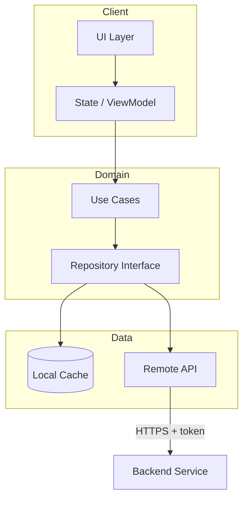
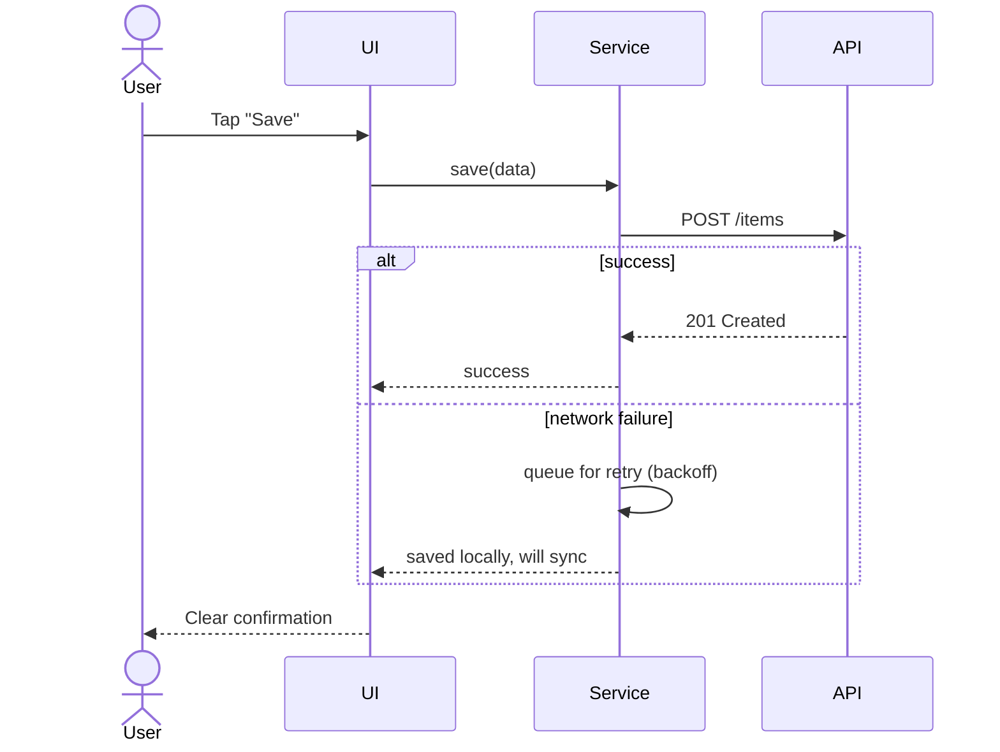
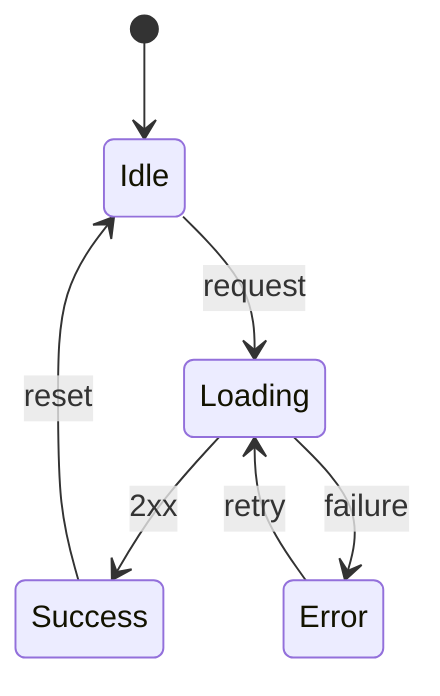
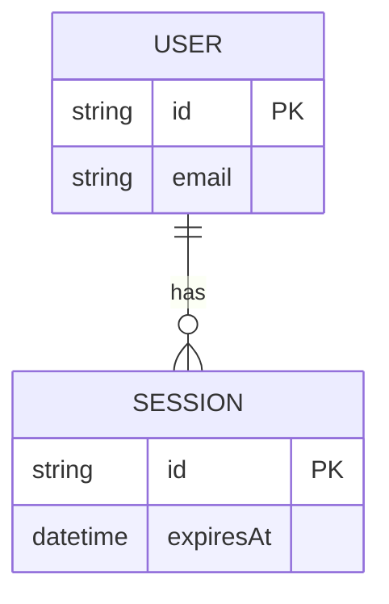

# Diagram Guide

Use Mermaid fenced blocks (renders natively on GitHub). Choose the diagram that answers the reader's question.

| Question | Diagram | Syntax |
|---|---|---|
| How is the system structured? | Architecture / layers | `flowchart TD` or `flowchart LR` with `subgraph` |
| What happens, in order, between components? | Sequence | `sequenceDiagram` |
| What states can this be in? | State machine | `stateDiagram-v2` |
| How is data modeled? | ER | `erDiagram` |
| How are types related? | Class | `classDiagram` |

Do not use unsupported types (timeline, gantt, journey, C4). Use a flowchart or table instead.

## Rules

1. **One idea per diagram.** If it needs more than ~12 nodes, split it.
2. **Label every edge** with the data or action (`"JWT"`, `"fetch profile"`).
3. **Group with `subgraph`**: Client, Backend, Data, External.
4. **Quote labels** containing parentheses, brackets, or colons: `A["Auth (OAuth2)"]`. Avoid HTML tags.
5. **Names must match the code.** Verify against real classes, files, and endpoints.
6. **Show failure paths** (retry, fallback, error state) in at least one diagram. This is what separates senior work.
7. Place the diagram directly under "How It Works", followed by a short walkthrough.
8. Keep colors minimal. Prefer `classDef` for 2-3 semantic colors (primary, data, external) over rainbow styling.

## Templates

### Layered architecture

### Request flow with failure path

### Lifecycle states

### Data model

