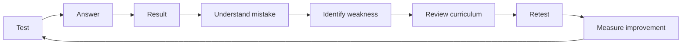
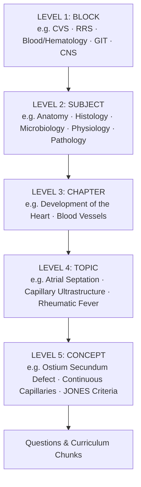
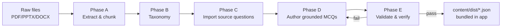
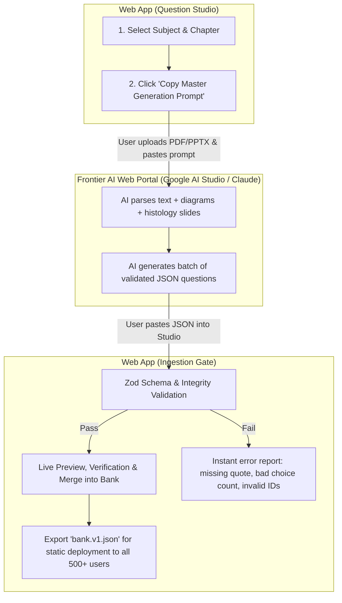
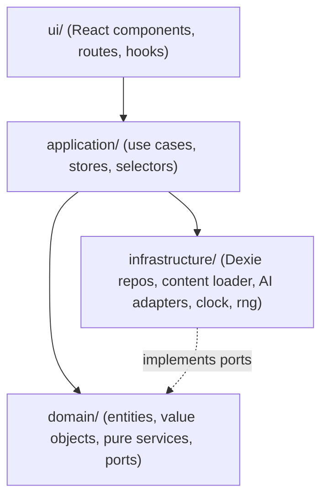
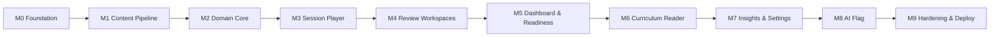

# CVS Exam Prep — Business & Engineering Requirements Document (BRD)

| Field | Value |
| :--- | :--- |
| Product | **CVS Exam Prep** — a premium, keyboard-first medical exam preparation web app |
| Block | Cardiovascular System (CVS) — Anatomy · Histology · Microbiology |
| Document type | BRD + Engineering Specification (Spec-Kit compatible) |
| Version | 1.0.0 |
| Status | Approved for implementation |
| Audience | Implementing AI agent(s) and human reviewers |
| Normative language | **MUST / MUST NOT / SHOULD / MAY** per RFC 2119 |

> [!IMPORTANT]
> This document is the **single source of truth**. If any instruction elsewhere (chat, code comments, tickets) conflicts with this BRD, this BRD wins. If this BRD is ambiguous, the agent **MUST stop and ask** — never guess on medical content, scoring logic, or product behavior.

---

## Table of Contents

0. [How to Use This Document with Spec Kit](#0-how-to-use-this-document-with-spec-kit)
1. [Product Vision](#1-product-vision)
2. [Constitution — Non-Negotiable Principles](#2-constitution--non-negotiable-principles)
3. [Scope & Non-Goals](#3-scope--non-goals)
4. [Content Sources & Taxonomy](#4-content-sources--taxonomy)
5. [Content Pipeline — Building the Question Bank](#5-content-pipeline--building-the-question-bank)
6. [Technology Stack](#6-technology-stack)
7. [Architecture](#7-architecture)
8. [Domain Model — Types](#8-domain-model--types)
9. [Algorithms & Formulas](#9-algorithms--formulas)
10. [Session Modes — Behavior Matrix](#10-session-modes--behavior-matrix)
11. [Keyboard Interaction Model](#11-keyboard-interaction-model)
12. [Information Architecture & Screens](#12-information-architecture--screens)
13. [Design System & UX](#13-design-system--ux)
14. [Persistence](#14-persistence)
15. [Ask AI (Feature-Flagged)](#15-ask-ai-feature-flagged)
16. [Non-Functional Requirements](#16-non-functional-requirements)
17. [Quality Engineering](#17-quality-engineering)
18. [Acceptance Criteria](#18-acceptance-criteria)
19. [Delivery Plan (Spec-Kit Tasks)](#19-delivery-plan-spec-kit-tasks)
20. [Agent Operating Rules](#20-agent-operating-rules)
21. [Glossary](#21-glossary)
22. [Open Questions](#22-open-questions)

---

## 0. How to Use This Document with Spec Kit

This BRD is structured to feed GitHub **Spec Kit** (spec-driven development) directly.

```bash
# One-time initialisation in the CVS folder (requires uv)
uvx --from git+https://github.com/github/spec-kit.git specify init . --here
```

| Spec-Kit command | Feed it | Output |
| :--- | :--- | :--- |
| `/speckit.constitution` | §2 Constitution (verbatim) | `.specify/memory/constitution.md` |
| `/speckit.specify` | §1, §3, §4, §10, §11, §12, §18 | `specs/001-cvs-exam-prep/spec.md` |
| `/speckit.clarify` | §22 Open Questions | Resolved ambiguities appended to spec |
| `/speckit.plan` | §5–§9, §13–§17 | `plan.md`, `data-model.md`, `contracts/`, `research.md` |
| `/speckit.tasks` | §19 Delivery Plan | `tasks.md` |
| `/speckit.analyze` | — | Cross-artifact consistency report (MUST be clean before implement) |
| `/speckit.implement` | `tasks.md` | Code |

> [!NOTE]
> If Spec Kit is unavailable, the agent MUST still follow the same phase order: **Constitution → Spec → Plan → Tasks → Implement**, and keep the equivalent artifacts under `specs/001-cvs-exam-prep/`.

---

## 1. Product Vision

### 1.1 What we are building

A **premium medical exam preparation web app** for 2nd-year medical students studying the CVS block.

We are **NOT** building: a quiz generator, a question reader, a knowledge-management system, a generic learning dashboard, or a chatbot with MCQs.

### 1.2 The two primary jobs

| Job | Question the learner asks | The app answers with |
| :--- | :--- | :--- |
| **JOB 1 — TEST MY KNOWLEDGE** | "How much do I actually know?" | Fast, realistic test sessions from the authorised MCQ bank |
| **JOB 2 — REVIEW FOR MY EXAM** | "What do I need to review before my exam?" | Ranked, actionable revision plan linked to the learner's own curriculum |

### 1.3 The core loop (more important than any feature)



### 1.4 The final product test

The product is complete **only if both answers are clearly YES**:

1. Can a student open the app **20 minutes before an exam** and immediately know exactly what to practise?
2. Can that student take a realistic test, identify mistakes, review the relevant curriculum, and retest those weak concepts **without leaving the app**?

---

## 2. Constitution — Non-Negotiable Principles

> Paste this section verbatim into `/speckit.constitution`.

**P1 — Testing & Review First.** Every screen serves TEST or REVIEW. Gamification, analytics, and AI are supporting systems and MUST NEVER block, cover, or delay a question.

**P2 — Medical Accuracy Is Absolute.** Every question, correct answer, explanation, and curriculum reference MUST be traceable to a specific location (file + page/slide) in the provided curriculum. No fact may appear in the bank that is not supported by the curriculum. Unsupported content is a **release-blocking defect**.

**P3 — No Runtime Question Generation.** The app MUST NOT generate, synthesise, or fetch questions at runtime. Retest and all sessions draw **only** from the validated, versioned question bank. No external/commercial/copyrighted question banks.

**P4 — Zero-Friction Interaction.** In non-exam modes, selecting an answer commits it immediately (no Submit button). Every learner action MUST be reachable via keyboard. Input-to-feedback latency MUST be < 50 ms.

**P5 — Exam Integrity.** In Exam/Mock modes, no correctness, explanation, hint, or AI medical assistance is revealed until the exam is submitted. This MUST be enforced in the domain layer, not only in the UI.

**P6 — Type Safety & Determinism.** TypeScript `strict` with no `any`, no non-null assertions (`!`), no `@ts-ignore`. All external data (content JSON, storage, imports) is validated with Zod at the boundary. Domain logic is pure and deterministic (injectable clock and RNG).

**P7 — Clean Architecture.** Dependencies point inward: `ui → application → domain`; `infrastructure` implements domain ports. The domain layer has zero dependencies on React, the browser, or storage.

**P8 — Local-First, Private, Free.** No accounts, no backend, no telemetry. All learner data lives in the learner's browser. The app is a static bundle deployable to a free CDN and serves 500+ concurrent users at $0.

**P9 — Test-Backed Changes.** Domain logic MUST have unit tests (≥ 90% line coverage in `domain/`). Every acceptance criterion in §18 MUST have an automated test (unit, component, or E2E).

**P10 — Accessible & Calm.** WCAG 2.2 AA. Respect `prefers-reduced-motion`. Typography and whitespace optimised for long, focused study sessions.

---

## 3. Scope & Non-Goals

### 3.1 In scope (v1)

- Quick Practice, Custom Test, Mock Exam, Rapid Revision, Exam Mode.
- Mistakes, Weak Areas, Due Reviews, Bookmarks, Exam Review workspaces.
- Curriculum Library ("My Materials") with deep links from questions to source pages/slides.
- Retest flow; post-test report; Exam Readiness; Dashboard with ONE primary recommendation.
- Analytics & Progress (supporting).
- Spaced repetition, confidence tracking, notes, flags, bookmarks.
- Settings: exam date, theme, defaults, data export/import/reset, AI configuration.
- Ask AI behind a feature flag (default **OFF**), Groq-ready adapter.

### 3.2 Explicit non-goals (v1)

| Non-goal | Rationale |
| :--- | :--- |
| Authentication / sign-up / user accounts | Not required; local-first |
| Backend server / database | Static hosting only |
| Cross-device sync | Replaced by JSON export/import |
| Telemetry / analytics SDKs | Privacy (P8) |
| Runtime AI question generation | P3 |
| XP-gated or streak-gated features | P1 |
| Native mobile apps | Responsive web is sufficient |

---

## 4. Content Sources & Taxonomy

### 4.0 The 5-Level Medical Hierarchy (Multi-Block Architecture)

Medical schools organize training around **Integrated System Blocks**, where each block contains multiple basic science and clinical subjects. The system model is strictly 5-tiered:



- **Block-Level Simulation:** Learner takes a 50-question mock exam spanning the entire Block (mixing Anatomy, Histology, Microbiology), simulating the real integrated university block exam.
- **Subject/Chapter Practice:** Learner can drill down into a single subject (e.g. "CVS Histology") or a single chapter.
- **Cross-Block Extensibility:** The engine is built once. Additional blocks (`rrs`, `hematology`, `git`) plug in as independent data folders under `content/[blockId]/` with zero UI/domain rewrites.

### 4.1 Block 206 (CVS) Source Inventory (Authoritative)

| ID | Subject | File | Format | Size | Notes |
| :--- | :--- | :--- | :--- | :--- | :--- |
| `SRC-ANA-01` | Anatomy | `curriculum/cvs/anatomy/2nd year cvs anatomy of heart and mediastnum hanout.pdf` | PDF | 49 pages | Text-extractable; some figure-only pages |
| `SRC-ANA-02` | Anatomy | `curriculum/cvs/anatomy/Development of the heart.pdf` | PDF | 16 pages | **Many pages are image-only** (diagrams) |
| `SRC-ANA-03` | Anatomy | `curriculum/cvs/anatomy/Fetal cirulation and BV development.pdf` | PDF | 16 pages | Partially image-only |
| `SRC-HIS-01` | Histology | `curriculum/cvs/histology/3- HISTOLOGY OF CVS ppt (1).pptx` | PPTX | ~16 slides | Lecture 3 — contains an **official Self-Assessment** (MCQ + T/F + completion) |
| `SRC-HIS-02` | Histology | `curriculum/cvs/histology/Histology of  the blood vessels 24&25.pptx` | PPTX | Lectures 24 & 25 | Blood vessels, capillaries, specialised arteries |
| `SRC-MIC-01` | Microbiology | `curriculum/cvs/microbiology/handout CVS microbiology.docx` | DOCX | 3 lectures | Rheumatic fever · Infective endocarditis · Viral myocarditis |

> [!WARNING]
> Image-only pages MUST NOT be silently skipped. The pipeline MUST flag them in `content/reports/extraction-report.json`. Questions MAY be authored from figure content only after OCR or human transcription, and such questions MUST carry `evidence.kind = 'figure'`.

### 4.2 Provisional taxonomy (Subject → Chapter → Topic)

> Derived from a first-pass extraction. The pipeline (§5, Phase A) MUST confirm or correct this against the actual headings and record the final taxonomy in `content/taxonomy.json`.

**Anatomy**

| Chapter | Topics |
| :--- | :--- |
| `ana-heart-mediastinum` — Heart & Mediastinum (`SRC-ANA-01`) | Pericardium · External features, borders & surface marking · Right atrium · Right ventricle · Left atrium · Left ventricle · Valves of the heart · Coronary arteries · Veins of the heart · Lymphatic drainage of the heart · Fibrous skeleton · Conducting system · Nerve supply of the heart · Large veins of the thorax (brachiocephalic, SVC, IVC, pulmonary veins, azygos system) · Large arteries of the thorax (aorta, pulmonary trunk) · Lymphatic drainage of the thorax & thoracic duct · Nerves of the thorax (phrenic, sympathetic trunk, vagus) · Trachea & principal bronchi · Oesophagus |
| `ana-heart-development` — Development of the Heart (`SRC-ANA-02`) | Cardiogenic area & heart tube · Sinus venosus · Atrial septation · Atrioventricular canal & cushions · Interventricular septum · Truncus/conus septation & great arteries · Development of the conducting system · Congenital heart anomalies (ASD, VSD, TGA, …) |
| `ana-fetal-circ-bv` — Fetal Circulation & Blood-Vessel Development (`SRC-ANA-03`) | Aortic arches & their fate · Dorsal aortae & branches · Anomalies of aortic arches (incl. coarctation) · Vitelline veins · Umbilical veins · Cardinal veins · Development of SVC · Development of IVC · Anomalies of venae cavae · Fetal circulation & changes at birth |

**Histology**

| Chapter | Topics |
| :--- | :--- |
| `his-heart` — Histology of the Heart, L3 (`SRC-HIS-01`) | Layers of the heart wall · Myocardium & chambers · Cardiac skeleton · Cardiac valves · Purkinje fibres · Intercalated disc |
| `his-blood-vessels` — Histology of Blood Vessels, L24–25 (`SRC-HIS-02`) | General structure (tunica intima/media/adventitia) · Large elastic arteries · Muscular arteries & arterioles · Veins · Vasa vasorum · Endothelial cells & functions · Capillaries (continuous, fenestrated, sinusoidal) · Specialised arteries (incl. umbilical) · Sensory structures (carotid sinus, carotid body) |

**Microbiology**

| Chapter | Topics |
| :--- | :--- |
| `mic-rheumatic-fever` — L1 (`SRC-MIC-01`) | Definition & epidemiology · Etiology & molecular mimicry · Type II hypersensitivity · Clinical features & JONES criteria · Diagnosis · Prevention |
| `mic-infective-endocarditis` — L2 (`SRC-MIC-01`) | Per handout headings |
| `mic-viral-myocarditis` — L3 (`SRC-MIC-01`) | Per handout headings |

---

## 5. Content Pipeline — Building the Question Bank

### 5.1 Principle

The curriculum is the **review source**; the question bank is the **assessment source**. The bank is built **offline, once per content release**, by a deterministic pipeline + authoring step + validation gate. The shipped app only reads validated JSON.



### 5.2 Phases

| Phase | Input | Output | Rules |
| :--- | :--- | :--- | :--- |
| **A — Extract** | `Anatomy/`, `Histology/`, `Microbiology/` | `content/chunks/*.json` (`CurriculumChunk[]`) | Python scripts in `tools/content/` (`pypdf`, `python-pptx`, `python-docx`). One chunk per page/slide/heading section. Preserve page/slide numbers. Flag image-only pages. |
| **B — Taxonomy** | chunks | `content/taxonomy.json` | Use document headings; stable kebab-case IDs (§4.2). |
| **C — Import** | Self-assessment blocks | `content/questions/source/*.json` | Existing questions imported **verbatim** with `origin: 'curriculum-self-assessment'`. Correct typos only in a `normalizedStem` field; keep `originalStem`. |
| **D — Author** | chunks + taxonomy | `content/questions/authored/*.json` | See §5.3. |
| **E — Validate** | all questions | `content/dist/bank.v{N}.json` + `content/reports/validation-report.json` | See §5.4. Build fails on any error. |

### 5.3 MCQ authoring rules (MUST)

1. **Grounded:** every question cites ≥ 1 `CurriculumChunk` and includes an `evidence.quote` — a **verbatim** substring of that chunk that proves the correct answer.
2. **Single best answer:** exactly one correct choice. Distractors MUST be plausible, drawn from the same curriculum domain, and **demonstrably wrong according to the curriculum**.
3. **Choices:** Exactly 4 choices (`a`, `b`, `c`, `d`) for all `single-best-answer` questions (standardized per official self-assessment and board format). Exactly 2 (`True`, `False`) for self-assessment `true-false` items. No "All of the above" / "None of the above". No negatively-phrased stems unless the word NOT/EXCEPT is capitalised.
4. **Explanation:** why the correct answer is correct + one line per distractor explaining why it is wrong (`choiceRationales`).
5. **Metadata:** `difficulty` (1–3), `highYield` (boolean, see criteria below), `cognitiveLevel` (`recall | understanding | application`), `concept` (short canonical concept label — used for Retest and grouping).
6. **High-yield criteria:** a question is `highYield: true` if its concept appears in a lecture's *Learning Objectives*, is listed in a *Notes*/summary box, is an official self-assessment item, or is a named clinical anomaly/criterion (e.g. JONES criteria, TGA, ASD).
7. **No duplication:** no two questions with the same `concept` AND the same correct-answer fact. Near-duplicate stems (normalised Levenshtein similarity > 0.85) are rejected.
8. **Language:** clear international medical English; spell-correct the source's typos in authored text (e.g. "Purkinjue" → "Purkinje"; "mediastnum" → "mediastinum").
9. **Coverage targets:** proportional to source volume, minimum per chapter:

| Chapter | Min. questions |
| :--- | ---: |
| `ana-heart-mediastinum` | 120 |
| `ana-heart-development` | 50 |
| `ana-fetal-circ-bv` | 50 |
| `his-heart` | 35 |
| `his-blood-vessels` | 50 |
| `mic-rheumatic-fever` | 30 |
| `mic-infective-endocarditis` | 30 |
| `mic-viral-myocarditis` | 25 |
| **Total (min.)** | **390** |

Every topic in `taxonomy.json` MUST have ≥ 3 questions, or be explicitly listed in the validation report as `insufficient-source-content` with justification.

### 5.4 Validation gate (Phase E)

The `validate-bank` script MUST fail the build if any check fails:

| Check | Rule |
| :--- | :--- |
| Schema | Every item parses with the Zod `QuestionSchema` |
| Evidence | `evidence.quote` is a verbatim (whitespace-normalised) substring of the referenced chunk |
| Answer integrity | Exactly one `isCorrect` choice; choice IDs unique; exactly 4 choices for SBA, 2 for T/F |
| Referential | `chapterId`, `topicId`, `sourceId`, `chunkId` all exist |
| Uniqueness | Unique `id`; no near-duplicate stems |
| Coverage | §5.3 rule 9 satisfied |
| Hygiene | No banned phrases (AOTA/NOTA), no empty rationales |

Additionally, a **second-pass independent verification** MUST be performed: a fresh agent context (or human) re-answers each authored question using **only** its cited chunk, without seeing the key. Any disagreement → question quarantined (`status: 'quarantined'`) and excluded from the shipped bank.

### 5.5 Question Ingestion Studio & Web-Portal Pipeline (Zero-Cost Content Loop)

To combine the **multimodal vision capabilities of frontier AI portals (Google AI Studio / Claude)** with zero API hosting costs, the application includes a dedicated **Question Ingestion Studio** (`/studio`).



#### Studio Functional Requirements:
1. **System Prompt Generator:** The Studio outputs a structured, high-yield system prompt for any selected chapter, pre-populated with:
   - Target chapter ID and topic IDs from `taxonomy.json`.
   - Strict Zod JSON schema specification.
   - Medical requirements: 4 choices, 1 correct, distractor rationales, verbatim evidence quote with exact page/slide number, and cognitive levels.
2. **Ingestion & Validation Gate:**
   - Accepts raw JSON pasted by the user.
   - Runs client-side Zod validation (`QuestionSchema.array().safeParse(json)`).
   - Validates that choice count = 4, exactly 1 `isCorrect`, quotes are non-empty, and topic IDs match known taxonomy.
3. **Live Bank Management:**
   - Shows total loaded questions by chapter and topic.
   - Allows testing newly ingested questions immediately in Practice mode.
   - Includes **[Export Shipped Bank (`bank.v1.json`)]** button to download the merged bank file ready for git commit into `content/dist/`.

---

## 6. Technology Stack

| Concern | Choice | Version (major) | Rationale |
| :--- | :--- | :--- | :--- |
| Build tool | **Vite** | 6.x | Fast HMR; static `dist/` output |
| UI | **React** | 19.x | Mature, component model, huge ecosystem |
| Language | **TypeScript** | 5.x, `strict` | P6 |
| Styling | **Tailwind CSS** | 4.x | Design tokens via CSS variables; zero runtime |
| Headless primitives | **Radix UI** | latest | Accessible dialogs, popovers, tooltips |
| Icons | **lucide-react** | latest | Consistent line icons |
| Routing | **React Router** | 7.x (library mode) | Lazy routes; SPA fallback |
| State | **Zustand** | 5.x | Minimal, selector-based, no boilerplate |
| Validation | **Zod** | 3.x | Runtime schemas = TS types |
| Persistence | **Dexie (IndexedDB)** | 4.x | Durable, large-capacity, indexed queries |
| Charts | **Recharts** *(lazy)* | 2.x | Only on Insights routes |
| Command palette | **cmdk** | 1.x | `⌘K` / `Ctrl+K` |
| Unit/Component tests | **Vitest** + Testing Library | latest | Fast, Vite-native |
| E2E | **Playwright** | latest | Keyboard flows, exam integrity |
| Lint/Format | **ESLint** (typescript-eslint strict) + **Prettier** | latest | Enforced in CI |
| Content tooling | **Python 3.12+** (`pypdf`, `python-pptx`, `python-docx`) via `uv` | — | Offline pipeline only |
| Hosting | **Cloudflare Pages** (alt: Vercel/Netlify) | — | Free, unlimited bandwidth, global CDN |
| CI | **GitHub Actions** | — | typecheck → lint → test → validate-bank → build |

> [!NOTE]
> Astro was evaluated and rejected for v1: ~90% of the surface is a single stateful, keyboard-driven island, so Astro's islands model adds cross-island state cost without benefit.

---

## 7. Architecture

### 7.1 Layering (Clean Architecture / Hexagonal)



**Dependency rule:** `domain` imports nothing outside itself. Enforced with `eslint-plugin-boundaries` (or `dependency-cruiser`) in CI.

### 7.2 Directory Organization & Workspace Hygiene (The 3-Zone Rule)

To prevent repository clutter and keep the project lightweight, predictable, and maintainable, the workspace is strictly organized into **three isolated zones**:

```
CVS/                                     <-- Project & Git Root
├── .gitignore                           <-- Strict exclusion: excludes node_modules, dist, temp files
├── README.md                            <-- Quickstart & developer instructions
├── BRD.md                               <-- Normative Requirements Document
├── package.json                         <-- Scripts, dependencies & build tools
├── vite.config.ts                       <-- Build configuration (SPA output)
├── tsconfig.json                        <-- TypeScript strict configuration
│
├── 📂 curriculum/                       <-- ZONE 1: Raw Faculty Materials (Read-Only Source of Truth)
│   └── 📂 cvs/                          <-- Block: CVS (Block 206)
│       ├── anatomy/                     (PDFs: Heart & Mediastinum, Development, Fetal Circulation)
│       ├── histology/                   (PPTXs: Heart L3, Blood Vessels L24-25)
│       └── microbiology/                (DOCX: CVS Microbiology Handout)
│   # (Extensible: curriculum/rrs/, curriculum/hematology/, etc.)
│
├── 📂 content/                          <-- ZONE 2: Medical Intelligence (Structured & Versioned Data)
│   └── 📂 cvs/                          <-- Block: CVS
│       ├── taxonomy.json                (Canonical Chapters, Topics, and Unit mappings)
│       └── dist/
│           └── bank.v1.json             (The unified 390+ CVS question bank shipped to all learners)
│   # (Extensible: content/rrs/, content/hematology/, etc.)
│
├── 📂 public/                           <-- Static Web Assets
│   └── curriculum/
│       └── cvs/                         (Web-viewable PDFs for in-app split-screen review)
│
└── 📂 src/                              <-- ZONE 3: Application Code (Clean Architecture)
    ├── domain/                          (Pure business logic: scoring, SRS, readiness, timers)
    ├── application/                     (Session use-cases, question selection, Zustand stores)
    ├── infrastructure/                  (Dexie/IndexedDB, bank loader, Groq AI adapter)
    └── ui/                              (Apple-grade UI components & screens)
        ├── app/                         (Router, Shell, Header, Global Layout)
        ├── design-system/               (Design tokens, Radix primitives, Typography)
        ├── keyboard/                    (Spatial keyboard command dispatcher)
        └── features/                    (Matches Navigation 1-to-1)
            ├── dashboard/               (Primary recommendation & readiness score)
            ├── test/                    (Quick Practice, Mock Exam, Rapid Revision, Custom)
            ├── review/                  (Mistakes, Weak Areas, Due Reviews, Bookmarks, Exam Review)
            ├── curriculum/              (In-app reader & deep-linked split view)
            ├── insights/                (Analytics & progress breakdown)
            └── studio/                  (Prompt Generator & JSON Ingestion Gate)
```

#### Workspace Rules (MUST):
1. **Raw curriculum is strictly read-only:** Code and build scripts never modify files in `curriculum/`.
2. **No single-question JSON sprawl:** Authoring in batches outputs directly to `content/dist/bank.v{N}.json`. The bank is never broken into hundreds of loose files in source control.
3. **Repository size ceiling:** The entire repository (excluding git history and raw curriculum) MUST remain under 15 MB.
4. **Git hygiene:** A strict root `.gitignore` excludes `node_modules/`, `dist/`, `.DS_Store`, build logs, and temporary scratchpads (`scratch/`).

### 7.3 Design patterns (where and why)

| Pattern | Where | Purpose |
| :--- | :--- | :--- |
| **Finite State Machine** | `domain/session` | Session lifecycle with illegal states unrepresentable (discriminated unions) |
| **Strategy** | `ModePolicy` per mode | Feedback timing, AI permissions, timer, navigation rules vary by mode without `if (mode === …)` scattered in UI |
| **Specification** | `domain/selection` | Composable question filters (`and/or/not`) for every session source (mistakes, weak, due, bookmarked…) |
| **Factory** | `SessionFactory` | Builds a `Session` from `SessionConfig` + bank + learner state |
| **Repository** | `ports/*Repository` | Storage abstraction; Dexie impl in infra, in-memory impl in tests |
| **Command** | `ui/keyboard` | Every shortcut is a registered command (id, keys, scope, `canExecute`, `execute`) — shared by keyboard, buttons, and command palette |
| **Observer / Domain Events** | `AttemptRecorded`, `SessionCompleted` | Decouples SRS, analytics, and mistake log from the answering flow |
| **Adapter** | `AiProvider` | Swap Disabled / Groq / future providers |
| **Result type** | All fallible operations | No thrown exceptions across layer boundaries |
| **Dependency Injection** | `AppContainer` (composition root) | Inject clock, RNG, repos — deterministic tests |

### 7.4 SOLID mapping

- **S** — One reason to change per module (e.g. `masteryCalculator.ts` only computes mastery).
- **O** — New modes are added by adding a `ModePolicy`, not by editing the engine.
- **L** — All `QuestionRepository` implementations are interchangeable in tests.
- **I** — Narrow ports (`AttemptReader`, `AttemptWriter`) instead of one god-repository.
- **D** — Use-cases depend on ports, never on Dexie or `fetch`.

---

## 8. Domain Model — Types

> These are **normative**. Zod schemas MUST mirror them exactly (`z.infer` is the source of the TS type for boundary data).

### 8.1 Shared primitives

```ts
// shared/brand.ts
declare const __brand: unique symbol;
export type Brand<T, B extends string> = T & { readonly [__brand]: B };

export type BlockId    = Brand<string, 'BlockId'>;     // e.g. 'cvs' | 'rrs' | 'hematology' | 'git'
export type SubjectId  = Brand<string, 'SubjectId'>;   // 'anatomy' | 'histology' | 'microbiology' | 'pathology'
export type ChapterId  = Brand<string, 'ChapterId'>;   // e.g. 'cvs-ana-heart-development'
export type TopicId    = Brand<string, 'TopicId'>;     // e.g. 'cvs-ana-heart-development/atrial-septation'
export type QuestionId = Brand<string, 'QuestionId'>;  // e.g. 'q-cvs-dev-0042'
export type ChoiceId   = Brand<string, 'ChoiceId'>;    // 'a' | 'b' | 'c' | 'd'
export type SourceId   = Brand<string, 'SourceId'>;    // e.g. 'SRC-CVS-ANA-02'
export type ChunkId    = Brand<string, 'ChunkId'>;     // e.g. 'SRC-CVS-ANA-02#p6'
export type SessionId  = Brand<string, 'SessionId'>;
export type AttemptId  = Brand<string, 'AttemptId'>;
export type ConceptKey = Brand<string, 'ConceptKey'>;  // canonical concept slug

export type IsoDateTime = Brand<string, 'IsoDateTime'>;
export type Millis      = Brand<number, 'Millis'>;
export type Ratio       = Brand<number, 'Ratio'>;      // 0..1 inclusive

// shared/result.ts
export type Result<T, E = DomainError> =
  | { readonly ok: true;  readonly value: T }
  | { readonly ok: false; readonly error: E };

export type DomainError =
  | { readonly kind: 'NotFound'; readonly entity: string; readonly id: string }
  | { readonly kind: 'InvalidTransition'; readonly from: string; readonly event: string }
  | { readonly kind: 'PolicyViolation'; readonly rule: string }
  | { readonly kind: 'EmptySelection'; readonly reason: string }
  | { readonly kind: 'StorageFailure'; readonly cause: string }
  | { readonly kind: 'ValidationFailure'; readonly issues: readonly string[] };

export const assertNever = (x: never): never => {
  throw new Error(`Unhandled variant: ${JSON.stringify(x)}`);
};
```

### 8.2 Curriculum

```ts
export type SourceFormat = 'pdf' | 'pptx' | 'docx';

export interface CurriculumSource {
  readonly id: SourceId;
  readonly subjectId: SubjectId;
  readonly title: string;            // human title, typo-corrected
  readonly fileName: string;         // original file name
  readonly format: SourceFormat;
  readonly publicPath: string;       // '/curriculum/<file>'
  readonly unitCount: number;        // pages or slides
}

export type LocationRef =
  | { readonly kind: 'page';    readonly page: number }
  | { readonly kind: 'slide';   readonly slide: number }
  | { readonly kind: 'section'; readonly heading: string; readonly ordinal: number };

export interface CurriculumChunk {
  readonly id: ChunkId;
  readonly sourceId: SourceId;
  readonly location: LocationRef;
  readonly heading: string | null;
  readonly text: string;             // normalised extracted text
  readonly hasFigures: boolean;
  readonly extraction: 'text' | 'ocr' | 'manual-transcription' | 'image-only-unprocessed';
  readonly topicIds: readonly TopicId[];
}

export interface Block {
  readonly id: BlockId;
  readonly name: string;             // "Cardiovascular System"
  readonly shortName: string;        // "CVS"
  readonly code?: string;            // "Block 206"
  readonly subjectIds: readonly SubjectId[];
}

export interface Subject {
  readonly id: SubjectId;
  readonly blockId: BlockId;
  readonly name: string;
  readonly order: number;
}

export interface Chapter {
  readonly id: ChapterId;
  readonly blockId: BlockId;
  readonly subjectId: SubjectId;
  readonly name: string;
  readonly order: number;
  readonly sourceIds: readonly SourceId[];
}

export interface Topic {
  readonly id: TopicId;
  readonly blockId: BlockId;
  readonly chapterId: ChapterId;
  readonly name: string;
  readonly order: number;
}
```

### 8.3 Questions

```ts
export type QuestionType = 'single-best-answer' | 'true-false';
export type Difficulty = 1 | 2 | 3;                       // easy | medium | hard
export type CognitiveLevel = 'recall' | 'understanding' | 'application';
export type QuestionOrigin = 'curriculum-self-assessment' | 'authored-grounded';
export type QuestionStatus = 'active' | 'quarantined';

export interface Choice {
  readonly id: ChoiceId;
  readonly text: string;
  readonly isCorrect: boolean;
  readonly rationale: string;                             // why right / why wrong
}

export interface Evidence {
  readonly chunkId: ChunkId;
  readonly quote: string;                                 // verbatim substring of chunk.text
  readonly kind: 'text' | 'figure';
}

export interface Question {
  readonly id: QuestionId;
  readonly blockId: BlockId;
  readonly type: QuestionType;
  readonly subjectId: SubjectId;
  readonly chapterId: ChapterId;
  readonly topicId: TopicId;
  readonly concept: ConceptKey;
  readonly stem: string;
  readonly choices: readonly Choice[];                    // 2 (T/F) or exactly 4 (SBA)
  readonly explanation: string;
  readonly examTip: string | null;                        // "exam trap" / key takeaway
  readonly mnemonic: string | null;                       // only if present in or derivable verbatim from source
  readonly difficulty: Difficulty;
  readonly cognitiveLevel: CognitiveLevel;
  readonly highYield: boolean;
  readonly origin: QuestionOrigin;
  readonly evidence: readonly [Evidence, ...Evidence[]];  // non-empty
  readonly status: QuestionStatus;
  readonly bankVersion: number;
}
```

### 8.4 Learner state

```ts
export type Confidence = 'guess' | 'unsure' | 'sure';    // default 'unsure' if not set

export interface Attempt {
  readonly id: AttemptId;
  readonly questionId: QuestionId;
  readonly sessionId: SessionId;
  readonly mode: SessionMode;
  readonly selectedChoiceId: ChoiceId | null;             // null = unanswered at submit
  readonly isCorrect: boolean | null;                     // null when unanswered
  readonly confidence: Confidence;
  readonly responseTimeMs: Millis;
  readonly answeredAt: IsoDateTime;
}

export type AttemptClassification =
  | 'mastered'            // correct + sure
  | 'shaky-correct'       // correct + unsure
  | 'lucky-guess'         // correct + guess
  | 'honest-miss'         // incorrect + guess/unsure
  | 'danger-zone'         // incorrect + sure  (confident error)
  | 'unanswered';

export interface ReviewCard {                              // SRS state per question
  readonly questionId: QuestionId;
  readonly easeFactor: number;                            // >= 1.3
  readonly intervalDays: number;
  readonly repetitions: number;
  readonly lapses: number;
  readonly dueAt: IsoDateTime;
  readonly lastReviewedAt: IsoDateTime | null;
}

export interface QuestionAnnotations {
  readonly questionId: QuestionId;
  readonly bookmarked: boolean;
  readonly needsRevision: boolean;
  readonly note: string | null;
  readonly updatedAt: IsoDateTime;
}

export interface LearnerSettings {
  readonly examDate: IsoDateTime | null;
  readonly theme: 'system' | 'light' | 'dark';
  readonly defaultQuestionCount: number;                  // default 20
  readonly rapidAutoAdvanceMs: number;                    // default 900
  readonly askConfidence: 'always' | 'never' | 'practice-only'; // default 'practice-only'
  readonly ai: AiSettings;
}
```

### 8.5 Sessions

```ts
export type SessionMode = 'practice' | 'exam' | 'mock' | 'rapid' | 'retest';

export type QuestionSource =
  | { readonly kind: 'all' }
  | { readonly kind: 'chapters'; readonly chapterIds: readonly ChapterId[] }
  | { readonly kind: 'topics'; readonly topicIds: readonly TopicId[] }
  | { readonly kind: 'incorrect' }
  | { readonly kind: 'mistakes'; readonly filter: MistakeFilter }
  | { readonly kind: 'weak-areas'; readonly threshold: Ratio }
  | { readonly kind: 'bookmarked' }
  | { readonly kind: 'needs-revision' }
  | { readonly kind: 'due' }
  | { readonly kind: 'high-yield' }
  | { readonly kind: 'unseen' }
  | { readonly kind: 'explicit'; readonly questionIds: readonly QuestionId[] };

export type MistakeFilter = 'all' | 'repeated' | 'danger-zone' | 'high-yield' | 'overdue';

export interface SessionConfig {
  readonly mode: SessionMode;
  readonly sources: readonly QuestionSource[];            // combined with AND
  readonly difficulties: readonly Difficulty[] | 'any';
  readonly highYieldOnly: boolean;
  readonly questionCount: number | 'all';
  readonly order: 'random' | 'curriculum';
  readonly timeLimitMs: Millis | null;                    // required for exam/mock
  readonly seed: number;                                  // deterministic shuffling
  readonly shuffleChoices: boolean;
}

export interface SessionItem {
  readonly questionId: QuestionId;
  readonly choiceOrder: readonly ChoiceId[];              // display order (post-shuffle)
  readonly response: ItemResponse;
  readonly flagged: boolean;
  readonly timeSpentMs: Millis;
}

export type ItemResponse =
  | { readonly status: 'unanswered' }
  | { readonly status: 'answered-hidden'; readonly choiceId: ChoiceId; readonly confidence: Confidence }   // exam/mock
  | { readonly status: 'answered-revealed'; readonly choiceId: ChoiceId; readonly confidence: Confidence; readonly isCorrect: boolean };

export type SessionState =
  | { readonly phase: 'in-progress'; readonly cursor: number; readonly startedAt: IsoDateTime; readonly pausedMs: Millis }
  | { readonly phase: 'reviewing-before-submit'; readonly cursor: number; readonly startedAt: IsoDateTime } // exam/mock "review screen"
  | { readonly phase: 'submitted'; readonly submittedAt: IsoDateTime; readonly reason: 'user' | 'timeout' }
  | { readonly phase: 'abandoned'; readonly at: IsoDateTime };

export interface Session {
  readonly id: SessionId;
  readonly config: SessionConfig;
  readonly items: readonly SessionItem[];
  readonly state: SessionState;
}

export type SessionEvent =
  | { readonly type: 'ANSWER'; readonly choiceId: ChoiceId; readonly confidence: Confidence; readonly at: IsoDateTime }
  | { readonly type: 'NAVIGATE'; readonly to: number }
  | { readonly type: 'TOGGLE_FLAG' }
  | { readonly type: 'OPEN_SUBMIT_REVIEW' }
  | { readonly type: 'SUBMIT'; readonly at: IsoDateTime }
  | { readonly type: 'TIMEOUT'; readonly at: IsoDateTime }
  | { readonly type: 'ABANDON'; readonly at: IsoDateTime };

// Pure reducer — the only way a session changes
export type SessionReducer = (s: Session, e: SessionEvent, policy: ModePolicy) => Result<Session>;
```

### 8.6 Mode policy (Strategy)

```ts
export interface ModePolicy {
  readonly mode: SessionMode;
  readonly feedback: 'immediate' | 'compact-immediate' | 'deferred-until-submit';
  readonly allowChangeAnswer: boolean;          // exam/mock: true until submit; others: false
  readonly autoAdvanceMs: number | null;        // rapid only
  readonly timer: 'none' | 'elapsed' | 'countdown';
  readonly allowFreeNavigation: boolean;
  readonly allowFlagging: boolean;
  readonly aiAccess: 'full' | 'rules-only';     // exam/mock: rules-only
  readonly showExplanationKey: boolean;         // 'E' enabled?
  readonly updatesSrs: boolean;
}
```

### 8.7 Analytics & recommendations

```ts
export interface MasteryStat {
  readonly scope: { kind: 'chapter'; id: ChapterId } | { kind: 'topic'; id: TopicId } | { kind: 'overall' };
  readonly attempted: number;
  readonly totalQuestions: number;
  readonly accuracy: Ratio;            // recency-weighted
  readonly mastery: Ratio;             // §9.2
  readonly band: 'critical' | 'weak' | 'developing' | 'strong';
  readonly dangerZoneCount: number;
  readonly repeatedMistakeCount: number;
  readonly dueCount: number;
  readonly confidence: 'insufficient-data' | 'low' | 'ok';  // sample-size guard
}

export interface ReadinessReport {
  readonly score: Ratio;
  readonly components: {
    readonly knowledge: Ratio; readonly consistency: Ratio; readonly highYield: Ratio;
    readonly weakAreas: Ratio; readonly recentPerformance: Ratio; readonly timing: Ratio;
  };
  readonly blockers: readonly Blocker[];   // "What is holding you back?" (max 3)
  readonly dataSufficiency: 'insufficient' | 'partial' | 'sufficient';
}

export type Blocker =
  | { readonly kind: 'weak-topic'; readonly topicId: TopicId; readonly mastery: Ratio }
  | { readonly kind: 'overdue-reviews'; readonly count: number }
  | { readonly kind: 'danger-zone'; readonly count: number }
  | { readonly kind: 'uncovered-high-yield'; readonly count: number };

export interface Recommendation {
  readonly id: string;
  readonly title: string;                 // "15-question Atrial Septation review"
  readonly reasons: readonly string[];    // max 4 bullets, data-backed
  readonly priority: number;              // §9.6
  readonly config: SessionConfig;         // one click → session
}
```

---

## 9. Algorithms & Formulas

> All functions are **pure**, live in `domain/`, receive `now` and data explicitly, and have exhaustive unit tests including edge cases (zero attempts, all correct, all wrong, single attempt).

### 9.1 Attempt classification

| isCorrect | confidence | Classification |
| :--- | :--- | :--- |
| true | sure | `mastered` |
| true | unsure | `shaky-correct` |
| true | guess | `lucky-guess` |
| false | guess / unsure | `honest-miss` |
| false | sure | `danger-zone` |
| null | — | `unanswered` |

### 9.2 Question mastery and aggregate mastery

Per question `q` with attempts ordered newest first, recency weight `w_i = 0.6^i` (i = 0 is newest), credit:

| Classification | Credit |
| :--- | ---: |
| mastered | 1.00 |
| shaky-correct | 0.75 |
| lucky-guess | 0.40 |
| honest-miss | 0.00 |
| danger-zone | 0.00 |
| unanswered | 0.00 |

$$\text{mastery}(q) = \frac{\sum_i w_i \cdot \text{credit}_i}{\sum_i w_i}$$

Unseen questions have mastery **0** for coverage-sensitive metrics and are **excluded** from accuracy.

Aggregate (topic/chapter/overall):

$$\text{mastery}(S) = \underbrace{\frac{\sum_{q \in S_{seen}} \text{mastery}(q)}{|S_{seen}|}}_{\text{accuracy}} \times \underbrace{\min\!\left(1, \frac{|S_{seen}|}{\max(3,\ 0.6\,|S|)}\right)}_{\text{coverage factor}}$$

**Bands:** `critical` < 0.50 ≤ `weak` < 0.70 ≤ `developing` < 0.85 ≤ `strong`. UI colours: 🔴 critical, 🟠 weak, 🟡 developing, 🟢 strong.
**Sample guard:** < 3 seen questions → `confidence: 'insufficient-data'`; display "Not enough data — Practise 5" instead of a percentage.

### 9.3 Mistake definitions

| Term | Definition |
| :--- | :--- |
| **Mistake** | A question whose **most recent** non-exam-hidden attempt is incorrect, OR whose mastery < 0.5 with ≥ 1 incorrect attempt |
| **Repeated mistake** | ≥ 2 incorrect attempts in total |
| **Danger-zone mistake** | ≥ 1 `danger-zone` attempt within the last 3 attempts |
| **High-yield mistake** | Mistake ∧ `question.highYield` |
| **Overdue review** | Mistake ∧ `reviewCard.dueAt < now` |
| **Resolved** | Last 2 attempts correct with confidence ≥ `unsure` → leaves the Mistakes list (history retained) |

### 9.4 Spaced repetition (SM-2 variant)

Quality `Q` from classification: mastered = 5, shaky-correct = 4, lucky-guess = 3, honest-miss = 1, danger-zone = 0.

```
if Q < 3:   repetitions = 0; lapses += 1; interval = 1 day   (danger-zone → interval = 0.5 day)
else:
  repetitions += 1
  interval = repetitions == 1 ? 1 : repetitions == 2 ? 3 : round(interval * easeFactor)
easeFactor = max(1.3, easeFactor + (0.1 - (5 - Q) * (0.08 + (5 - Q) * 0.02)))
dueAt = now + interval
```

- Initial `easeFactor = 2.5`.
- **Exam-proximity compression:** if `examDate` is set and `dueAt > examDate - 1 day`, clamp `dueAt` to `max(now + 0.5 day, examDate - 1 day)`.
- SRS updates only when `policy.updatesSrs` (true for practice, rapid, retest; exam/mock update on **submit**).

### 9.5 Exam Readiness

| Component | Formula | Weight |
| :--- | :--- | ---: |
| Knowledge | overall mastery (§9.2) across all active questions | 0.30 |
| High-Yield | mastery over high-yield questions | 0.20 |
| Weak Areas | 1 − (weighted share of topics in `critical`/`weak`, weighted by question count) | 0.15 |
| Consistency | 1 − (danger-zone + lucky-guess attempts) / answered attempts, last 100 attempts | 0.15 |
| Recent Performance | accuracy over last 50 answered attempts | 0.10 |
| Timing | `min(1, 60s / median response time)` over last 50 timed attempts (60 s per question = target) | 0.10 |

$$\text{readiness} = \sum_k \text{weight}_k \times \text{component}_k$$

`dataSufficiency`: < 30 answered → `insufficient` (show "Answer 30 questions to unlock readiness", **no score**); < 40% coverage → `partial` (show score with a "partial data" badge); else `sufficient`.
**Blockers:** top-3 by impact among weakest topics (lowest mastery × question count), overdue reviews (if ≥ 5), danger-zone items (if ≥ 3), uncovered high-yield (if ≥ 10).

### 9.6 Exam Review priority & Next-Best-Action

For each topic `t`:

$$\text{priority}(t) = 0.35(1-\text{mastery}_t) + 0.20\,\hat{r}_t + 0.15\,\hat{d}_t + 0.15\,\hat{u}_t + 0.10\,\text{hy}_t + 0.05\,\text{urgency}$$

where `r̂` = normalised repeated mistakes, `d̂` = normalised danger-zone count, `û` = normalised due count (all min-max normalised across topics to 0..1), `hy` = share of high-yield questions in topic, `urgency` = `1` if exam ≤ 3 days else `0.5` if ≤ 7 days else `0`.

- **Exam Review** lists top topics by priority (ties → curriculum order), each with a one-click session: `sources = [{kind:'topics', topicIds:[t]}]`, prioritising mistakes → due → unseen → rest; size = `clamp(10, 20, mistakes + due + 5)`.
- **Dashboard "What should I do now?"** shows exactly **ONE** recommendation, by rule order:
  1. Unfinished session exists → "Resume session".
  2. Zero attempts → "Diagnostic: 20 random questions across all chapters".
  3. Overdue reviews ≥ 10 → "Due review (N)".
  4. Otherwise → the top Exam-Review topic.
  Reasons MUST be computed facts (e.g. "3 repeated mistakes", "Lowest-performing topic (54%)").

### 9.7 Retest resolution

Given a source question `q` and the questions answered in the current context, produce up to `n` (default 1, max 5) **existing** questions in this strict priority order, skipping any answered in the last 10 minutes except level 1:

1. **Same question** `q` (choices reshuffled).
2. **Related** — questions sharing ≥ 1 `evidence.chunkId` with `q`.
3. **Same concept** — same `concept`.
4. **Same topic**.
5. **Same chapter** (lowest mastery first).

Never generate content. If nothing qualifies beyond level 1, show only "Retest same question".

### 9.8 Session selection (Specification pattern)

1. Build the candidate set = AND of all `sources` specs, then difficulty and high-yield filters. Exclude `quarantined`.
2. If empty → `Result.error({kind:'EmptySelection'})` with a human reason ("You have no bookmarked questions yet").
3. If `questionCount < |candidates|`, choose with **stratified sampling** by topic (proportional, at least 1 per topic when possible) for `mock`; for other modes weight by `(1 - mastery(q)) + 0.2`.
4. Order by `config.order`; shuffle with `SeededRng(config.seed)`.

---

## 10. Session Modes — Behavior Matrix

| Behavior | Practice (default) | Exam | Mock Exam | Rapid Revision | Retest |
| :--- | :--- | :--- | :--- | :--- | :--- |
| Commit on select | ✅ immediate | ✅ records (hidden) | ✅ records (hidden) | ✅ immediate | ✅ immediate |
| Submit button per question | ❌ | ❌ | ❌ | ❌ | ❌ |
| Correctness shown | Immediately | After **Submit Exam** | After **Submit Exam** | Immediately (compact) | Immediately |
| Explanation | Full (`E` toggles) | ❌ until submit | ❌ until submit | 1-line + `E` to expand | Full |
| Change answer | ❌ | ✅ until submit | ✅ until submit | ❌ | ❌ |
| Timer | Elapsed (subtle) | Countdown | Countdown (required) | None | None |
| Flagging | ✅ | ✅ | ✅ | ❌ | ❌ |
| Free navigation / grid | ✅ | ✅ | ✅ | Forward only | ✅ |
| Auto-advance | ❌ (`Enter`/`→`) | ❌ | ❌ | ✅ after `rapidAutoAdvanceMs` (correct); waits for key if incorrect | ❌ |
| Ask AI | Full | Rules-only | Rules-only | Full (opens drawer, pauses auto-advance) | Full |
| Confidence prompt | Per settings | Optional | Optional | ❌ (defaults to `unsure`) | Per settings |
| Visual theme | Standard | **Exam chrome** (§13.3) | **Exam chrome** | Minimal | Standard |
| SRS update | On answer | On submit | On submit | On answer | On answer |

**Timeout (exam/mock):** at 0:00 the session auto-submits with `reason: 'timeout'`; unanswered items recorded as `unanswered`. Warnings at 10 min, 5 min, 1 min (visual + optional sound, `aria-live="assertive"`).

**Pre-submit review screen (exam/mock):** shows answered / unanswered / flagged counts and the question grid; `Enter` confirms submit through a confirmation dialog.

**Resumability:** any in-progress session is persisted after every event and resumable after reload; exam timers continue from wall-clock (time away counts) — this is stated on the start screen.

### 10.1 Feedback panel (practice / retest) after an incorrect answer

```
✗ Incorrect — you chose B. Correct: D
Why: <explanation>   ·  Why not B: <rationale for B>
📖 Review: Development of the heart · Page 6           [V] Review Curriculum
⟳ [T] Retest this question   [Shift+T] Retest related  ·  [Enter] Next
```

### 10.2 Post-test report (all modes, mandatory, shown immediately)

Order of sections (answers the four questions: *How did I do? What did I get wrong? What should I review? What should I test again?*):

1. Score %, correct / incorrect / unanswered, total time, avg time/question.
2. Weakest chapters/topics in this session (+ difficulty breakdown).
3. Danger-zone count & lucky-guess count (confidence calibration).
4. Recommended review (count) with curriculum links grouped by source/page.
5. Actions: **[Review Mistakes]** **[Review Weak Areas]** **[Retest Incorrect]** **[Retake Test]**.
6. Collapsible per-question review list (now with explanations).

---

## 11. Keyboard Interaction Model

### 11.1 Spatial model

- **Horizontal = questions:** `←` previous · `→` next
- **Vertical = choices:** `↑` previous choice · `↓` next choice (moves focus highlight; does **not** commit)
- **Direct answer:** `1`–`5` commit choice N immediately (in display order). `Space` commits the focused choice.

### 11.2 Full keymap

| Key | Action | Scope | Disabled in |
| :--- | :--- | :--- | :--- |
| `1`–`5` | Answer choice N | Question | After commit (non-exam) |
| `↑` / `↓` | Move choice focus | Question | — |
| `Space` | Commit focused choice | Question | — |
| `←` / `→` | Prev / next question | Question | Rapid (`←`) |
| `Enter` | Continue / next after feedback; confirm dialogs; palette select | Global | Never submits an answer |
| `A` | Ask AI | Question | When AI disabled → toast "Ask AI is turned off" |
| `B` | Toggle bookmark | Question | — |
| `F` | Toggle flag | Question | Rapid, Retest |
| `R` | Toggle "Needs revision" | Question | — |
| `O` | Open notes | Question | — |
| `E` | Toggle explanation | Question | Exam/Mock (before submit) |
| `C` | Cycle confidence (guess → unsure → sure) **before** answering | Question | — |
| `V` | Review curriculum for this question | Feedback | Exam/Mock (before submit) |
| `T` / `Shift+T` | Retest same / related | Feedback | Exam/Mock (before submit) |
| `G` | Open question grid | Session | Rapid |
| `S` | Open submit review | Exam/Mock | Others |
| `Esc` | Close overlay / pause menu | Global | — |
| `⌘K` / `Ctrl+K` | Command palette | Global | — |
| `?` | Shortcut help overlay | Global | — |

### 11.3 Rules

- Shortcuts are **scoped** (`global` < `session` < `question` < `overlay`); the topmost active scope wins.
- Single-key shortcuts are **suppressed** while focus is in a text input/textarea/contenteditable.
- Key-repeat (`event.repeat`) MUST NOT commit answers.
- All shortcuts are registered as **Commands** (§7.3) and surfaced in the help overlay and palette automatically — no hard-coded duplicate lists.
- A complete session (start → answer all → report → retest) MUST be achievable without a mouse (verified by Playwright).

---

## 12. Information Architecture & Screens

### 12.1 Navigation (exact hierarchy)

```
Top Bar:    [ MED QUESTS ]                        [ Active Block: CVS (Cardiovascular) ▾ ]

Dashboard
TEST        Quick Practice · Mock Exam · Rapid Revision · Custom Test
REVIEW      Mistakes · Weak Areas · Due Reviews · Bookmarks · Exam Review
CURRICULUM  My Materials (scoped to active block)
INSIGHTS    Analytics · Progress · Readiness
TOOLS       Question Studio · Ask AI · Settings
```

### 12.2 Routes

| Route | Screen | Primary action |
| :--- | :--- | :--- |
| `/` | Dashboard (§12.3) | The ONE recommendation `[Start]` |
| `/test/quick` | Quick Practice | `[Start Test]` → first question immediately |
| `/test/mock` | Mock Exam setup | `[Start Mock Exam]` |
| `/test/rapid` | Rapid Revision setup (1 screen, presets) | `[Start]` |
| `/test/custom` | Custom Test builder | `[Start]` |
| `/session/:id` | Session player (mode-aware) | Answer |
| `/session/:id/report` | Post-test report | Review / Retest |
| `/review/mistakes` | Mistakes workspace | `[Start Mistake Review]` |
| `/review/weak` | Weak Areas | `[Practice]` per topic |
| `/review/due` | Due Reviews | `[Start Due Review]` |
| `/review/bookmarks` | Bookmarks | `[Practice Bookmarks]` |
| `/review/exam` | Exam Review | Priority list `[Start]` |
| `/curriculum` | My Materials | Open source |
| `/curriculum/:sourceId/:location` | Curriculum reader | `[Retest Me]` |
| `/insights/analytics` · `/insights/progress` | Insights | — |
| `/studio` | Question Studio (§5.5) | Copy Prompt / Ingest JSON / Export Bank |
| `/ai` · `/settings` | Tools | — |

### 12.3 Dashboard layout

```
EXAM PREPARATION                                   Exam in 3 days (set date)
Overall Mastery 78% · Completed 342/480 · Accuracy 81% · Weak Areas 4 · Due 17
[Continue Studying]  [Start Exam]  [Review Weak Areas]

WHAT SHOULD I DO NOW?
Recommended: 15-question Atrial Septation review
• Lowest-performing topic (54%) • 3 repeated mistakes • 5 due • High-yield     [Start ⏎]

EXAM READINESS 78%   Knowledge 82 · Consistency 74 · High-Yield 89 · Weak 68 · Recent 81 · Timing 76
What is holding you back? 1. Atrial septation  2. Coronary arteries  3. 7 overdue reviews
```

### 12.4 Quick Practice

Single screen. Defaults pre-filled (all chapters, 20 questions, random, any difficulty). Toggle chips: **High-Yield · Incorrect · Weak Areas · Bookmarked · Due**. Chapter/topic tree with counts. `Enter` starts. **No intermediate screens.**

### 12.5 Mock Exam

Configure: questions (default 50), time (default 120 min / 2 hours; auto-suggest 144 s/question), chapters, difficulty, randomisation. Shows rules summary ("No feedback until submit · Timer continues if you leave"). Stratified selection (§9.8).

### 12.6 Mistakes workspace

Header counts: total · repeated · danger-zone · high-yield · overdue — each a filter chip. List grouped by topic with last-attempt classification and curriculum link. `[Start Mistake Review]` creates a practice session from the active filter.

### 12.7 Weak Areas

Table of topics sorted ascending by mastery with band colour, attempted/total, danger-zone count, and `[Practice]` (10–15 questions, weighted to mistakes & unseen). Topics with insufficient data shown separately as "Not yet tested".

### 12.8 Curriculum reader

- Renders the extracted chunk text for the target location with the cited **evidence quote highlighted**, prev/next location, and `[Open original]` (PDF opens at `#page=N` in a side panel; PPTX/DOCX → pre-converted PDF in `public/curriculum/` if available, else download).
- Back-link context: "You came from Question 24 — `[Retest Me]`".
- Lists all questions citing this location.

---

## 13. Design System & UX

### 13.1 Aesthetic

Apple-grade restraint: generous whitespace, one accent colour, soft depth, crisp type. Content first; chrome recedes.

### 13.2 Tokens (CSS variables, Tailwind v4 `@theme`)

| Token | Light | Dark |
| :--- | :--- | :--- |
| `--bg` | `#FBFBFD` | `#0B0B0F` |
| `--surface` | `#FFFFFF` | `#16161D` |
| `--text` | `#1D1D1F` | `#F5F5F7` |
| `--muted` | `#6E6E73` | `#A1A1A6` |
| `--accent` | `#0A66FF` | `#3D8BFF` |
| `--success` | `#1E9E5A` | `#34C77B` |
| `--danger` | `#D93636` | `#FF5C5C` |
| `--warning` | `#C77700` | `#FFB340` |
| `--exam-chrome` | `#111827` | `#000000` |

- Typography: `Inter` (UI) with `font-feature-settings: 'cv11','ss01'`; question stem 18–20 px / 1.6; choices 16–17 px; tabular numerals for timers/stats.
- Radius 12 px (cards), 10 px (choices); spacing on a 4 px grid.
- Motion: ≤ 150 ms ease-out; **Rapid Revision uses zero transitions**; all motion disabled under `prefers-reduced-motion`.
- Colour is never the sole signal: correct/incorrect also use icons (✓/✗) and text.

### 13.3 Exam chrome (must feel different)

Dark top bar with countdown, progress (`17 / 50`), flag counter, grid button; no sidebar; no AI button styling (rules-only); neutral selection colour (no green/red) until submit.

### 13.4 Session player layout priority

1. Question stem · 2. Choices · 3. Progress · 4. Timer · 5. Navigation · 6. Feedback · 7. Secondary tools (icon row, collapsed). Analytics, gamification, and AI content MUST NOT overlay the stem or choices; AI opens in a right-side drawer (desktop) / bottom sheet (mobile).

### 13.5 Responsive

Breakpoints: `sm 640`, `md 768`, `lg 1024`, `xl 1280`. Mobile: tap targets ≥ 44×44 px, choices full-width, navigation via swipe + buttons.

---

## 14. Persistence

### 14.1 Dexie schema (v1)

| Table | Primary key | Indexes |
| :--- | :--- | :--- |
| `attempts` | `id` | `questionId`, `sessionId`, `answeredAt`, `[questionId+answeredAt]` |
| `reviewCards` | `questionId` | `dueAt` |
| `annotations` | `questionId` | `bookmarked`, `needsRevision` |
| `sessions` | `id` | `state.phase`, `createdAt` |
| `settings` | `key` (singleton `'learner'`) | — |
| `meta` | `key` | — (`schemaVersion`, `bankVersion`) |

### 14.2 Rules

- Every read from storage is validated with Zod; corrupt rows are quarantined to `meta.corrupt` and reported, never crash the app.
- **Migrations** are versioned, forward-only, and unit-tested with fixture databases.
- **Bank version changes:** attempts referencing removed/quarantined question IDs are retained but excluded from analytics.
- **Export / Import:** single JSON file (`cvs-exam-prep-backup-YYYY-MM-DD.json`) with `schemaVersion`; import validates fully before writing (all-or-nothing transaction). **Reset all data** requires typed confirmation ("RESET").
- Storage persistence: request `navigator.storage.persist()` on first session.

---

## 15. Ask AI (Feature-Flagged)

### 15.1 Status

**Default: OFF** (`VITE_FEATURE_AI=false`). UI entry points show "Ask AI is turned off" with a link to Settings. The core loop MUST be fully functional with AI disabled.

### 15.2 Port

```ts
export interface AiContext {
  readonly mode: SessionMode;
  readonly policy: Pick<ModePolicy, 'aiAccess'>;
  readonly question: Pick<Question, 'stem' | 'chapterId' | 'topicId' | 'concept'>;
  readonly choices: readonly { id: ChoiceId; text: string }[];
  readonly selectedChoiceId: ChoiceId | null;
  readonly isCorrect: boolean | null;            // null in exam/mock before submit
  readonly correctChoiceId: ChoiceId | null;     // null in exam/mock before submit
  readonly confidence: Confidence | null;
  readonly responseTimeMs: Millis | null;
  readonly previousAttempts: readonly Pick<Attempt, 'isCorrect' | 'confidence' | 'answeredAt'>[];
  readonly note: string | null;
  readonly curriculumExcerpts: readonly { chunkId: ChunkId; text: string; location: string }[];
}

export interface AiProvider {
  readonly id: 'disabled' | 'groq';
  ask(ctx: AiContext, userMessage: string, signal: AbortSignal): AsyncIterable<string>;
}

export interface AiSettings {
  readonly enabled: boolean;
  readonly provider: 'disabled' | 'groq';
  readonly groqApiKey: string | null;            // stored locally only (BYO key)
  readonly model: string;                        // e.g. a Llama model available on Groq
}
```

### 15.3 Exam integrity enforcement (P5)

`buildAiContext()` in the **domain** layer strips `isCorrect`, `correctChoiceId`, rationales, explanation, and curriculum excerpts when `policy.aiAccess === 'rules-only'`, and the system prompt restricts answers to app rules / timer / navigation. Unit tests MUST assert that no answer-revealing field is present in rules-only contexts.

### 15.4 Grounding

System prompt: answer **only** from provided curriculum excerpts; cite locations; if the excerpts don't cover it, say so. Quick prompts (practice): *Why was my answer wrong? · Explain the correct answer · Compare B and C · Explain from my lecture · What is the exam trap? · Give me a mnemonic · What should I remember? · Connect to another concept.*

### 15.5 Key handling

v1 uses **bring-your-own Groq key** stored in IndexedDB, with a clear warning. An optional Cloudflare Worker proxy MAY be added later behind the same `AiProvider` port; no key is ever committed or bundled.

---

## 16. Non-Functional Requirements

| Category | Requirement |
| :--- | :--- |
| Performance | LCP < 1.5 s (4G, mid-range laptop); initial JS ≤ 180 KB gzip (bank lazy-loaded & cached); answer → feedback < 50 ms; route change < 100 ms; Insights/charts code-split |
| Scale | Static CDN; no server; supports 500+ concurrent users at $0 |
| Offline | Service worker (`vite-plugin-pwa`) precaches app shell + bank; fully usable offline after first load |
| Accessibility | WCAG 2.2 AA; full keyboard; visible focus ring; `aria-live="polite"` for feedback, `assertive` for timer warnings; screen-reader labels "Choice 3 of 4: …"; contrast ≥ 4.5:1 |
| Reliability | No data loss on reload/crash mid-session; storage writes debounced ≤ 250 ms and flushed on `visibilitychange` |
| Security & privacy | No third-party scripts; strict CSP (`default-src 'self'`; `connect-src 'self' https://api.groq.com` only when AI enabled); no PII collected |
| Browser support | Last 2 versions of Chrome, Edge, Safari, Firefox; iOS Safari 16+ |
| Determinism | All randomness via `SeededRng`; all time via `Clock` port |

---

## 17. Quality Engineering

### 17.1 Code standards

- `tsconfig`: `strict`, `noUncheckedIndexedAccess`, `exactOptionalPropertyTypes`, `noImplicitOverride`, `noFallthroughCasesInSwitch`, `verbatimModuleSyntax`.
- ESLint: `typescript-eslint/strict-type-checked`, `react-hooks`, `jsx-a11y`, boundaries plugin; zero warnings in CI.
- Exhaustive `switch` with `assertNever` on every discriminated union.
- Immutability: domain objects `readonly`; updates via pure functions.
- Components: function components, ≤ 200 lines, presentational vs container split; no business logic in components.
- Naming: `camelCase` functions, `PascalCase` types/components, `kebab-case` files, `SCREAMING_SNAKE` constants.
- No magic numbers — all thresholds (§9) live in `domain/config/thresholds.ts` with doc comments citing the BRD section.
- Documentation: TSDoc on every exported domain symbol.

### 17.2 Test pyramid

| Layer | Tool | Must cover |
| :--- | :--- | :--- |
| Domain unit | Vitest | §9 formulas (golden tables), session reducer transitions incl. invalid ones, mode policies, selection specs, retest priority, AI context stripping |
| Content | Vitest + Python | §5.4 validation; bank loads & parses |
| Component | Testing Library | Choice list keyboard, feedback panel, exam chrome hides correctness |
| E2E | Playwright | Every §18 acceptance criterion; mouse-free full loop; exam timeout; resume after reload |
| Property-based | fast-check | Reducer never reaches an invalid state; SRS intervals monotonic on success |

### 17.3 CI gates (all must pass)

`typecheck` → `lint` → `test:unit --coverage` (domain ≥ 90%) → `content:validate` → `build` → `test:e2e` → bundle-size check.

### 17.4 Definition of Done (per task)

Code + tests + types + a11y check + no console errors + docs updated + acceptance criteria demonstrably passing + `/speckit.analyze` clean.

---

## 18. Acceptance Criteria

> Gherkin-style; each MUST map to at least one automated test ID in `tasks.md`.

**AC-01 Immediate commit (practice).** Given a practice question, When I press `3`, Then choice 3 is committed and correctness + explanation appear within 50 ms, And no Submit button exists.

**AC-02 Exam integrity.** Given an exam/mock session, When I answer any question, Then no correctness, colour, explanation, or rationale is rendered or present in the DOM, And `E`, `V`, `T` are disabled, And Ask AI is rules-only.

**AC-03 Exam submit report.** Given I submit an exam, Then I see score, %, correct, incorrect, unanswered, total time, avg time/question, chapter/topic/difficulty performance, confidence calibration, mistakes, weak areas and recommendations.

**AC-04 Timeout.** Given a mock with 1 minute left, When the timer reaches 0, Then the session auto-submits with reason `timeout` and the report opens.

**AC-05 Quick start.** Given Quick Practice with defaults, When I press `Enter`, Then the first question is displayed with no intermediate screen.

**AC-06 Rapid flow.** Given Rapid Revision, When I answer correctly, Then the next question appears automatically after `rapidAutoAdvanceMs` with no animation; When incorrect, Then it waits for `Enter`/`→`.

**AC-07 Mistakes workspace.** Given I have answered questions incorrectly, Then `/review/mistakes` shows totals for repeated, danger-zone, high-yield, overdue per §9.3, And `[Start Mistake Review]` starts a session containing only those questions.

**AC-08 Weak Areas.** Topics display mastery and band per §9.2; `[Practice]` starts a session scoped to that topic; topics with < 3 seen are shown as "Not yet tested".

**AC-09 Exam Review.** With an exam date set, Exam Review shows "You have N days until your exam" and a priority-ordered list per §9.6, each with a working `[Start]`.

**AC-10 Curriculum link.** After an incorrect answer, `[Review Curriculum]` (`V`) opens the cited source at the cited page/slide with the evidence quote highlighted, And `[Retest Me]` returns to a retest of that question.

**AC-11 Retest priority.** Retest returns existing questions only, in §9.7 order; no question outside the bank can ever appear.

**AC-12 Dashboard recommendation.** The dashboard shows exactly one recommendation with data-backed reasons per §9.6 rule order.

**AC-13 Readiness.** With < 30 answers, readiness shows the unlock message and no number; otherwise shows score + six components + ≤ 3 blockers per §9.5.

**AC-14 Keyboard-only.** A Playwright test completes: Dashboard → Quick Practice → answer 10 questions → report → Retest incorrect → Curriculum → Retest Me, using only the keyboard.

**AC-15 Persistence.** Reloading mid-session restores the exact question, answers, flags, and timer; export → reset → import restores all data byte-equivalently (normalised).

**AC-16 Accuracy gate.** `content:validate` fails if any question lacks a verbatim evidence quote or has ≠ 1 correct choice.

**AC-17 AI off.** With `VITE_FEATURE_AI=false`, pressing `A` shows a non-blocking notice and no network request is made.

**AC-18 20-minute test.** A first-time user with prior data, landing on `/`, can start the recommended session in ≤ 1 keypress (`Enter`).

---

## 19. Delivery Plan (Spec-Kit Tasks)



| Milestone | Deliverables | Exit criteria |
| :--- | :--- | :--- |
| **M0 Foundation** | Spec-Kit init, constitution, Vite/React/TS/Tailwind scaffold, lint/test/CI, design tokens, app shell & nav | CI green on empty app |
| **M1 Content Pipeline** | Extraction scripts, chunks, taxonomy, imported self-assessment, authored bank, validator, independent verification, `bank.v1.json` | AC-16; coverage table met; verification report attached |
| **M2 Domain Core** | Types/Zod (§8), reducer, mode policies, selection specs, mastery, SRS, mistakes, readiness, priority, retest | Domain coverage ≥ 90%; golden tests for §9 |
| **M3 Session Player** | Practice, Exam, Mock, Rapid, Retest; keyboard command system; feedback panel; pre-submit review; post-test report; persistence | AC-01–06, AC-11, AC-14, AC-15 |
| **M4 Review Workspaces** | Mistakes, Weak Areas, Due, Bookmarks, Exam Review | AC-07–09 |
| **M5 Dashboard & Readiness** | Dashboard, one recommendation, readiness | AC-12, AC-13, AC-18 |
| **M6 Curriculum Reader** | My Materials, reader, evidence highlight, retest bridge | AC-10 |
| **M7 Insights & Settings** | Analytics, progress, settings, export/import/reset | AC-15 |
| **M8 AI Flag** | `AiProvider` port, Disabled + Groq adapters, rules-only enforcement | AC-17; AI-context stripping tests |
| **M9 Hardening & Deploy** | a11y audit, perf budget, PWA/offline, CSP, Cloudflare Pages deploy | All ACs green; Lighthouse ≥ 95 (Perf, A11y, Best Practices) |

---

## 20. Agent Operating Rules

**The agent MUST:**

1. Follow the phase order in §0 and keep Spec-Kit artifacts up to date.
2. Treat the curriculum files as **read-only**.
3. Cite `file + page/slide` for every medical fact it writes, anywhere.
4. Run `typecheck`, `lint`, `test`, and `content:validate` before declaring any task done.
5. Prefer small, reviewable commits with Conventional Commit messages (`feat(session): …`).
6. Stop and ask when: source text is ambiguous or contradictory, a page is image-only and the fact matters, a formula in §9 seems wrong in practice, or a requirement conflicts with the constitution.
7. Record every decision deviating from this BRD in `specs/001-cvs-exam-prep/decisions.md` (ADR format) — only after approval.

**The agent MUST NOT:**

1. Invent medical facts, numbers, eponyms, mnemonics, or clinical details absent from the curriculum.
2. Import, scrape, or paraphrase questions from external/commercial banks.
3. Generate questions at runtime or pad the bank with synthetic filler.
4. Add authentication, a backend, telemetry, or third-party trackers.
5. Use `any`, `!`, `@ts-ignore`, or disable lint rules without an ADR.
6. Reveal correctness in exam/mock before submit through any channel (UI, DOM, AI, console, storage readable by UI).
7. Ship a question whose independent verification failed.

---

## 21. Glossary

| Term | Meaning |
| :--- | :--- |
| **Bank** | The validated, versioned set of `Question`s shipped with the app |
| **Chunk** | A page/slide/section of curriculum text with a stable ID |
| **Evidence quote** | Verbatim curriculum text proving a question's correct answer |
| **Danger zone** | Incorrect answer given with confidence `sure` |
| **Lucky guess** | Correct answer given with confidence `guess` |
| **Mastery** | Recency-weighted, confidence-adjusted, coverage-scaled correctness (§9.2) |
| **Due** | `reviewCard.dueAt ≤ now` |
| **Mode policy** | Strategy object defining a mode's behaviour (§8.6) |
| **Retest** | Immediate re-assessment using existing questions (§9.7) |

---

## 22. Clarified Decisions & Open Questions

| # | Topic | Status | Decision / Clarification |
| :--- | :--- | :--- | :--- |
| **Q1** | SBA Choice Count | **RESOLVED** | **Exactly 4 choices** (`a`, `b`, `c`, `d`) per question, matching the official self-assessment and board style. |
| **Q2** | Fill-in-the-blank Items | **RESOLVED** | Converted to 4-choice SBA questions (`authored-grounded`) with original blank as key + 3 curriculum-drawn distractors. |
| **Q3** | Official Mock Exam Spec | **RESOLVED** | Exactly **50 questions in 2 hours (120 minutes)** (144 seconds per question). |
| **Q4** | Verification Pass | Pending | Fresh agent context + spot-check of 10% by human reviewer. |
| **Q5** | Original Files Hosting | **RESOLVED** | Original curriculum files (`PDF`, `PPTX`) will be hosted in `public/curriculum/` for in-app reader split-view. |
| **Q6** | Language | **RESOLVED** | English only (v1). |
| **Q7** | Multi-block Architecture | **RESOLVED** | First-class 5-level multi-block hierarchy (`Block → Subject → Chapter → Topic → Concept`), with CVS (Block 206) shipped as the initial fully populated block. The engine dynamically supports additional blocks (RRS, Hematology, GIT, etc.) via independent `content/[blockId]/` folders with zero code rewrites. |
