# Med Quests Platform

[](https://react.dev/)
[](https://www.typescriptlang.org/)
[](https://tailwindcss.com/)
[](https://vitest.dev/)
[](#system-architecture)
[](#)

A high-performance, local-first medical exam preparation platform engineered for medical students tackling high-stakes university block exams and USMLE Step 1/Step 2 board certifications. 

Engineered with **Apple Human Interface Guidelines (HIG)** aesthetic fidelity, strict **SOLID Principles**, **Clean / Hexagonal Architecture**, and an intelligent **Bilingual (English & Arabic) AI Agentic Copilot** with runtime tool isolation and BiDi script detection.

---

## Table of Contents

1. [Product Vision & Medical Exam Fidelity](#product-vision--medical-exam-fidelity)
2. [System Architecture & Hexagonal Boundaries](#system-architecture--hexagonal-boundaries)
3. [Deep Dive: Bilingual Architecture & Chat-Scoped AI Localization](#deep-dive-bilingual-architecture--chat-scoped-ai-localization)
   - [The Core Challenge: "In The Chat Only" Isolation](#1-the-core-challenge-in-the-chat-only-isolation)
   - [SOLID Principles Engineering Realization](#2-solid-principles-engineering-realization)
   - [Gang of Four (GoF) Design Patterns](#3-gang-of-four-gof-design-patterns)
   - [Architectural Topology & Dataflow (Diagram)](#4-architectural-topology--dataflow)
   - [Class Hierarchy & Port Contracts (Diagram)](#5-class-hierarchy--port-contracts)
   - [Chat-Scoped Agentic Turn Sequence (Diagram)](#6-chat-scoped-agentic-turn-sequence)
   - [BiDi Presentation & Arabic Typography Rules](#7-bidi-presentation--arabic-typography-rules)
4. [Deep Dive: Distributed Global Question Bank, Delta Sync & Editorial Governance (SPEC-005)](#deep-dive-distributed-global-question-bank-delta-sync--editorial-governance-spec-005)
   - [The Core Challenge: Scaling Isolated IndexedDB to Global Cohorts](#1-the-core-challenge-scaling-isolated-indexeddb-to-global-cohorts)
   - [The Four Decoupled Data Streams (Diagram)](#2-the-four-decoupled-data-streams)
   - [Deterministic Clinical Quality Gate Pipeline (Diagram)](#21-deterministic-clinical-quality-gate-pipeline)
   - [SOLID Principles & Software Engineering Patterns](#3-solid-principles--software-engineering-patterns)
   - [Question Editorial Lifecycle State Machine (Diagram)](#31-question-editorial-lifecycle-state-machine-state-pattern)
   - [System Topology & Edge Cloud Infrastructure (Diagram)](#4-system-topology--edge-cloud-infrastructure)
   - [Class Hierarchy & Domain Contracts (Diagram)](#5-class-hierarchy--domain-contracts)
   - [Non-Destructive Downstream Delta-Sync Protocol (Diagram)](#6-non-destructive-downstream-delta-sync-protocol)
   - [Conflict-Free Downstream Merge Decision Tree (Diagram)](#61-conflict-free-downstream-merge-decision-tree)
   - [Author Ingest vs. Faculty Review Workflow Sequence (Diagram)](#7-author-ingest-vs-faculty-review-workflow-sequence)
   - [Role-Based Access Control (RBAC) & Governance Cockpit (Diagram)](#8-role-based-access-control-rbac--governance-cockpit)
5. [Deep Dive: Multi-Model AI Agentic Copilot, Real-Time Thinking & Two-Tier Telemetry](#deep-dive-multi-model-ai-agentic-copilot-real-time-thinking--two-tier-telemetry)
   - [Multi-Model Inference & Simple-Terms Model Catalog](#1-multi-model-inference--simple-terms-model-catalog)
   - [Fallback Routing & Rate-Limit Resilience](#2-fallback-routing--rate-limit-resilience)
   - [Real-Time Chain-of-Thought Stream Filter (ThinkTagStreamFilter)](#3-real-time-chain-of-thought-stream-filter-thinktagstreamfilter)
   - [Collapsible Reasoning Accordion UI](#4-collapsible-reasoning-accordion-ui)
   - [Two-Tier Generation Telemetry Architecture (Memory Staging → IndexedDB v6)](#5-two-tier-generation-telemetry-architecture-memory-staging--indexeddb-v6)
   - [Model Benchmark Insights Cockpit & Speed Leaderboard](#6-model-benchmark-insights-cockpit--speed-leaderboard)
   - [Quick Power Actions with Namespaced 0ms Caching](#7-quick-power-actions-with-namespaced-0ms-caching)
   - [Rich Clinical Markdown, Tables & KaTeX Equations](#8-rich-clinical-markdown-tables--katex-equations)
   - [Pedagogical Anti-Refusal Policy & Direct Socratic Guidance](#9-pedagogical-anti-refusal-policy--direct-socratic-guidance)
6. [Local-First Persistence & Storage Topology](#local-first-persistence--storage-topology)
7. [Repository Structure](#repository-structure)
8. [Quality Engineering & Verification Matrix](#quality-engineering--verification-matrix)
9. [Getting Started](#getting-started)

---

## Product Vision & Medical Exam Fidelity

Medical board exams (USMLE Step 1/Step 2, IFOM, university block systems) test diagnostic acumen, pathophysiological causal chains, and rapid clinical decision-making. 

```
TEST → ANSWER → IMMEDIATE RESULT → UNDERSTAND MISTAKE → IDENTIFY WEAKNESS → REVIEW CURRICULUM → RETEST
```

- **Zero-Friction Ergonomics:** Spatial keyboard navigation (`1–5` for single-strike answer submission, `←`/`→` for navigation, `↑`/`↓` for option scrolling), rendering immediate sub-50ms feedback.
- **Cognitive Remediation:** Rather than simple answer reveals, the system orchestrates Socratic dialogue, Hemodynamic Pressure-Volume (P-V) loop simulations, and memory anchor contrast cards.
- **USMLE Linguistic Fidelity:** Clinical entities (e.g., *Aortic Stenosis*, *Pulsus parvus et tardus*, *MAP*, *Option A*) preserve canonical English nomenclature even during Arabic Socratic debriefs to ensure board exam readiness.

---

## System Architecture & Hexagonal Boundaries

The application is structured under strict **Clean / Hexagonal Architecture (Ports and Adapters)** to decouple medical domain algorithms from UI chrome and LLM infrastructure.

```mermaid
graph TB
    subgraph Presentation_Layer ["Presentation Layer (React 19 + Tailwind v4 + Apple HIG)"]
        UI_Shell["Shell & Header (LocaleToggle, Theme)"]
        UI_Session["Session Player (Keyboard Engine, Vignettes)"]
        UI_Copilot["AI Copilot Drawer (BiDi Chat, Markdown)"]
        UI_Settings["CopilotSettingsModal (Segmented Cards)"]
        UI_Report["Post-Test Report & Psychometrics"]
    end

    subgraph Application_Layer ["Application Layer (Zustand State Mesh)"]
        Store_Locale["useLocaleStore (UI Platform Locale)"]
        Store_AiSettings["useAiSettingsStore (Chat Language & API Keys)"]
        Store_Copilot["useCopilotStore (Turn Dispatcher & Event Stream)"]
        Store_Session["useSessionStore (Question State & Telemetry)"]
    end

    subgraph Domain_Layer ["Pure Domain Layer (Zero External Dependencies)"]
        Domain_i18n["i18n Types & Translation Dictionaries (en, ar)"]
        Domain_Script["ScriptDetector (Unicode BiDi Engine)"]
        Domain_Policy["ChatLanguagePolicy (Strategy & Directive Builder)"]
        Domain_Prompt["SystemPromptBuilder (Fluent Prompt Builder)"]
        Domain_Power["PowerActions & Bilingual Clinical Prompts"]
        Domain_Cache["PowerActionCacheService (Namespaced Storage)"]
        Domain_Tools["Clinical Tool Definitions (Zod Schemas)"]
    end

    subgraph Infrastructure_Layer ["Infrastructure & Gateway Layer"]
        Infra_Orch["AgenticOrchestrator (Multi-Provider Stream)"]
        Infra_Engines["EngineRegistry (Groq, Gemini, OpenRouter)"]
        Infra_Storage["IndexedDB Gateway (Dexie.js: Sessions, Cache)"]
        Infra_Sim["Hemodynamic Simulation Engine (P-V Loops)"]
    end

    Presentation_Layer --> Application_Layer
    Application_Layer --> Domain_Layer
    Infrastructure_Layer --> Domain_Layer
    Application_Layer --> Infrastructure_Layer
```

---

## Deep Dive: Bilingual Architecture & Chat-Scoped AI Localization

### 1. The Core Challenge: "In The Chat Only" Isolation

In high-stakes clinical education, naive whole-app translation breaks clinical fidelity. Medical students frequently require **an English USMLE vignette accompanied by an Arabic Socratic tutor**, or vice versa. 

Furthermore, LLM function calling creates an acute engineering hazard:
- **Machine Contract vs Human Prose:** Function-calling tools (`simulate_hemodynamic_pv_loop`, `calculate_cardiovascular_equation`) require exact ASCII string keys and JSON schemas. Injecting language directives into the tool declarations causes LLMs to translate parameter names into Arabic (e.g., `{"lesion": "aortic_stenosis"}` becomes `{"الآفة": "تضيق_الأبهر"}`), silently failing JSON schema validation.
- **The Solution:** The AI Agent is made bilingual **strictly within the chat conversational orchestration pipeline**. The UI platform chrome and the AI conversation maintain independent, decoupled state lifecycles.

---

### 2. SOLID Principles Engineering Realization

| Principle | Architectural Implementation | Code Reference |
| :--- | :--- | :--- |
| **S — Single Responsibility (SRP)** | Segregated Unicode script analysis (`ScriptDetector`), language policy resolution (`ChatLanguagePolicy`), UI state (`useLocaleStore`), and namespaced caching (`PowerActionCacheService`). | [`scriptDetector.ts`](src/domain/i18n/scriptDetector.ts)<br>[`languagePolicy.ts`](src/domain/ai/languagePolicy.ts) |
| **O — Open/Closed (OCP)** | `SystemPromptBuilder` is extended via `.withChatLanguageDirective(ctx)` without altering core prompt logic. New languages are added by registering dictionaries satisfying `TranslationDictionary` without UI refactoring. | [`systemPromptBuilder.ts`](src/domain/ai/systemPromptBuilder.ts) |
| **L — Liskov Substitution (LSP)** | `enDictionary` and `arDictionary` implement the identical compile-time TypeScript interface `TranslationDictionary`. Any omitted translation key triggers a compilation error (`tsc -b`). | [`dictionaries/en.ts`](src/domain/i18n/dictionaries/en.ts)<br>[`dictionaries/ar.ts`](src/domain/i18n/dictionaries/ar.ts) |
| **I — Interface Segregation (ISP)** | UI chrome consumes `PlatformLocale` (`'en' \| 'ar'`) and `useDirection()`, while AI chat consumes `AiChatLanguagePreference` (`'auto' \| 'en' \| 'ar'`). Components only depend on the interfaces they require. | [`types.ts`](src/domain/i18n/types.ts) |
| **D — Dependency Inversion (DIP)** | High-level orchestrators (`AgenticOrchestrator`) depend upon pure domain contracts (`ResolvedChatLanguageContext`) rather than concrete UI state or browser globals (`navigator.language`). | [`agenticOrchestrator.ts`](src/infrastructure/ai/agenticOrchestrator.ts) |

---

### 3. Gang of Four (GoF) Design Patterns

1. **Strategy Pattern (`ChatLanguagePolicy`)**:
   - `AutoDetectLanguageStrategy`: Computes Arabic Unicode script ratio (`\u0600-\u06FF`). If script density $\ge 25\%$, dynamically resolves turn language to `'ar'`; otherwise defaults to `'en'`.
   - `ExplicitArabicStrategy` / `ExplicitEnglishStrategy`: Enforces deterministic output regardless of user message language.
2. **Builder Pattern (`SystemPromptBuilder`)**:
   - Stepwise fluent assembly of role personas, active telemetry, tool calling rules, and the isolated `CHAT LANGUAGE & BILINGUAL MEDICAL TERMINOLOGY DIRECTIVE`.
3. **Namespaced Flyweight Cache Pattern (`PowerActionCacheService`)**:
   - Partitions cached Socratic answers by question ID, action key, and resolved language:
     $$\text{CacheKey} = \text{questionId} : \text{actionKey} : \text{lang}$$
   - Precludes cross-lingual cache poisoning when toggling between English and Arabic.
4. **Adapter Pattern (`DomDirectionAdapter`)**:
   - Instantaneous synchronous synchronization of `<html dir="ltr|rtl" lang="en|ar">` and font variables to eliminate Flash of Unstyled Content (FOUC).

---

### 4. Architectural Topology & Dataflow


---

### 5. Class Hierarchy & Port Contracts


---

### 6. Chat-Scoped Agentic Turn Sequence

The following sequence details how an Arabic-speaking medical student interacts with the AI Copilot. Notice how **tool execution is completely quarantined in canonical English**, preventing LLM hallucinations, while the resulting Socratic response is synthesized in fluent Arabic with USMLE term retention.

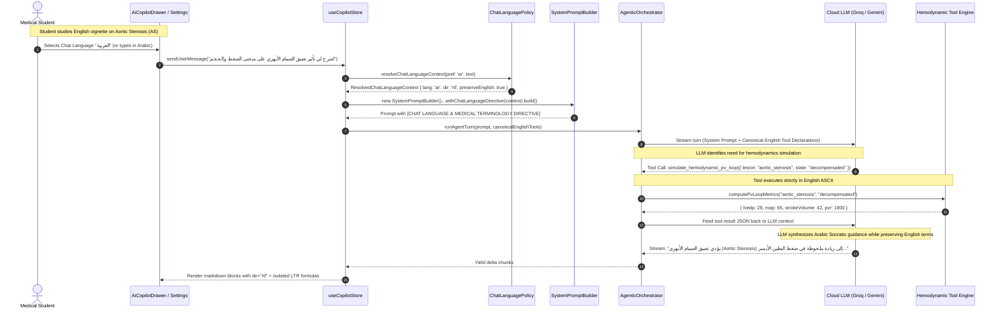

---

### 7. BiDi Presentation & Arabic Typography Rules

Rendering Arabic alongside complex medical formulas requires strict CSS and Unicode handling:

1. **Glyph Ligature Joining Protection:**
   Tailwind's default negative letter spacing (`tracking-tight`) breaks Arabic cursive ligatures. The platform enforces:
   ```css
   :root[dir="rtl"] {
     letter-spacing: 0 !important;
     line-height: 1.65;
     font-family: var(--font-arabic), -apple-system, BlinkMacSystemFont, "Segoe UI", Roboto, sans-serif;
   }
   ```
2. **Formula & Code Isolation:**
   Hemodynamic equations (e.g. $\text{MAP} = \text{DBP} + \frac{1}{3}(\text{SBP} - \text{DBP})$) and code fragments must never inherit RTL sentence direction. The markdown engine wraps them in `.ltr-isolate` with `unicode-bidi: isolate; dir="ltr";`.
3. **CSS Logical Properties:**
   All components use bidirectional logical properties (`ps-*`, `pe-*`, `ms-*`, `me-*`, `border-s-*`) instead of physical coordinates (`pl-*`, `pr-*`, `border-l-*`).

---

## Deep Dive: Distributed Global Question Bank, Delta Sync & Editorial Governance (SPEC-005)

### 1. The Core Challenge: Scaling Isolated IndexedDB to Global Cohorts

Historically, the Question Authoring Studio operated purely inside client-side IndexedDB. When an author generated or pasted a JSON batch of clinical questions, it was written solely to their local browser database (`db.questions`). 

While this delivered an instantaneous $0\text{ms}$ write and enabled 100% offline study, it created an **isolated walled garden**:
- No mechanism existed to share high-yield authored items with peer scholars across universities.
- Allowing unrestricted writes directly into a shared global database would corrupt curriculum integrity through hallucinated distractors, incorrect dosages, and duplicate items.
- Naive cloud database syncs risk overwriting or deleting an author's private questions, bookmarks, or historical test attempts.

To solve this, Med Quests implements the **Apple CloudKit Public vs. Private Database Architecture**, separating local student sandboxing from authoritative cloud distribution.

---

### 2. The Four Decoupled Data Streams

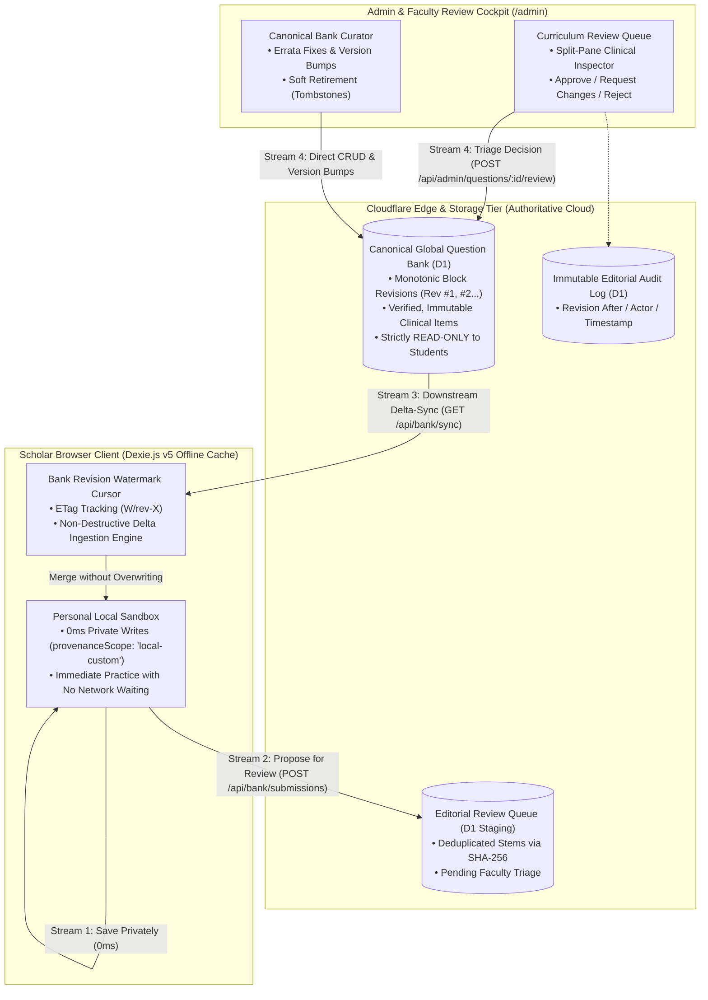

1. **Stream 1 — Private Local Sandbox (`0 ms`, Student-Owned)**:
   Authors paste JSON in [`QuestionStudio.tsx`](src/ui/features/studio/QuestionStudio.tsx) and click **"Save to My Device (Private)"**. Questions are validated via Zod and written immediately to Dexie (`provenanceScope: 'local-custom'`). Students can practice on them instantly—offline or online—with zero network blocking.
2. **Stream 2 — Guarded Editorial Review Pipeline (Staging $\rightarrow$ Faculty Moderation)**:
   Authors click **"Add Locally & Submit for Global Review"**. Questions are committed locally for immediate study **and** submitted to the Global Staging Queue (`editorialStatus: 'pending_review'`). Items undergo deterministic quality gating (Zod schema, verbatim evidence grounding check, and SHA-256 stem deduplication) before entering faculty triage.
3. **Stream 3 — Unidirectional Downstream Delta-Sync (`GET /api/bank/sync`)**:
   Learners synchronize with the canonical bank on app boot or via the **"Sync Global Bank"** button. The client sends `If-None-Match: "W/rev-X"`. If no new questions were published, the edge returns `304 Not Modified` ($0\text{ bytes}$). Incoming canonical items merge non-destructively into IndexedDB **without ever overwriting `local-custom` items**.
4. **Stream 4 — Direct Canonical Bank Curation (Admin & Faculty CRUD)**:
   Faculty Reviewers and Admins access a dedicated cockpit to review submissions, inline-edit errata, create canonical questions directly (bumping `bankVersion` and the block's `BankRevisionNumber`), and soft-retire (`archived`) obsolete questions without breaking historical student [`Attempt`](src/domain/model/types.ts) foreign keys.

---

### 2.1 Deterministic Clinical Quality Gate Pipeline

Before any item enters the local database or reaches the faculty review queue, it must traverse the multi-stage quality pipeline:

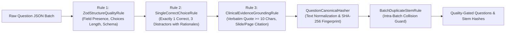

---

### 3. SOLID Principles & Software Engineering Patterns

| Principle / Pattern | Concrete Engineering Implementation |
| :--- | :--- |
| **S — Single Responsibility (SRP)** | Dedicated domain classes: [`QuestionCanonicalHasher`](src/domain/questionBank/canonicalHasher.ts) handles stem normalization and SHA-256 fingerprinting; [`QuestionQualityGatePipeline`](src/domain/questionBank/qualityGatePipeline.ts) validates clinical grounding; [`QuestionEditorialStateMachine`](src/domain/questionBank/editorialStateMachine.ts) encapsulates lifecycle transitions; [`NonDestructiveBankMergeStrategy`](src/domain/questionBank/nonDestructiveMergeStrategy.ts) executes conflict-free downstream merges. |
| **O — Open/Closed (OCP)** | Ingestion validation rules implement [`IQuestionQualityRule`](specs/005-global-question-bank-governance/contracts/question-bank-governance-ports.ts) (`ZodStructureQualityRule`, `SingleCorrectChoiceRule`, `ClinicalEvidenceGroundingRule`). Adding new USMLE board validation rules requires zero modifications to the ingestion pipeline. Similarly, search queries compose via [`ISpecification<T>`](src/domain/questionBank/questionSpecifications.ts). |
| **L — Liskov Substitution (LSP)** | [`EdgeQuestionBankGateway`](src/infrastructure/questionBank/edgeQuestionBankGateway.ts) seamlessly switches between remote Cloudflare Worker endpoints and an offline local simulator while honoring identical pre/post-conditions and `Result<T, QuestionBankDomainError>` invariants. |
| **I — Interface Segregation (ISP)** | Capabilities are split into four narrow, role-aligned contracts in [`question-bank-governance-ports.ts`](specs/005-global-question-bank-governance/contracts/question-bank-governance-ports.ts): `IDownstreamBankSyncPort` (student read-only sync), `IStudioProposalSubmissionPort` (author proposals), `IFacultyReviewQueuePort` (triage), and `ICanonicalBankCuratorPort` (canonical CRUD). |
| **D — Dependency Inversion (DIP)** | Application stores ([`useQuestionStore`](src/application/stores/useQuestionStore.ts), [`useBankGovernanceStore`](src/application/stores/useBankGovernanceStore.ts)) and UI views depend strictly on abstract domain ports and immutable Value Objects—never directly on `fetch()`, SQL queries, or storage primitives. |
| **Nominal Branded Types** | `BankRevisionNumber`, `StemSha256Hash`, `SubmissionTicketId`, and `EditorialAuditEventId` eliminate primitive obsession at compile-time. |

---

### 3.1 Question Editorial Lifecycle State Machine (State Pattern)

The lifecycle of every question is strictly governed by [`QuestionEditorialStateMachine`](src/domain/questionBank/editorialStateMachine.ts):

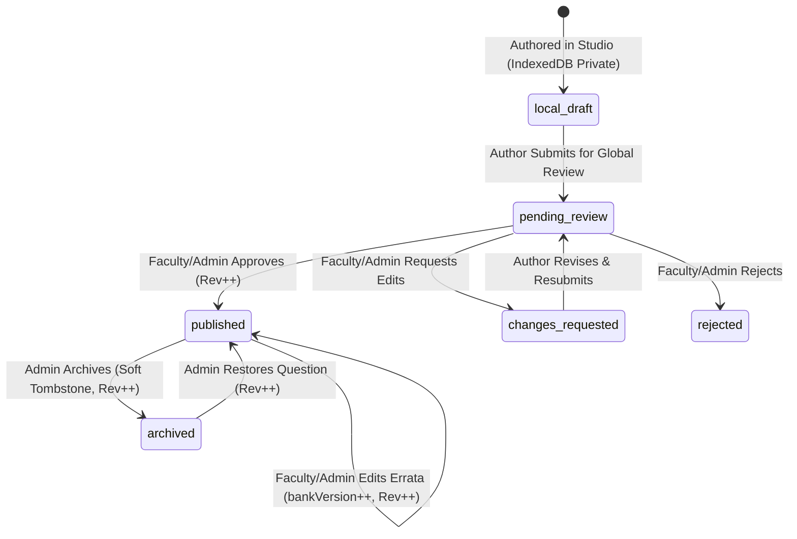

---

### 4. System Topology & Edge Cloud Infrastructure

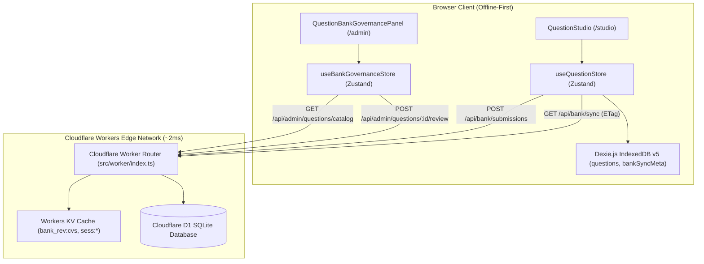

---

### 5. Class Hierarchy & Domain Contracts

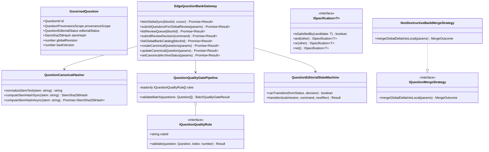

---

### 6. Non-Destructive Downstream Delta-Sync Protocol

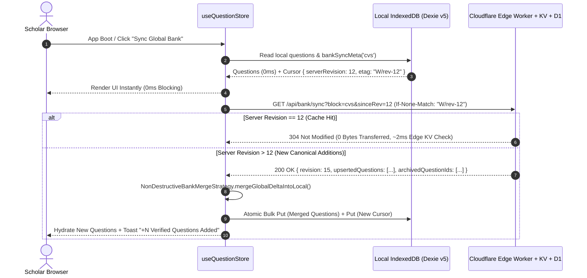

### 6.1 Conflict-Free Downstream Merge Decision Tree

When incoming canonical items are received from the edge, [`NonDestructiveBankMergeStrategy`](src/domain/questionBank/nonDestructiveMergeStrategy.ts) processes each item through a zero-data-loss decision tree:

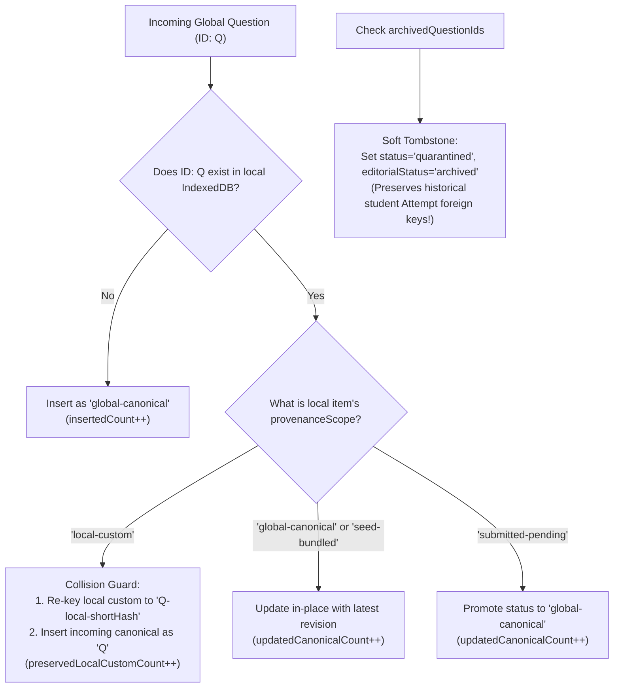

| Local IndexedDB State | Incoming Global Delta State | Deterministic Merge Resolution |
| :--- | :--- | :--- |
| **Not present locally** | `published` (`global-canonical`) | **Insert** into local IndexedDB (`insertedCount++`). |
| `seed-bundled` or `global-canonical` | `published` with `globalRevision > local.globalRevision` | **Update** local record with latest canonical correction (`updatedCanonicalCount++`). |
| `submitted-pending` | `published` (`global-canonical`) | **Promote** local record to `global-canonical` now that faculty approved it. |
| `local-custom` (Private student item) | Same `id` exists in global delta | **Namespace & Preserve Both**: Re-keys local custom item to `${id}-local-${shortHash}` (`preservedLocalCustomCount++`) and inserts canonical item under `${id}`. **Zero student data loss.** |
| `global-canonical` | Listed in `archivedQuestionIds` | **Soft-Tombstone**: Marks local copy `status = 'quarantined'` / `editorialStatus = 'archived'`. Excluded from new tests; preserves historical student [`Attempt`](src/domain/model/types.ts) lookups. |
| `local-custom` (Private student item) | Not in global bank | **100% Untouched** (`preservedLocalCustomCount++`). |

---

### 7. Author Ingest vs. Faculty Review Workflow Sequence

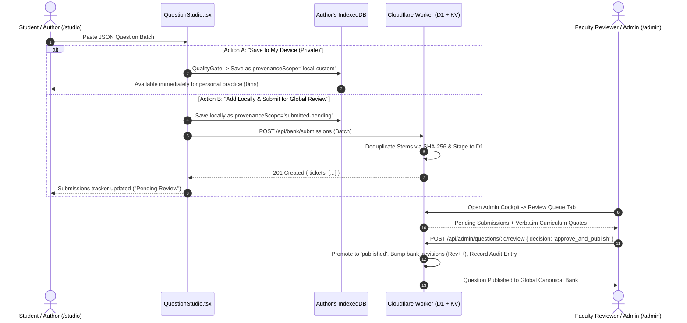

---

### 8. Role-Based Access Control (RBAC) & Governance Cockpit

| Capability / Operation | `anonymous` | `student-free` / `student-pro` | `faculty-reviewer` | `admin` |
| :--- | :---: | :---: | :---: | :---: |
| **Practice & Author Locally in Studio (`/studio`)** | ✅ | ✅ | ✅ | ✅ |
| **Downstream Delta Sync (`GET /api/bank/sync`)** | ✅ | ✅ | ✅ | ✅ |
| **Submit Questions for Global Review (`/studio`)** | ✅ | ✅ | ✅ | ✅ |
| **View Own Submissions Tracker & Reviewer Notes** | ✅ | ✅ | ✅ | ✅ |
| **Curriculum Review Queue Access (`/admin`)** | ❌ | ❌ | ✅ | ✅ |
| **Approve, Request Changes, Reject Submissions** | ❌ | ❌ | ✅ | ✅ |
| **Direct Canonical Question Creation & Errata Updates** | ❌ | ❌ | ✅ | ✅ |
| **Soft-Retire (Archive) / Restore Canonical Questions** | ❌ | ❌ | ❌ | ✅ |
| **Platform User Management, AI Quotas & Security Bans** | ❌ | ❌ | ❌ | ✅ |

#### Governance Cockpit Split-Screen Architecture

The [`QuestionBankGovernancePanel.tsx`](src/ui/features/admin/QuestionBankGovernancePanel.tsx) is organized into a high-density, split-screen triage workstation:

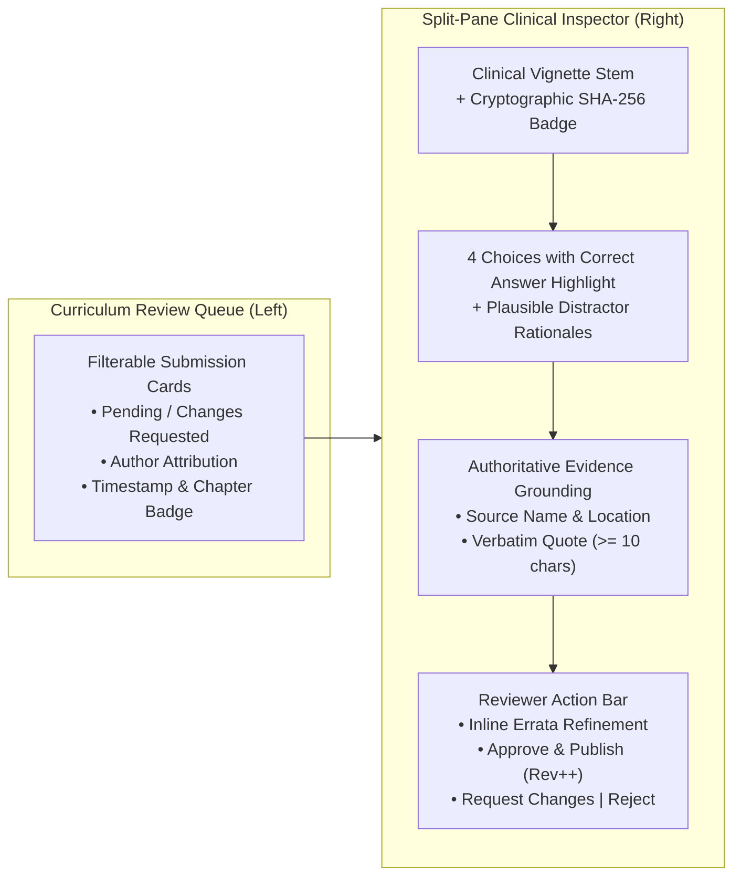

---

## Deep Dive: Multi-Model AI Agentic Copilot, Real-Time Thinking & Two-Tier Telemetry

The platform features an extensible **Agentic Orchestrator** capable of executing structured clinical reasoning across multiple inference providers, real-time reasoning interception, and a dual-tier telemetry pipeline.

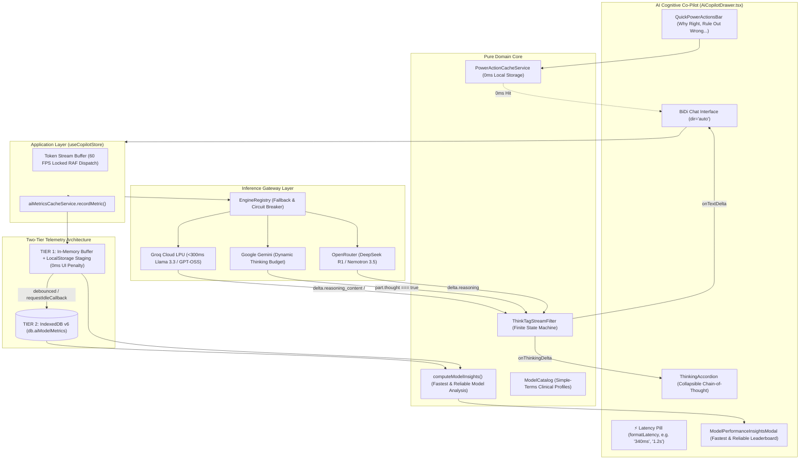

---

### 1. Multi-Model Inference & Simple-Terms Model Catalog

Medical students require distinct inference profiles depending on their study phase: rapid-fire question drills demand sub-300ms responses, whereas complex multi-system pathophysiology requires deep frontier reasoning.

The platform unifies three primary inference providers via [`EngineRegistry`](src/infrastructure/ai/engineRegistry.ts):
- **Groq Cloud (LPU Hardware)**: Extreme inference speed ($<300\text{ms}$) via `llama-3.3-70b-versatile`, `openai/gpt-oss-20b`, and `openai/gpt-oss-120b`. Includes dynamic model discovery querying `GET https://api.groq.com/openai/v1/models` against the student's key.
- **Google Gemini (DeepMind)**: Multimodal reasoning with native dynamic thinking budget (`gemini-3.5-flash-lite`, `gemini-2.5-flash`, `gemini-2.5-pro`).
- **OpenRouter Cloud**: Broad frontier model access (`nvidia/nemotron-3.5-lightning:free`, `meta-llama/llama-3.1-8b-instruct:free`, `recursive/flint-v1.0:free`, and DeepSeek R1).

#### Simple-Terms Model Catalog ([`modelCatalog.ts`](src/domain/ai/modelCatalog.ts))
Raw engineering identifiers (`openai/gpt-oss-120b`, `nvidia/nemotron-3.5-lightning:free`) are translated into clear, human-friendly cards in the settings modal:

| Simple Display Name | Raw Model ID | Provider | Latency Target | Recommended Clinical Use Case |
| :--- | :--- | :--- | :--- | :--- |
| **Instant Socratic Mentor** | `openai/gpt-oss-20b` | Groq | `~50ms` | Real-time rapid-fire vignette drills and instant distractor elimination. |
| **Deep Clinical Reasoning** | `openai/gpt-oss-120b` | Groq | `~250ms` | Complex multi-system USMLE vignettes, diagnostic dilemmas, acid-base. |
| **Specialist Reasoning** | `qwen/qwen3.8-27b` | Groq | `~120ms` | Detailed pharmacology mechanisms, receptor pathways, pathophysiology. |
| **Gemini 3.5 Flash Lite** | `gemini-3.5-flash-lite` | Gemini | `~300ms` | High-speed multimodal Socratic tutoring with dynamic chain-of-thought. |
| **Gemini 2.5 Flash** | `gemini-2.5-flash` | Gemini | `~600ms` | Balanced clinical depth, physiological loop simulation, balanced speed. |
| **Gemini 2.5 Pro** | `gemini-2.5-pro` | Gemini | `~1.8s` | Frontier clinical reasoning for complex, multi-layered board vignettes. |
| **Nemotron 3.5 (Free)** | `nvidia/nemotron-3.5-lightning:free` | OpenRouter | `~450ms` | High-throughput clinical analysis without token credit limitations. |
| **Flint 1.0 (Free)** | `recursive/flint-v1.0:free` | OpenRouter | `~500ms` | Step-by-step diagnostic deconstruction and differential diagnosis. |
| **Llama 3.1 8B (Free)** | `meta-llama/llama-3.1-8b-instruct:free` | OpenRouter | `~400ms` | Reliable open-weights clinical tutoring for general question review. |

---

### 2. Fallback Routing & Rate-Limit Resilience

High-volume study sessions frequently trigger API rate limits (`429 Too Many Requests`) on free or shared tiers. Med Quests eliminates study interruption through active fallback routing:
1. **Circuit-Breaker Failover**: If the active engine returns a 429 rate limit or network abort, [`AgenticOrchestrator`](src/infrastructure/ai/agenticOrchestrator.ts) automatically falls back to an alternate configured provider (e.g., Groq $\rightarrow$ Gemini $\rightarrow$ OpenRouter).
2. **Visual Engine Provenance**: The chat drawer header and message footers clearly display fallback provenance (e.g., `OPENROUTER (Backup) • Nemotron 3.5`), ensuring full transparency.
3. **Metric Quarantine**: Aborted and 429 requests are tagged with `status: 'rate-limited'` and isolated from benchmark speed calculations, ensuring hardware metrics remain uncorrupted by API errors.

---

### 3. Real-Time Chain-of-Thought Stream Filter (`ThinkTagStreamFilter`)

Modern frontier reasoning models (DeepSeek-R1, QwQ, Groq reasoning models) emit cognitive chain-of-thought tokens through distinct, incompatible protocols:
- `delta.reasoning_content` (Groq / OpenAI-compatible)
- `delta.reasoning` (OpenRouter)
- `part.thought === true` (Gemini 2.5 Flash dynamic thinking)
- Embedded in-band XML tags `<think>...</think>` in `content` streams

#### The Streaming Chunk-Boundary Problem
When models emit raw `<think>` tags, token chunk boundaries split unpredictably:
```
Chunk 1: "Let me consider the patient's symptoms: <th"
Chunk 2: "ink>\n1. Elevated JVP\n2. Pulsus paradoxus\n</thi"
Chunk 3: "nk>\nThis constellation indicates cardiac tamponade."
```
Naive string replacement destroys streaming performance or leaks unparsed XML into the user's prose.

#### Finite State Machine Solution ([`thinkTagStreamFilter.ts`](src/infrastructure/ai/providers/openAiCompatibleProvider.ts))
[`ThinkTagStreamFilter`](src/infrastructure/ai/providers/openAiCompatibleProvider.ts) implements an in-flight finite state machine:

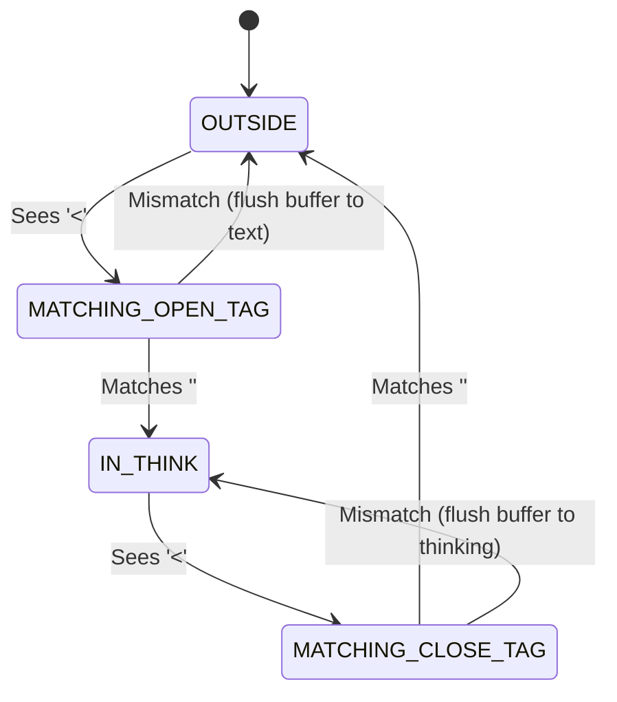

- **Zero-Copy Performance**: Operates in $O(1)$ amortized memory with no regex compilation per chunk.
- **Strict Separation**: Emits isolated `onThinkingDelta` events for reasoning and `onTextDelta` events for user-facing prose.

---

### 4. Collapsible Reasoning Accordion UI (`ThinkingAccordion.tsx`)

Reasoning tokens stream into a dedicated, fluid UI element ([`ThinkingAccordion.tsx`](src/ui/features/copilot/ThinkingAccordion.tsx)) directly above the assistant's clinical response:
- **Auto-Expansion During Reasoning**: While the model is actively thinking (`isStreaming && !hasText`), the accordion expands automatically with a shimmering border and animated pulse indicator (`"Clinical Reasoning in progress..."`).
- **Auto-Collapse on Answer Completion**: As soon as the final clinical explanation begins streaming, the accordion smoothly collapses into an Apple HIG glassmorphic pill (`"Clinical Reasoning (N words)"`), allowing the student to review the direct explanation without distraction while keeping full reasoning accessible in one click.

---

### 5. Two-Tier Generation Telemetry Architecture (Memory Staging → IndexedDB v6)

To provide accurate speed insights across models without degrading the 60 FPS animation frame rate, Med Quests utilizes a **two-tier telemetry pipeline**:

```
Generation Complete / Abort / 429
                 │
                 ▼
┌────────────────────────────────────────────────────────┐
│ TIER 1: Synchronous In-Memory Buffer + LocalStorage    │
│ • 0ms UI latency penalty (no write locks)              │
│ • LocalStorage mirror guards against page refresh      │
│ • Immediate availability in benchmark summary          │
└────────────────────────┬───────────────────────────────┘
                         │
                         ▼ Debounced / requestIdleCallback
┌────────────────────────────────────────────────────────┐
│ TIER 2: Asynchronous IndexedDB Persistence (Dexie v6)  │
│ • MedQuestsDB.aiModelMetrics table:                    │
│   id, providerId, modelId, latencyMs, status, ts...    │
│ • Persistent long-term hardware speed benchmarks       │
└────────────────────────────────────────────────────────┘
```

1. **Precision Capture**: Millisecond latency is measured using `performance.now() - startTime`.
2. **Instant Staging**: [`aiMetricsCacheService.recordMetric()`](src/infrastructure/ai/telemetry/aiMetricsCacheService.ts) appends to an in-memory array and syncs with `localStorage` in $<1\text{ms}$.
3. **Non-Blocking Persistence**: A debounced background job flushes staged records into `db.aiModelMetrics` via `requestIdleCallback` when the main thread is idle.
4. **Unified Telemetry Queries**: [`getAllMetrics()`](src/infrastructure/ai/telemetry/aiMetricsCacheService.ts) merges persisted IndexedDB records with unpersisted memory records (deduplicated by UUID) so metrics are always up to date.

---

### 6. Model Benchmark Insights Cockpit & Speed Leaderboard (`ModelPerformanceInsightsModal.tsx`)

Medical students can benchmark configured models using the integrated Telemetry Cockpit (accessible via the `Gauge` icon in the drawer or "Speed Benchmarks" in Settings):

- **🏆 Fastest Model Card**: Highlights the model with the lowest average completion latency on successful turns.
- **🛡️ Most Reliable Model Card**: Highlights the model with the highest success rate and fewest rate limits.
- **⏱️ Global Latency & Volume**: Tracks aggregate generation speed across all queries and total recorded turns.
- **Ranked Leaderboard Table**:
  - **Rank & Model**: Model display name, provider badge, and speed badges (`⚡ Fastest`, `🛡️ Most Reliable`).
  - **Avg Latency**: Visual color-coded pill (Green $<1\text{s}$, Amber $1\text{s}-2.5\text{s}$, Slate $>2.5\text{s}$).
  - **Speed Range**: Minimum and maximum recorded generation times.
  - **Throughput**: Estimated characters per second ($\text{chars}/\text{sec}$).
  - **Success Rate**: Percentage of completed vs. rate-limited/failed queries.
  - **Reset Telemetry**: Cleanly wipes local telemetry when testing new network conditions or API keys.

---

### 7. Quick Power Actions with Namespaced 0ms Caching

Four instant clinical Power Actions are pinned directly beneath the active vignette for single-click Socratic analysis:

| Power Action | Key | Socratic Objective | Clinical Prompt Archetype |
| :--- | :--- | :--- | :--- |
| **Why Right** | `why_correct` | Explain the underlying physiology proving the keyed choice correct. | "Deeply explain why [Correct Option] is pathophysiologically correct for this patient." |
| **Rule Out Wrong** | `rule_out_wrong` | Refute distractors and explain the exact clinical fallacy of each wrong choice. | "Refute every incorrect distractor and explain why each is contraindicated or incorrect." |
| **Pivot Clues** | `pivot_clues` | Extract pivotal diagnostic anchors and pathognomonic findings from the stem. | "Identify the pivotal anchor clues in this vignette that rule in the primary diagnosis." |
| **Cognitive Bridge** | `cognitive_bridge` | Synthesize a high-yield mnemonic and contrast table to anchor recall. | "Provide a high-yield memory anchor, mnemonic, and contrast rule for this concept." |

- **Instant 0ms Cache Hit**: Responses are stored in IndexedDB (`db.aiCache`) under namespaced keys:
  $$\text{CacheKey} = \text{questionId} : \text{actionKey} : \text{chatLanguage}$$
- Clicking any previously generated Power Action displays the response in $0\text{ms}$ with an `Instant Cache` badge, completely bypassing LLM network calls.

---

### 8. Rich Clinical Markdown, Tables & KaTeX Equations

AI explanations are rendered using GitHub Flavored Markdown (GFM) via [`CopilotMarkdownView.tsx`](src/ui/features/copilot/CopilotMarkdownView.tsx):
- **Clinical Tables**: Structured comparison grids for anatomical remnants, pharmacology contraindications, and staging criteria.
- **KaTeX Hemodynamic Math**: Inline ($...$) and display ($$...$$) math for formulas:
  $$\text{MAP} = \text{DBP} + \frac{1}{3}(\text{SBP} - \text{DBP}) \qquad \text{EF} = \frac{\text{SV}}{\text{EDV}} \times 100$$
- **One-Click Message Copying**: Assistant and student messages feature a one-click copy button with instant visual confirmation (`Copied`).
- **Timestamp & Model Provenance**: Every message displays its generation timestamp and model attribution pill.

---

### 9. Pedagogical Anti-Refusal Policy & Direct Socratic Guidance

To ensure uninterrupted learning during exam preparation, the AI system prompt enforces strict clinical pedagogy policies:
- **Zero Refusal on Active Vignettes**: The model is forbidden from refusing to discuss the active question or withholding the correct answer when explicitly asked.
- **Transparent Direct Guidance**: While the tutor prioritizes Socratic probing, explicit queries (e.g. *"What is the correct answer and why?"*) immediately confirm the keyed choice with complete pathophysiological rationales.
- **Focused Clinical Prose**: Unnecessary notifications (e.g. excessive spaced-repetition card synthesis banners) are suppressed to maintain focus on clinical concepts.

---

## Local-First Persistence & Storage Topology

Data is stored client-side in the browser via **IndexedDB (Dexie.js v6)** for privacy, instant launch, and full offline capability:

```
IndexedDB: MedQuestsDB (v6)
├── questions                 # Canonical USMLE vignettes, psychometrics, provenanceScope
├── attempts                  # Exam attempts, single-strike answers, mode, confidence
├── reviewCards               # Spaced repetition intervals, due dates, lapses
├── bookmarks                 # Bookmarked question IDs
├── notes                     # Student clinical notes per vignette
├── aiSettings                # Engine preferences, model IDs, API keys, chatLanguage
├── aiThreads                 # Multi-turn conversation histories
├── srsCards                  # High-yield topic flashcards
├── aiCache                   # Namespaced Socratic power actions (${qid}:${action}:${lang})
├── bankSyncMeta              # Cloud delta sync revision counters and ETags
├── studioSubmissions         # Global question bank review tickets and reviewer notes
└── aiModelMetrics            # Two-tier telemetry records (latency, status, throughput)
```

---

## Repository Structure

```
Med Quests Apps/
├── .specify/                               # Spec-Kit memory & configuration
├── .agents/                                # Autonomous engineering agents
├── BRD.md                                  # Business & Engineering Requirements (1,300+ lines)
├── specs/                                  # Formal Architecture Specs & Plans
│   └── 004-bilingual-i18n-ai-localization/ # Bilingual Spec, Plan & Contracts
├── src/
│   ├── domain/                             # PURE DOMAIN LAYER (Zero external dependencies)
│   │   ├── i18n/                           # ScriptDetector, Dictionaries (en, ar), Types
│   │   ├── ai/                             # ChatLanguagePolicy, SystemPromptBuilder, Tools
│   │   ├── questionBank/                   # Catalog models & psychometrics
│   │   └── auth/                           # Role schemas & RBAC contracts
│   ├── application/                        # APPLICATION STATE LAYER
│   │   └── stores/                         # useLocaleStore, useAiSettingsStore, useCopilotStore
│   ├── infrastructure/                     # ADAPTERS & INFRASTRUCTURE
│   │   ├── ai/                             # AgenticOrchestrator, EngineRegistry (Groq, Gemini)
│   │   ├── storage/                        # Dexie.js IndexedDB schema & migrations
│   │   └── questionBank/                   # JSON bank loader & integrity gate
│   └── ui/                                 # PRESENTATION LAYER (Apple HIG)
│       ├── app/                            # Shell, Navigation, LocaleToggle
│       └── features/                       # Copilot, Session Player, Studio, Reports
```

---

## Quality Engineering & Verification Matrix

Quality is enforced via automated continuous testing with zero warnings or loose types:

```bash
# Execute full Vitest suite (100% green)
pnpm test

# Run strict TypeScript compiler checks and Vite production bundle
pnpm build
```

| Verification Check | Standard | Result |
| :--- | :--- | :--- |
| **Unit & Integration Suite** | Vitest 3.2.7 | **21 / 21 passed (129 tests green)** |
| **Type Integrity** | TypeScript 5.7 (`tsc -b`) | **0 errors (Strict Null Checks)** |
| **Production Build** | Vite 6.4.5 + Rollup | **2.11s build time, clean chunks** |
| **Internationalization** | Compile-Time LSP Checks | **100% Key Parity (`en` $\leftrightarrow$ `ar`)** |

---

## Getting Started

### Prerequisites
- **Node.js**: `v20.x` or higher
- **pnpm**: `v9.x` or higher

### Installation & Development
```bash
# Clone the repository
git clone https://github.com/your-org/med-quests-apps.git
cd med-quests-apps

# Install dependencies
pnpm install

# Start local development server
pnpm dev

# Run test suite
pnpm test
```

---

## Normative Specification & Documentation

- [BRD.md](BRD.md) — Normative Business & Engineering Requirements Document
- [Global Question Bank & Editorial Governance Spec (SPEC-005)](specs/005-global-question-bank-governance/spec.md)
- [Global Question Bank Port Contracts](specs/005-global-question-bank-governance/contracts/question-bank-governance-ports.ts)
- [Bilingual Architecture Specification (SPEC-004)](specs/004-bilingual-i18n-ai-localization/spec.md)
- [Bilingual Engineering Plan](specs/004-bilingual-i18n-ai-localization/plan.md)
- [i18n and AI Port Contracts](specs/004-bilingual-i18n-ai-localization/contracts/i18n-ai-language-ports.ts)
