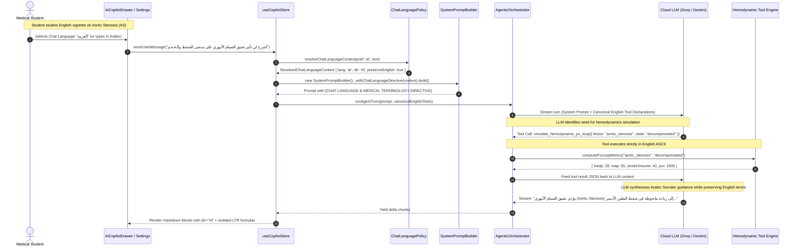

# Med Quests Platform

[](https://react.dev/)
[](https://www.typescriptlang.org/)
[](https://tailwindcss.com/)
[](https://vitest.dev/)
[](#system-architecture)
[](#)

A high-performance, local-first medical exam preparation platform engineered for medical students tackling high-stakes university block exams and USMLE Step 1/Step 2 board certifications. 

Engineered with **Apple Human Interface Guidelines (HIG)** aesthetic fidelity, strict **SOLID Principles**, **Clean / Hexagonal Architecture**, and an intelligent **Bilingual (English & Arabic) AI Agentic Copilot** with runtime tool isolation and BiDi script detection.

---

## Table of Contents

1. [Product Vision & Medical Exam Fidelity](#product-vision--medical-exam-fidelity)
2. [System Architecture & Hexagonal Boundaries](#system-architecture--hexagonal-boundaries)
3. [Deep Dive: Bilingual Architecture & Chat-Scoped AI Localization](#deep-dive-bilingual-architecture--chat-scoped-ai-localization)
   - [The Core Challenge: "In The Chat Only" Isolation](#1-the-core-challenge-in-the-chat-only-isolation)
   - [SOLID Principles Engineering Realization](#2-solid-principles-engineering-realization)
   - [Gang of Four (GoF) Design Patterns](#3-gang-of-four-gof-design-patterns)
   - [Architectural Topology & Dataflow (Diagram)](#4-architectural-topology--dataflow)
   - [Class Hierarchy & Port Contracts (Diagram)](#5-class-hierarchy--port-contracts)
   - [Chat-Scoped Agentic Turn Sequence (Diagram)](#6-chat-scoped-agentic-turn-sequence)
   - [BiDi Presentation & Arabic Typography Rules](#7-bidi-presentation--arabic-typography-rules)
4. [Multi-Model Agentic Copilot & Clinical Tools](#multi-model-agentic-copilot--clinical-tools)
5. [Local-First Persistence & Storage Topology](#local-first-persistence--storage-topology)
6. [Repository Structure](#repository-structure)
7. [Quality Engineering & Verification Matrix](#quality-engineering--verification-matrix)
8. [Getting Started](#getting-started)

---

## Product Vision & Medical Exam Fidelity

Medical board exams (USMLE Step 1/Step 2, IFOM, university block systems) test diagnostic acumen, pathophysiological causal chains, and rapid clinical decision-making. 

```
TEST → ANSWER → IMMEDIATE RESULT → UNDERSTAND MISTAKE → IDENTIFY WEAKNESS → REVIEW CURRICULUM → RETEST
```

- **Zero-Friction Ergonomics:** Spatial keyboard navigation (`1–5` for single-strike answer submission, `←`/`→` for navigation, `↑`/`↓` for option scrolling), rendering immediate sub-50ms feedback.
- **Cognitive Remediation:** Rather than simple answer reveals, the system orchestrates Socratic dialogue, Hemodynamic Pressure-Volume (P-V) loop simulations, and memory anchor contrast cards.
- **USMLE Linguistic Fidelity:** Clinical entities (e.g., *Aortic Stenosis*, *Pulsus parvus et tardus*, *MAP*, *Option A*) preserve canonical English nomenclature even during Arabic Socratic debriefs to ensure board exam readiness.

---

## System Architecture & Hexagonal Boundaries

The application is structured under strict **Clean / Hexagonal Architecture (Ports and Adapters)** to decouple medical domain algorithms from UI chrome and LLM infrastructure.

```mermaid
graph TB
    subgraph Presentation_Layer ["Presentation Layer (React 19 + Tailwind v4 + Apple HIG)"]
        UI_Shell["Shell & Header (LocaleToggle, Theme)"]
        UI_Session["Session Player (Keyboard Engine, Vignettes)"]
        UI_Copilot["AI Copilot Drawer (BiDi Chat, Markdown)"]
        UI_Settings["CopilotSettingsModal (Segmented Cards)"]
        UI_Report["Post-Test Report & Psychometrics"]
    end

    subgraph Application_Layer ["Application Layer (Zustand State Mesh)"]
        Store_Locale["useLocaleStore (UI Platform Locale)"]
        Store_AiSettings["useAiSettingsStore (Chat Language & API Keys)"]
        Store_Copilot["useCopilotStore (Turn Dispatcher & Event Stream)"]
        Store_Session["useSessionStore (Question State & Telemetry)"]
    end

    subgraph Domain_Layer ["Pure Domain Layer (Zero External Dependencies)"]
        Domain_i18n["i18n Types & Translation Dictionaries (en, ar)"]
        Domain_Script["ScriptDetector (Unicode BiDi Engine)"]
        Domain_Policy["ChatLanguagePolicy (Strategy & Directive Builder)"]
        Domain_Prompt["SystemPromptBuilder (Fluent Prompt Builder)"]
        Domain_Power["PowerActions & Bilingual Clinical Prompts"]
        Domain_Cache["PowerActionCacheService (Namespaced Storage)"]
        Domain_Tools["Clinical Tool Definitions (Zod Schemas)"]
    end

    subgraph Infrastructure_Layer ["Infrastructure & Gateway Layer"]
        Infra_Orch["AgenticOrchestrator (Multi-Provider Stream)"]
        Infra_Engines["EngineRegistry (Groq, Gemini, OpenRouter)"]
        Infra_Storage["IndexedDB Gateway (Dexie.js: Sessions, Cache)"]
        Infra_Sim["Hemodynamic Simulation Engine (P-V Loops)"]
    end

    Presentation_Layer --> Application_Layer
    Application_Layer --> Domain_Layer
    Infrastructure_Layer --> Domain_Layer
    Application_Layer --> Infrastructure_Layer
```



---

## Deep Dive: Bilingual Architecture & Chat-Scoped AI Localization

### 1. The Core Challenge: "In The Chat Only" Isolation

In high-stakes clinical education, naive whole-app translation breaks clinical fidelity. Medical students frequently require **an English USMLE vignette accompanied by an Arabic Socratic tutor**, or vice versa. 

Furthermore, LLM function calling creates an acute engineering hazard:
- **Machine Contract vs Human Prose:** Function-calling tools (`simulate_hemodynamic_pv_loop`, `calculate_cardiovascular_equation`) require exact ASCII string keys and JSON schemas. Injecting language directives into the tool declarations causes LLMs to translate parameter names into Arabic (e.g., `{"lesion": "aortic_stenosis"}` becomes `{"الآفة": "تضيق_الأبهر"}`), silently failing JSON schema validation.
- **The Solution:** The AI Agent is made bilingual **strictly within the chat conversational orchestration pipeline**. The UI platform chrome and the AI conversation maintain independent, decoupled state lifecycles.

---

### 2. SOLID Principles Engineering Realization

| Principle | Architectural Implementation | Code Reference |
| :--- | :--- | :--- |
| **S — Single Responsibility (SRP)** | Segregated Unicode script analysis (`ScriptDetector`), language policy resolution (`ChatLanguagePolicy`), UI state (`useLocaleStore`), and namespaced caching (`PowerActionCacheService`). | [`scriptDetector.ts`](src/domain/i18n/scriptDetector.ts)<br>[`languagePolicy.ts`](src/domain/ai/languagePolicy.ts) |
| **O — Open/Closed (OCP)** | `SystemPromptBuilder` is extended via `.withChatLanguageDirective(ctx)` without altering core prompt logic. New languages are added by registering dictionaries satisfying `TranslationDictionary` without UI refactoring. | [`systemPromptBuilder.ts`](src/domain/ai/systemPromptBuilder.ts) |
| **L — Liskov Substitution (LSP)** | `enDictionary` and `arDictionary` implement the identical compile-time TypeScript interface `TranslationDictionary`. Any omitted translation key triggers a compilation error (`tsc -b`). | [`dictionaries/en.ts`](src/domain/i18n/dictionaries/en.ts)<br>[`dictionaries/ar.ts`](src/domain/i18n/dictionaries/ar.ts) |
| **I — Interface Segregation (ISP)** | UI chrome consumes `PlatformLocale` (`'en' \| 'ar'`) and `useDirection()`, while AI chat consumes `AiChatLanguagePreference` (`'auto' \| 'en' \| 'ar'`). Components only depend on the interfaces they require. | [`types.ts`](src/domain/i18n/types.ts) |
| **D — Dependency Inversion (DIP)** | High-level orchestrators (`AgenticOrchestrator`) depend upon pure domain contracts (`ResolvedChatLanguageContext`) rather than concrete UI state or browser globals (`navigator.language`). | [`agenticOrchestrator.ts`](src/infrastructure/ai/agenticOrchestrator.ts) |

---

### 3. Gang of Four (GoF) Design Patterns

1. **Strategy Pattern (`ChatLanguagePolicy`)**:
   - `AutoDetectLanguageStrategy`: Computes Arabic Unicode script ratio (`\u0600-\u06FF`). If script density $\ge 25\%$, dynamically resolves turn language to `'ar'`; otherwise defaults to `'en'`.
   - `ExplicitArabicStrategy` / `ExplicitEnglishStrategy`: Enforces deterministic output regardless of user message language.
2. **Builder Pattern (`SystemPromptBuilder`)**:
   - Stepwise fluent assembly of role personas, active telemetry, tool calling rules, and the isolated `CHAT LANGUAGE & BILINGUAL MEDICAL TERMINOLOGY DIRECTIVE`.
3. **Namespaced Flyweight Cache Pattern (`PowerActionCacheService`)**:
   - Partitions cached Socratic answers by question ID, action key, and resolved language:
     $$\text{CacheKey} = \text{questionId} : \text{actionKey} : \text{lang}$$
   - Precludes cross-lingual cache poisoning when toggling between English and Arabic.
4. **Adapter Pattern (`DomDirectionAdapter`)**:
   - Instantaneous synchronous synchronization of `<html dir="ltr|rtl" lang="en|ar">` and font variables to eliminate Flash of Unstyled Content (FOUC).

---

### 4. Architectural Topology & Dataflow


---

### 5. Class Hierarchy & Port Contracts


---

### 6. Chat-Scoped Agentic Turn Sequence

The following sequence details how an Arabic-speaking medical student interacts with the AI Copilot. Notice how **tool execution is completely quarantined in canonical English**, preventing LLM hallucinations, while the resulting Socratic response is synthesized in fluent Arabic with USMLE term retention.



---

### 7. BiDi Presentation & Arabic Typography Rules

Rendering Arabic alongside complex medical formulas requires strict CSS and Unicode handling:

1. **Glyph Ligature Joining Protection:**
   Tailwind's default negative letter spacing (`tracking-tight`) breaks Arabic cursive ligatures. The platform enforces:
   ```css
   :root[dir="rtl"] {
     letter-spacing: 0 !important;
     line-height: 1.65;
     font-family: var(--font-arabic), -apple-system, BlinkMacSystemFont, "Segoe UI", Roboto, sans-serif;
   }
   ```
2. **Formula & Code Isolation:**
   Hemodynamic equations (e.g. $\text{MAP} = \text{DBP} + \frac{1}{3}(\text{SBP} - \text{DBP})$) and code fragments must never inherit RTL sentence direction. The markdown engine wraps them in `.ltr-isolate` with `unicode-bidi: isolate; dir="ltr";`.
3. **CSS Logical Properties:**
   All components use bidirectional logical properties (`ps-*`, `pe-*`, `ms-*`, `me-*`, `border-s-*`) instead of physical coordinates (`pl-*`, `pr-*`, `border-l-*`).

---

## Multi-Model Agentic Copilot & Clinical Tools

The platform features an extensible **Agentic Orchestrator** capable of executing structured clinical reasoning across multiple inference providers:

```
┌─────────────────────────────────────────────────────────────┐
│                    Agentic Orchestrator                     │
└──────────────┬───────────────────────────────┬──────────────┘
               │                               │
       ┌───────┴────────┐              ┌───────┴────────┐
       │ Clinical Tools │              │ Model Gateway  │
       └───────┬────────┘              └───────┬────────┘
               │                               ├─ Groq (Llama 3.3 70B, sub-300ms)
               ├─ simulate_hemodynamic_pv_loop ├─ Google Gemini (Gemini 2.5 Flash)
               ├─ calculate_cardiovascular_eq  └─ OpenRouter (DeepSeek R1, Claude)
               └─ remediate_memory_anchor
```

- **Zero-Latency Power Actions:** Instant cached Socratic breakdowns (`Why Right`, `Rule Out Wrong`, `Pivot Clues`, `Cognitive Bridge`) served in $<10\text{ms}$ from namespaced IndexedDB cache.
- **Dynamic Model Switching:** Medical students can switch between low-latency local providers (Groq) and frontier reasoning models (Gemini / DeepSeek R1) in settings.

---

## Local-First Persistence & Storage Topology

Data is stored client-side in the browser via **IndexedDB (Dexie.js)** for privacy, instant launch, and full offline capability:

```
IndexedDB: medquests_cvs_v1
├── questionCatalog           # Canonical USMLE vignette stems & psychometrics
├── studentQuestionStates     # Bookmark flags, personal notes, mastery ratings
├── testSessions              # Completed exam runs, time-per-question, raw scores
├── studentTelemetryEvents    # Micro-interactions: option hover dwell time, answer revisions
├── aiPowerActionCache        # Namespaced Socratic responses (${qid}:${action}:${lang})
└── aiSettings                # Engine preferences, model selection, chatLanguage preference
```

---

## Repository Structure

```
Med Quests Apps/
├── .specify/                               # Spec-Kit memory & configuration
├── .agents/                                # Autonomous engineering agents
├── BRD.md                                  # Business & Engineering Requirements (1,300+ lines)
├── specs/                                  # Formal Architecture Specs & Plans
│   └── 004-bilingual-i18n-ai-localization/ # Bilingual Spec, Plan & Contracts
├── src/
│   ├── domain/                             # PURE DOMAIN LAYER (Zero external dependencies)
│   │   ├── i18n/                           # ScriptDetector, Dictionaries (en, ar), Types
│   │   ├── ai/                             # ChatLanguagePolicy, SystemPromptBuilder, Tools
│   │   ├── questionBank/                   # Catalog models & psychometrics
│   │   └── auth/                           # Role schemas & RBAC contracts
│   ├── application/                        # APPLICATION STATE LAYER
│   │   └── stores/                         # useLocaleStore, useAiSettingsStore, useCopilotStore
│   ├── infrastructure/                     # ADAPTERS & INFRASTRUCTURE
│   │   ├── ai/                             # AgenticOrchestrator, EngineRegistry (Groq, Gemini)
│   │   ├── storage/                        # Dexie.js IndexedDB schema & migrations
│   │   └── questionBank/                   # JSON bank loader & integrity gate
│   └── ui/                                 # PRESENTATION LAYER (Apple HIG)
│       ├── app/                            # Shell, Navigation, LocaleToggle
│       └── features/                       # Copilot, Session Player, Studio, Reports
```

---

## Quality Engineering & Verification Matrix

Quality is enforced via automated continuous testing with zero warnings or loose types:

```bash
# Execute full Vitest suite (100% green)
pnpm test

# Run strict TypeScript compiler checks and Vite production bundle
pnpm build
```

| Verification Check | Standard | Result |
| :--- | :--- | :--- |
| **Unit & Integration Suite** | Vitest 3.2.7 | **16 / 16 passed (108 tests green)** |
| **Type Integrity** | TypeScript 5.7 (`tsc -b`) | **0 errors (Strict Null Checks)** |
| **Production Build** | Vite 6.1.0 + Rollup | **2.11s build time, clean chunks** |
| **Internationalization** | Compile-Time LSP Checks | **100% Key Parity (`en` $\leftrightarrow$ `ar`)** |

---

## Getting Started

### Prerequisites
- **Node.js**: `v20.x` or higher
- **pnpm**: `v9.x` or higher

### Installation & Development
```bash
# Clone the repository
git clone https://github.com/your-org/med-quests-apps.git
cd med-quests-apps

# Install dependencies
pnpm install

# Start local development server
pnpm dev

# Run test suite
pnpm test
```

---

## Normative Specification & Documentation

- [BRD.md](BRD.md) — Normative Business & Engineering Requirements Document
- [Bilingual Architecture Specification](specs/004-bilingual-i18n-ai-localization/spec.md)
- [Bilingual Engineering Plan](specs/004-bilingual-i18n-ai-localization/plan.md)
- [i18n and AI Port Contracts](specs/004-bilingual-i18n-ai-localization/contracts/i18n-ai-language-ports.ts)
