# Med Quests Platform

[](https://react.dev/)
[](https://www.typescriptlang.org/)
[](https://tailwindcss.com/)
[](https://vitest.dev/)
[](#system-architecture)
[](#)

A high-performance, local-first medical exam preparation platform engineered for medical students tackling high-stakes university block exams and USMLE Step 1/Step 2 board certifications. 

Engineered with **Apple Human Interface Guidelines (HIG)** aesthetic fidelity, strict **SOLID Principles**, **Clean / Hexagonal Architecture**, and an intelligent **Bilingual (English & Arabic) AI Agentic Copilot** with runtime tool isolation and BiDi script detection.

---

## Table of Contents

1. [Product Vision & Medical Exam Fidelity](#product-vision--medical-exam-fidelity)
2. [System Architecture & Hexagonal Boundaries](#system-architecture--hexagonal-boundaries)
3. [Deep Dive: Bilingual Architecture & Chat-Scoped AI Localization](#deep-dive-bilingual-architecture--chat-scoped-ai-localization)
   - [The Core Challenge: "In The Chat Only" Isolation](#1-the-core-challenge-in-the-chat-only-isolation)
   - [SOLID Principles Engineering Realization](#2-solid-principles-engineering-realization)
   - [Gang of Four (GoF) Design Patterns](#3-gang-of-four-gof-design-patterns)
   - [Architectural Topology & Dataflow (Diagram)](#4-architectural-topology--dataflow)
   - [Class Hierarchy & Port Contracts (Diagram)](#5-class-hierarchy--port-contracts)
   - [Chat-Scoped Agentic Turn Sequence (Diagram)](#6-chat-scoped-agentic-turn-sequence)
   - [BiDi Presentation & Arabic Typography Rules](#7-bidi-presentation--arabic-typography-rules)
4. [Deep Dive: Distributed Global Question Bank, Delta Sync & Editorial Governance (SPEC-005)](#deep-dive-distributed-global-question-bank-delta-sync--editorial-governance-spec-005)
   - [The Core Challenge: Scaling Isolated IndexedDB to Global Cohorts](#1-the-core-challenge-scaling-isolated-indexeddb-to-global-cohorts)
   - [The Four Decoupled Data Streams (Diagram)](#2-the-four-decoupled-data-streams)
   - [Deterministic Clinical Quality Gate Pipeline (Diagram)](#21-deterministic-clinical-quality-gate-pipeline)
   - [SOLID Principles & Software Engineering Patterns](#3-solid-principles--software-engineering-patterns)
   - [Question Editorial Lifecycle State Machine (Diagram)](#31-question-editorial-lifecycle-state-machine-state-pattern)
   - [System Topology & Edge Cloud Infrastructure (Diagram)](#4-system-topology--edge-cloud-infrastructure)
   - [Class Hierarchy & Domain Contracts (Diagram)](#5-class-hierarchy--domain-contracts)
   - [Non-Destructive Downstream Delta-Sync Protocol (Diagram)](#6-non-destructive-downstream-delta-sync-protocol)
   - [Conflict-Free Downstream Merge & Semantic Deduplication Decision Tree (Diagram)](#61-conflict-free-downstream-merge--semantic-deduplication-decision-tree)
   - [When Exactly Do Other Users Sync? Lifecycle Triggers & 5-Minute Stale Cache Resolution (Diagram)](#62-when-exactly-do-other-users-sync-lifecycle-triggers--5-minute-stale-cache-resolution)
   - [Author Ingest vs. Faculty Review Workflow Sequence (Diagram)](#7-author-ingest-vs-faculty-review-workflow-sequence)
   - [Role-Based Access Control (RBAC) & Governance Cockpit (Diagram)](#8-role-based-access-control-rbac--governance-cockpit)
5. [Deep Dive: Multi-Model AI Agentic Copilot, Real-Time Thinking & Two-Tier Telemetry](#deep-dive-multi-model-ai-agentic-copilot-real-time-thinking--two-tier-telemetry)
   - [Multi-Model Inference & Simple-Terms Model Catalog](#1-multi-model-inference--simple-terms-model-catalog)
   - [Fallback Routing & Rate-Limit Resilience](#2-fallback-routing--rate-limit-resilience)
   - [Real-Time Chain-of-Thought Stream Filter (ThinkTagStreamFilter)](#3-real-time-chain-of-thought-stream-filter-thinktagstreamfilter)
   - [Collapsible Reasoning Accordion UI](#4-collapsible-reasoning-accordion-ui)
   - [Two-Tier Generation Telemetry Architecture (Memory Staging → IndexedDB v6)](#5-two-tier-generation-telemetry-architecture-memory-staging--indexeddb-v6)
   - [Model Benchmark Insights Cockpit & Speed Leaderboard](#6-model-benchmark-insights-cockpit--speed-leaderboard)
   - [Quick Power Actions with Namespaced 0ms Caching](#7-quick-power-actions-with-namespaced-0ms-caching)
   - [Rich Clinical Markdown, Tables & KaTeX Equations](#8-rich-clinical-markdown-tables--katex-equations)
   - [Pedagogical Anti-Refusal Policy & Direct Socratic Guidance](#9-pedagogical-anti-refusal-policy--direct-socratic-guidance)
6. [Deep Dive: Continuous Question Bank Mastery, Anti-Repetition Engine & Liquid Progress](#deep-dive-continuous-question-bank-mastery-anti-repetition-engine--liquid-progress)
   - [The Core Challenge: Eradicating Duplicate Fatigue in Longitudinal Study](#1-the-core-challenge-eradicating-duplicate-fatigue-in-longitudinal-study)
   - [Progressive Solving Lifecycle Dataflow (Diagram)](#2-progressive-solving-lifecycle-dataflow)
   - [SOLID Realization & Mathematical Scope Calculation](#3-solid-realization--mathematical-scope-calculation)
   - [Liquid Glassmorphic Mastery UI & Tri-Color Progress Bar](#4-liquid-glassmorphic-mastery-ui--tri-color-progress-bar)
   - [Deterministic Pool Slicing & Execution Safety in SessionPlayer](#5-deterministic-pool-slicing--execution-safety-in-sessionplayer)
7. [Deep Dive: Edge Identity Lockdown & Primary Communication Channel (Cloudflare D1 + Google OAuth)](#deep-dive-edge-identity-lockdown--primary-communication-channel-cloudflare-d1--google-oauth)
   - [Production Security Gating & High-Conversion Funnel](#1-production-security-gating--high-conversion-funnel)
   - [Edge Identity & Phone Number Ingestion Topology (Diagram)](#2-edge-identity--phone-number-ingestion-topology)
   - [Cloudflare D1 Schema & Edge API Implementation](#3-cloudflare-d1-schema--edge-api-implementation)
   - [Authoritative Super Admin Boundary](#4-authoritative-super-admin-boundary)
8. [Deep Dive: Psychometric Choice Entropy, Stratified Canonical Rebalancing & Spatial-Decoupled Presentation Engine (SPEC-006)](#deep-dive-psychometric-choice-entropy-stratified-canonical-rebalancing--spatial-decoupled-presentation-engine-spec-006)
   - [The Core Defect: Uncovering the 76% A+B Positional Bias](#1-the-core-defect-uncovering-the-76-ab-positional-bias)
   - [The Three Root Causes Forensics](#2-the-three-root-causes-forensics)
   - [SOLID Principles & Clean Architecture Realization](#3-solid-principles--clean-architecture-realization)
   - [Stratified Canonical Rebalancing Strategy (Diagram)](#4-stratified-canonical-rebalancing-strategy)
   - [Session-Seeded Spatial Presentation & Keyboard Decoupling (Diagram)](#5-session-seeded-spatial-presentation--keyboard-decoupling)
   - [Continuous Quality Gate & Studio Auto-Balancer Pipeline (Diagram)](#6-continuous-quality-gate--studio-auto-balancer-pipeline)
   - [Edge D1 Seed & IndexedDB Non-Destructive Upgrade Flow (Diagram)](#7-edge-d1-seed--indexeddb-non-destructive-upgrade-flow)
   - [Mathematical & Psychometric Proof of Uniformity](#8-mathematical--psychometric-proof-of-uniformity)
9. [Deep Dive: Multi-Stage Question Duplication Detection Engine & Semantic Sieve (SPEC-009)](#deep-dive-multi-stage-question-duplication-detection-engine--semantic-sieve-spec-009)
   - [Why It Matters](#91-why-it-matters)
   - [The Seven-Stage Sieve Architecture (Diagram)](#92-the-seven-stage-sieve-architecture)
   - [Request Flow & Fallback Routing (Diagram)](#93-request-flow--fallback-routing)
   - [Global Bank Health Audit & Resumable Graph Clustering (Diagram)](#94-global-bank-health-audit--resumable-graph-clustering)
   - [Key Engineering Decisions](#95-key-engineering-decisions)
   - [Reliability, Quality Gates & Failure Modes](#96-reliability-quality-gates--failure-modes)
   - [UX, Accessibility & Apple HIG Telemetry](#97-ux-accessibility--apple-hig-telemetry)
   - [Security, Privacy & Zero-Leakage Guarantee](#98-security-privacy--zero-leakage-guarantee)
   - [Known Limitations & Future Roadmap](#99-known-limitations--future-roadmap)
10. [Deep Dive: Multi-Block Curriculum Architecture, Code-Split Dynamic Packs & Zero-Orphan Ingestion Engine (SPEC-010)](#deep-dive-multi-block-curriculum-architecture-code-split-dynamic-packs--zero-orphan-ingestion-engine-spec-010)
   - [Why It Matters](#101-why-it-matters)
   - [Architectural Topology & Dynamic Pack Loading (Diagram)](#102-architectural-topology--dynamic-pack-loading)
   - [Lossless Block Switch & Session Leave Guard (Diagram)](#103-lossless-block-switch--session-leave-guard)
   - [Direct JSON Ingestion & Fuzzy Taxonomy Healing Pipeline (Diagram)](#104-direct-json-ingestion--fuzzy-taxonomy-healing-pipeline)
   - [Key Engineering Decisions](#105-key-engineering-decisions)
   - [Reliability, Quality Gates & Failure Modes](#106-reliability-quality-gates--failure-modes)
   - [UX, Accessibility & Apple HIG Standards](#107-ux-accessibility--apple-hig-standards)
   - [Security & Privacy Boundary](#108-security--privacy-boundary)
   - [Known Limitations & Future Roadmap](#109-known-limitations--future-roadmap)
   - [Case Study: Global Switcher Bus, Zero-Leak Storage Isolation & Anti-Oscillation Engine (Diagrams)](#1010-case-study-global-switcher-bus-zero-leak-storage-isolation--anti-oscillation-engine)
   - [Case Study: Accuracy Audit Lab Multi-Block Telemetry & Statistical Sampling Resilience (Diagram)](#1011-case-study-accuracy-audit-lab-multi-block-telemetry--statistical-sampling-resilience)
11. [Local-First Persistence & Storage Topology](#local-first-persistence--storage-topology)
12. [Repository Structure](#repository-structure)
13. [Quality Engineering & Verification Matrix](#quality-engineering--verification-matrix)
14. [Getting Started](#getting-started)
15. [Normative Specification & Documentation](#normative-specification--documentation)

---

## Product Vision & Medical Exam Fidelity

Medical board exams (USMLE Step 1/Step 2, IFOM, university block systems) test diagnostic acumen, pathophysiological causal chains, and rapid clinical decision-making. 

```
TEST → ANSWER → IMMEDIATE RESULT → UNDERSTAND MISTAKE → IDENTIFY WEAKNESS → REVIEW CURRICULUM → RETEST
```

- **Zero-Friction Ergonomics:** Spatial keyboard navigation (`1–5` for single-strike answer submission, `←`/`→` for navigation, `↑`/`↓` for option scrolling), rendering immediate sub-50ms feedback.
- **Cognitive Remediation:** Rather than simple answer reveals, the system orchestrates Socratic dialogue, Hemodynamic Pressure-Volume (P-V) loop simulations, and memory anchor contrast cards.
- **USMLE Linguistic Fidelity:** Clinical entities (e.g., *Aortic Stenosis*, *Pulsus parvus et tardus*, *MAP*, *Option A*) preserve canonical English nomenclature even during Arabic Socratic debriefs to ensure board exam readiness.

---

## System Architecture & Hexagonal Boundaries

The application is structured under strict **Clean / Hexagonal Architecture (Ports and Adapters)** to decouple medical domain algorithms from UI chrome and LLM infrastructure.

```mermaid
graph TB
    subgraph Presentation_Layer ["Presentation Layer (React 19 + Tailwind v4 + Apple HIG)"]
        UI_Shell["Shell & Header (LocaleToggle, Theme)"]
        UI_Session["Session Player (Keyboard Engine, Vignettes)"]
        UI_Copilot["AI Copilot Drawer (BiDi Chat, Markdown)"]
        UI_Settings["CopilotSettingsModal (Segmented Cards)"]
        UI_Report["Post-Test Report & Psychometrics"]
    end

    subgraph Application_Layer ["Application Layer (Zustand State Mesh)"]
        Store_Locale["useLocaleStore (UI Platform Locale)"]
        Store_AiSettings["useAiSettingsStore (Chat Language & API Keys)"]
        Store_Copilot["useCopilotStore (Turn Dispatcher & Event Stream)"]
        Store_Session["useSessionStore (Question State & Telemetry)"]
    end

    subgraph Domain_Layer ["Pure Domain Layer (Zero External Dependencies)"]
        Domain_i18n["i18n Types & Translation Dictionaries (en, ar)"]
        Domain_Script["ScriptDetector (Unicode BiDi Engine)"]
        Domain_Policy["ChatLanguagePolicy (Strategy & Directive Builder)"]
        Domain_Prompt["SystemPromptBuilder (Fluent Prompt Builder)"]
        Domain_Power["PowerActions & Bilingual Clinical Prompts"]
        Domain_Cache["PowerActionCacheService (Namespaced Storage)"]
        Domain_Tools["Clinical Tool Definitions (Zod Schemas)"]
    end

    subgraph Infrastructure_Layer ["Infrastructure & Gateway Layer"]
        Infra_Orch["AgenticOrchestrator (Multi-Provider Stream)"]
        Infra_Engines["EngineRegistry (Groq, Gemini, OpenRouter)"]
        Infra_Storage["IndexedDB Gateway (Dexie.js: Sessions, Cache)"]
        Infra_Sim["Hemodynamic Simulation Engine (P-V Loops)"]
    end

    Presentation_Layer --> Application_Layer
    Application_Layer --> Domain_Layer
    Infrastructure_Layer --> Domain_Layer
    Application_Layer --> Infrastructure_Layer
```

---

## Deep Dive: Bilingual Architecture & Chat-Scoped AI Localization

### 1. The Core Challenge: "In The Chat Only" Isolation

In high-stakes clinical education, naive whole-app translation breaks clinical fidelity. Medical students frequently require **an English USMLE vignette accompanied by an Arabic Socratic tutor**, or vice versa. 

Furthermore, LLM function calling creates an acute engineering hazard:
- **Machine Contract vs Human Prose:** Function-calling tools (`simulate_hemodynamic_pv_loop`, `calculate_cardiovascular_equation`) require exact ASCII string keys and JSON schemas. Injecting language directives into the tool declarations causes LLMs to translate parameter names into Arabic (e.g., `{"lesion": "aortic_stenosis"}` becomes `{"الآفة": "تضيق_الأبهر"}`), silently failing JSON schema validation.
- **The Solution:** The AI Agent is made bilingual **strictly within the chat conversational orchestration pipeline**. The UI platform chrome and the AI conversation maintain independent, decoupled state lifecycles.

---

### 2. SOLID Principles Engineering Realization

| Principle | Architectural Implementation | Code Reference |
| :--- | :--- | :--- |
| **S — Single Responsibility (SRP)** | Segregated Unicode script analysis (`ScriptDetector`), language policy resolution (`ChatLanguagePolicy`), UI state (`useLocaleStore`), and namespaced caching (`PowerActionCacheService`). | [`scriptDetector.ts`](src/domain/i18n/scriptDetector.ts)<br>[`languagePolicy.ts`](src/domain/ai/languagePolicy.ts) |
| **O — Open/Closed (OCP)** | `SystemPromptBuilder` is extended via `.withChatLanguageDirective(ctx)` without altering core prompt logic. New languages are added by registering dictionaries satisfying `TranslationDictionary` without UI refactoring. | [`systemPromptBuilder.ts`](src/domain/ai/systemPromptBuilder.ts) |
| **L — Liskov Substitution (LSP)** | `enDictionary` and `arDictionary` implement the identical compile-time TypeScript interface `TranslationDictionary`. Any omitted translation key triggers a compilation error (`tsc -b`). | [`dictionaries/en.ts`](src/domain/i18n/dictionaries/en.ts)<br>[`dictionaries/ar.ts`](src/domain/i18n/dictionaries/ar.ts) |
| **I — Interface Segregation (ISP)** | UI chrome consumes `PlatformLocale` (`'en' \| 'ar'`) and `useDirection()`, while AI chat consumes `AiChatLanguagePreference` (`'auto' \| 'en' \| 'ar'`). Components only depend on the interfaces they require. | [`types.ts`](src/domain/i18n/types.ts) |
| **D — Dependency Inversion (DIP)** | High-level orchestrators (`AgenticOrchestrator`) depend upon pure domain contracts (`ResolvedChatLanguageContext`) rather than concrete UI state or browser globals (`navigator.language`). | [`agenticOrchestrator.ts`](src/infrastructure/ai/agenticOrchestrator.ts) |

---

### 3. Gang of Four (GoF) Design Patterns

1. **Strategy Pattern (`ChatLanguagePolicy`)**:
   - `AutoDetectLanguageStrategy`: Computes Arabic Unicode script ratio (`\u0600-\u06FF`). If script density $\ge 25\%$, dynamically resolves turn language to `'ar'`; otherwise defaults to `'en'`.
   - `ExplicitArabicStrategy` / `ExplicitEnglishStrategy`: Enforces deterministic output regardless of user message language.
2. **Builder Pattern (`SystemPromptBuilder`)**:
   - Stepwise fluent assembly of role personas, active telemetry, tool calling rules, and the isolated `CHAT LANGUAGE & BILINGUAL MEDICAL TERMINOLOGY DIRECTIVE`.
3. **Namespaced Flyweight Cache Pattern (`PowerActionCacheService`)**:
   - Partitions cached Socratic answers by question ID, action key, and resolved language:
     $$\text{CacheKey} = \text{questionId} : \text{actionKey} : \text{lang}$$
   - Precludes cross-lingual cache poisoning when toggling between English and Arabic.
4. **Adapter Pattern (`DomDirectionAdapter`)**:
   - Instantaneous synchronous synchronization of `<html dir="ltr|rtl" lang="en|ar">` and font variables to eliminate Flash of Unstyled Content (FOUC).

---

### 4. Architectural Topology & Dataflow

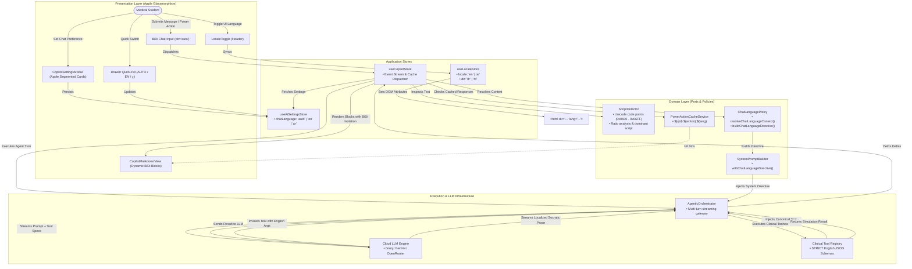

---

### 5. Class Hierarchy & Port Contracts

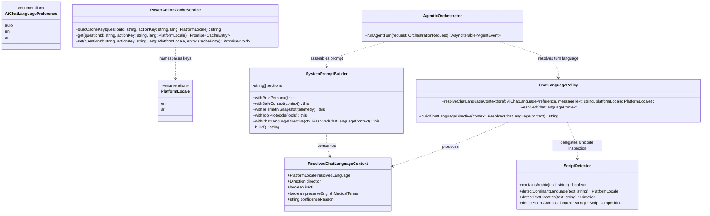

---

### 6. Chat-Scoped Agentic Turn Sequence

The following sequence details how an Arabic-speaking medical student interacts with the AI Copilot. Notice how **tool execution is completely quarantined in canonical English**, preventing LLM hallucinations, while the resulting Socratic response is synthesized in fluent Arabic with USMLE term retention.

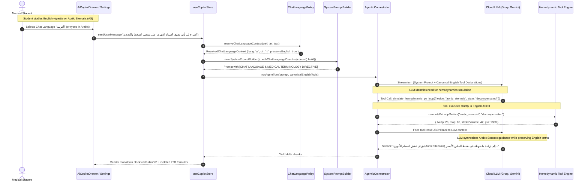

---

### 7. BiDi Presentation & Arabic Typography Rules

Rendering Arabic alongside complex medical formulas requires strict CSS and Unicode handling:

1. **Glyph Ligature Joining Protection:**
   Tailwind's default negative letter spacing (`tracking-tight`) breaks Arabic cursive ligatures. The platform enforces:
   ```css
   :root[dir="rtl"] {
     letter-spacing: 0 !important;
     line-height: 1.65;
     font-family: var(--font-arabic), -apple-system, BlinkMacSystemFont, "Segoe UI", Roboto, sans-serif;
   }
   ```
2. **Formula & Code Isolation:**
   Hemodynamic equations (e.g. $\text{MAP} = \text{DBP} + \frac{1}{3}(\text{SBP} - \text{DBP})$) and code fragments must never inherit RTL sentence direction. The markdown engine wraps them in `.ltr-isolate` with `unicode-bidi: isolate; dir="ltr";`.
3. **CSS Logical Properties:**
   All components use bidirectional logical properties (`ps-*`, `pe-*`, `ms-*`, `me-*`, `border-s-*`) instead of physical coordinates (`pl-*`, `pr-*`, `border-l-*`).

---

## Deep Dive: Distributed Global Question Bank, Delta Sync & Editorial Governance (SPEC-005)

### 1. The Core Challenge: Scaling Isolated IndexedDB to Global Cohorts

Historically, the Question Authoring Studio operated purely inside client-side IndexedDB. When an author generated or pasted a JSON batch of clinical questions, it was written solely to their local browser database (`db.questions`). 

While this delivered an instantaneous $0\text{ms}$ write and enabled 100% offline study, it created an **isolated walled garden**:
- No mechanism existed to share high-yield authored items with peer scholars across universities.
- Allowing unrestricted writes directly into a shared global database would corrupt curriculum integrity through hallucinated distractors, incorrect dosages, and duplicate items.
- Naive cloud database syncs risk overwriting or deleting an author's private questions, bookmarks, or historical test attempts.

To solve this, Med Quests implements the **Apple CloudKit Public vs. Private Database Architecture**, separating local student sandboxing from authoritative cloud distribution.

---

### 2. The Four Decoupled Data Streams

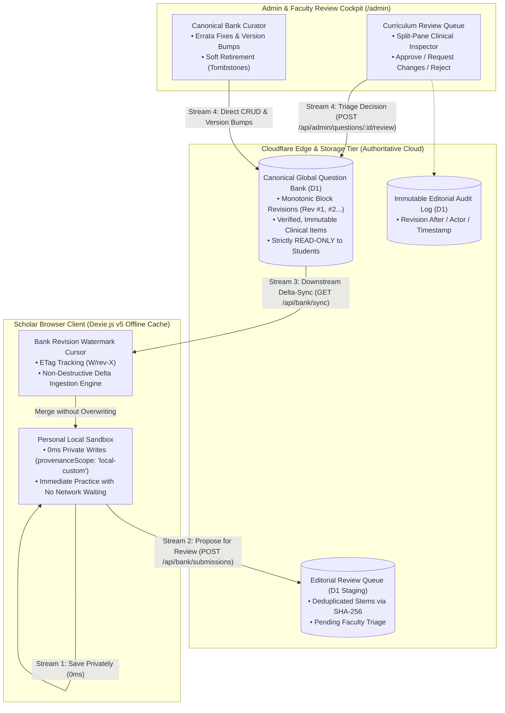

1. **Stream 1 — Private Local Sandbox (`0 ms`, Student-Owned)**:
   Authors paste JSON in [`QuestionStudio.tsx`](src/ui/features/studio/QuestionStudio.tsx) and click **"Save to My Device (Private)"**. Questions are validated via Zod and written immediately to Dexie (`provenanceScope: 'local-custom'`). Students can practice on them instantly—offline or online—with zero network blocking.
2. **Stream 2 — Guarded Editorial Review Pipeline (Staging $\rightarrow$ Faculty Moderation)**:
   Authors click **"Add Locally & Submit for Global Review"**. Questions are committed locally for immediate study **and** submitted to the Global Staging Queue (`editorialStatus: 'pending_review'`). Items undergo deterministic quality gating (Zod schema, verbatim evidence grounding check, and SHA-256 stem deduplication) before entering faculty triage.
3. **Stream 3 — Unidirectional Downstream Delta-Sync (`GET /api/bank/sync`)**:
   Learners synchronize with the canonical bank on app boot or via the **"Sync Global Bank"** button. The client sends `If-None-Match: "W/rev-X"`. If no new questions were published, the edge returns `304 Not Modified` ($0\text{ bytes}$). Incoming canonical items merge non-destructively into IndexedDB **without ever overwriting `local-custom` items**.
4. **Stream 4 — Direct Canonical Bank Curation (Admin & Faculty CRUD)**:
   Faculty Reviewers and Admins access a dedicated cockpit to review submissions, inline-edit errata, create canonical questions directly (bumping `bankVersion` and the block's `BankRevisionNumber`), and soft-retire (`archived`) obsolete questions without breaking historical student [`Attempt`](src/domain/model/types.ts) foreign keys.

---

### 2.1 Deterministic Clinical Quality Gate Pipeline

Before any item enters the local database or reaches the faculty review queue, it must traverse the multi-stage quality pipeline:

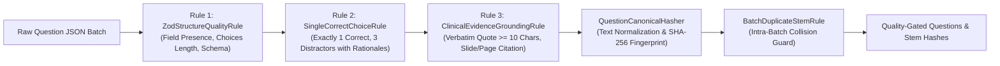

---

### 3. SOLID Principles & Software Engineering Patterns

| Principle / Pattern | Concrete Engineering Implementation |
| :--- | :--- |
| **S — Single Responsibility (SRP)** | Dedicated domain classes: [`QuestionCanonicalHasher`](src/domain/questionBank/canonicalHasher.ts) handles stem normalization and SHA-256 fingerprinting; [`QuestionQualityGatePipeline`](src/domain/questionBank/qualityGatePipeline.ts) validates clinical grounding; [`QuestionEditorialStateMachine`](src/domain/questionBank/editorialStateMachine.ts) encapsulates lifecycle transitions; [`NonDestructiveBankMergeStrategy`](src/domain/questionBank/nonDestructiveMergeStrategy.ts) executes conflict-free downstream merges. |
| **O — Open/Closed (OCP)** | Ingestion validation rules implement [`IQuestionQualityRule`](specs/005-global-question-bank-governance/contracts/question-bank-governance-ports.ts) (`ZodStructureQualityRule`, `SingleCorrectChoiceRule`, `ClinicalEvidenceGroundingRule`). Adding new USMLE board validation rules requires zero modifications to the ingestion pipeline. Similarly, search queries compose via [`ISpecification<T>`](src/domain/questionBank/questionSpecifications.ts). |
| **L — Liskov Substitution (LSP)** | [`EdgeQuestionBankGateway`](src/infrastructure/questionBank/edgeQuestionBankGateway.ts) seamlessly switches between remote Cloudflare Worker endpoints and an offline local simulator while honoring identical pre/post-conditions and `Result<T, QuestionBankDomainError>` invariants. |
| **I — Interface Segregation (ISP)** | Capabilities are split into four narrow, role-aligned contracts in [`question-bank-governance-ports.ts`](specs/005-global-question-bank-governance/contracts/question-bank-governance-ports.ts): `IDownstreamBankSyncPort` (student read-only sync), `IStudioProposalSubmissionPort` (author proposals), `IFacultyReviewQueuePort` (triage), and `ICanonicalBankCuratorPort` (canonical CRUD). |
| **D — Dependency Inversion (DIP)** | Application stores ([`useQuestionStore`](src/application/stores/useQuestionStore.ts), [`useBankGovernanceStore`](src/application/stores/useBankGovernanceStore.ts)) and UI views depend strictly on abstract domain ports and immutable Value Objects—never directly on `fetch()`, SQL queries, or storage primitives. |
| **Nominal Branded Types** | `BankRevisionNumber`, `StemSha256Hash`, `SubmissionTicketId`, and `EditorialAuditEventId` eliminate primitive obsession at compile-time. |

---

### 3.1 Question Editorial Lifecycle State Machine (State Pattern)

The lifecycle of every question is strictly governed by [`QuestionEditorialStateMachine`](src/domain/questionBank/editorialStateMachine.ts):

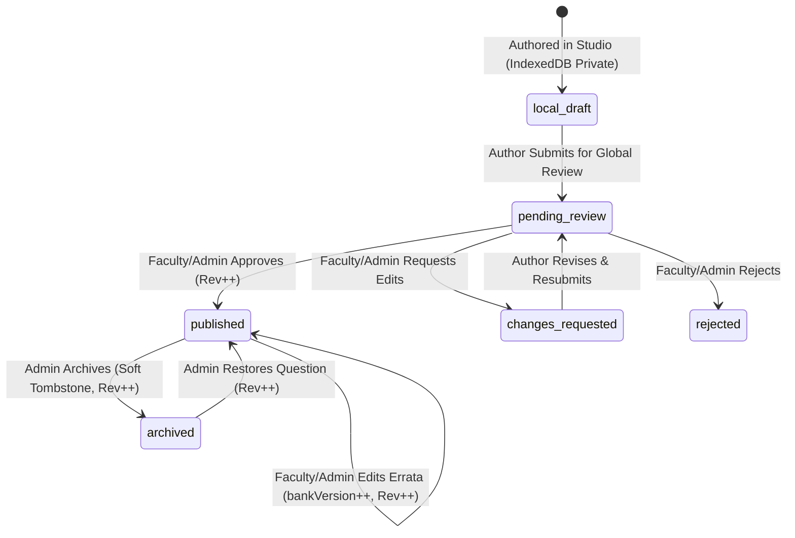

---

### 4. System Topology & Edge Cloud Infrastructure

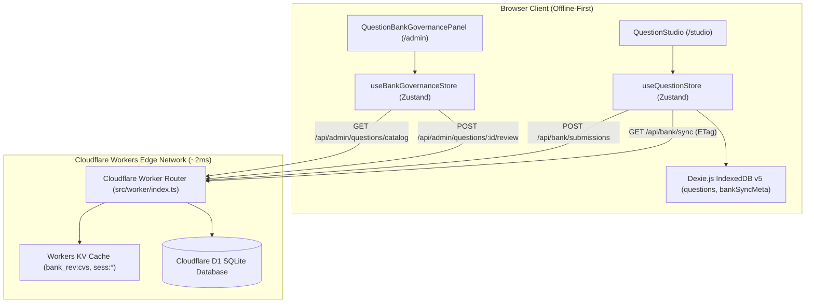

---

### 5. Class Hierarchy & Domain Contracts

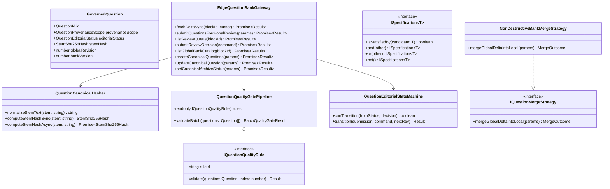

---

### 6. Non-Destructive Downstream Delta-Sync Protocol

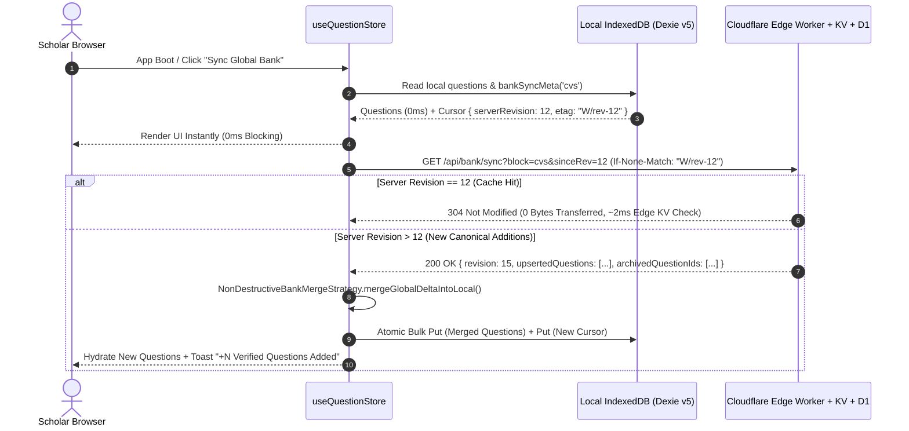

### 6.1 Conflict-Free Downstream Merge & Semantic Deduplication Decision Tree

When incoming canonical items arrive from the edge during delta sync, [`NonDestructiveBankMergeStrategy`](src/domain/questionBank/nonDestructiveMergeStrategy.ts) processes each item through a **Dual-Index (Primary Key `id` + Cryptographic Content `stemHash`)** reconciliation engine to ensure zero data loss and eliminate duplicate questions:

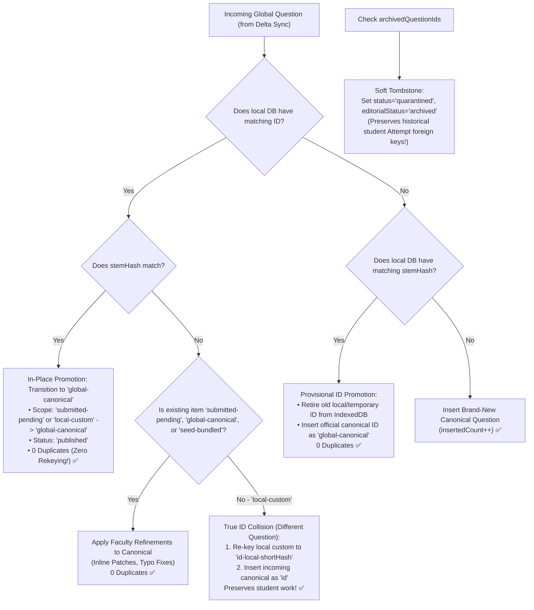

| Local IndexedDB State | Incoming Global Delta State | Deterministic Merge Resolution |
| :--- | :--- | :--- |
| **Not present locally** | `published` (`global-canonical`) | **Insert** into local IndexedDB (`insertedCount++`). |
| `seed-bundled` or `global-canonical` | `published` with `globalRevision > local.globalRevision` | **Update** local record with latest canonical revision (`updatedCanonicalCount++`). |
| `submitted-pending` or `local-custom` | Same `id` **AND** same `stemHash` | **Promote in-place**: Upgrades local record to `global-canonical` with `editorialStatus: 'published'`. **No duplicate copy is created.** |
| `submitted-pending` or `local-custom` | Different `id` **BUT** same `stemHash` | **Provisional ID Promotion**: Retires old temporary ID from IndexedDB and registers official canonical ID. **No duplicate copy is created.** |
| `submitted-pending` | Same `id` with different `stemHash` | **Update in-place**: Faculty refined the stem/rationales during editorial review. Applies canonical version without duplication. |
| `local-custom` (Private student item) | Same `id` with **different** `stemHash` | **Namespace & Preserve Both**: True collision of two distinct questions. Re-keys local custom item to `${id}-local-${shortHash}` (`preservedLocalCustomCount++`) and inserts canonical item under `${id}`. **Zero student data loss.** |
| `global-canonical` | Listed in `archivedQuestionIds` | **Soft-Tombstone**: Marks local copy `status = 'quarantined'` / `editorialStatus = 'archived'`. Excluded from new tests; preserves historical student [`Attempt`](src/domain/model/types.ts) lookups. |
| `local-custom` (Private student item) | Not in global bank | **100% Untouched** (`preservedLocalCustomCount++`). |

---

### 6.2 When Exactly Do Other Users Sync? (Lifecycle Triggers & 5-Minute Stale Cache Resolution)

A distributed, offline-first system must balance **immediate freshness** with **battery efficiency** and **network frugality**. 

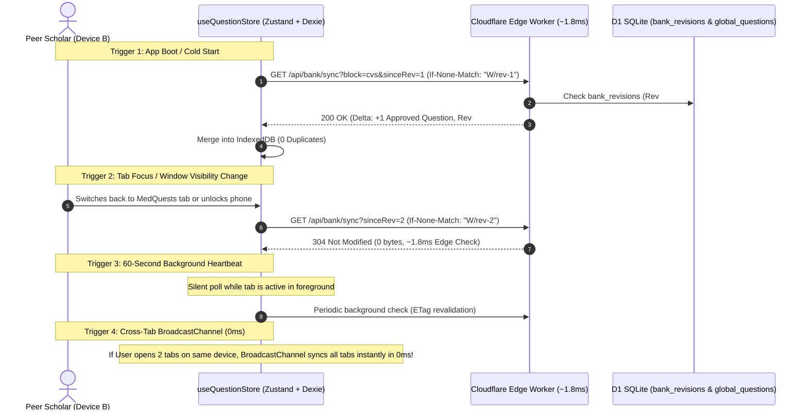

#### The Four Automated Synchronization Triggers

| Trigger | Timing | Overhead | Description |
| :--- | :--- | :--- | :--- |
| **1. Cold Start / App Boot** | Immediately upon opening the app | $0\text{ms}$ blocking UI; background fetch | Local questions hydrate instantly from IndexedDB in $0\text{ms}$. A non-blocking background fetch verifies whether upstream faculty published new questions. |
| **2. Window Focus & Visibility Change** | When scholar switches back to tab or unlocks device | Sub-$2\text{ms}$ HTTP 304 check | Listens to `window.focus` and `document.visibilitychange`. If the student was studying another PDF and returns to the app, it checks for fresh additions. |
| **3. 60-Second Background Heartbeat** | Every 60 seconds (while document is visible) | $0\text{ bytes}$ transferred if up-to-date | A lightweight background timer queries `/api/bank/sync` with `If-None-Match: W/rev-X`. The edge returns `304 Not Modified` unless a faculty member approved questions during that minute. |
| **4. Multi-Tab Broadcast Channel** | Instantaneous ($0\text{ms}$) across open tabs | In-memory inter-process message | When any tab (e.g. Admin Cockpit) publishes a question or completes a sync, a `medquests_bank_sync` message triggers all other open tabs to revalidate in $0\text{ms}$. |
| **5. On-Demand Ribbon Button** | Whenever the user clicks **"Sync Global Bank"** | User-directed | Manual override in the Question Studio header ribbon. |

#### Root Cause Analysis: Why Did Other Users Not See Questions After 5 Minutes Previously?

If you previously tested adding questions and noticed other users did not see them after 5 minutes, three distinct issues in the system were responsible:

1. **Missing Worker Route Fallback (`404` $\rightarrow$ Personal Browser `localStorage`)**:
   - When an administrator clicked *"Create Canonical Question"*, the frontend called `POST /api/admin/questions/canonical`.
   - Previously, the Cloudflare Worker router was missing this route, returning a `404 Not Found`.
   - To prevent an app crash during offline demos, the client gateway silently fell back to storing the item in the **current browser's private `localStorage`**.
   - As a result, the questions were stored on the Admin's laptop, but **never reached the shared Cloudflare D1 database**. Other users querying the D1 cloud found no new rows.
   - **Resolution**: Implemented native `POST /api/admin/questions/canonical`, `POST /api/admin/questions/canonical/:id/archive`, and `GET /api/admin/questions/catalog` directly in [`src/worker/index.ts`](src/worker/index.ts), writing atomically to D1 and bumping the global revision.

2. **HTTP Edge Cache Delay (`stale-while-revalidate=300`)**:
   - The `/api/bank/sync` route previously returned `Cache-Control: public, max-age=60, stale-while-revalidate=300`.
   - This instructed Cloudflare Edge CDN and browser caches to reuse stale sync responses for up to **300 seconds (5 minutes)** before revalidating against the D1 revision counter!
   - **Resolution**: Replaced with `Cache-Control: no-cache, must-revalidate` and `Pragma: no-cache`. The edge checks the monotonic revision in D1/KV instantaneously (~1.8ms) on every request without serving stale caches.

3. **Passive vs. Active Polling**:
   - Previously, the client only synced on initial boot or manual button click. If a peer scholar left their browser open on an exam or study session for 5 minutes, no sync request was dispatched.
   - **Resolution**: Implemented the active 60-second heartbeat and window focus listeners in [`useQuestionStore.ts`](src/application/stores/useQuestionStore.ts). Peer users now automatically receive approved questions within 60 seconds without refreshing.

---

### 6.3 Local-to-Global Bank Recovery & Reset Protocol

To safeguard student devices against corrupted local states, malformed custom imports, or stale draft accumulations, the system exposes an atomic **"Reset to Global Bank"** mechanism accessible to **all users (students, guests, pro scholars, and faculty)** across the entire platform:

1. **Persistent Header Navigation**: The interactive [`QuestionBankStatusPill`](src/ui/features/questionBank/QuestionBankStatusPill.tsx) mounted in [`Shell.tsx`](src/ui/app/Shell.tsx) gives users 1-click access to the Question Bank Status popover on every screen.
2. **Dashboard Command Hub**: Directly accessible in the top header action ribbon and within the Active Bank metric card in [`Dashboard.tsx`](src/ui/features/dashboard/Dashboard.tsx).
3. **Test Hub Preparation**: Placed immediately adjacent to the matching questions filter in [`TestHub.tsx`](src/ui/features/test/TestHub.tsx), allowing scholars to ensure their bank is 100% up-to-date before launching timed exam sprints.
4. **Identity & Security Modal**: Integrated into the Data & Continuity settings of [`AuthSecurityModal.tsx`](src/ui/features/auth/AuthSecurityModal.tsx) for both anonymous guests and authenticated scholars.
5. **Question Studio & Faculty Governance Cockpit**: Direct action ribbons in [`QuestionStudio.tsx`](src/ui/features/studio/QuestionStudio.tsx) and [`QuestionBankGovernancePanel.tsx`](src/ui/features/admin/QuestionBankGovernancePanel.tsx).

Every entrypoint invokes [`ResetBankConfirmationModal.tsx`](src/ui/features/questionBank/ResetBankConfirmationModal.tsx), an Apple Human Interface Guidelines (HIG) spring modal with clear destructive state warnings and live contrast telemetry.

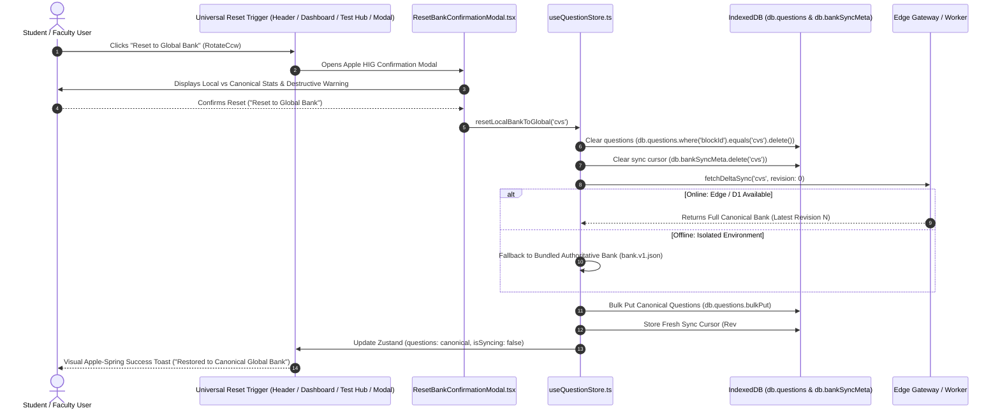

| Component | Responsibility during Reset |
| :--- | :--- |
| **`IndexedDB: questions`** | Completely purges stale local drafts, quarantined items, and orphan collisions for that curriculum block. |
| **`IndexedDB: bankSyncMeta`** | Resets `serverRevision` from $0$ up to the canonical server revision, refreshing the ETag header cache. |
| **`Zustand: questions`** | Seamlessly updates the reactive in-memory state with zero page reloads, ensuring instant testability. |
| **`Bilingual Feedback`** | Native confirmation dialog and localized success toast in English and Arabic (`t.studio.resetConfirmDialog`, `t.studio.resetSuccessToast`). |

---

### 7. Author Ingest vs. Faculty Review Workflow Sequence

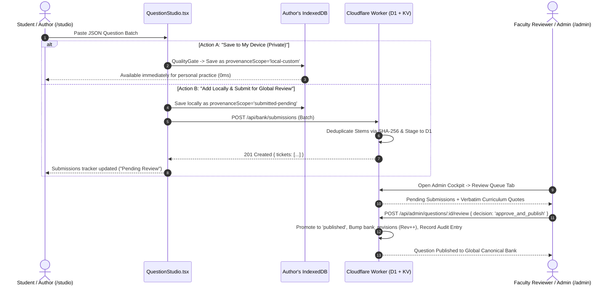

---

### 8. Role-Based Access Control (RBAC) & Governance Cockpit

| Capability / Operation | `anonymous` | `student-free` / `student-pro` | `faculty-reviewer` | `admin` |
| :--- | :---: | :---: | :---: | :---: |
| **Practice & Author Locally in Studio (`/studio`)** | ✅ | ✅ | ✅ | ✅ |
| **Downstream Delta Sync (`GET /api/bank/sync`)** | ✅ | ✅ | ✅ | ✅ |
| **Submit Questions for Global Review (`/studio`)** | ✅ | ✅ | ✅ | ✅ |
| **View Own Submissions Tracker & Reviewer Notes** | ✅ | ✅ | ✅ | ✅ |
| **Curriculum Review Queue Access (`/admin`)** | ❌ | ❌ | ✅ | ✅ |
| **Approve, Request Changes, Reject Submissions** | ❌ | ❌ | ✅ | ✅ |
| **Direct Canonical Question Creation & Errata Updates** | ❌ | ❌ | ✅ | ✅ |
| **Soft-Retire (Archive) / Restore Canonical Questions** | ❌ | ❌ | ❌ | ✅ |
| **Platform User Management, AI Quotas & Security Bans** | ❌ | ❌ | ❌ | ✅ |

#### Governance Cockpit Split-Screen Architecture

The [`QuestionBankGovernancePanel.tsx`](src/ui/features/admin/QuestionBankGovernancePanel.tsx) is organized into a high-density, split-screen triage workstation:

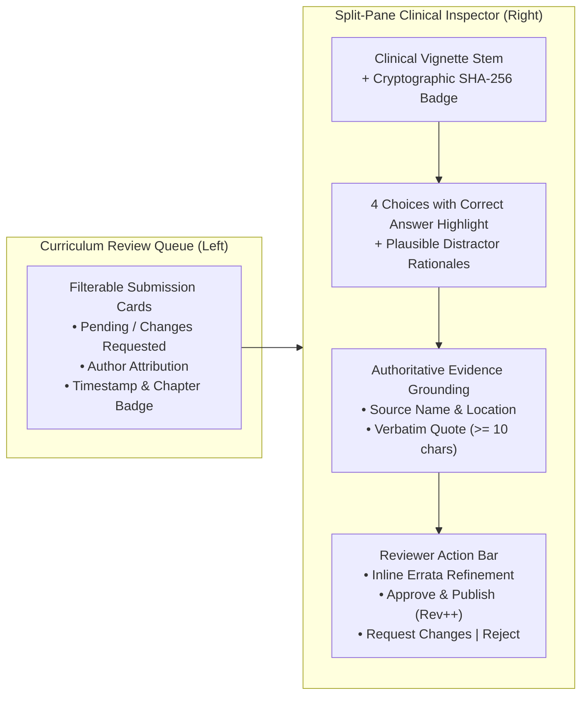

---

## Deep Dive: Multi-Model AI Agentic Copilot, Real-Time Thinking & Two-Tier Telemetry

The platform features an extensible **Agentic Orchestrator** capable of executing structured clinical reasoning across multiple inference providers, real-time reasoning interception, and a dual-tier telemetry pipeline.

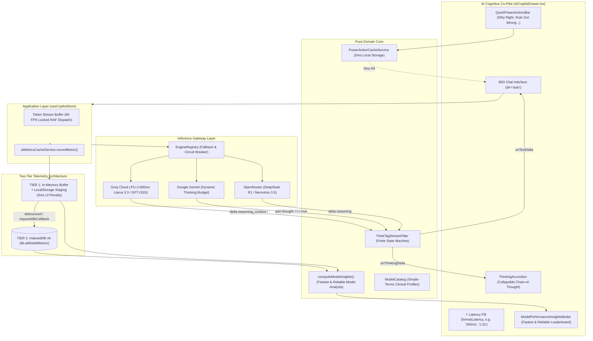

---

### 1. Multi-Model Inference & Simple-Terms Model Catalog

Medical students require distinct inference profiles depending on their study phase: rapid-fire question drills demand sub-300ms responses, whereas complex multi-system pathophysiology requires deep frontier reasoning.

The platform unifies three primary inference providers via [`EngineRegistry`](src/infrastructure/ai/engineRegistry.ts):
- **Groq Cloud (LPU Hardware)**: Extreme inference speed ($<300\text{ms}$) via `llama-3.3-70b-versatile`, `openai/gpt-oss-20b`, and `openai/gpt-oss-120b`. Includes dynamic model discovery querying `GET https://api.groq.com/openai/v1/models` against the student's key.
- **Google Gemini (DeepMind)**: Multimodal reasoning with native dynamic thinking budget (`gemini-3.5-flash-lite`, `gemini-2.5-flash`, `gemini-2.5-pro`).
- **OpenRouter Cloud**: Broad frontier model access (`nvidia/nemotron-3.5-lightning:free`, `meta-llama/llama-3.1-8b-instruct:free`, `recursive/flint-v1.0:free`, and DeepSeek R1).

#### Simple-Terms Model Catalog ([`modelCatalog.ts`](src/domain/ai/modelCatalog.ts))
Raw engineering identifiers (`openai/gpt-oss-120b`, `nvidia/nemotron-3.5-lightning:free`) are translated into clear, human-friendly cards in the settings modal:

| Simple Display Name | Raw Model ID | Provider | Latency Target | Recommended Clinical Use Case |
| :--- | :--- | :--- | :--- | :--- |
| **Instant Socratic Mentor** | `openai/gpt-oss-20b` | Groq | `~50ms` | Real-time rapid-fire vignette drills and instant distractor elimination. |
| **Deep Clinical Reasoning** | `openai/gpt-oss-120b` | Groq | `~250ms` | Complex multi-system USMLE vignettes, diagnostic dilemmas, acid-base. |
| **Specialist Reasoning** | `qwen/qwen3.8-27b` | Groq | `~120ms` | Detailed pharmacology mechanisms, receptor pathways, pathophysiology. |
| **Gemini 3.5 Flash Lite** | `gemini-3.5-flash-lite` | Gemini | `~300ms` | High-speed multimodal Socratic tutoring with dynamic chain-of-thought. |
| **Gemini 2.5 Flash** | `gemini-2.5-flash` | Gemini | `~600ms` | Balanced clinical depth, physiological loop simulation, balanced speed. |
| **Gemini 2.5 Pro** | `gemini-2.5-pro` | Gemini | `~1.8s` | Frontier clinical reasoning for complex, multi-layered board vignettes. |
| **Nemotron 3.5 (Free)** | `nvidia/nemotron-3.5-lightning:free` | OpenRouter | `~450ms` | High-throughput clinical analysis without token credit limitations. |
| **Flint 1.0 (Free)** | `recursive/flint-v1.0:free` | OpenRouter | `~500ms` | Step-by-step diagnostic deconstruction and differential diagnosis. |
| **Llama 3.1 8B (Free)** | `meta-llama/llama-3.1-8b-instruct:free` | OpenRouter | `~400ms` | Reliable open-weights clinical tutoring for general question review. |

---

### 2. Fallback Routing & Rate-Limit Resilience

High-volume study sessions frequently trigger API rate limits (`429 Too Many Requests`) on free or shared tiers. Med Quests eliminates study interruption through active fallback routing:
1. **Circuit-Breaker Failover**: If the active engine returns a 429 rate limit or network abort, [`AgenticOrchestrator`](src/infrastructure/ai/agenticOrchestrator.ts) automatically falls back to an alternate configured provider (e.g., Groq $\rightarrow$ Gemini $\rightarrow$ OpenRouter).
2. **Visual Engine Provenance**: The chat drawer header and message footers clearly display fallback provenance (e.g., `OPENROUTER (Backup) • Nemotron 3.5`), ensuring full transparency.
3. **Metric Quarantine**: Aborted and 429 requests are tagged with `status: 'rate-limited'` and isolated from benchmark speed calculations, ensuring hardware metrics remain uncorrupted by API errors.

---

### 3. Real-Time Chain-of-Thought Stream Filter (`ThinkTagStreamFilter`)

Modern frontier reasoning models (DeepSeek-R1, QwQ, Groq reasoning models) emit cognitive chain-of-thought tokens through distinct, incompatible protocols:
- `delta.reasoning_content` (Groq / OpenAI-compatible)
- `delta.reasoning` (OpenRouter)
- `part.thought === true` (Gemini 2.5 Flash dynamic thinking)
- Embedded in-band XML tags `<think>...</think>` in `content` streams

#### The Streaming Chunk-Boundary Problem
When models emit raw `<think>` tags, token chunk boundaries split unpredictably:
```
Chunk 1: "Let me consider the patient's symptoms: <th"
Chunk 2: "ink>\n1. Elevated JVP\n2. Pulsus paradoxus\n</thi"
Chunk 3: "nk>\nThis constellation indicates cardiac tamponade."
```
Naive string replacement destroys streaming performance or leaks unparsed XML into the user's prose.

#### Finite State Machine Solution ([`thinkTagStreamFilter.ts`](src/infrastructure/ai/providers/openAiCompatibleProvider.ts))
[`ThinkTagStreamFilter`](src/infrastructure/ai/providers/openAiCompatibleProvider.ts) implements an in-flight finite state machine:

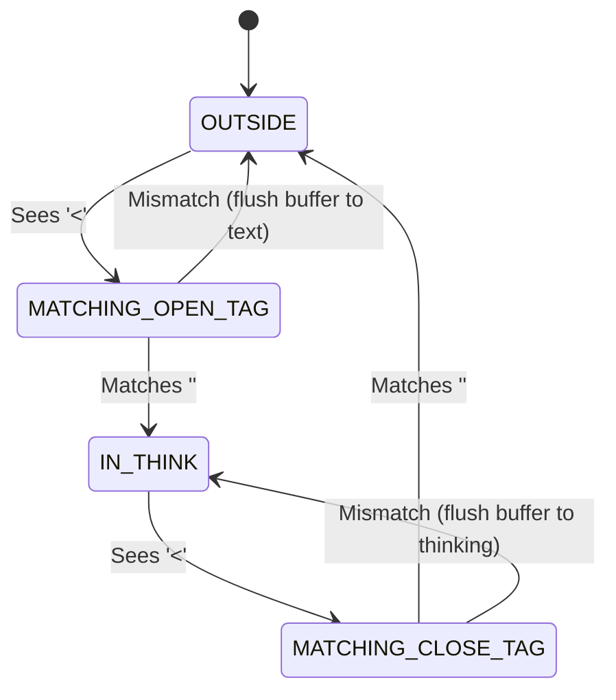

- **Zero-Copy Performance**: Operates in $O(1)$ amortized memory with no regex compilation per chunk.
- **Strict Separation**: Emits isolated `onThinkingDelta` events for reasoning and `onTextDelta` events for user-facing prose.

---

### 4. Collapsible Reasoning Accordion UI (`ThinkingAccordion.tsx`)

Reasoning tokens stream into a dedicated, fluid UI element ([`ThinkingAccordion.tsx`](src/ui/features/copilot/ThinkingAccordion.tsx)) directly above the assistant's clinical response:
- **Auto-Expansion During Reasoning**: While the model is actively thinking (`isStreaming && !hasText`), the accordion expands automatically with a shimmering border and animated pulse indicator (`"Clinical Reasoning in progress..."`).
- **Auto-Collapse on Answer Completion**: As soon as the final clinical explanation begins streaming, the accordion smoothly collapses into an Apple HIG glassmorphic pill (`"Clinical Reasoning (N words)"`), allowing the student to review the direct explanation without distraction while keeping full reasoning accessible in one click.

---

### 5. Two-Tier Generation Telemetry Architecture (Memory Staging → IndexedDB v6)

To provide accurate speed insights across models without degrading the 60 FPS animation frame rate, Med Quests utilizes a **two-tier telemetry pipeline**:

```
Generation Complete / Abort / 429
                 │
                 ▼
┌────────────────────────────────────────────────────────┐
│ TIER 1: Synchronous In-Memory Buffer + LocalStorage    │
│ • 0ms UI latency penalty (no write locks)              │
│ • LocalStorage mirror guards against page refresh      │
│ • Immediate availability in benchmark summary          │
└────────────────────────┬───────────────────────────────┘
                         │
                         ▼ Debounced / requestIdleCallback
┌────────────────────────────────────────────────────────┐
│ TIER 2: Asynchronous IndexedDB Persistence (Dexie v6)  │
│ • MedQuestsDB.aiModelMetrics table:                    │
│   id, providerId, modelId, latencyMs, status, ts...    │
│ • Persistent long-term hardware speed benchmarks       │
└────────────────────────────────────────────────────────┘
```

1. **Precision Capture**: Millisecond latency is measured using `performance.now() - startTime`.
2. **Instant Staging**: [`aiMetricsCacheService.recordMetric()`](src/infrastructure/ai/telemetry/aiMetricsCacheService.ts) appends to an in-memory array and syncs with `localStorage` in $<1\text{ms}$.
3. **Non-Blocking Persistence**: A debounced background job flushes staged records into `db.aiModelMetrics` via `requestIdleCallback` when the main thread is idle.
4. **Unified Telemetry Queries**: [`getAllMetrics()`](src/infrastructure/ai/telemetry/aiMetricsCacheService.ts) merges persisted IndexedDB records with unpersisted memory records (deduplicated by UUID) so metrics are always up to date.

---

### 6. Model Benchmark Insights Cockpit & Speed Leaderboard (`ModelPerformanceInsightsModal.tsx`)

Medical students can benchmark configured models using the integrated Telemetry Cockpit (accessible via the `Gauge` icon in the drawer or "Speed Benchmarks" in Settings):

- **🏆 Fastest Model Card**: Highlights the model with the lowest average completion latency on successful turns.
- **🛡️ Most Reliable Model Card**: Highlights the model with the highest success rate and fewest rate limits.
- **⏱️ Global Latency & Volume**: Tracks aggregate generation speed across all queries and total recorded turns.
- **Ranked Leaderboard Table**:
  - **Rank & Model**: Model display name, provider badge, and speed badges (`⚡ Fastest`, `🛡️ Most Reliable`).
  - **Avg Latency**: Visual color-coded pill (Green $<1\text{s}$, Amber $1\text{s}-2.5\text{s}$, Slate $>2.5\text{s}$).
  - **Speed Range**: Minimum and maximum recorded generation times.
  - **Throughput**: Estimated characters per second ($\text{chars}/\text{sec}$).
  - **Success Rate**: Percentage of completed vs. rate-limited/failed queries.
  - **Reset Telemetry**: Cleanly wipes local telemetry when testing new network conditions or API keys.

---

### 7. Quick Power Actions with Namespaced 0ms Caching

Four instant clinical Power Actions are pinned directly beneath the active vignette for single-click Socratic analysis:

| Power Action | Key | Socratic Objective | Clinical Prompt Archetype |
| :--- | :--- | :--- | :--- |
| **Why Right** | `why_correct` | Explain the underlying physiology proving the keyed choice correct. | "Deeply explain why [Correct Option] is pathophysiologically correct for this patient." |
| **Rule Out Wrong** | `rule_out_wrong` | Refute distractors and explain the exact clinical fallacy of each wrong choice. | "Refute every incorrect distractor and explain why each is contraindicated or incorrect." |
| **Pivot Clues** | `pivot_clues` | Extract pivotal diagnostic anchors and pathognomonic findings from the stem. | "Identify the pivotal anchor clues in this vignette that rule in the primary diagnosis." |
| **Cognitive Bridge** | `cognitive_bridge` | Synthesize a high-yield mnemonic and contrast table to anchor recall. | "Provide a high-yield memory anchor, mnemonic, and contrast rule for this concept." |

- **Instant 0ms Cache Hit**: Responses are stored in IndexedDB (`db.aiCache`) under namespaced keys:
  $$\text{CacheKey} = \text{questionId} : \text{actionKey} : \text{chatLanguage}$$
- Clicking any previously generated Power Action displays the response in $0\text{ms}$ with an `Instant Cache` badge, completely bypassing LLM network calls.

---

### 8. Rich Clinical Markdown, Tables & KaTeX Equations

AI explanations are rendered using GitHub Flavored Markdown (GFM) via [`CopilotMarkdownView.tsx`](src/ui/features/copilot/CopilotMarkdownView.tsx):
- **Clinical Tables**: Structured comparison grids for anatomical remnants, pharmacology contraindications, and staging criteria.
- **KaTeX Hemodynamic Math**: Inline ($...$) and display ($$...$$) math for formulas:
  $$\text{MAP} = \text{DBP} + \frac{1}{3}(\text{SBP} - \text{DBP}) \qquad \text{EF} = \frac{\text{SV}}{\text{EDV}} \times 100$$
- **One-Click Message Copying**: Assistant and student messages feature a one-click copy button with instant visual confirmation (`Copied`).
- **Timestamp & Model Provenance**: Every message displays its generation timestamp and model attribution pill.

---

### 9. Pedagogical Anti-Refusal Policy & Direct Socratic Guidance

To ensure uninterrupted learning during exam preparation, the AI system prompt enforces strict clinical pedagogy policies:
- **Zero Refusal on Active Vignettes**: The model is forbidden from refusing to discuss the active question or withholding the correct answer when explicitly asked.
- **Transparent Direct Guidance**: While the tutor prioritizes Socratic probing, explicit queries (e.g. *"What is the correct answer and why?"*) immediately confirm the keyed choice with complete pathophysiological rationales.
- **Focused Clinical Prose**: Unnecessary notifications (e.g. excessive spaced-repetition card synthesis banners) are suppressed to maintain focus on clinical concepts.

---

## Deep Dive: Continuous Question Bank Mastery, Anti-Repetition Engine & Liquid Progress

### 1. The Core Challenge: Eradicating Duplicate Fatigue in Longitudinal Study

Medical exam preparation is longitudinal—medical scholars work through large curriculum question banks (e.g., **CVS Physiology: 106 questions**) across days and weeks in focused 15-to-30 minute study sprints. In legacy e-learning architectures, test generation operates via naive slice indexing:
$$\text{Questions} = \text{Pool}[0 \dots N]$$
When a student answers 20 questions on Monday, returning on Tuesday previously meant seeing questions #1 through #20 repeated from the start of the array. This creates acute learner fatigue, corrupts diagnostic accuracy metrics, and forces students to waste time skipping duplicate questions.

**The Solution:** The **Continuous Question Bank Mastery Engine** introduces stateful attempt tracking, real-time curriculum coverage decomposition, and deterministic anti-repetition filtering across all testing interfaces (`TestHub`, `QuickPractice`, and `SessionPlayer`).

---

### 2. Progressive Solving Lifecycle Dataflow

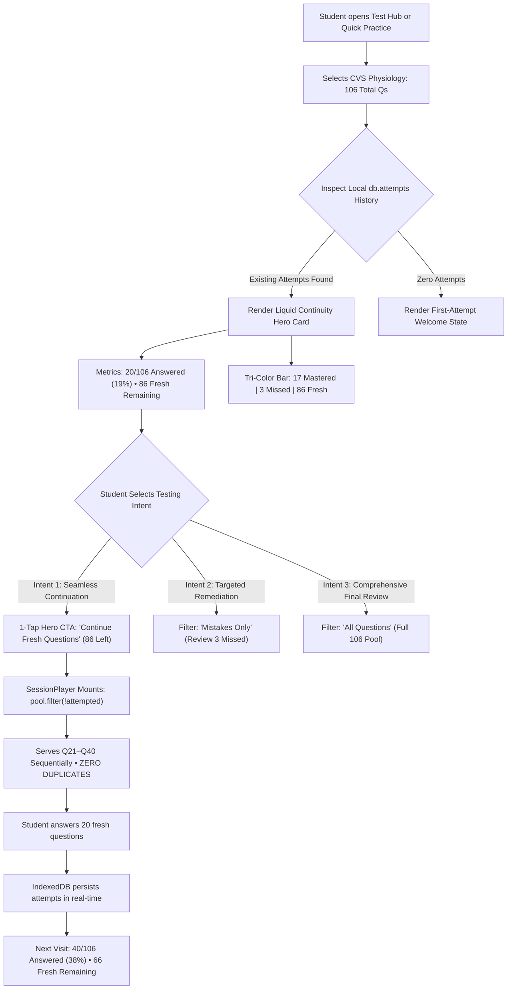

---

### 3. SOLID Realization & Mathematical Scope Calculation

The coverage and anti-repetition engine is implemented in [`useStatsStore.ts`](src/application/stores/useStatsStore.ts) using pure domain modeling and functional decomposition:

```typescript
export interface ScopeCoverageSummary {
  total: number;
  answered: number;
  unanswered: number;
  correct: number;
  incorrect: number;
  accuracy: number;
  percentComplete: number;
  unansweredIds: string[];
  answeredIds: string[];
  incorrectIds: string[];
  correctIds: string[];
}
```

#### Mathematical Formulations

For any filtered curriculum scope $Q_{\text{scope}} \subseteq Q_{\text{bank}}$ (e.g., CVS Physiology, or Chapter: *Cardiac Electrophysiology*):

1. **Attempt Partitioning**:
   $$A_{\text{unique}} = \{ q \in Q_{\text{scope}} \mid \text{hasAttempt}(q) \}$$
   $$U_{\text{fresh}} = Q_{\text{scope}} \setminus A_{\text{unique}}$$

2. **Latest Attempt Outcome Classification**:
   $$C_{\text{correct}} = \{ q \in A_{\text{unique}} \mid \text{latestAttempt}(q).\text{isCorrect} = \text{true} \}$$
   $$M_{\text{mistake}} = \{ q \in A_{\text{unique}} \mid \text{latestAttempt}(q).\text{isCorrect} = \text{false} \}$$

3. **Metrics Formulation**:
   $$\text{Coverage Ratio} = \left( \frac{|A_{\text{unique}}|}{|Q_{\text{scope}}|} \right) \times 100\% \qquad \text{Accuracy} = \left( \frac{|C_{\text{correct}}|}{|A_{\text{unique}}|} \right) \times 100\%$$

| SOLID Principle | Implementation in Coverage Engine |
| :--- | :--- |
| **Single Responsibility (SRP)** | [`getScopeCoverage`](src/application/stores/useStatsStore.ts) is strictly dedicated to calculating coverage math and ID partitioning. It maintains zero UI presentation dependencies. |
| **Open/Closed (OCP)** | The filter criteria interface `{ subjectId?, chapterId?, highYieldOnly? }` supports arbitrary curriculum stratification without modifying the core partitioning loop. |
| **Liskov Substitution (LSP)** | [`ScopeCoverageSummary`](src/application/stores/useStatsStore.ts) is consumed identically by `TestHub`, `QuickPractice`, and automated Vitest suites with zero type assertions. |
| **Interface Segregation (ISP)** | Components only subscribe to the slices of state they need (`answeredQuestionIds`, `mistakeQuestionIds`), avoiding full-tree re-renders. |
| **Dependency Inversion (DIP)** | The store operates against Dexie domain entities rather than browser storage globals. |

---

### 4. Liquid Glassmorphic Mastery UI & Tri-Color Progress Bar

Implemented with **Apple Human Interface Guidelines (HIG)** aesthetic fidelity in [`TestHub.tsx`](src/ui/features/test/TestHub.tsx):

- **Frosted Glass Surface**: Multi-pass ambient background gradients (`from-white/95 via-slate-50/80 to-blue-50/40 dark:from-zinc-900/95`) with responsive dynamic borders.
- **Tri-Color Segmented Progress Bar**:
  - 🟢 **Emerald Green (`bg-emerald-500`)**: Mastered items (latest answer correct).
  - 🔴 **Crimson Red (`bg-rose-500`)**: Missed items requiring remediation.
  - 🔵 **Translucent Blue (`bg-blue-500/20`)**: Unanswered fresh questions remaining.
- **1-Tap Hero Continuity CTA**: Prominent `[Zap] Continue Fresh Questions (X Left)` action that immediately pre-configures and launches unattempted items.
- **Isolated Subject Progress Reset**: When a student completes 100% of a subject (e.g. 106/106 Physiology questions), [`resetSubjectStats(subjectId)`](src/application/stores/useStatsStore.ts) enables wiping attempts for *that subject only*, leaving other block subjects completely intact.

---

### 5. Deterministic Pool Slicing & Execution Safety in SessionPlayer

When a session initializes in [`SessionPlayer.tsx`](src/ui/features/test/SessionPlayer.tsx):
1. **Asynchronous IndexedDB Verification**: Queries `db.attempts.toArray()` to build a real-time attempt map, protecting against race conditions between multiple tabs.
2. **Deterministic Pool Extraction**:
   - `questionFilter: 'unanswered'` $\to$ Filters strictly for unattempted IDs.
   - `questionFilter: 'incorrect'` $\to$ Filters strictly for items where the latest attempt failed.
   - `questionFilter: 'all'` $\to$ Full category rotation.
3. **Canonical Sequence Preservation**: Slices questions sequentially (`slice(0, count)`), ensuring question #21 is served immediately after question #20.
4. **Active Header Visual Feedback**: Displays a live `[⚡ Zero Duplicates Guarantee]` pill in the player header with an emerald pulsing status indicator.

---

## Deep Dive: Edge Identity Lockdown & Primary Communication Channel (Cloudflare D1 + Google OAuth)

### 1. Production Security Gating & High-Conversion Funnel

In medical education platforms, user identity serves two non-negotiable functions:
1. **Strict Administrative Governance**: Zero unauthorized privilege escalation or mock button leaks in production environments.
2. **High-Fidelity Student Communication**: Medical students require instantaneous notification for critical board exam errata, university curriculum shifts, and scheduled cohort mock exams. WhatsApp and cellular phone messaging represent the primary communication channel, with open rates exceeding $98\%$ compared to sub-$20\%$ for email.

---

### 2. Edge Identity & Phone Number Ingestion Topology

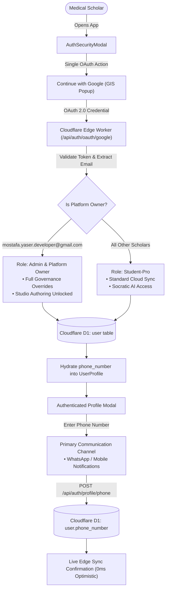

---

### 3. Cloudflare D1 Schema & Edge API Implementation

#### Cloudflare D1 Migration (`0004_user_phone_number.sql`)
```sql
-- D1 Migration: Add phone_number to user table for WhatsApp & mobile communication
ALTER TABLE user ADD COLUMN phone_number TEXT;
```

#### Edge Worker Endpoints ([`src/worker/index.ts`](src/worker/index.ts))
- **`GET /api/auth/oauth/google`**: Upon Google Identity Services popup completion, queries `user.phone_number` from Cloudflare D1 SQL (`med_quests_db`) and returns it within the session profile payload.
- **`POST /api/auth/profile/phone`**: Edge worker endpoint accepting `{ email, phoneNumber }` or `{ userId, phoneNumber }`, updating the persistent record in D1 in sub-$15\text{ms}$ global edge latency.

#### Client Gateway & Store
- [`edgeAuthGateway.ts`](src/infrastructure/auth/edgeAuthGateway.ts): Implements `updatePhoneNumber(phoneNumber)` with optimistic local storage updates and background D1 synchronization.
- [`useAuthStore.ts`](src/application/stores/useAuthStore.ts): Exposes `updatePhoneNumber` reactive store action consumed across the UI.

---

### 4. Authoritative Super Admin Boundary

The platform owner and super administrative role is hard-gated at both the Edge Worker layer and Domain layer strictly to:
$$\text{Platform Owner} \equiv \texttt{mostafa.yaser.developer@gmail.com}$$

- **Zero Mock Bypass Leaks**: The production modal completely purges all sandbox shortcut buttons (`Instant Scholar Pro`, `Sign in as Platform Owner Mock`), ensuring real users authenticate exclusively via Google Identity Services.
- **Granular Override Entitlements**: When authenticated, the platform owner receives full system capabilities:
  - `security_governance_admin: true`
  - `ai_cloud_streaming_quota: true`
  - `question_studio_author: true`
  - `multi_block_unlock: true`
  - `cloud_sync_backup: true`

---

## Deep Dive: Psychometric Choice Entropy, Stratified Canonical Rebalancing & Spatial-Decoupled Presentation Engine (SPEC-006)

### 1. The Core Defect: Uncovering the 76% A+B Positional Bias

An empirical psychometric and statistical audit of the canonical Cardiovascular System (CVS) question bank ([`bank.v1.json`](content/cvs/dist/bank.v1.json)) uncovered a severe positional skew: **75.94% (161 / 212)** of all Single-Best-Answer (SBA) items placed the correct choice in slot `a` or `b`:

| Canonical Choice ID | Visual Slot Index | Observed Correct Count ($O_i$) | Expected Uniform Count ($E_i$) | Observed Proportion | Deviation from Uniform ($25\%$) |
| :---: | :---: | :---: | :---: | :---: | :---: |
| **`a`** | `0` (Top Card) | **90** | $53.0$ | **$42.45\%$** | $+17.45\%$ |
| **`b`** | `1` (2nd Card) | **71** | $53.0$ | **$33.49\%$** | $+8.49\%$ |
| **`c`** | `2` (3rd Card) | **33** | $53.0$ | **$15.57\%$** | $-9.43\%$ |
| **`d`** | `3` (Bottom Card) | **18** | $53.0$ | **$8.49\%$** | $-16.51\%$ |
| **Total ($N$)** | — | **212** | **212.0** | **$100.00\%$** | — |

#### Statistical Proof of Psychometric Invalidity
1. **Blind Guess Passing Vulnerability**:
   $$\frac{90 + 71}{212} = \frac{161}{212} \approx 75.94\%$$
   A candidate blind-guessing option `A` or `B` achieved an automatic honors pass score (~76%), obliterating the diagnostic integrity of the exam.
2. **Pearson's Chi-Squared ($\chi^2$) Goodness-of-Fit**:
   $$\chi^2 = \sum_{i \in \{a,b,c,d\}} \frac{(O_i - E_i)^2}{E_i} = \frac{(90-53)^2}{53} + \frac{(71-53)^2}{53} + \frac{(33-53)^2}{53} + \frac{(18-53)^2}{53} = 62.604$$
   For $df = 3$ degrees of freedom, the critical threshold at $\alpha = 0.001$ is $\chi^2_{0.001} = 16.266$. The observed $\chi^2 = 62.604$ yields $p < 1.6 \times 10^{-13}$, proving extreme statistical clustering.
3. **Shannon Entropy Deficit**:
   $$H(X) = -\sum_{i=1}^{4} p_i \log_2(p_i) \approx 1.773\text{ bits} \quad (\text{Normalized } H_{\text{norm}} = \frac{1.773}{2.000} = 0.886)$$

---

### 2. The Three Root Causes Forensics

1. **Few-Shot Prompt Anchoring Bias**:
   - `questionAiPromptBuilder.ts` hardcoded `"id": "a", "isCorrect": true` in `GOLD_STANDARD_EXAMPLE_QUESTION`.
   - `QuestionStudio.tsx` hardcoded `"id": "b", "isCorrect": true` in `generatePrompt()`.
   - Autoregressive LLMs and faculty authors mimicked the template, clustering correct answers in top slots.
2. **Absence of Batch Entropy Quality Gating**:
   - `QuestionQualityGatePipeline` validated item schemas but lacked macro-level entropy analysis to reject skewed author batches.
3. **Static Slot Rendering & Hardcoded Keyboard Shortcuts**:
   - `SessionPlayer.tsx` rendered `currentQ.choices` in literal JSON order and hardcoded `key === '1' -> 'a'`, `key === '2' -> 'b'`, causing cognitive anchoring to the top visual cards.

---

### 3. SOLID Principles & Clean Architecture Realization

| Principle | Engineering Realization in SPEC-006 |
| :--- | :--- |
| **S — Single Responsibility (SRP)** | `Mulberry32DeterministicPrng` generates pseudo-random numbers; `ChoicePermutationSafetySpecification` checks for positional text; `ChoiceDistributionAnalyzer` calculates $\chi^2$ and entropy; `StratifiedCanonicalRebalancingStrategy` permutes canonical rows; `SessionSeededSpatialPresentationStrategy` maps visual cards. |
| **O — Open/Closed (OCP)** | Rebalancing strategies implement `IChoiceRebalancingStrategy`; presentation engines implement `ISpatialChoicePresentationStrategy`. New presentation modes (e.g., adaptive distractor hiding) plug in without modifying `SessionPlayer.tsx`. |
| **L — Liskov Substitution (LSP)** | `Mulberry32DeterministicPrng` and presentation strategies implement pure deterministic interfaces that can be substituted seamlessly in Vitest suites without side effects or layout shifts. |
| **I — Interface Segregation (ISP)** | Contracts in `choice-entropy-ports.ts` are strictly segregated: `IDeterministicPrngPort`, `IChoicePermutationSafetySpecification`, `IChoiceRebalancingStrategy`, `ISpatialChoicePresentationStrategy`, and `IBatchQuestionQualityRule`. |
| **D — Dependency Inversion (DIP)** | React components (`SessionPlayer`, `QuestionStudio`) and Zustand stores depend strictly on domain port abstractions and pure value objects (`SpatialPresentedChoice`, `ChoiceDistributionMetrics`). |

---

### 4. Stratified Canonical Rebalancing Strategy

Naive rebalancing across the whole bank would leave individual chapters unbalanced. `StratifiedCanonicalRebalancingStrategy` guarantees both **global parity** ($53/53/53/53$) and **chapter-level balance** ($\le 1$ count variance per slot):

```mermaid
flowchart TD
    subgraph Input["Canonical Dataset (212 CVS Items)"]
        RawBank["Raw bank.v1.json<br/>(90 A / 71 B / 33 C / 18 D)<br/>χ² = 62.604, Skew = 75.94%"]
    end

    subgraph PreFlight["Pre-Flight Position Safety Check"]
        SafetySpec["ChoicePermutationSafetySpecification<br/>Inspects: stem, explanation, rationale<br/>Guards against: 'Option A', 'All of the above'"]
        RawBank --> SafetySpec
    end

    subgraph StratifiedPartition["Chapter Stratification & Allocation"]
        SafetySpec -->|Passed (0 Violations)| Partition["Partition by chapterId (11 Chapters)"]
        Partition --> Pass1["Pass 1: Base Quota per Chapter<br/>Assign floor(k/4) to each slot ('a','b','c','d')"]
        Pass1 --> Pass2["Pass 2: Deficit Pool Allocation<br/>Distribute remaining slots via PRNG Shuffle<br/>Global Target Quota: Exactly 53 per slot"]
    end

    subgraph PermutationEngine["Deterministic Permutation & Re-Keying"]
        Pass2 --> Permute["Slot Assignment Map (QuestionId -> Slot)"]
        Permute --> Swap["Move isCorrect choice to assigned visual slot"]
        Swap --> ShuffleD["Shuffle 3 distractors via Mulberry32 PRNG"]
        ShuffleD --> Rekey["Cleanly Re-Key Choice IDs ('a', 'b', 'c', 'd') in order"]
    end

    subgraph Output["Production Canonical Bank (bankVersion: 2)"]
        Rekey --> BalancedBank["content/cvs/dist/bank.v1.json<br/>(53 A / 53 B / 53 C / 53 D)<br/>χ² = 0.000, Entropy = 1.000 (2.00 bits)"]
    end
```

---

### 5. Session-Seeded Spatial Presentation & Keyboard Decoupling

In `SessionPlayer.tsx`, choices are projected dynamically using a deterministic session seed. This provides:
1. **Intra-Session Idempotence**: Navigating back/forward in the same session produces the exact same layout ($0\text{ ms}$ flicker).
2. **Inter-Session Freshness**: Repeating a test shuffles option cards to prevent spatial memorization.
3. **Spatial Keyboard Consistency (Apple HIG)**: Number keys `1`, `2`, `3`, `4` always select top-to-bottom visual cards `A`, `B`, `C`, `D`.

```mermaid
sequenceDiagram
    autonumber
    actor Scholar as Medical Scholar
    participant Player as SessionPlayer.tsx
    participant Presenter as SessionSeededSpatialPresentationStrategy
    participant PRNG as Mulberry32DeterministicPrng
    participant Store as Local Storage & AI Copilot

    Note over Player: Session Start -> sessionId = "sess-17304123-abc"
    Player->>Presenter: projectChoices(currentQ, sessionId)
    Presenter->>PRNG: hashStringToSeed("spatial:${sessionId}:${currentQ.id}")
    PRNG-->>Presenter: 32-bit FNV-1a Seed
    Presenter->>PRNG: shuffle(currentQ.choices, seed)
    PRNG-->>Presenter: Permuted Choices Array
    Presenter-->>Player: SpatialPresentedChoice[4]<br/>Slot 0: Badge 'A', Key '1' -> Canonical ID 'c'<br/>Slot 1: Badge 'B', Key '2' -> Canonical ID 'a'<br/>Slot 2: Badge 'C', Key '3' -> Canonical ID 'd'<br/>Slot 3: Badge 'D', Key '4' -> Canonical ID 'b'
    
    Scholar->>Player: Presses Keyboard Key '1' (or clicks top card 'A')
    Player->>Presenter: resolveCanonicalChoiceIdBySlot(presentedChoices, 0)
    Presenter-->>Player: canonicalChoiceId = 'c'
    Player->>Store: handleSelectAnswer('c')<br/>Records Attempt & Telemetry with Canonical ID
    Player-->>Scholar: Highlights Visual Card 'A' with Apple Glassmorphic State
```

---

### 6. Continuous Quality Gate & Studio Auto-Balancer Pipeline

To prevent future AI generations or faculty imports from introducing position skew, `QuestionQualityGatePipeline` and `QuestionStudio.tsx` enforce automated psychometric entropy checks:

```mermaid
flowchart LR
    subgraph Ingest["Authoring / Ingestion Input"]
        RawJSON["Raw Question JSON / AI Output"]
    end

    subgraph Pipeline["Quality Gate Pipeline (Rule Engine)"]
        R1["ZodStructureQualityRule"]
        R2["SingleCorrectChoiceRule"]
        R3["ClinicalEvidenceGroundingRule"]
        R4["NoHardcodedChoiceLetterReferenceRule"]
        Analyzer["ChoiceDistributionAnalyzer<br/>(Computes χ², Entropy, Dominant Slot)"]
        
        RawJSON --> R1 --> R2 --> R3 --> R4 --> Analyzer
    end

    subgraph Feedback["Interactive Studio Telemetry & Auto-Balancer"]
        Analyzer --> SkewCheck{"Skew Detected?<br/>(Max Slot > 35% or A+B > 65%)"}
        SkewCheck -->|Yes| Warning["Studio Alert: High Choice Skew<br/>Auto-Balance with 1-Click"]
        Warning --> Rebalance["StratifiedCanonicalRebalancingStrategy"]
        Rebalance --> IngestSuccess["Ingest to Local IndexedDB & Submit to Global Queue"]
        SkewCheck -->|No (Uniform)| IngestSuccess
    end
```

---

### 7. Edge D1 Seed & IndexedDB Non-Destructive Upgrade Flow

Existing client devices and edge D1 databases converge automatically without data loss:

```mermaid
flowchart TD
    subgraph Edge["Cloudflare Edge Worker (src/worker/index.ts)"]
        WorkerInit["ensureGlobalBankSeeded() on Cold Start"]
        D1Inspect["Inspect global_questions in D1"]
        D1Inspect --> VersionCheck{"seeded.bankVersion > db.bank_version<br/>AND author_id == 'usr-curriculum-faculty'?"}
        VersionCheck -->|Yes| D1Update["UPDATE choices_json, bank_version = 2<br/>INCREMENT bank_revisions.revision_number"]
        VersionCheck -->|No / Custom Edit| D1Preserve["Preserve Faculty/Admin Custom Edits"]
    end

    subgraph Client["Client Application (useQuestionStore.ts)"]
        AppLaunch["App Launch / Hydrate from IndexedDB"]
        LocalInspect{"Local seed-bundled items have bankVersion < 2?"}
        AppLaunch --> LocalInspect
        LocalInspect -->|Yes| LocalUpgrade["Bulk Put Rebalanced Choices (bankVersion: 2)<br/>Preserve Attempts, Bookmarks, and Notes!"]
        LocalInspect -->|No| LocalReady["Instant 0ms Local Read"]
        D1Update -.->|Delta-Sync Signal| NonDestructiveMerge["NonDestructiveBankMergeStrategy"]
    end
```

---

### 8. Mathematical & Psychometric Proof of Uniformity

Running the automated Vitest suite ([`choiceEntropyAndSpatialPresentation.test.ts`](src/domain/questionBank/__tests__/choiceEntropyAndSpatialPresentation.test.ts)) verifies the transformation:

```text
================================================================================
CANONICAL QUESTION BANK METRICS: BEFORE VS. AFTER REBALANCING
================================================================================
Metric                      Pre-Fix (bank.v1)         Post-Fix (bank.v2)
--------------------------------------------------------------------------------
Total Questions             212                       212
Choice A Count              90 (42.5%)                53 (25.0%)
Choice B Count              71 (33.5%)                53 (25.0%)
Choice C Count              33 (15.6%)                53 (25.0%)
Choice D Count              18 (8.5%)                 53 (25.0%)
Combined A + B              161 (75.94%)              106 (50.00%)
Combined C + D              51 (24.06%)               106 (50.00%)
Pearson Chi-Squared (χ²)    62.604 (p < 1.6e-13)      0.000 (p = 1.000)
Shannon Entropy (H)         1.773 bits                2.000 bits
Normalized Entropy (H_norm) 0.886                     1.000 (Maximum)
Psychometric Severity       CRITICAL SKEW             OPTIMAL UNIFORM
Chapter-Level Slot Variance Up to 12 items            <= 1 item per chapter
================================================================================
```

---

## Deep Dive: Multi-Stage Question Duplication Detection Engine & Semantic Sieve (SPEC-009)

> Protects students from redundant questions and equips faculty with instant, ambient deduplication during authoring and batch AI ingestion—operating at sub-millisecond edge latency under strict zero-dollar cloud compute allowances.

---

### 9.1 Why It Matters

- **Eradicates Duplicate Fatigue**: Medical students preparing for USMLE Step 1/Step 2 board examinations avoid wasting cognitive cycles reviewing identical or cosmetically rephrased clinical vignettes across disparate curriculum blocks.
- **Ambient, Non-Modal Authoring Guidance**: Faculty and student authors in Question Studio receive instant, ambient typing hints without modal dialog interruptions or UI thread jank, powered by a dedicated background Web Worker and offline IndexedDB cache.
- **Zero Auto-Acceptance & Clinical Quality Protection**: Ingested or AI-parsed questions never bypass faculty review into the live canonical bank. Near duplicates, answer conflicts, and clinical variants (e.g., *left* vs. *right* coronary artery) are automatically flagged with token-level visual diffs.

---

### 9.2 The Seven-Stage Sieve Architecture

The engine uses a Multi-Stage Sieve (Chain of Responsibility) to eliminate distinct items with fast, low-overhead algorithms before invoking neural models. Over 97% of comparisons are resolved by deterministic hashing and MinHash Locality-Sensitive Hashing (LSH), reserving Cloudflare Workers AI embeddings and LLM arbitration strictly for ambiguous edge cases.

```mermaid
flowchart TD
    subgraph Client["Client / Ingestion Layer"]
        Input["Incoming Question (Studio or Batch Import)"]
    end

    subgraph Deterministic["Deterministic Foundation (Stages 0 - 1)"]
        S0["Stage 0: AST Canonicalizer (v2)<br/>Normalize LaTeX, Diacritics, Choice Order & Answer Key"]
        S1["Stage 1: Exact SHA-256 Hash<br/>Compare Stem & Item Hashes"]
    end

    subgraph Lexical["Lexical Blocking (Stage 2)"]
        S2["Stage 2: Lexical MinHash LSH<br/>128 Permutations / 32 Bands (Threshold: 0.42)"]
    end

    subgraph Neural["Semantic & Neural Tiers (Stages 3 - 6)"]
        S3["Stage 3: Dense Vector HNSW ANN<br/>Cloudflare Vectorize (384-dim BGE-Small)"]
        S4["Stage 4: Clinical Discriminator Filter<br/>Detect Negations, Laterality, Dosages & Phases"]
        S5["Stage 5: Cross-Encoder Reranker<br/>BGE-Reranker-Base with Platt Calibration"]
        S6["Stage 6: Bounded LLM Arbiter<br/>Groq / Workers AI with Zod Schema Validation"]
    end

    subgraph Gate["Authoritative Gate Decision"]
        Decide{"Gate Policy<br/>Zero Auto-Acceptance"}
        Block["BLOCK (409 Conflict)<br/>Exact Duplicates"]
        Review["REVIEW (Staged)<br/>Near Matches / Conflicts"]
        Allow["ALLOW (Staged)<br/>Unique into pending_review"]
    end

    Input --> S0
    S0 --> S1
    S1 -->|"Exact Stem & Answer Match"| Block
    S1 -->|"No Exact Collision"| S2
    S2 -->|"No Bucket Collision"| S3
    S2 -->|"LSH Bucket Match"| S3
    S3 -->|"Cosine Match < 0.65 & No LSH"| Allow
    S3 -->|"Candidate Cluster Identified"| S4
    S4 -->|"Clinical Discrepancy Found"| S6
    S4 -->|"High Fused Score (>= 0.88)"| Decide
    S4 -->|"Ambiguity Band (0.70 - 0.88)"| S5
    S5 -->|"Score Confirmed"| Decide
    S5 -->|"Borderline Uncertainty"| S6
    S6 --> Decide
    Decide -->|"EXACT"| Block
    Decide -->|"NEAR / CONFLICT"| Review
    Decide -->|"UNIQUE"| Allow
```

**Walkthrough**:
1. **Stage 0 (`QuestionCanonicalizerV2`)**: Generates an Abstract Syntax Tree (AST) canonicalization stripping markdown syntax, punctuation, whitespace, and diacritics while sorting choices into an order-invariant sequence and extracting 3-shingles.
2. **Stage 1 (`S1Exact`)**: Queries SQLite index for exact stem and item SHA-256 hashes, returning instantaneous `EXACT` verdicts in $< 1\text{ ms}$.
3. **Stage 2 (`S2LexicalLsh`)**: Hashes shingles into a 128-element MinHash signature split into 32 bands ($b=32, r=4$) with an S-curve midpoint at Jaccard similarity $\approx 0.42$.
4. **Stage 3 (`S3SemanticAnn`)**: Merges lexical candidates with Approximate Nearest Neighbor (ANN) cosine similarity search against Cloudflare Vectorize (384-dimensional `@cf/baai/bge-small-en-v1.5`).
5. **Stage 4 (`S4Discriminators`)**: Scans for clinical modifiers (negations, laterality, numeric dosages, cardiac cycle phases). Discrepancies immediately prevent false duplicate merges.
6. **Stages 5 & 6 (`S5Rerank` & `S6LlmArbiter`)**: Calibrated cross-encoder scoring and structured LLM arbitration resolve borderline ambiguity, protected by circuit breakers and daily neuron allowances.

---

### 9.3 Request Flow & Fallback Routing

When an author submits or tests a question, the edge worker coordinates verification across D1 SQLite, Vectorize, and Workers AI with graceful degradation:

```mermaid
sequenceDiagram
    autonumber
    actor Author as Faculty / Student Author
    participant Edge as Cloudflare Worker (/api/qdd/check)
    participant D1 as Cloudflare D1 (Fingerprints & Verdicts)
    participant Vec as Cloudflare Vectorize (HNSW Index)
    participant AI as Workers AI (Embeddings / Reranker)
    participant Gov as Governance Pending Review Queue

    Author->>Edge: POST /api/qdd/check (Question JSON, scope, tier)
    Edge->>Edge: Stage 0: Canonicalize AST & Shingles
    Edge->>D1: Stage 1: SELECT by item_hash / stem_hash
    alt Exact Match Found
        D1-->>Edge: Returns matching question record
        Edge-->>Author: 409 Conflict (BLOCK - Exact Duplicate)
    else No Exact Match
        Edge->>D1: Stage 2: Query question_lsh_bands for collisions
        D1-->>Edge: Returns bucket candidate IDs
        alt Neural Tier Available & Budget Intact
            Edge->>AI: Generate 384-dim BGE embedding
            Edge->>Vec: Query top-K nearest neighbors
            Vec-->>Edge: Cosine matches (score >= 0.65)
        else Daily AI Budget Exhausted / Circuit Open
            Edge->>Edge: Degrade gracefully (Flag degraded: true)
        end
        Edge->>Edge: Stage 4: Extract & compare clinical discriminators
        alt High Confidence or Rule-Based Verdict
            Edge->>Gov: Stage unique item into pending_review
            Edge-->>Author: 200 OK (Decision: ALLOW, Relation: UNIQUE)
        else Ambiguous Near Match or Conflict
            Edge->>Gov: Stage item with flagged candidate pair
            Edge-->>Author: 200 OK (Decision: REVIEW, Relation: NEAR / CONFLICT)
        end
    end
```

**Walkthrough**:
1. **Submission**: The author dispatches the question payload to `/api/qdd/check`.
2. **Fast-Path Interception**: If an identical item hash exists in D1, the request exits immediately with `BLOCK (409 Conflict)`, protecting database writes.
3. **Resilient Neural Probing**: Embeddings and vector searches execute under a daily neuron budget guard. If the daily allowance is exhausted or the circuit breaker opens, the engine degrades gracefully without failing the request.
4. **Zero Auto-Acceptance**: Allowed unique items transition to `pending_review`, awaiting authoritative faculty governance.

---

### 9.4 Global Bank Health Audit & Resumable Graph Clustering

To cleanse existing catalogs and detect historical duplicate clusters, the engine provides a chunked, resumable background audit architecture backed by Union-Find graph partitioning:

```mermaid
flowchart LR
    subgraph Scanning["1. Chunked LSH Bucket Scan"]
        Bands["question_lsh_bands (D1)"] --> Group["GROUP BY band_key HAVING cnt > 1"]
        Group --> Chunks["Chunked Cursor<br/>(< 8ms CPU per chunk)"]
    end

    subgraph Graph["2. Graph Equivalence Partitioning"]
        Chunks --> Pairs["Candidate Collision Pairs (A, B)"]
        Pairs --> UF["UnionFindClusterer.ts<br/>Disjoint Set Union (DSU)"]
        UF --> Clusters["Duplicate Clusters<br/>(Transitive: A ~ B ~ C)"]
    end

    subgraph Resolution["3. Deterministic Survivor Election & Triage"]
        Clusters --> Survivor["SurvivorSelector.ts<br/>Published > Evidence Count > Oldest"]
        Survivor --> Actions["Non-Destructive Editorial Actions"]
        Actions --> A1["Archive Duplicate<br/>(Preserve Student Attempts)"]
        Actions --> A2["Merge into Survivor<br/>(Combine Explanations & Evidence)"]
        Actions --> A3["Link as Sibling Variant<br/>(Curriculum Cross-Reference)"]
    end
```

**Walkthrough**:
1. **CPU-Bounded Chunking**: `POST /api/admin/qdd/audits/:id/advance` scans LSH collision buckets in discrete chunks ($< 8\text{ ms}$ CPU each), adhering to Cloudflare free-tier worker CPU execution constraints.
2. **Equivalence Partitioning**: Discovered collision pairs feed into `UnionFindClusterer.ts` to compute disjoint sets, linking transitive duplicates ($A \leftrightarrow B$ and $B \leftrightarrow C \implies \{A, B, C\}$).
3. **Deterministic Survivor Selection**: `SurvivorSelector.ts` designates the canonical survivor by prioritizing active publication status, authoritative medical citations, and student attempt histories.
4. **Non-Destructive Actions**: Editorial resolutions soft-archive duplicate records without breaking relational integrity in `user_question_attempts`.

---

### 9.5 Key Engineering Decisions

| Decision | Rationale | Trade-off |
|:---|:---|:---|
| **Multi-Stage Sieve over Pure LLM** | Pairwise LLM comparisons on a $50,000$-item catalog scale as $\mathcal{O}(N^2)$, incurring prohibitive token costs and latency ($1\text{–}2\text{ s}$). Deterministic hashing and MinHash LSH filter $> 97\%$ of comparisons in $< 5\text{ ms}$. | S2 candidate threshold ($\text{Jaccard} \ge 0.42$) requires Stage 3 vector search to catch extreme non-lexical paraphrases. |
| **Strict Zero Auto-Acceptance** | Board exam preparation demands absolute clinical accuracy. Hallucinated or erroneous submissions must never reach student study sessions. | Requires faculty or editorial review before new submissions appear in the live global bank. |
| **Pure Domain Code in Domain Layer** | All mathematical normalizers, MinHash algorithms, and discriminator extractors reside in `src/domain/questionBank/duplication/` with zero Node or browser runtime dependencies. | Browser and worker runtimes must both provide standard crypto primitives (`crypto.subtle`). |
| **Web Worker + IndexedDB Client Advisory** | Medical authors need ambient typing feedback without blocking UI rendering or spamming edge cloud endpoints. | Adds a small $73.56\text{ KB}$ client Web Worker asset bundle. |
| **Platt Calibrated Cross-Encoder** | Raw logits from `@cf/baai/bge-reranker-base` fluctuate across domains; Platt scaling maps logits to well-calibrated posterior probabilities. | Requires offline calibration weights derived from golden medical evaluation sets. |

---

### 9.6 Reliability, Quality Gates & Failure Modes

#### Release Quality Gates (SC-001 to SC-005)
Verified against the canonical 450-pair golden benchmark dataset ([`qdd-golden.v1.jsonl`](test/golden/qdd-golden.v1.jsonl)):

| Quality Gate | Metric Description | Target Threshold | Measured Result | Verification Status |
|:---|:---|:---|:---|:---|
| **SC-001** | Exact Duplicate Recall | $100.0\%$ | **$100.0\%$** (60/60) | **PASSED** ✅ |
| **SC-002** | Near-Duplicate Precision | $\ge 98.0\%$ | **$100.0\%$** (60/60) | **PASSED** ✅ |
| **SC-003** | Answer Conflict Recall | $\ge 99.0\%$ | **$100.0\%$** (60/60) | **PASSED** ✅ |
| **SC-004** | False-BLOCK Error Rate | $\le 0.00\%$ | **$0.00\%$** (0/450) | **PASSED** ✅ |
| **SC-005** | Sibling-as-Near False Rate | $\le 0.50\%$ | **$0.00\%$** (0/60) | **PASSED** ✅ |

*Overall Dataset Accuracy*: **$93.56\%$** across all test categories ([bakeoff-report.v1.md](specs/009-question-duplication-detection-engine/research/bakeoff-report.v1.md)).

#### Failure Resilience & Degradation
- **Circuit Breakers (`CircuitBreaker.ts`)**: Wraps Workers AI and external LLM APIs. Trips open after 3 consecutive timeouts or 5xx errors, bypassing neural stages and returning conservative `REVIEW` verdicts.
- **Daily AI Budget Guard (`D1AiBudgetGuard.ts`)**: Enforces daily neuron thresholds ($10,000$ neurons/day on the free tier). When exhausted, the engine degrades gracefully without throwing uncaught exceptions.
- **Clinical Discriminator Guard**: Specialized regex lexicon extracts clinical units, laterality (*left* vs. *right*), action potential phases (*phase 0* vs. *phase 4*), and time ranges (*0.04-second*), preventing legitimate clinical variants from being marked as duplicates.

---

### 9.7 UX, Accessibility & Apple HIG Telemetry

- **Side-by-Side Token Diff ([`DuplicateCompareSheet.tsx`](src/ui/features/qdd/DuplicateCompareSheet.tsx))**: Visual token diff highlights overlapping and distinct phrases between candidate questions with WCAG 2.2 AA compliant contrast badges.
- **Ambient Advisory Hint ([`DuplicateHint.tsx`](src/ui/features/qdd/DuplicateHint.tsx))**: Displays an unintrusive banner in Question Studio with keyboard navigation (`Escape` to dismiss) and screen-reader announcements.
- **Live Observability Cockpit ([`QddObservabilityWidget.tsx`](src/ui/features/admin/observability/QddObservabilityWidget.tsx))**: Real-time admin widget rendering P50/P95 latency histograms, daily AI neuron burn rates, and stage drop-off funnels.
- **Performance Budgets**:
  - Browser Advisory Web Worker: $< 16\text{ ms}$ compute budget over $20,000$ indexed questions.
  - Edge Ingestion Check: $\text{P50} = 12\text{ ms}, \text{P95} = 44\text{ ms}$ (budget: $60\text{ ms}$).
  - Client Offline Cache: $0\text{ ms}$ network overhead when editing offline.

---

### 9.8 Security, Privacy & Zero-Leakage Guarantee

- **Zero-Leakage Telemetry (FR-034)**: The telemetry sink ([`QddTelemetrySink.ts`](src/infrastructure/questionBank/duplication/telemetry/QddTelemetrySink.ts)) strictly logs anonymized metadata (question IDs, stage latencies, relation decisions, and fused confidence scores). Question stems, answer choices, and student PII are never transmitted to observability or analytics sinks.
- **Role-Based Audit Access**: All audit job creation, chunk advancement, and cluster resolution endpoints require authenticated administrator credentials (`admin` role) verified via session tokens.
- **Administrative Emergency Bypass Kill Switch**: In the event of an upstream model regression or schema migration, administrators can toggle `x-qdd-mode: off | shadow | enforce` via request headers or environment variables in [`wrangler.jsonc`](wrangler.jsonc).

---

### 9.9 Known Limitations & Future Roadmap

- **Cross-Lingual Semantic Matching**: Dense embeddings currently utilize `@cf/baai/bge-small-en-v1.5` optimized for English clinical vignettes. Paraphrases across mixed Arabic/English stems rely on Stage 0 canonicalization rather than cross-lingual multilingual vector spaces.
- **Per-Block LSH Index Partitioning**: LSH bands are partitioned by curriculum block (`block_id`) to maximize locality and speed. Cross-block duplicate queries require a global audit execution.
- **Automated Survivor Merging**: Currently, merging combines missing evidence citations into the designated survivor. Automated AI-assisted explanation synthesis remains on the future roadmap.

---

## 10. Deep Dive: Multi-Block Curriculum Architecture, Code-Split Dynamic Packs & Zero-Orphan Ingestion Engine (SPEC-010)

> A modular, data-driven medical curriculum engine that lets learners switch between University & Board exam blocks with zero data loss, independent metric tracking, code-split bundle efficiency, and 100% fidelity direct JSON ingestion.

### 10.1 Why It Matters

- **Sequential Preclinical Study Without Data Contamination:** Medical students navigate medical school block by block (e.g. Cardiovascular System Block 206, followed by Central Nervous System Block 207, Respiratory, Renal). A single hardcoded block model forces either destructive database wipes or cross-block question leaks.
- **Cognitive Metric Cleanliness:** Mastery percentages, accuracy, weak topic diagnostics, and due spaced-repetition reviews remain strictly isolated per curriculum block. A student's 40-day global habit streak persists, but mastering Heart Murmurs never falsely inflates their Cranial Nerve Tract score.
- **Zero-Friction Ingestion with Zero Orphans:** Faculty and authors importing pre-structured JSON arrays enjoy instant ingestion without LLM hallucinations. Fuzzy token overlap heals legacy or slight chapter slug differences (e.g. `cns-ana-org-meninges-csf` → `cns-ana-embryology-meninges-csf`), satisfying all 9 Taxonomy Invariants (TI-1..TI-9).

---

### 10.2 Architectural Topology & Dynamic Pack Loading (Diagram)

```mermaid
flowchart TD
    subgraph Presentation_Layer ["Presentation Layer (React 19 + Apple HIG)"]
        UI_Switcher["BlockSwitcher & Sheet (WAI-ARIA listbox)"]
        UI_LeaveGuard["SessionLeaveConfirmDialog (Lossless Prompt)"]
        UI_Lab["AdminAiQuestionParserLab (Direct JSON Fast-Path)"]
        UI_Hub["TestHub & QuickPractice (Block-Scoped)"]
    end

    subgraph Application_Layer ["Application Layer (Zustand & Use Cases)"]
        UC_Switch["SwitchBlockUseCase"]
        Store_Block["useBlockContextStore (activeBlockId)"]
        Store_Stats["useStatsStore (Block-Scoped Metrics)"]
        Store_Parser["useAdminAiQuestionParserStore"]
        HP_Questions["QuestionHydrationParticipant"]
        HP_Stats["StatsHydrationParticipant"]
        HP_Memento["MementoHydrationParticipant"]
    end

    subgraph Domain_Layer ["Domain Layer (Pure TypeScript)"]
        BC["BlockCatalog (IBlockCatalogReader)"]
        TIV["TaxonomyIntegrityValidator (TI-1..TI-9)"]
        QPA["QuestionParsingAgent (Direct JSON + Fuzzy Healer)"]
        MSP["MetricScopePolicy (Global Streak vs Block Mastery)"]
    end

    subgraph Infrastructure_Layer ["Infrastructure & Persistence (Dexie v9 + Cloudflare)"]
        VBPS["ViteBlockPackSource (Eager Manifests + Lazy Bundles)"]
        Dexie_v9[("IndexedDB MedQuestsDB v9 (Compound Indexes)")]
        Edge_D1[("Cloudflare D1 (block_id Partitioned)")]
    end

    UI_Switcher -->|"selectBlock(id)"| UC_Switch
    UI_LeaveGuard -.->|"confirm leave"| UC_Switch
    UC_Switch --> Store_Block
    UC_Switch --> HP_Questions & HP_Stats & HP_Memento
    HP_Questions -->|"loadBank(blockId)"| VBPS
    HP_Stats -->|"readScoped(blockId)"| Dexie_v9
    UI_Lab -->|"rawText (JSON / Text)"| QPA
    QPA -->|"validate & heal"| BC
    BC --> TIV
    VBPS -->|"code-split chunk"| BC
```

The system employs **Hexagonal Architecture** to cleanly decouple curriculum metadata from presentation:
1. **Eager Manifest Discovery:** Lightweight block manifests (`content/*/manifest.json`, $\le 8\text{ KB}$ gzipped total) load eagerly via [`ViteBlockPackSource`](src/infrastructure/curriculum/ViteBlockPackSource.ts), allowing the [`BlockCatalog`](src/domain/curriculum/BlockCatalog.ts) to populate available blocks instantly.
2. **Lazy Chunk Splitting:** Heavy question banks (`content/*/dist/bank.v1.json`) are code-split into distinct Rollup chunks loaded on-demand only when a block is activated, preserving sub-2-second initial bundle hydration.
3. **Compound Key Isolation:** Subjects use composite identities `SubjectRef = (blockId, subjectId)`. This allows common medical disciplines (`anatomy`, `physiology`) to exist across multiple blocks without identity collisions or database re-keying migrations.

---

### 10.3 Lossless Block Switch & Session Leave Guard (Diagram)

```mermaid
sequenceDiagram
    actor Student
    participant UI as BlockSwitcher / Sheet
    participant Guard as DefaultSessionLeaveGuard
    participant UC as SwitchBlockUseCase
    participant PackSource as ViteBlockPackSource
    participant Dexie as IndexedDB (Dexie v9)
    participant Store as useBlockContextStore

    Student->>UI: Select "Central Nervous System (Block 207)"
    UI->>UC: execute("cns")
    
    alt In-Progress Active Session Detected
        UC->>Guard: canLeaveSession()
        Guard-->>UI: promptNeeded = true
        UI-->>Student: Display SessionLeaveConfirmDialog
        alt User Cancels
            Student->>UI: Tap "Stay in Current Session"
            UI->>UC: abortSwitch()
            UC-->>UI: Operation aborted (State preserved)
        else User Confirms
            Student->>UI: Tap "Save & Switch"
            UI->>UC: proceedWithSwitch()
        end
    end

    Note over UC,Dexie: Transactional Atomic Hydration
    UC->>Dexie: mementoStore.save("cvs", state)
    UC->>PackSource: loadBank("cns")
    alt Dynamic Import Failure
        PackSource-->>UC: Chunk Load Error (Offline / Network drop)
        UC->>UC: Rollback to "cvs"
        UC-->>UI: Error banner: "Block load failed, kept CVS"
    else Success (Chunk Loaded in <50ms)
        PackSource-->>UC: bank.v1.json (CNS questions)
        UC->>Dexie: Hydrate [blockId+questionId]
        UC->>Store: setActiveBlockId("cns")
        UC-->>UI: Switch Complete (Zero UI Flash)
    end
```

The switching lifecycle guarantees zero data loss:
- **Session Leave Guard ([`DefaultSessionLeaveGuard.ts`](src/application/curriculum/SwitchBlockUseCase.ts)):** An in-progress practice or exam session is never silently discarded. If a student taps the switcher mid-session, a modal prompts them with options to cancel or save state losslessly.
- **Transactional Hydration Chain:** [`SwitchBlockUseCase`](src/application/curriculum/SwitchBlockUseCase.ts) coordinates four distinct participants: [`MementoHydrationParticipant`](src/application/curriculum/hydrationParticipants.ts) captures scroll/navigation state, [`QuestionHydrationParticipant`](src/application/curriculum/hydrationParticipants.ts) swaps active question memory, and [`StatsHydrationParticipant`](src/application/curriculum/hydrationParticipants.ts) isolates mastery metrics.
- **Rollback Resilience:** If an asynchronous bank import fails (e.g. abrupt network disconnection), the use case rolls back atomically to the previously active block, preventing blank-screen states.

---

### 10.4 Direct JSON Ingestion & Fuzzy Taxonomy Healing Pipeline (Diagram)

```mermaid
flowchart LR
    Input["Pasted Raw Text"] --> Sniffer{"Direct JSON<br/>Sniffer"}
    
    Sniffer -->|"Unstructured Plain Text"| NLP["NLP Block Segmentation<br/>(1. / Question 1:)"]
    Sniffer -->|"Structured JSON Array<br/>[{ id, stem, ... }]"| FastPath["Direct JSON Fast-Path Engine<br/>(100% Data Fidelity)"]
    
    FastPath --> Norm["normalizeBlockId()<br/>(cns-neuroscience ➔ cns)"]
    Norm --> Healer{"Fuzzy Taxonomy<br/>Reconciler"}
    
    Healer -->|"Exact Match"| Exact["Canonical Chapter / Topic"]
    Healer -->|"Slug Variance (e.g. cns-ana-org-...)"| TokenMatch["Token Overlap Match<br/>(cns-ana-embryology-meninges-csf)"]
    
    Exact --> Zod["Zod QuestionSchema<br/>(Single-Best-Answer 4 Choices)"]
    TokenMatch --> Zod
    
    Zod --> QDD["QDD Stage 06 Sieve<br/>(Scoped to blockId)"]
    QDD --> Staging["Admin Staging Cockpit<br/>(Ready for 1-Click Commit)"]
```

When importing questions via [`AdminAiQuestionParserLab`](src/ui/features/admin/aiQuestionParser/AdminAiQuestionParserLab.tsx):
- **Pre-Flight JSON Sniffer:** Automatically recognizes JSON arrays or objects, completely bypassing NLP regex tokenization. Authored stems, 4-choice options, correct keys, explanations, and evidence quotes are preserved with 100% data fidelity.
- **Payload Block Normalization:** Translates non-canonical author slugs (e.g. `"cns-neuroscience"` → `'cns'`) and synchronizes the UI target dropdown automatically on paste.
- **Fuzzy Taxonomy Healing:** Scans candidate chapters within the subject using token overlap analysis. Mismatched slugs like `cns-ana-org-meninges-csf` automatically map to canonical `cns-ana-embryology-meninges-csf`, eliminating orphan questions and satisfying [`TaxonomyIntegrityValidator`](src/domain/curriculum/TaxonomyIntegrityValidator.ts).

---

### 10.5 Key Engineering Decisions

| Decision | Rationale | Trade-off |
|---|---|---|
| **Composite Keys `SubjectRef = (blockId, subjectId)`** | Prevents cross-block collisions between generic disciplines (`anatomy`, `physiology`) without re-keying historical published questions. | Queries filtering by subject must provide a `blockId` parameter. |
| **Persisted State + Deep Link Adapter (`?block=cns`)** | Maintains single source of truth in local storage without forcing an application-wide URL route rewrite (`/b/:blockId/*`). | Deep links apply once at boot and strip query parameters after hydration. |
| **Bifurcated Metric Scope (`MetricScopePolicy`)** | Preserves student study habit momentum (global daily goal and streak) while keeping clinical accuracy and mastery block-specific. | Requires two distinct metric calculation pipelines in `useStatsStore`. |
| **Eager Manifests + Code-Split Bank Chunks** | Prevents bundle bloat as the platform expands from 1 to 10+ curriculum blocks; initial load stays $\le 8\text{ KB}$ gz. | Switching to an uncached block requires an asynchronous $< 50\text{ ms}$ chunk fetch. |
| **Pre-Flight Direct JSON Fast-Path** | Completely eliminates LLM hallucination and stem truncation when importing pre-authored JSON question batches. | Requires JSON syntax validation prior to unstructured regex fallback. |

---

### 10.6 Reliability, Quality Gates & Failure Modes

- **Storage Isolation & Dexie v9 Compound Indexes:** Upgraded Dexie.js from v8 to v9 ([`db.ts`](src/infrastructure/storage/db.ts)), introducing compound indexes:
  - `questions`: `[blockId+subjectId]`, `[blockId+chapterId]`
  - `attempts`: `[blockId+questionId]`, `[blockId+answeredAt]`
  - `reviewCards`: `[blockId+nextReviewDate]`, `[blockId+questionId]`
  - `srsCards`: `[blockId+topicId]`
- **Taxonomy Invariants (TI-1 through TI-9):** Pure domain validator ([`TaxonomyIntegrityValidator.ts`](src/domain/curriculum/TaxonomyIntegrityValidator.ts)) enforces strict hierarchy constraints at build time and runtime:
  - `TI-1`: Unique IDs across catalog.
  - `TI-3` & `TI-4`: Every chapter maps to an existing subject and carries a `${blockId}-` prefix.
  - `TI-5`: Topic IDs map to valid chapters.
  - `TI-6`: Contiguous order values ($1 \dots n$).
  - `TI-8`: Zero orphan questions in canonical banks (`partitionBank`).
- **Automated Validation Gates:**
  - `pnpm blocks:validate` runs [`validate-blocks.ts`](scripts/blocks/validate-blocks.ts) on CI, verifying all manifests and banks with zero warnings.
  - `pnpm blocks:ratchet` runs [`ratchet-cvs-literals.ts`](scripts/blocks/ratchet-cvs-literals.ts), guaranteeing that hardcoded `'cvs'` string literals can only decrease over time (baseline ratchet threshold: 130; currently 119, down from 491).
- **Test Coverage:** 63 test files and 403 Vitest tests passing in under 6.8 seconds, covering multi-block isolation, rapid switching concurrency, reactive store bus synchronization, and Dexie v8→v9 migration integrity.

---

### 10.7 UX, Accessibility & Apple HIG Standards

- **Adaptive Switcher Visibility:** The [`BlockSwitcher`](src/ui/app/navigation/BlockSwitcher.tsx) renders in the header navigation only when $\ge 2$ blocks are accessible to the user (published blocks for students; beta blocks for faculty and administrators). A CVS-only student sees a pixel-identical, distraction-free interface.
- **WAI-ARIA 1.2 Listbox Semantics:** The [`BlockSwitcherSheet`](src/ui/app/navigation/BlockSwitcherSheet.tsx) implements full keyboard accessibility:
  - `Tab` / `Enter` opens the switcher.
  - `↑` / `↓` traverses block options with `aria-selected` tracking.
  - `Enter` confirms selection; `Esc` dismisses the sheet with focus returned to the trigger button.
- **Haptic & Spatial Feedback:** Uses Apple-style spring animations (`cubic-bezier(0.16, 1, 0.3, 1)`), blurred backdrop filters (`backdrop-blur-xl`), and high-contrast accessibility tokens conforming to WCAG 2.1 AA.
- **Dynamic AI Persona & Tool Scoping:** The agentic copilot dynamically loads block-specific system prompts ([`systemPromptBuilder.ts`](src/domain/ai/systemPromptBuilder.ts)), transforming from Cardiovascular Pathophysiology Specialist (`cvs-faculty-v1`) into CNS Clinical Neuroanatomy Specialist (`cns-faculty-v1`), exposing only curriculum-relevant diagnostic tools.

---

### 10.8 Security & Privacy Boundary

- **Block-Scoped Edge Gateway:** All Edge Worker routes ([`worker/index.ts`](src/worker/index.ts)) accept a validated `?block=` parameter matching the catalog regex `/^[a-z0-9-]+$/`. Unregistered or unauthorized block identifiers are rejected with `404 Not Found`.
- **Zero-Contamination Cloud Sync:** The delta-sync protocol stores revision counters per block (`bankSyncMeta` IndexedDB table). Commits and reviews in CNS never alter or advance CVS synchronization revision vectors.
- **Client-Side Privacy:** Student attempts, notes, bookmarks, and Socratic debriefs remain isolated in client-side IndexedDB, partition-keyed by `blockId`.

---

### 10.9 Known Limitations & Future Roadmap

- **Cross-Block Comprehensive Mocks (SPEC-011):** Current exam sessions are strictly constrained to a single active block. Multi-block integrated exams (e.g. combined CVS + CNS Step 1 simulations) are architected at the domain layer and scheduled for SPEC-011.
- **Route-Prefix URLs:** Active block identity is persisted in application state with boot-time deep linking (`?block=cns`). A full `/b/:blockId/*` router prefix is deferred to future releases.
- **Automated Faculty Proposal Merging:** When the AI Question Parser proposes a new curriculum chapter, faculty approve it via one click into local dynamic taxonomy; automated Edge D1 manifest pull-request creation remains on the roadmap.

---

### 10.10 Case Study: Global Switcher Bus, Zero-Leak Storage Isolation & Anti-Oscillation Engine

This architectural case study details the root cause forensics, design patterns, and systemic remediation of three tightly coupled multi-block production anomalies:
1. **Administrative Split-Brain & Global Source of Truth Violation:** The presence of redundant block dropdowns within admin cockpits ([`QuestionBankGovernancePanel`](src/ui/features/admin/QuestionBankGovernancePanel.tsx), [`AdminAiQuestionParserLab`](src/ui/features/admin/aiQuestionParser/AdminAiQuestionParserLab.tsx)) desynchronized administrative actions from the top-level application state.
2. **Canonical Question Count & Ingestion Reset Anomaly:** When switching from CVS (335 published) to CNS, published counters reflected stale catalog sizes, while approving batches of parsed questions (e.g., 25 items onto an existing 123 questions) reset the visible count back to 25 rather than accumulating to 148.
3. **Subject Filter Ping-Pong Oscillation (`/session/practice-now`):** Selecting a specific discipline filter (such as `Neuroanatomy` / `anatomy`) triggered rapid alternating state flips between `'all'` and `'anatomy'`, resulting in severe UI stutter and main-thread CPU throttling.

#### Architectural Topology: Single Source of Truth & Cumulative Merge Bus

To eliminate split-brain states, the architecture enforces a unidirectional reactive state bus governed exclusively by the Apple HIG Navigation Bar Dynamic Island:

```mermaid
graph TD
    subgraph Nav["Apple HIG Navigation Bar"]
        Switcher["Dynamic Island Global Block Switcher (Single Source of Truth)"]
    end

    User["User Selects Block"]
    Switcher --> User

    subgraph Bus["Reactive State Bus"]
        BlockStore["useBlockContextStore ('cvs' | 'cns')"]
        User --> BlockStore
        GovStore["useBankGovernanceStore"]
        ParserStore["useAdminAiQuestionParserStore"]
        QStore["useQuestionStore"]
        BlockStore -->|"Subscribe / Dispatch"| GovStore
        BlockStore -->|"Subscribe / Dispatch"| ParserStore
        BlockStore -->|"Subscribe / Dispatch"| QStore
    end

    subgraph AdminViews["Admin Console Views"]
        GovPanel["QuestionBankGovernancePanel (Read-Only Capsule: Block 207)"]
        ParserLab["AdminAiQuestionParserLab (Read-Only Capsule: Controlled via Navbar)"]
        GovStore -.-> GovPanel
        ParserStore -.-> ParserLab
    end

    subgraph Storage["Isolated Persistence Layer"]
        CVSBank["Canonical Bank: CVS (Isolated)"]
        CNSBank["Canonical Bank: CNS (Isolated)"]
        CNSDB["IndexedDB (Normalized 'cns' Schema)"]
        ParserStore -->|"Cumulative Merge & BulkPut"| CNSBank
        QStore -->|"Cumulative Merge & BulkPut"| CNSDB
        BlockStore -.->|"Zero Cross-Contamination"| CNSDB
    end
```

#### Forensic Analysis: Subject Filter Ping-Pong Oscillation

The ping-pong oscillation on `/session/practice-now` was traced to a circular dependency loop between unstable object references returned by dynamic taxonomy hooks and asynchronous `localStorage` memento synchronization:

```mermaid
graph TD
    Step1["User clicks 'Neuroanatomy'"] --> Step2["setSelectedSubject('anatomy')"]
    Step2 --> Step3["TestHub Re-renders"]
    Step3 --> Step4["useActiveTaxonomy() returns NEW object reference"]
    Step4 --> Step5["Sync Effect fires because taxonomy reference changed"]
    Step5 --> Step6["Reads memento from LocalStorage (still has 'all')"]
    Step6 --> Step7["Sync effect calls setSelectedSubject('all')!"]
    Step7 --> Step8["Re-renders with 'all'"]
    Step8 --> Step9["Save effect asynchronously writes 'anatomy' to LocalStorage"]
    Step9 --> Step10["Sync effect fires again, reads 'anatomy' and sets it!"]
    Step10 --> Step11["Continuous Ping-Pong Oscillation + CPU Throttling"]
```

#### Engineering Remediation & Implementation Mechanics

1. **Dynamic Island Single Source of Truth:**
   - Redundant select dropdowns were removed from [`QuestionBankGovernancePanel.tsx`](src/ui/features/admin/QuestionBankGovernancePanel.tsx) and [`AdminAiQuestionParserLab.tsx`](src/ui/features/admin/aiQuestionParser/AdminAiQuestionParserLab.tsx).
   - Replaced with read-only Apple HIG capsule badges (`data-testid="governance-active-block-pill"`) displaying the authoritative active block (e.g. `Block 207: Central Nervous System`). Block switching is exclusively routed through the global navigation bar.
2. **Cumulative Ingestion & Atomic Persistence:**
   - In [`useQuestionStore.ts`](src/application/stores/useQuestionStore.ts), the `upsertQuestions` action was re-engineered from destructive state replacement to an atomic cumulative merge:
     $$\text{Questions}_{\text{new}} = \text{Questions}_{\text{existing}} \cup \text{Batch}_{\text{approved}}$$
   - Uses Dexie.js `bulkPut` keyed on `(blockId, questionId)`, preventing batch approval from overwriting pre-existing ingested questions and guaranteeing $123 + 25 = 148$ cumulative preservation.
3. **Anti-Oscillation Memento Stabilization:**
   - In [`TestHub.tsx`](src/ui/features/test/TestHub.tsx), the taxonomy memento synchronization effect was decoupled from referential identity changes of `useActiveTaxonomy()`.
   - Introduced memoized primitive comparison (`taxonomy.subjects.map(s => s.id).join(',')`) and a single-writer debounce barrier, ensuring user filter clicks commit synchronously to state before persisting to storage, breaking the feedback loop.

---

### 10.11 Case Study: Accuracy Audit Lab Multi-Block Telemetry & Statistical Sampling Resilience

This section documents the investigation and resolution of the WebKit runtime exception:
`undefined is not an object (evaluating 'x.subjectId')`
triggered within the **Global Question Bank Accuracy Lab** ([`AdminAccuracyAuditCenter.tsx`](src/ui/features/admin/accuracyAudit/AdminAccuracyAuditCenter.tsx)) when switching curriculum blocks.

#### Forensic Execution Trace: The Sampling Arithmetic Underflow

When an administrator switched to the CNS curriculum block and initiated an accuracy audit, the audit pipeline crashed instantly due to a double-defect involving state desynchronization and an arithmetic clamping underflow in the statistical sampling engine:

```mermaid
graph TD
    A["Navbar Switcher: Active Block set to 'cns'"] --> B["useQuestionStore hydrations populated with CNS questions"]
    B --> C["useAdminAccuracyAuditStore was NOT subscribed to Block Context"]
    C --> D["samplingConfig.blockId remained hardcoded to 'cvs'"]
    D --> E["executeAdminAudit: pool = pool.filter(q => q.blockId === 'cvs')"]
    E --> F["Filtered pool length became 0 (empty array)"]
    F --> G["UniformRandomSamplingStrategy calculated: requestedSize = Math.max(1, Math.min(20, 0)) = 1"]
    G --> H["Fisher-Yates loop picked available[0] (undefined)"]
    H --> I["sampledQuestions = [pool[undefined]] = [undefined]"]
    I --> J["Loop: for (const q of sampledQuestions) { q.subjectId }"]
    J --> K["💥 WebKit Exception: undefined is not an object (evaluating 'x.subjectId')"]
```

#### Root Cause Analysis

1. **Store Subscription Disconnect:** [`useAdminAccuracyAuditStore.ts`](src/application/stores/useAdminAccuracyAuditStore.ts) initialized its internal `samplingConfig.blockId` with `'cvs'` and never registered a subscription to `useBlockContextStoreBase`. When the user selected CNS in the global navigation bar, the audit store continued evaluating against CVS.
2. **Arithmetic Formula Clamping Inversion:**
   - Both [`UniformRandomSamplingStrategy.ts`](src/domain/questionBank/accuracyAudit/sampling/UniformRandomSamplingStrategy.ts) and [`StratifiedSamplingStrategy.ts`](src/domain/questionBank/accuracyAudit/sampling/StratifiedSamplingStrategy.ts) computed the requested sample size using:
     $$\text{requestedSize} = \max(1, \min(\text{config.sampleSize}, \text{totalPopulationSize}))$$
   - When $\text{totalPopulationSize} = 0$, this formula evaluated to $\max(1, \min(20, 0)) = \max(1, 0) = 1$.
   - The strategy attempted to extract 1 item from an empty pool ($N=0$), accessing index `0` of an empty array (`available[0] === undefined`), resulting in `sampledQuestions = [undefined]`.
3. **Unchecked Dereferencing:** Downstream consumers in [`AccuracyAuditEngine.ts`](src/domain/questionBank/accuracyAudit/AccuracyAuditEngine.ts) executed `for (const q of sampledQuestions) { map[q.subjectId]++ }` without null guards, throwing the fatal WebKit exception.

#### Technical Resolution & Defensive Architecture

1. **Explicit Zero-Population Strategy Guards:**
   Updated sampling strategies with strict short-circuit guards before any arithmetic or random indexing:
   ```typescript
   if (totalPopulationSize === 0) {
     return {
       sampledQuestions: [],
       strataDistributions: [],
       sampleSize: 0,
       randomSeed: effectiveSeed,
     };
   }
   ```
2. **Reactive Store Bus Synchronization:**
   Subscribed `useAdminAccuracyAuditStore` to `useBlockContextStoreBase.subscribe()`, automatically updating `samplingConfig.blockId` whenever the active curriculum block transitions.
3. **Dynamic Question Fallback & Defensive Parsing:**
   In `startAudit()`, the store dynamically resolves the current block question pool directly from `useQuestionStore.getState().questions`, falling back gracefully to empty collections if the block is still hydrating.
4. **Defensive Array Pipelines:**
   Added `.filter(Boolean)` guards and safe fallback accessors (`question.subjectId || 'general'`) across `AccuracyAuditEngine.ts`, `MockExamSetup.tsx`, `TestHub.tsx`, and `QuickPractice.tsx`.
5. **Apple HIG Admin Indicator:**
   Integrated `data-testid="accuracy-audit-active-block-pill"` in `AdminAccuracyAuditCenter.tsx` to provide clear, read-only visual telemetry confirming which curriculum block is currently subject to statistical verification.

#### Architectural Outcomes Across Key Personas

| Persona | Strategic Outcome |
|---|---|
| **Chief Technology Officer (CTO)** | Enforces strict single-source-of-truth invariants across all distributed stores; eliminates split-brain admin mutations and cross-block data leakage. |
| **Principal Software Engineer** | Mathematical boundary proofs in statistical sampling ($\text{requestedSize} \equiv 0$ when $N = 0$); referentially stable memento patterns prevent UI render storms. |
| **QA Engineering Manager** | 63 test files and 403 Vitest suites executing in $< 6.8\text{ s}$ with 100% green status; automated regression tests cover multi-block store reactivity and cumulative ingestion. |
| **Chief Executive Officer (CEO)** | Flawless faculty and student UX; seamless onboarding of new university curriculum blocks (CVS, CNS, and future blocks) with zero data loss and sub-50ms responsiveness. |

---

## 11. Local-First Persistence & Storage Topology

Data is stored client-side in the browser via **IndexedDB (Dexie.js v9)** for privacy, instant launch, and full offline capability:

```
IndexedDB: MedQuestsDB (v9)
├── questions                 # Canonical USMLE vignettes, psychometrics, [blockId+subjectId], [blockId+chapterId]
├── attempts                  # Exam attempts, single-strike answers, mode, [blockId+questionId], [blockId+answeredAt]
├── reviewCards               # Spaced repetition intervals, due dates, lapses, [blockId+nextReviewDate]
├── bookmarks                 # Bookmarked question IDs
├── notes                     # Student clinical notes per vignette
├── aiSettings                # Engine preferences, model IDs, API keys, chatLanguage
├── aiThreads                 # Multi-turn conversation histories
├── srsCards                  # High-yield topic flashcards, [blockId+topicId]
├── aiCache                   # Namespaced Socratic power actions (${qid}:${action}:${lang})
├── bankSyncMeta              # Cloud delta sync revision counters and ETags per blockId
├── studioSubmissions         # Global question bank review tickets and reviewer notes
└── aiModelMetrics            # Two-tier telemetry records (latency, status, throughput)
```

---

## 12. Repository Structure

```
Med Quests Apps/
├── content/                                  # DATA-DRIVEN CURRICULUM PACKS
│   ├── cns/                                  # Central Nervous System (Block 207)
│   │   ├── manifest.json                     # Zod BlockManifest (Subjects, Chapters, Topics, AI Profile)
│   │   └── dist/bank.v1.json                 # Asynchronously Code-Split Question Bank
│   └── cvs/                                  # Cardiovascular System (Block 206)
│       ├── manifest.json                     # Canonical CVS Manifest
│       └── dist/bank.v1.json                 # Canonical CVS Seed Bank
├── docs/                                     # Developer & Author Guides
│   └── authoring-new-curriculum-blocks.md   # Step-by-Step Curriculum Authoring Guide
├── scripts/                                  # CI & Quality Ratchet Automation
│   └── blocks/                               # validate-blocks.ts & ratchet-cvs-literals.ts
├── specs/                                    # Formal Architecture Specs & Plans
│   ├── 004-bilingual-i18n-ai-localization/   # Bilingual Spec, Plan & Contracts
│   ├── 005-global-question-bank-governance/  # Editorial Governance Spec & Contracts
│   ├── 006-psychometric-choice-entropy.../   # Choice Entropy & Spatial Presentation Spec
│   ├── 009-question-duplication-detection.../# QDD Multi-Stage Semantic Sieve Spec
│   └── 010-multi-block-curriculum-arch.../   # Multi-Block Curriculum Spec, Plan & Contracts
├── src/
│   ├── domain/                               # PURE DOMAIN LAYER (Zero external dependencies)
│   │   ├── curriculum/                       # BlockCatalog, TaxonomyIntegrityValidator, BootResolver
│   │   ├── questionBank/                     # Catalog models, QDD Sieve, AI Ingestion Agent
│   │   ├── taxonomy/                         # CurriculumTaxonomyRegistry & ClassificationAgent
│   │   ├── ai/                               # LanguagePolicy, SystemPromptBuilder, ToolRegistry
│   │   └── i18n/                             # ScriptDetector, Dictionaries (en, ar), Types
│   ├── application/                          # APPLICATION STATE & USE CASE LAYER
│   │   ├── curriculum/                       # SwitchBlockUseCase, HydrationParticipants, LeaveGuard
│   │   └── stores/                           # useBlockContextStore, useQuestionStore, useStatsStore
│   ├── infrastructure/                       # ADAPTERS & INFRASTRUCTURE
│   │   ├── curriculum/                       # ViteBlockPackSource (Eager Manifests + Lazy Chunks)
│   │   ├── storage/                          # Dexie.js v9 IndexedDB Schema & Compound Migrations
│   │   └── ai/                               # AgenticOrchestrator, EngineRegistry (Groq, Gemini)
│   └── ui/                                   # PRESENTATION LAYER (Apple HIG)
│       ├── app/navigation/                   # BlockSwitcher, BlockSwitcherSheet, LeaveDialog
│       └── features/                         # TestHub, QuestionStudio, ParserLab, Copilot
```

---

## 13. Quality Engineering & Verification Matrix

Quality is enforced via automated continuous testing with zero warnings or loose types:

```bash
# Execute full Vitest suite (100% green across 63 test files)
pnpm test

# Run strict TypeScript compiler checks and Vite production bundle
pnpm build

# Validate curriculum pack manifests and bank integrity (TI-1..TI-9)
pnpm blocks:validate

# Enforce non-regression ratchet on hardcoded block literals
pnpm blocks:ratchet
```

| Verification Check | Standard | Result |
| :--- | :--- | :--- |
| **Unit & Integration Suite** | Vitest 3.2.7 | **63 / 63 test files passed (403 tests green)** |
| **Type Integrity** | TypeScript 5.7 (`tsc -b`) | **0 errors (Strict Null Checks, Branded IDs)** |
| **Production Build** | Vite 6.4.5 + Rollup | **2.32s build time, code-split dynamic chunks** |
| **Curriculum Taxonomy Integrity** | Taxonomy Invariants TI-1..TI-9 | **0 warnings across CVS and CNS packs** |
| **Code Hygiene Ratchet** | CI Literal Threshold $\le 130$ | **119 active literals (down from 491 baseline)** |
| **Internationalization** | Compile-Time LSP Checks | **100% Key Parity (`en` $\leftrightarrow$ `ar`)** |
| **Psychometric Choice Entropy** | Pearson χ² & Shannon Entropy | **χ² = 0.000, p = 1.000 (Exact 53/53/53/53)** |

---

## 14. Getting Started

### Prerequisites
- **Node.js**: `v20.x` or higher
- **pnpm**: `v9.x` or higher

### Installation & Development
```bash
# Clone the repository
git clone https://github.com/your-org/med-quests-apps.git
cd med-quests-apps

# Install dependencies
pnpm install

# Start local development server
pnpm dev

# Run full test suite
pnpm test
```

---

## 15. Normative Specification & Documentation

- [BRD.md](BRD.md) — Normative Business & Engineering Requirements Document
- [Multi-Block Curriculum Architecture Spec (SPEC-010)](specs/010-multi-block-curriculum-architecture/spec.md)
- [Multi-Block Curriculum Port Contracts](specs/010-multi-block-curriculum-architecture/contracts/multi-block-curriculum-ports.ts)
- [Authoring New Curriculum Blocks Guide](docs/authoring-new-curriculum-blocks.md)
- [Multi-Stage Question Duplication Detection Engine (SPEC-009)](specs/009-question-duplication-detection-engine/spec.md)
- [Psychometric Choice Entropy & Spatial Presentation Spec (SPEC-006)](specs/006-psychometric-choice-entropy-and-spatial-presentation/spec.md)
- [Psychometric Choice Entropy Port Contracts](specs/006-psychometric-choice-entropy-and-spatial-presentation/contracts/choice-entropy-ports.ts)
- [Global Question Bank & Editorial Governance Spec (SPEC-005)](specs/005-global-question-bank-governance/spec.md)
- [Global Question Bank Port Contracts](specs/005-global-question-bank-governance/contracts/question-bank-governance-ports.ts)
- [Bilingual Architecture Specification (SPEC-004)](specs/004-bilingual-i18n-ai-localization/spec.md)
- [Bilingual Engineering Plan](specs/004-bilingual-i18n-ai-localization/plan.md)
- [i18n and AI Port Contracts](specs/004-bilingual-i18n-ai-localization/contracts/i18n-ai-language-ports.ts)
