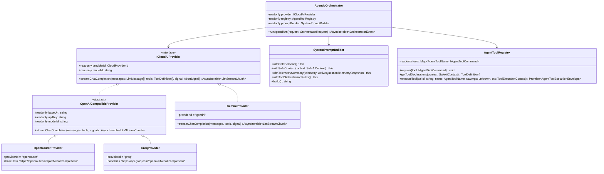
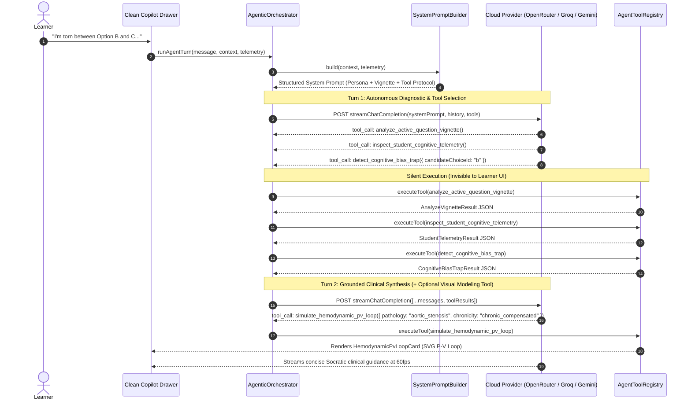

# Implementation Plan: Cloud-Native Agentic Co-Pilot & Autonomous Clinical Toolset (v2.0)

**Branch**: `002-ai-cognitive-copilot` | **Date**: 2026-10-24 | **Spec**: [spec.md](spec.md) | **Contracts**: [ai-copilot-ports.ts](contracts/ai-copilot-ports.ts)

---

## 1. Executive Summary

This architecture overhaul replaces the legacy offline rule engine and superficial UI tool buttons with a **lean, cloud-native, multi-turn agentic architecture**:
1. **Cloud Provider Trio (Zero Local Engine)**:
   - **OpenRouter (`openrouter`)**: Default lightweight model provider with high rate limits (`meta-llama/llama-3.1-8b-instruct:free` / `google/gemma-3-12b-it:free`).
   - **Groq Cloud (`groq`)**: Ultra-fast LPU streaming (`llama-3.3-70b-versatile`).
   - **Google Gemini (`gemini`)**: Deep clinical reasoning (`gemini-2.5-flash`).
   - **Direct Key Activation**: Fixes the prior bug where unauthenticated/guest sessions blocked BYO API keys. Any configured key works immediately with smart automatic fallback across configured providers.
2. **Dedicated `SystemPromptBuilder` (OOP Builder Pattern)**:
   - Dynamically constructs a structured, authoritative Medical Faculty System Prompt containing the active clinical vignette, learner mastery metrics, strict pre-commit Socratic constraints vs post-commit rationale rules, and explicit instructions for autonomous background tool invocation.
3. **Multi-Turn ReAct `AgenticOrchestrator`**:
   - Solves the single-turn tool cutoff issue: when the model calls `analyze_active_question_vignette`, `inspect_student_cognitive_telemetry`, or `detect_cognitive_bias_trap`, the orchestrator executes them silently, feeds the structured diagnostic JSON back to the model as a `tool` role message, and streams the grounded clinical response.
4. **9 High-Impact Clinical & Autonomous Tools (Tools A–I)**:
   - **Silent Background Diagnostics (A, B, C)**: Invisible to the user; give the agent x-ray vision into the vignette and the student's hesitation/bias patterns.
   - **Clinical & Pathophysiological Modeling (D, E, F)**: Interactive Pressure-Volume (P-V) Loop Simulator, Peer Cohort Distractor Analytics, and Physiological Cardiovascular Equation Solver ($MAP, CO, SVR, AVA$).
   - **Active Memory & Remediation (G, H, I)**: Spaced Repetition Flashcard Synthesizer (persisted to `db.srsCards`), Clinical Mnemonic Anchor, and 3-Step Targeted Micro-Curriculum Prescriber.
5. **Minimalist, Distraction-Free UI**:
   - Removes all bloated capabilities modals, noisy quick-intent pill bars, and superficial receipt clutter.
   - Replaces them with a clean, high-craft clinical conversation view and sleek inline cards for P-V loops, physiological equations, peer stats, and SRS flashcards.

---

## 2. Object-Oriented Architecture & Class Hierarchy

---

## 3. Multi-Turn ReAct Tool Execution Lifecycle

---

## 4. Source File Plan & Module Responsibilities

### Phase 1: Cleanup & Removal of Legacy Fluff
- **Delete**:
  - `src/domain/ai/offlineTutor.ts` & `src/domain/ai/__tests__/offlineTutor.test.ts`
  - `src/domain/ai/intents.ts` (removes noisy quick-intent pill bar)
  - `src/ui/features/copilot/CopilotCapabilitiesModal.tsx`
  - `src/ui/features/copilot/artifacts/DifferentialTableCard.tsx`
  - `src/ui/features/copilot/artifacts/CurriculumCitationCard.tsx`
  - `src/ui/features/copilot/artifacts/RetestLauncherCard.tsx`
  - `src/ui/features/copilot/artifacts/CoverageAuditCard.tsx`

### Phase 2: Domain Layer (`src/domain/ai/`)
- **`src/domain/ai/settings.ts`**:
  - `CloudProviderId = 'openrouter' | 'groq' | 'gemini'`
  - Default `activeProvider: 'openrouter'`, default models (`meta-llama/llama-3.1-8b-instruct:free`, `llama-3.3-70b-versatile`, `gemini-2.5-flash`).
- **`src/domain/ai/telemetry.ts`**:
  - `QuestionTelemetryTracker`: Pure OOP tracker recording `timeSpentSeconds`, `choiceToggles`, and `stemRereadCount` per active question.
- **`src/domain/ai/systemPromptBuilder.ts`**:
  - `SystemPromptBuilder`: Fluent OOP builder generating the authoritative medical faculty system prompt with explicit instructions for Autonomous Background Tools (A–C), Clinical Modeling Tools (D–F), and Memory/Remediation Tools (G–I).
- **`src/domain/ai/tools/`**:
  - `toolTypes.ts`: All interfaces and Zod schemas for Tools A–I (`AnalyzeVignetteResult`, `StudentTelemetryResult`, `CognitiveBiasTrapResult`, `PvLoopSimulationResult`, `PeerCohortDifficultyResult`, `CardiovascularEquationResult`, `SrsAnchorResult`, `MnemonicAnchorResult`, `MicroCurriculumResult`).
  - `autonomousDiagnosticTools.ts`: Implementations of Tools A, B, and C (`AnalyzeVignetteTool`, `InspectTelemetryTool`, `DetectCognitiveBiasTool`).
  - `clinicalModelingTools.ts`: Implementations of Tools D, E, and F (`SimulatePvLoopTool`, `SimulatePeerCohortTool`, `CalculateCvEquationTool`).
  - `memoryRemediationTools.ts`: Implementations of Tools G, H, and I (`CreateSrsAnchorTool`, `FormulateMnemonicTool`, `PrescribeMicroCurriculumTool`).
  - `toolRegistry.ts`: `AgentToolRegistry` enforcing policy gates (e.g., blocking clinical tools during unsubmitted timed mock exams) and dispatching tool calls polymorphically.

### Phase 3: Infrastructure Layer (`src/infrastructure/ai/` & `src/infrastructure/storage/db.ts`)
- **`src/infrastructure/storage/db.ts`**:
  - Upgrade Dexie schema to include `srsCards` table for `create_spaced_repetition_anchor`.
- **`src/infrastructure/ai/providers/openAiCompatibleProvider.ts`**:
  - Base streaming SSE adapter supporting OpenAI-format `messages`, `tools`, and `tool_calls` (shared by OpenRouter and Groq).
- **`src/infrastructure/ai/providers/openRouterProvider.ts`**:
  - Concrete adapter for `https://openrouter.ai/api/v1/chat/completions` with `HTTP-Referer` and `X-Title` headers.
- **`src/infrastructure/ai/providers/groqProvider.ts`**:
  - Concrete adapter for `https://api.groq.com/openai/v1/chat/completions`.
- **`src/infrastructure/ai/providers/geminiProvider.ts`**:
  - Concrete adapter for Google Gemini v1beta SSE (`streamGenerateContent`) supporting multi-turn `functionCall` and `functionResponse` parts.
- **`src/infrastructure/ai/agenticOrchestrator.ts`**:
  - `AgenticOrchestrator`: Executes the multi-turn ReAct loop (up to 3 tool rounds), yields silent status indicators for background tools (`visibility === 'silent'`), yields structured artifact payloads for visible tools (`visibility === 'artifact'`), and streams the final synthesized markdown response.

### Phase 4: Clean, Minimalist UI Layer (`src/ui/features/copilot/`)
- **`src/ui/features/copilot/AiCopilotDrawer.tsx`**:
  - Clean, distraction-free medical chat interface.
  - Subtle, non-intrusive status line when silent background tools run (e.g., *"Analyzing clinical vignette & telemetry..."*).
  - Renders clean clinical cards only when Tools D–I are invoked.
- **`src/ui/features/copilot/CopilotSettingsModal.tsx`**:
  - Clean 3-provider configuration selector (**OpenRouter**, **Groq Cloud**, **Google Gemini**) with instant key validation and model selection.
- **`src/ui/features/copilot/cards/`**:
  - `HemodynamicPvLoopCard.tsx`: Interactive SVG Pressure-Volume Loop comparing Normal vs Pathological ventricular mechanics (EDV, ESV, SV, EF%, Preload/Afterload).
  - `CardiovascularEquationCard.tsx`: Clean formula & step-by-step physiological calculation display ($MAP, CO, SVR, AVA$).
  - `PeerCohortTrapCard.tsx`: Visual distractor bar chart & peer trap alert.
  - `MemoryRemediationCard.tsx`: Unified clean view for saved SRS Flashcards, Clinical Mnemonics, and 3-Step Micro-Curriculum prescriptions.

---

## 5. Verification & Quality Gates

1. **Unit Tests (`vitest`)**:
   - `systemPromptBuilder.test.ts`: Verifies system prompt generation across tutor vs proctor modes and pre-commit vs post-commit states.
   - `autonomousTools.test.ts`: Verifies Tools A, B, and C output deterministic, strictly typed diagnostic structures.
   - `clinicalModelingTools.test.ts`: Verifies P-V loop physiological shifts and exact mathematical accuracy of $MAP$, Fick $CO$, $SVR$, and Gorlin $AVA$.
   - `agenticOrchestrator.test.ts`: Verifies the multi-turn ReAct loop (Tool Call → Silent Execution → Tool Result Feedback → Final Text Stream) and provider resolution without guest auth blocking.
2. **Build & Type Check (`pnpm build`)**:
   - Zero TypeScript errors under `strict: true`, `noUnusedLocals: true`, `noUnusedParameters: true`.
