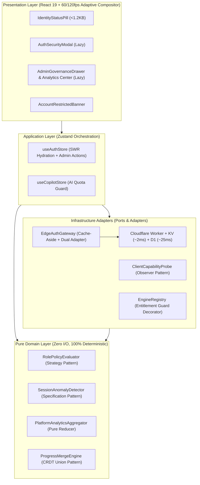

# Principal Engineering Specification: Enterprise Identity, RBAC Governance, Per-User AI Entitlements & Global Cohort Analytics

**Document ID**: `SPEC-003-ENTERPRISE-AUTH-ANALYTICS`  
**Author**: Principal Full-Stack Software Engineer (Apple Platform & Cloud Architecture)  
**Status**: Production Specification & Reference Architecture  
**Target Stack**: TypeScript 5.7 (`strict: true`), React 19, Zustand 5, Cloudflare Workers, Workers KV, Cloudflare D1 (SQLite), Dexie.js (IndexedDB)

---

## 1. Executive Summary & Architectural Philosophy

Med Quests requires an authentication, authorization, and telemetry architecture that satisfies two seemingly contradictory goals:
1. **Zero Perceived Client Latency (`< 1 ms` startup hydration, `< 8.3 ms` 120Hz frame budget)**: Medical students opening the app minutes before an exam must never wait on a blocking network spinner, and budget devices must never drop frames during timed sessions.
2. **Real-Time Centralized Administrative Control (`~2 ms` Edge KV Enforcement)**: Platform administrators must be able to dynamically activate or exclude Cloud AI features (`ai_cloud_streaming_quota`) for specific users, restrict authoring tools, ban/suspend malicious or account-sharing users across the entire platform immediately, and inspect aggregated telemetry and learning statistics across all users.

To achieve both without compromise, the system employs **Hexagonal Architecture (Ports & Adapters)**, **SOLID Object-Oriented & Functional Principles**, and a **Hybrid Local-First + Cloudflare Edge KV Cache-Aside** topology.

---

## 2. SOLID Principles & Software Design Patterns

### 2.1 Adherence to SOLID Principles

| Principle | Architectural Implementation in Med Quests |
| :--- | :--- |
| **S — Single Responsibility Principle (SRP)** | Each domain module has exactly one reason to change: [`entitlements.ts`](file:///Users/mac/Documents/Med%20Quests%20Apps/src/domain/auth/entitlements.ts) evaluates role/flag permissions; [`telemetryParser.ts`](file:///Users/mac/Documents/Med%20Quests%20Apps/src/domain/auth/telemetryParser.ts) parses `request.cf` and HTTP Client Hints; [`anomalyDetector.ts`](file:///Users/mac/Documents/Med%20Quests%20Apps/src/domain/auth/anomalyDetector.ts) computes Haversine velocity and session anomalies; [`hardwareTier.ts`](file:///Users/mac/Documents/Med%20Quests%20Apps/src/domain/auth/hardwareTier.ts) classifies client GPU/CPU capabilities; [`governanceAnalytics.ts`](file:///Users/mac/Documents/Med%20Quests%20Apps/src/domain/auth/governanceAnalytics.ts) aggregates cross-user telemetry and executes directory filtering. |
| **O — Open/Closed Principle (OCP)** | Role policies (`ROLE_ENTITLEMENT_POLICIES`) and feature flags (`FeatureFlagKeySchema`) are declarative, immutable registries. Adding a new role tier or feature flag requires zero modifications to the `RolePolicyEvaluator` resolution algorithm. |
| **L — Liskov Substitution Principle (LSP)** | Both `CloudflareEdgeAuthAdapter` (production edge worker) and `LocalSimulatedEdgeAuthAdapter` (offline/local simulator) satisfy `AuthGatewayPort` and `AdminGovernancePort` with identical pre/post-conditions and `Result<T, AuthDomainError>` return semantics. Similarly, `OfflineTutorEngine`, `GroqCloudEngine`, and `GeminiCloudEngine` are seamlessly substitutable under `AiEngine`. |
| **I — Interface Segregation Principle (ISP)** | Contracts are segregated into focused ports: `IRolePolicyEvaluator` (permission checks), `AuthGatewayPort` (session lifecycle), `EdgeTelemetryExtractorPort` (0ms header extraction), `ClientCapabilityDetectorPort` (hardware probing), and `IAdminGovernanceService` (user management & cohort analytics). Client UI components only depend on the narrow slice they consume. |
| **D — Dependency Inversion Principle (DIP)** | High-level application stores (`useAuthStore`, `useCopilotStore`) and domain services depend strictly on abstract TypeScript interfaces and pure domain ports—never directly on `fetch`, `localStorage`, or Cloudflare Worker bindings. |

### 2.2 Core Design Patterns



1. **Stale-While-Revalidate (SWR) Optimistic Hydration Pattern**:
   On boot, `useAuthStore` synchronously reads the cached local session snapshot in `< 1 ms` so the UI renders on the very first browser paint. Background revalidation runs inside `requestIdleCallback` against the Cloudflare Worker edge.
2. **Cache-Aside + Write-Through Eviction Pattern**:
   Cloudflare Workers KV stores `sess:{sha256(token)}` (TTL 600s) and `usr_guard:{userId}`. Every administrative mutation (role change, AI feature exclusion, or account block) writes to Cloudflare D1 and synchronously evicts/updates the KV guard key, guaranteeing global enforcement in `~2 ms`.
3. **Entitlement Decorator / Guard Pattern (AI Feature Activation & Exclusion)**:
   `resolveAiEngine(settings, entitlements)` wraps cloud AI instantiation (`GroqCloudEngine` / `GeminiCloudEngine`) with an explicit RBAC + per-user override check (`entitlements.ai_cloud_streaming_quota`). If an administrator excludes a user from Cloud AI, the factory deterministically falls back to the local `OfflineTutorEngine` without crashing or leaking API calls.
4. **Specification Pattern for User Directory & Security Filtering**:
   `filterManagedUsers(users, filterSpec)` composes predicate specifications (search query, role filter, restriction filter, AI entitlement status, and security anomaly presence) in pure domain code.

---

## 3. Capabilities & Latency Budget Specification

### 3.1 End-to-End Latency Budgets

| Operation | Target Latency | Execution Mechanism |
| :--- | :---: | :--- |
| **Cold App Boot Auth Hydration** | `< 1.0 ms` | Synchronous read from local storage snapshot into `useAuthStore`. |
| **Hardware & Timezone Capability Probe** | `< 0.5 ms` | Non-blocking read of `navigator.hardwareConcurrency`, `deviceMemory`, `connection`, `Intl`. |
| **Edge Geo & Network Sniffing** | `0.0 ms` | Pre-populated by Cloudflare edge network on `request.cf` during TLS handshake. |
| **Warm Session & Block Verification** | `1.5 – 4.0 ms` | Cloudflare Workers KV read (`sess:{tokenHash}` + `usr_guard:{userId}`) at nearest PoP (`colo`). |
| **Cold Session Fallback (Cache Miss)** | `18.0 – 35.0 ms` | Indexed SQLite query on Cloudflare D1 (`idx_session_token_hash`), auto-hydrating KV. |
| **Admin Block / AI Toggle Propagation** | `< 5.0 ms` | Synchronous KV `usr_guard:{userId}` write + active `sess:*` eviction. |
| **UI Modal / Drawer Animation Frame Time** | `< 8.3 ms` | Locked 120fps on `ultra` tier via GPU-composited `transform: translate3d` & `opacity`. |

---

## 4. Role Hierarchy & Granular Feature Entitlement Matrix

### 4.1 Role Tiers (`UserRole`)

1. **`anonymous` (Local Guest)**: Default local-first scholar. 100% free access to offline practice, mock exams, and the offline curriculum-grounded Socratic AI tutor.
2. **`student-free` (Authenticated Student)**: Cloud progress backup across up to 2 devices and a starter quota of 15 daily Cloud AI requests.
3. **`student-pro` (Scholar Pro)**: High-rate Cloud AI streaming (`ai_cloud_streaming_quota: true`, 250 requests/day), multi-block early unlocks, and up to 4 concurrent devices.
4. **`faculty-reviewer` (Medical Faculty)**: Full access to Question Studio (`/studio`) for authoring and verifying clinical vignettes, 500 daily Cloud AI requests, and 5 concurrent devices.
5. **`admin` (Platform Administrator)**: Full access to the **Enterprise Governance & Cohort Analytics Command Center**, user role management, per-user feature overrides, instant account blocking, 5,000 daily Cloud AI requests, and 10 concurrent devices.

### 4.2 Per-User Feature Activation & Exclusion (`customFeatureOverrides`)

Every `UserProfile` carries an explicit override map:
```typescript
customFeatureOverrides: Partial<Record<FeatureFlagKey, boolean>>
```
Resolution follows a strict three-layer precedence rule in [`RolePolicyEvaluator.resolveEntitlements()`](file:///Users/mac/Documents/Med%20Quests%20Apps/src/domain/auth/entitlements.ts#L125-L137):
$$\text{EffectiveEntitlement}(u, f) = \begin{cases} \text{true} & \text{if } f \in \{\text{local\_practice\_and\_mock}, \text{local\_grounded\_copilot}\} \text{ (Constitution Invariant)} \\ u.\text{customFeatureOverrides}[f] & \text{if } f \in \text{dom}(u.\text{customFeatureOverrides}) \\ \text{RolePolicy}(u.\text{role}).\text{defaultFeatures}[f] & \text{otherwise} \end{cases}$$

**Key Administrative Capabilities**:
- **Granting AI to a Free Student**: An admin can toggle `ai_cloud_streaming_quota = true` on a specific `student-free` user (e.g., scholarship recipient or beta tester) without upgrading their entire role to `student-pro`.
- **Excluding AI from a Pro/Faculty User**: An admin can toggle `ai_cloud_streaming_quota = false` on a `student-pro` user who is abusing token quotas, immediately cutting off their cloud LLM access while preserving their other account benefits.

---

## 5. Multi-Level Security Enforcement: Feature Blocking vs. Platform Banning

### 5.1 Three-State Account Restriction Model (`AccountRestriction`)

```typescript
export type AccountStatus = 'active' | 'suspended' | 'blocked';
```

| Status | Platform Access | Cloud Sync & Cloud AI | Local Offline Study | Recovery / Expiration |
| :--- | :--- | :--- | :--- | :--- |
| **`active`** | Full access per role & feature overrides | Enabled per entitlements | 100% Enabled | Normal operation |
| **`suspended`** | Temporary security hold (e.g. impossible travel anomaly) | Paused (`403 ACCOUNT_SUSPENDED`) | Allowed in local guest mode | Auto-expires at `blockedUntil` or via Admin review |
| **`blocked`** | Complete platform account ban | Immediately terminated (`403 ACCOUNT_BLOCKED`) | Account locked; shows `AccountRestrictedBanner` | Requires explicit Admin unblock |

### 5.2 Automated Security Anomaly Detection & One-Click Quarantine

The domain service [`detectSessionAnomalies()`](file:///Users/mac/Documents/Med%20Quests%20Apps/src/domain/auth/anomalyDetector.ts) continuously evaluates incoming sessions against four security invariants:
1. **`impossible_travel_geo_shift`**: Haversine great-circle distance between two sessions divided by elapsed time exceeds `900 km/h` (commercial aircraft speed threshold) across >300 km.
2. **`excessive_concurrent_devices`**: Active device count exceeds `ROLE_ENTITLEMENT_POLICIES[role].maxConcurrentDevices`.
3. **`high_threat_ip_score`**: Cloudflare Bot/Threat score $\ge 50$.
4. **`rapid_failed_auth_attempts`**: $\ge 5$ failed sign-in attempts within a 5-minute window.

Administrators can click **"Quarantine Flagged Accounts"** in the Governance Command Center to automatically suspend or block all accounts exhibiting active security anomalies.

---

## 6. Global Cohort & Telemetry Analytics Dashboard Specification

To give platform leadership complete visibility into all collected user data without compromising privacy, the **Admin Governance & Analytics Command Center** aggregates telemetry across all registered scholars into a real-time **Platform Analytics Snapshot** (`PlatformAnalyticsSnapshot`):

### 6.1 Aggregated Metrics & KPIs
1. **Population & Activity Metrics**:
   - Total Registered Scholars, Active Today Count, Blocked/Suspended Count, and Role Tier Breakdown (`student-free`, `student-pro`, `faculty-reviewer`, `admin`).
2. **Academic & Curriculum Mastery Telemetry**:
   - Platform-wide Question Attempts, Global Mean Accuracy (%), Mean Cardiovascular (CVS) Block Mastery (%), and University Cohort Comparison (e.g., Cairo University, Ain Shams University, Alexandria University, Mansoura University).
3. **AI Co-Pilot Entitlement & Quota Telemetry**:
   - Number of users with active `ai_cloud_streaming_quota` vs. excluded users, Total Daily Cloud AI Requests Consumed vs. Allocated Capacity, and top AI power users.
4. **Cloudflare Edge Network & Hardware Tier Telemetry**:
   - Distribution of connections across Cloudflare Edge Colocations (`CAI`, `FRA`, `LHR`, `DXB`, `IAD`) with mean edge verification latency (`ms`) and KV Cache Hit Ratio (%).
   - Client Hardware Tier distribution (`Ultra 120fps`, `Balanced 60fps`, `Low-Spec Saver`) and Device/OS breakdown (`macOS`, `iOS`, `Windows`, `Android`).
5. **Security & Anomaly Radar**:
   - Count of accounts flagged for `impossible_travel_geo_shift`, `excessive_concurrent_devices`, or `high_threat_ip_score`, paired with an immutable, chronological `SecurityAuditLogEntry` stream.
