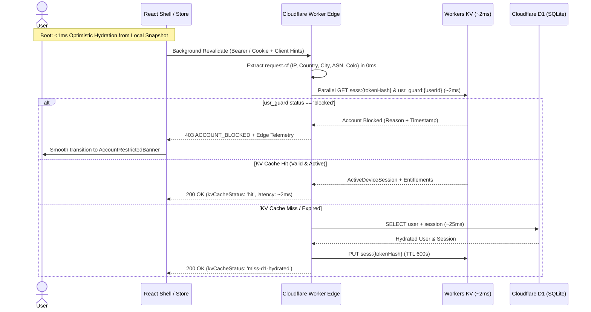
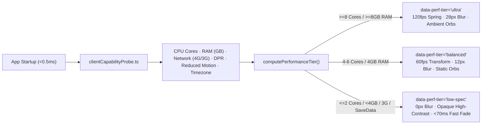

# Implementation Plan: Edge Authentication, Role Governance, Network Telemetry & Adaptive 60/120fps UX Engine

**Branch**: `003-edge-auth-adaptive-telemetry` | **Date**: 2026-10-24 | **Spec**: [spec.md](spec.md)
**Input**: Feature specification from `specs/003-edge-auth-adaptive-telemetry/spec.md`, [research.md](research.md), [data-model.md](data-model.md), and `.specify/memory/constitution.md`

---

## Summary

Architect and implement an ultra-fast, zero-blocking **Edge Authentication, RBAC Governance, Network Intelligence, and Adaptive 60/120fps UX Engine** for the Med Quests platform. The system combines:
1. **Stale-While-Revalidate Optimistic Auth (`< 1 ms` startup)** with **Better Auth + Cloudflare D1 + Workers KV Cache-Aside (`~2 ms` warm edge verification)**.
2. **Deterministic Local-to-Cloud Progress Merge** (`attempts`, `reviewCards`, `bookmarks`, `notes`) so local-first anonymous study sessions transition into authenticated accounts with zero data loss.
3. **Instant Role-Based Access Control (RBAC), Granular Feature Entitlements & Immediate User Blocking** via synchronous KV session eviction and `usr_guard:{userId}` edge enforcement.
4. **Dual-Pipeline Telemetry**:
   - **Edge Geo/Network Intelligence (`request.cf` + Client Hints)**: `0 ms` capture of IP, Country, City, Region, ASN/ISP, Edge `colo`, HTTP/TLS version, OS, Browser, and Device category, plus impossible-travel / concurrent-device anomaly detection.
   - **Client Hardware & Timezone Probe**: `< 0.5 ms` non-invasive detection of CPU cores, RAM tier, effective network type, DPR, `prefers-reduced-motion`, and local IANA timezone.
5. **Three-Tier Adaptive CSS Compositor Engine (`ultra` | `balanced` | `low-spec`)**: Locks UI transitions at 60/120fps on high-end hardware via GPU-composited spring physics while automatically stripping expensive multi-pass blurs and infinite keyframe loops on constrained devices.

---

## Technical Context

- **Language/Version**: TypeScript 5.7+ (`strict: true`, zero `any`, zero `!`, exhaustive discriminated unions with `assertNever`)
- **Primary Dependencies**: React 19 (`React.lazy` + `Suspense`), Zustand 5, Zod 3, Dexie.js 4, Lucide React, Tailwind CSS v4, Cloudflare Workers / D1 / KV bindings (`wrangler.jsonc`)
- **Software Design Patterns**:
  1. **Hexagonal Architecture (Ports & Adapters)**: Pure domain contracts (`AuthGatewayPort`, `EdgeTelemetryExtractorPort`, `EdgeKvCachePort`, `ClientCapabilityDetectorPort`, `AdminGovernancePort`) in `src/domain/auth/` implemented by infrastructure adapters in `src/infrastructure/auth/`.
  2. **Cache-Aside + Write-Through Invalidation Pattern**: Workers KV serves warm session reads in `~2 ms`; mutations (role update, account block, device revoke) write to D1 and immediately purge/update KV keys (`sess:{hash}` + `usr_guard:{userId}`).
  3. **Stale-While-Revalidate (SWR) Optimistic Hydration Pattern**: `useAuthStore` hydrates synchronously on boot (`< 1 ms`) from a local snapshot and reconciles with the edge in the background via `requestIdleCallback`.
  4. **Strategy Pattern**: Seamless runtime switching between `CloudflareEdgeAuthAdapter` (production / Wrangler edge) and `LocalSimulatedEdgeAuthAdapter` (offline / local Vite dev with realistic simulated Cloudflare colos, multi-device sessions, and instant role/block testing).
  5. **Observer & Reactive CSS Variable Binding Pattern**: `ClientCapabilityDetector` listens to network (`navigator.connection`) and motion (`matchMedia`) changes and updates `document.documentElement.dataset.perfTier` without triggering React tree re-renders.
- **Performance & UX Targets**:
  - Initial JS bundle overhead: `< 1.5 KB` gzipped (all Auth, Security & Governance modals lazy-loaded on demand with hover prefetch).
  - Client startup hydration: `< 1 ms` synchronous state load + `< 0.5 ms` hardware capability probe.
  - Warm edge session check: `1–4 ms` via Workers KV.
  - Animation frame budget: `< 8.3 ms` (120Hz ProMotion) / `< 16.6 ms` (60Hz) using strictly GPU-composited `transform: translate3d` and `opacity`.

---

## Constitution Check

*GATE: Verified before and after Phase 1 design.*

- [x] **P1 — Testing & Review First**: Auth and telemetry never block or gate practice or mock exams; anonymous learners can test and review immediately.
- [x] **P2 — Medical Accuracy Is Absolute**: Untouched; medical content and verification remain 100% curriculum-grounded.
- [x] **P3 — No Runtime Question Generation**: Untouched.
- [x] **P4 — Zero-Friction Interaction**: `< 1 ms` optimistic hydration; adaptive `low-spec` tier guarantees `< 16 ms` answer selection latency even on budget tablets.
- [x] **P5 — Exam Integrity**: Mid-exam background token refreshes are silent and never interrupt or leak exam state.
- [x] **P6 — Type Safety & Determinism**: Discriminated `AuthState` union, `Result<T, AuthDomainError>` error handling, and Zod boundary schemas.
- [x] **P7 — Clean Architecture**: `ui → application → domain ← infrastructure`.
- [x] **P8 — Local-First, Private, Free**: Default `anonymous-guest` mode remains 100% free and offline; zero third-party analytics SDKs; invasive browser fingerprinting (`getBattery`, Canvas/Audio hashing) strictly prohibited.
- [x] **P9 — Test-Backed Changes**: Unit tests for RBAC entitlement resolution, geo/device anomaly detection, hardware tier classification, and CRDT progress merge.
- [x] **P10 — Accessible & Calm**: Full keyboard navigation (`Esc`, focus trap, `aria-live`), calm Account Restricted screen, and automatic `0 ms` transitions under `prefers-reduced-motion: reduce`.

---

## Project Structure

### Documentation & Design Artifacts (`specs/003-edge-auth-adaptive-telemetry/`)

```text
specs/003-edge-auth-adaptive-telemetry/
├── spec.md                              # Feature Specification (User Stories P1-P5, FRs, SCs)
├── plan.md                              # This Implementation Plan
├── research.md                          # Architectural & Performance Decisions
├── data-model.md                        # Strict TypeScript Interfaces, Unions, Zod & D1/KV Schema
├── quickstart.md                        # End-to-End Verification & Testing Guide
├── checklists/
│   └── requirements.md                  # Validated Specification Quality Checklist
└── contracts/
    └── auth-telemetry-ports.ts          # Domain Ports, Error Unions & Fluid Motion Tokens
```

### Source Code Layout (`src/` & `worker/`)

```text
src/
├── domain/
│   └── auth/
│       ├── types.ts                     # AuthState, UserProfile, EdgeNetworkTelemetry, ClientCapabilityProfile, Zod schemas
│       ├── entitlements.ts              # Pure RBAC role & feature flag evaluation + Role policies
│       ├── telemetryParser.ts           # Pure User-Agent, Client Hints & request.cf geo extractor
│       ├── anomalyDetector.ts           # Pure impossible-travel & concurrent-device detector
│       ├── hardwareTier.ts              # Pure deterministic PerformanceTier classifier (ultra | balanced | low-spec)
│       └── progressMerge.ts             # Pure deterministic CRDT union merge for local-to-cloud sync
├── application/
│   └── stores/
│       └── useAuthStore.ts              # Zustand store: optimistic hydration, RBAC actions, device management & perf tier
├── infrastructure/
│   ├── storage/
│   │   └── db.ts                        # Dexie schema integration for auth snapshot & sync metadata
│   └── auth/
│       ├── clientCapabilityProbe.ts     # Safe <0.5ms browser probe + root data-perf-tier compositor binder
│       └── edgeAuthGateway.ts           # Dual adapter (Cloudflare Worker API + Local Edge Simulator with KV/D1 parity)
├── ui/
│   ├── app/
│   │   └── Shell.tsx                    # Compact Identity, Edge Latency Pill & Adaptive Tier indicator in header
│   └── features/
│       └── auth/
│           ├── IdentityStatusPill.tsx       # <1.2KB header trigger showing Role badge, Edge Colo & Perf Tier
│           ├── AuthSecurityModal.tsx        # Lazy-loaded 60fps Sign-In / Sign-Up / Active Devices / Hardware Telemetry modal
│           ├── AdminGovernanceDrawer.tsx    # Lazy-loaded RBAC, Feature Entitlements & Instant Block console
│           └── AccountRestrictedBanner.tsx  # Calm, informative blocked-account recovery view
└── worker/
    ├── index.ts                         # Cloudflare Worker entrypoint (request.cf extraction + KV Cache-Aside + D1)
    └── migrations/
        └── 0001_better_auth_edge_telemetry.sql  # Cloudflare D1 SQLite schema for user, session & security_audit_log
```

---

## Architecture Sequence Diagrams

### 1. Hybrid KV Edge Verification & Instant Block Enforcement



### 2. Adaptive Hardware Probe & Zero-Overdraw CSS Compositor Pipeline


