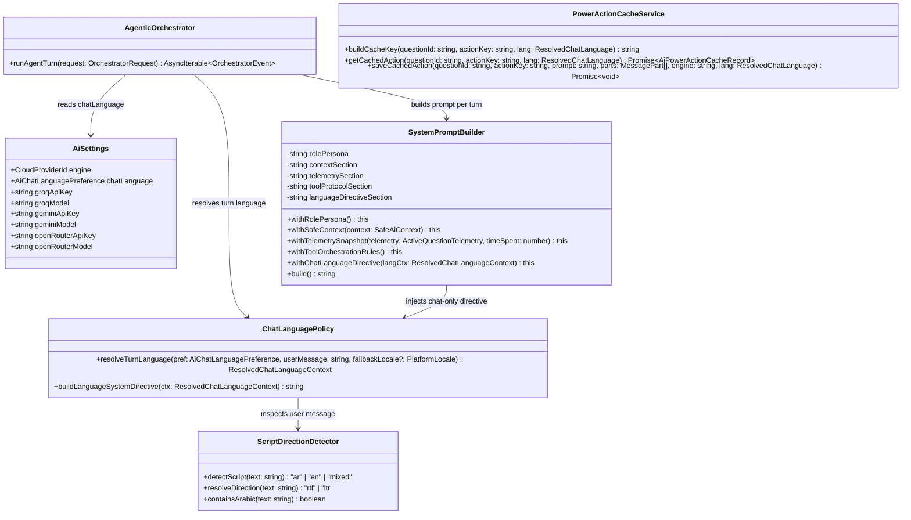
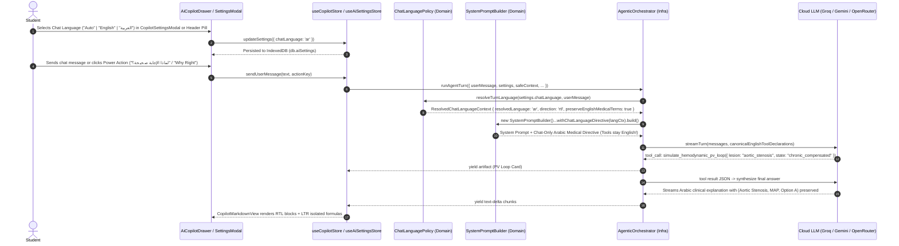

# Implementation Plan: Apple-Grade Bilingual Platform (`en` & `ar`) & Chat-Scoped AI Language Engine

**Branch**: `004-bilingual-i18n-ai-localization` | **Date**: 2026-10-25 | **Spec**: [spec.md](file:///Users/mac/Documents/Med%20Quests%20Apps/specs/004-bilingual-i18n-ai-localization/spec.md) | **Contracts**: [i18n-ai-language-ports.ts](file:///Users/mac/Documents/Med%20Quests%20Apps/specs/004-bilingual-i18n-ai-localization/contracts/i18n-ai-language-ports.ts)

---

## 1. Principal SWE Architectural Overview

At Apple, building a bilingual **English (`en`) & Arabic (`ar`)** platform for a high-stakes clinical domain requires solving two distinct problems without tangling them:

1. **Application Chrome & Bi-Directional (LTR/RTL) Presentation Layer**:
   - The UI shell, navigation, drawers, and interactive controls must mirror naturally when `dir="rtl"` is active using **CSS Logical Properties** (`ms-*`, `me-*`, `ps-*`, `pe-*`, `start-*`, `end-*`, `border-s-*`), while preserving LTR clinical data integrity on USMLE vignettes, ECG/P-V Loop graphs, and mathematical equations.
2. **Chat-Only AI Cognitive Co-Pilot Language Engine**:
   - The AI Agent must know the user's preferred chat language (`auto` | `en` | `ar`) **strictly within the chat orchestration pipeline** (`SystemPromptBuilder`, `AgenticOrchestrator`, `CopilotSettingsModal`, `AiCopilotDrawer`, and `PowerActionCacheService`).
   - Why *"In The Chat Only"* is a critical architectural boundary:
     - **Tool Calls Must Remain Canonical English**: When the LLM invokes `simulate_hemodynamic_pv_loop({ lesion: "aortic_stenosis", state: "chronic_compensated" })` or `calculate_cardiovascular_equation`, the tool name and JSON arguments are machine-to-machine contracts validated by Zod. Injecting localization into tool schemas breaks LLM function calling.
     - **Medical Board Exam Fidelity**: Even when the student converses in Arabic (`ar`), USMLE board concepts (`Option A`, `Aortic Stenosis`, `Pulsus parvus et tardus`, `MAP`, `SVR`) must be retained in parentheses alongside the Arabic pathophysiological explanation.

---

## 2. SOLID Principles & Design Patterns Architecture

### 2.1 SOLID Principles Mapping

| Principle | Architectural Application in Med Quests |
| :--- | :--- |
| **S — Single Responsibility (SRP)** | • `ScriptDirectionDetector` (`src/domain/i18n/scriptDetector.ts`): Only detects Unicode script (`ar` vs `en`) and BiDi direction (`rtl` vs `ltr`). • `ChatLanguagePolicy` (`src/domain/ai/languagePolicy.ts`): Only resolves the effective AI chat turn language and formats the LLM prompt directive. • `useLocaleStore` (`src/application/stores/useLocaleStore.ts`): Only manages UI locale state and DOM `dir`/`lang` attributes. • `useAiSettingsStore` (`src/application/stores/useAiSettingsStore.ts`): Persists `chatLanguage` inside `db.aiSettings` alongside model/engine settings. |
| **O — Open/Closed (OCP)** | • `SystemPromptBuilder` is extended via a new fluent builder step `.withChatLanguageDirective(context)` without modifying existing role, context, telemetry, or tool protocol builders. • New languages can be added by registering a dictionary satisfying `TranslationDictionary` and a `ChatLanguageStrategy` without touching UI components. |
| **L — Liskov Substitution (LSP)** | • Both `enDictionary` and `arDictionary` strictly implement the compile-time `TranslationDictionary` interface. Any missing key in `arDictionary` is a compile-time TypeScript error (`tsc -b`). |
| **I — Interface Segregation (ISP)** | • Components that only need RTL directionality consume `useDirection()` (`{ dir, isRtl }`). • AI Chat components consume `settings.chatLanguage` from `useAiSettingsStore`. • UI Chrome consumes `useTranslation()`. |
| **D — Dependency Inversion (DIP)** | • `AgenticOrchestrator` and `SystemPromptBuilder` depend on pure domain abstractions (`ResolvedChatLanguageContext`, `AiChatLanguagePreference`), never on browser globals (`navigator.language`, `document.dir`) or React state. |

### 2.2 Gang of Four (GoF) Design Patterns Used

1. **Strategy Pattern (`ChatLanguageStrategy`)**:
   - Encapsulates the algorithm for resolving the active turn's response language:
     - `AutoDetectLanguageStrategy`: Analyzes the user's chat message Unicode code points (`\u0600-\u06FF`). If Arabic script ratio `>= 0.25`, resolves to `'ar'`; otherwise resolves to `'en'` (or inherits the active conversation's last resolved language for short follow-ups).
     - `ExplicitArabicStrategy`: Forces `'ar'` response regardless of whether the student clicked an English prompt or typed a short query.
     - `ExplicitEnglishStrategy`: Forces `'en'` response regardless of input script.
2. **Builder Pattern (`SystemPromptBuilder.withChatLanguageDirective`)**:
   - Appends a deterministic, high-priority `CHAT LANGUAGE & BILINGUAL MEDICAL TERMINOLOGY DIRECTIVE` section to the system prompt sent to Groq, Gemini, or OpenRouter.
3. **Adapter Pattern (`DomDirectionAdapter`)**:
   - Synchronizes `<html lang="en|ar" dir="ltr|rtl">` and CSS font variables at `0ms` synchronous layout time to prevent Flash of Unstyled/Unmirrored Content (FOUC).
4. **Flyweight & Namespace Cache Pattern (`PowerActionCacheService`)**:
   - Namespaces IndexedDB cache keys as `${questionId}:${actionKey}:${resolvedLanguage}` so 0ms instant Power Actions (`Why Right`, `Rule Out Wrong`, `Pivot Clues`) cache and serve the exact language requested by the user.

---

## 3. Class & Sequence Diagrams

### 3.1 Domain & Application Class Hierarchy

### 3.2 Chat-Only Bilingual AI Turn Sequence

---

## 4. Detailed Implementation Phases & File Manifest

### Phase 1: Pure Domain Layer — Script Detection, AI Language Policy & Prompt Builder
1. **[NEW] `src/domain/i18n/types.ts` & `src/domain/i18n/scriptDetector.ts`**:
   - Pure Unicode script analyzer (`\u0600-\u06FF`, `\u0750-\u077F`, `\u08A0-\u08FF`).
   - Exports `detectDominantLanguage(text: string): 'ar' | 'en'`, `detectTextDirection(text: string): 'rtl' | 'ltr'`, and `hasArabicCharacters(text: string): boolean`.
2. **[MODIFY] [`src/domain/ai/settings.ts`](file:///Users/mac/Documents/Med%20Quests%20Apps/src/domain/ai/settings.ts)**:
   - Add `AiChatLanguagePreferenceSchema = z.enum(['auto', 'en', 'ar'])`.
   - Extend `AiSettingsSchema` with `chatLanguage: AiChatLanguagePreferenceSchema.default('auto')`.
   - Update `DEFAULT_AI_SETTINGS` and `parseAiSettings` migration logic so existing IndexedDB settings seamlessly default `chatLanguage` to `'auto'`.
3. **[NEW] `src/domain/ai/languagePolicy.ts`**:
   - Implements `resolveChatLanguageContext(preference: AiChatLanguagePreference, userMessage: string, fallbackLocale?: 'en' | 'ar'): ResolvedChatLanguageContext`.
   - Implements `buildChatLanguageDirective(ctx: ResolvedChatLanguageContext): string`:
     - When `resolvedLanguage === 'ar'`:
       - Instructs the AI to respond in **clear, authoritative Modern Standard Medical Arabic (اللغة العربية الفصحى الطبية)**.
       - **Medical Term Preservation Rule**: Always keep canonical USMLE English medical terms, diseases, anatomical structures, physiological abbreviations (`MAP`, `CO`, `SVR`, `EDV`, `ESV`, `P-V Loop`), and Option letters (`Option A`, `Option B`) in parentheses next to the Arabic term, e.g., `تضيق الصمام الأبهري (Aortic Stenosis)`.
       - **Tool Protocol Guardrail**: Strictly mandates that all function/tool call names and JSON arguments MUST remain in canonical English.
       - **Callout Header Mapping**: Supports clean structured headers so `CopilotMarkdownView` renders luxury callout boxes in both Arabic and English.
     - When `resolvedLanguage === 'en'`:
       - Instructs the AI to respond in concise, authoritative USMLE Clinical English, even if the student included Arabic words in their prompt.
4. **[MODIFY] [`src/domain/ai/systemPromptBuilder.ts`](file:///Users/mac/Documents/Med%20Quests%20Apps/src/domain/ai/systemPromptBuilder.ts)**:
   - Add `.withChatLanguageDirective(context: ResolvedChatLanguageContext): this` and include `this.languageDirectiveSection` in `.build()`.
5. **[MODIFY] [`src/domain/ai/powerActions.ts`](file:///Users/mac/Documents/Med%20Quests%20Apps/src/domain/ai/powerActions.ts) & [`src/domain/ai/powerActionCacheService.ts`](file:///Users/mac/Documents/Med%20Quests%20Apps/src/domain/ai/powerActionCacheService.ts)**:
   - Add Arabic labels/tooltips (`labelAr`, `shortLabelAr`, `tooltipAr`) and language-aware prompt generation to `POWER_ACTIONS`.
   - Namespace `PowerActionCacheService.buildCacheKey(questionId, actionKey, lang = 'en')` as `${questionId}:${actionKey}:${lang}` so English and Arabic cached Power Actions coexist cleanly in IndexedDB.

### Phase 2: Infrastructure & Application Stores — Orchestrator & Locale Store
6. **[MODIFY] [`src/infrastructure/ai/agenticOrchestrator.ts`](file:///Users/mac/Documents/Med%20Quests%20Apps/src/infrastructure/ai/agenticOrchestrator.ts)**:
   - Resolve `const langContext = resolveChatLanguageContext(settings.chatLanguage ?? 'auto', userMessage)` and pass `.withChatLanguageDirective(langContext)` into `SystemPromptBuilder`.
7. **[NEW] `src/domain/i18n/dictionaries/en.ts` & `src/domain/i18n/dictionaries/ar.ts`**:
   - Strongly-typed bilingual dictionaries covering Navigation (`Shell.tsx`), AI Co-Pilot Drawer (`AiCopilotDrawer.tsx`), Chatbot Settings (`CopilotSettingsModal.tsx`), Quick Power Actions (`QuickPowerActionsBar.tsx`), and common UI actions.
8. **[NEW] `src/application/stores/useLocaleStore.ts`**:
   - Zustand store managing platform `locale: 'en' | 'ar'`, `dir: 'ltr' | 'rtl'`, `setLocale(locale)`, `toggleLocale()`, and `t` dictionary selector.
   - Synchronizes `<html lang="..." dir="...">` immediately on startup and switch (`initLocale()`).
9. **[MODIFY] [`src/application/stores/useCopilotStore.ts`](file:///Users/mac/Documents/Med%20Quests%20Apps/src/application/stores/useCopilotStore.ts)**:
   - Pass resolved chat language (`'en' | 'ar'`) when looking up and saving `powerActionCacheService` entries and generating localized Power Action prompts.

### Phase 3: Apple-Grade Bilingual UI & BiDi Markdown Rendering
10. **[MODIFY] [`src/index.css`](file:///Users/mac/Documents/Med%20Quests%20Apps/src/index.css)**:
    - Add `--font-arabic: 'IBM Plex Sans Arabic', 'SF Arabic', -apple-system, 'Geeza Pro', 'Cairo', sans-serif;`.
    - Add `:root[dir="rtl"]` typography rules (`letter-spacing: 0`, optimized Arabic line-height) and `.bidi-isolate` / `.ltr-formula` utility rules.
11. **[MODIFY] [`src/ui/features/copilot/CopilotSettingsModal.tsx`](file:///Users/mac/Documents/Med%20Quests%20Apps/src/ui/features/copilot/CopilotSettingsModal.tsx)**:
    - Add the **"Co-Pilot Chat Language / لغة المحادثة"** segmented selector card (`Auto-Detect` | `English` | `العربية`) with clear descriptions of how the AI Mentor responds in the chat while preserving USMLE terminology.
    - Localize modal labels using `useLocaleStore` / active chat language.
12. **[MODIFY] [`src/ui/features/copilot/AiCopilotDrawer.tsx`](file:///Users/mac/Documents/Med%20Quests%20Apps/src/ui/features/copilot/AiCopilotDrawer.tsx)**:
    - Add a sleek 1-click **Chat Language Quick-Pill (`AUTO` / `EN` / `عربي`)** in the Co-Pilot Drawer header right next to the Model Engine pill so students can switch AI response language mid-conversation without even opening the modal.
    - Localize starter inquiry prompts, input placeholder, and status indicators based on the active chat language (`ar` vs `en`).
    - Apply `dir="auto"` to user and assistant chat message containers so Arabic and English turns align naturally.
13. **[MODIFY] [`src/ui/features/copilot/CopilotMarkdownView.tsx`](file:///Users/mac/Documents/Med%20Quests%20Apps/src/ui/features/copilot/CopilotMarkdownView.tsx)**:
    - Detect paragraph/block script direction via `detectTextDirection(line)` and set `dir={blockDir}` on headings, paragraphs, lists, blockquotes, and tables.
    - Replace physical left/right classes (`border-l-2`, `pl-3`, `space-x-2`, `text-left`) with CSS Logical Properties (`border-s-2`, `ps-3`, `gap-2`, `text-start`).
    - Wrap inline `<code>` and mathematical arrows/formulas in `dir="ltr"` spans so equations never invert inside RTL Arabic explanations.
    - Recognize both English and Arabic medical callout headers (`BOARD EXAM RULE` / `قاعدة الاختبار`, `MEMORY ANCHOR` / `مرساة الذاكرة`, `DISTRACTOR TRAP` / `فخ الخيارات المضللة`, `CORE CONCEPT` / `المفهوم الأساسي`).
14. **[MODIFY] [`src/ui/features/copilot/QuickPowerActionsBar.tsx`](file:///Users/mac/Documents/Med%20Quests%20Apps/src/ui/features/copilot/QuickPowerActionsBar.tsx)**:
    - Display Arabic or English short labels & tooltips according to the active chat language preference.
15. **[NEW] `src/ui/app/LocaleToggle.tsx` & [MODIFY] [`src/ui/app/Shell.tsx`](file:///Users/mac/Documents/Med%20Quests%20Apps/src/ui/app/Shell.tsx)**:
    - Add a compact Apple glass `EN / ع` language toggle pill in the top navigation bar alongside `ThemeToggle`, and localize navigation items via `useLocaleStore`.

---

## 5. Verification & Testing Strategy (Constitution P9)

1. **Unit Tests (`src/domain/i18n/__tests__/scriptDetector.test.ts`)**:
   - Verify pure English, pure Arabic, mixed Arabic+English medical terms (`"ما هو سبب Aortic Stenosis في الخيار B؟"`), and number/symbol strings resolve to the exact expected script and direction in `< 1 ms`.
2. **Unit Tests (`src/domain/ai/__tests__/languagePolicy.test.ts` & `systemPromptBuilder.test.ts`)**:
   - Verify `chatLanguage: 'auto' | 'en' | 'ar'` resolution rules.
   - Verify `SystemPromptBuilder.withChatLanguageDirective(...)` injects the Arabic medical instruction, preserves canonical English tool call rules, and maintains exam integrity constraints in both `proctor` and `tutor` modes.
3. **Unit Tests (`src/domain/ai/__tests__/powerActionCacheService.test.ts`)**:
   - Verify English (`q1:why_correct:en`) and Arabic (`q1:why_correct:ar`) cache entries do not collide.
4. **Build & Type Verification**:
   - Run `pnpm test` (`vitest run`) and `pnpm build` (`tsc -b && vite build`) with zero warnings or errors.
