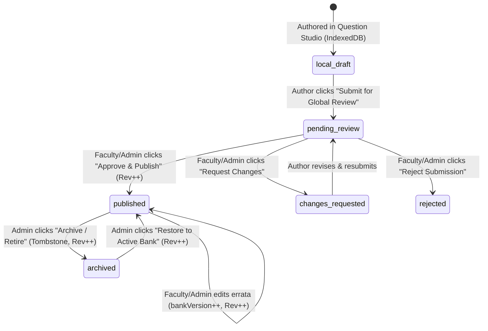
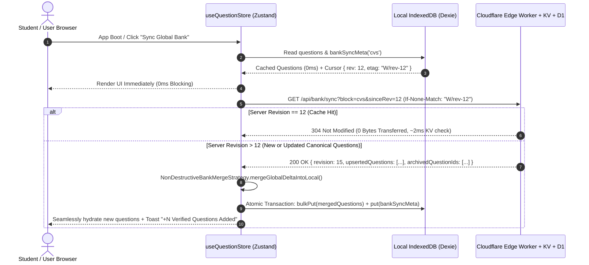
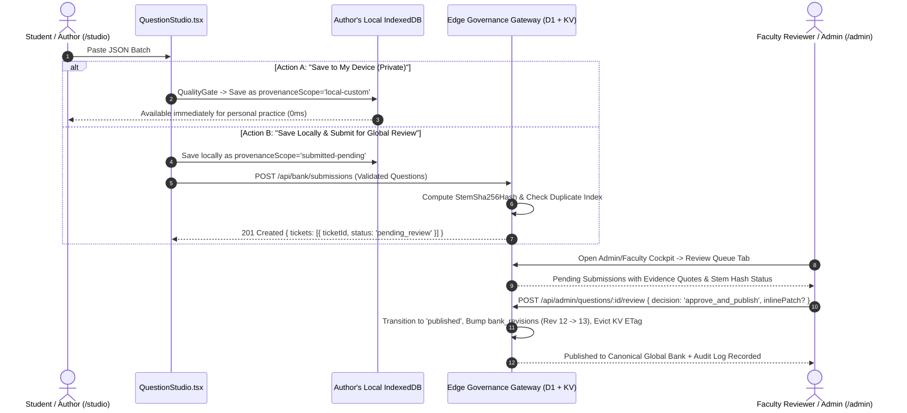

# Principal Engineering Specification: Distributed Global Question Bank, Non-Destructive Delta Synchronization & Editorial Governance Cockpit

**Document ID**: `SPEC-005-GLOBAL-QUESTION-BANK-GOVERNANCE`  
**Author**: Principal Full-Stack Software Engineer (Apple Platform & Cloud Architecture)  
**Status**: Architectural Specification & Pre-Implementation Blueprint  
**Target Stack**: TypeScript 5.7 (`strict: true`), React 19, Zustand 5, Dexie.js 4 (IndexedDB), Cloudflare Workers, Cloudflare Workers KV, Cloudflare D1 (SQLite)  
**Contracts Reference**: [question-bank-governance-ports.ts](file:///Users/mac/Documents/Med%20Quests%20Apps/specs/005-global-question-bank-governance/contracts/question-bank-governance-ports.ts)

---

## 1. Executive Summary & Architectural Philosophy

Currently, Med Quests operates with a purely client-local Question Studio ([`QuestionStudio.tsx`](file:///Users/mac/Documents/Med%20Quests%20Apps/src/ui/features/studio/QuestionStudio.tsx)) and Zustand store ([`useQuestionStore.ts`](file:///Users/mac/Documents/Med%20Quests%20Apps/src/application/stores/useQuestionStore.ts)) backed by Dexie IndexedDB ([`db.ts`](file:///Users/mac/Documents/Med%20Quests%20Apps/src/infrastructure/storage/db.ts)). While this yields `0 ms` local latency, every user is isolated in a private silo.

To scale the Global Question Bank across all users without sacrificing local-first speed or clinical accuracy, we adopt the **Apple CloudKit Public vs. Private Database Architecture**:

1. **Stream 1 — Private Local Sandbox (`0 ms`, Unmoderated, Student-Owned)**:
   Any user can paste or author JSON questions in the Studio and save them directly to their local IndexedDB (`provenanceScope: 'local-custom'`). They can practice on those questions immediately—offline or online—without waiting for external approval.
2. **Stream 2 — Guarded Editorial Review Pipeline (Opt-In Submission $\rightarrow$ Faculty Triage)**:
   Authors can submit local questions to the **Global Curriculum Review Queue** (`editorialStatus: 'pending_review'`). Submissions undergo deterministic quality gating (Zod schema, verbatim evidence grounding check, and SHA-256 stem deduplication) before entering the **Faculty & Admin Review Cockpit**, where reviewers can **Approve & Publish**, **Request Changes**, or **Reject** with structured notes.
3. **Stream 3 — Unidirectional Read-Only Downstream Delta Sync (`304 Not Modified` / Revision Cursor)**:
   Every student client synchronizes from the **Canonical Global Question Bank** via a strictly read-only edge endpoint (`GET /api/bank/sync`). Incoming canonical updates (`provenanceScope: 'global-canonical'`) merge deterministically into the user's local IndexedDB **without ever overwriting or deleting the user's `local-custom` questions** and **without ever mutating the global database**.
4. **Stream 4 — Direct Canonical Bank Curation (Admin & Faculty CRUD + Soft Retirement)**:
   Platform Administrators (`admin`) and Faculty Reviewers (`faculty-reviewer`) have a dedicated **Global Bank Curator** dashboard to add new canonical items directly, edit stems/explanations/distractors in-place (auto-incrementing `bankVersion` and the block's `BankRevisionNumber`), and soft-retire outdated questions (`editorialStatus: 'archived'`) so historical student [`Attempt`](file:///Users/mac/Documents/Med%20Quests%20Apps/src/domain/model/types.ts#L124-L135) and [`ReviewCard`](file:///Users/mac/Documents/Med%20Quests%20Apps/src/domain/model/types.ts#L137-L146) records never suffer broken foreign keys.

---

## 2. SOLID Principles & Object-Oriented Design Patterns

### 2.1 Adherence to SOLID Principles

| Principle | Architectural Implementation in `005-global-question-bank-governance` |
| :--- | :--- |
| **S — Single Responsibility Principle (SRP)** | Each OOP class has a single, cohesive responsibility: `QuestionCanonicalHasher` normalizes stems and computes SHA-256 fingerprints; `QuestionEditorialStateMachine` enforces valid lifecycle transitions and role guards; `NonDestructiveBankMergeStrategy` merges global deltas into local state while protecting `local-custom` items; `QuestionQualityGatePipeline` runs validation rules; `QuestionSpecificationBuilder` builds composable search/filter predicates. |
| **O — Open/Closed Principle (OCP)** | Validation rules implement [`IQuestionQualityRule`](file:///Users/mac/Documents/Med%20Quests%20Apps/specs/005-global-question-bank-governance/contracts/question-bank-governance-ports.ts#L298-L302) (`SchemaStructureQualityRule`, `ClinicalEvidenceGroundingRule`, `SingleCorrectDistractorRule`). Adding new medical board validation rules requires zero modifications to `QuestionQualityGatePipeline`. Similarly, filter criteria compose via [`ISpecification<T>`](file:///Users/mac/Documents/Med%20Quests%20Apps/specs/005-global-question-bank-governance/contracts/question-bank-governance-ports.ts#L270-L275). |
| **L — Liskov Substitution Principle (LSP)** | Both `CloudflareEdgeQuestionBankGateway` (remote Worker + KV + D1) and `SimulatedEdgeQuestionBankGateway` (deterministic local-first edge simulator) implement the exact same segregated ports (`IDownstreamBankSyncPort`, `IStudioProposalSubmissionPort`, `IFacultyReviewQueuePort`, `ICanonicalBankCuratorPort`) and honor identical pre/post-conditions and `Result<T, QuestionBankDomainError>` invariants. |
| **I — Interface Segregation Principle (ISP)** | Rather than a bloated `IQuestionBankService` god-interface, capabilities are split into four narrow role-aligned ports in [`question-bank-governance-ports.ts`](file:///Users/mac/Documents/Med%20Quests%20Apps/specs/005-global-question-bank-governance/contracts/question-bank-governance-ports.ts#L322-L462): `IDownstreamBankSyncPort` (student read-only sync), `IStudioProposalSubmissionPort` (author proposals), `IFacultyReviewQueuePort` (reviewer triage), and `ICanonicalBankCuratorPort` (canonical CRUD & archiving). |
| **D — Dependency Inversion Principle (DIP)** | Application stores (`useQuestionStore`, `useBankGovernanceStore`) and React 19 UI views depend strictly on abstract domain ports and pure OOP domain services—never directly on `fetch()`, SQL strings, or browser storage APIs. |

---

### 2.2 Object-Oriented Class Architecture (UML Class Diagram)

```mermaid
classDiagram
    class GovernedQuestion {
        +QuestionId id
        +BlockId blockId
        +SubjectId subjectId
        +ChapterId chapterId
        +TopicId topicId
        +QuestionProvenanceScope provenanceScope
        +QuestionEditorialStatus editorialStatus
        +StemSha256Hash stemHash
        +number globalRevision
        +number bankVersion
    }

    class QuestionCanonicalHasher {
        +normalizeStemText(stem: string) string
        +computeStemHashSync(stem: string) StemSha256Hash
        +computeStemHashAsync(stem: string) Promise~StemSha256Hash~
    }

    class QuestionEditorialStateMachine {
        +canTransition(from: QuestionEditorialStatus, decision: EditorialReviewDecisionType) boolean
        +transition(submission: QuestionReviewSubmission, command: EditorialDecisionCommand, nextRev: BankRevisionNumber) Result~EditorialTransitionOutcome, QuestionBankDomainError~
    }

    class IQuestionQualityRule {
        <<interface>>
        +string ruleId
        +validate(question: Question, index: number) Result~void, QuestionBankDomainError~
    }

    class QuestionQualityGatePipeline {
        -readonly IQuestionQualityRule[] rules
        +validateBatch(questions: Question[]) BatchQualityGateResult
    }

    class IQuestionMergeStrategy {
        <<interface>>
        +mergeGlobalDeltaIntoLocal(params: MergeParams) MergeOutcome
    }

    class NonDestructiveBankMergeStrategy {
        +mergeGlobalDeltaIntoLocal(params: MergeParams) MergeOutcome
    }

    class ISpecification~T~ {
        <<interface>>
        +isSatisfiedBy(candidate: T) boolean
        +and(other: ISpecification~T~) ISpecification~T~
        +or(other: ISpecification~T~) ISpecification~T~
        +not() ISpecification~T~
    }

    class CompositeSpecification~T~ {
        <<abstract>>
        +isSatisfiedBy(candidate: T)* boolean
        +and(other: ISpecification~T~) ISpecification~T~
        +or(other: ISpecification~T~) ISpecification~T~
        +not() ISpecification~T~
    }

    class EdgeQuestionBankGateway {
        +fetchDeltaSync(blockId: BlockId, cursor: BankSyncCursor) Promise~Result~
        +submitQuestionsForGlobalReview(params: SubmitParams) Promise~Result~
        +listReviewQueue(blockId: BlockId) Promise~Result~
        +submitReviewDecision(command: EditorialDecisionCommand) Promise~Result~
        +listGlobalBankCatalog(blockId: BlockId) Promise~Result~
        +createCanonicalQuestions(params: CreateParams) Promise~Result~
        +updateCanonicalQuestion(params: UpdateParams) Promise~Result~
        +setCanonicalArchiveStatus(params: ArchiveParams) Promise~Result~
    }

    QuestionQualityGatePipeline o-- IQuestionQualityRule
    NonDestructiveBankMergeStrategy ..|> IQuestionMergeStrategy
    CompositeSpecification ..|> ISpecification
    EdgeQuestionBankGateway --> QuestionCanonicalHasher
    EdgeQuestionBankGateway --> QuestionEditorialStateMachine
    EdgeQuestionBankGateway --> QuestionQualityGatePipeline
```



---

## 3. Professional Data Types & Domain Invariants

### 3.1 Nominal Branded Types

To eliminate primitive obsession (e.g., accidentally passing a `UserId` where a `SubmissionTicketId` is expected, or an unhashed stem string where a `StemSha256Hash` is required), the domain layer enforces compile-time nominal branding:

```typescript
declare const __brand: unique symbol;
export type Brand<T, B extends string> = T & { readonly [__brand]: B };

export type BankRevisionNumber = Brand<number, 'BankRevisionNumber'>;
export type StemSha256Hash = Brand<string, 'StemSha256Hash'>;
export type SubmissionTicketId = Brand<string, 'SubmissionTicketId'>;
export type EditorialAuditEventId = Brand<string, 'EditorialAuditEventId'>;
```

### 3.2 Editorial Lifecycle State Machine (`QuestionEditorialStatus`)



### 3.3 Non-Destructive Merge Matrix (`NonDestructiveBankMergeStrategy`)

When `syncWithGlobalBank()` runs on a student's device, the merge engine evaluates every question by `(id, provenanceScope)`:

| Local IndexedDB State | Incoming Global Delta State | Deterministic Merge Resolution |
| :--- | :--- | :--- |
| **Not present locally** | `published` (`global-canonical`) | **Insert** into local IndexedDB (`insertedCount++`). |
| `seed-bundled` or `global-canonical` | `published` with `globalRevision > local.globalRevision` | **Update** local record with latest canonical correction (`updatedCanonicalCount++`). |
| `submitted-pending` | `published` (`global-canonical`) | **Promote** local record to `global-canonical` (`updatedCanonicalCount++`) now that faculty approved it. |
| `local-custom` (Private student item) | Same `id` exists in global delta | **Namespace & Preserve Both**: Re-key the student's private item to `${id}-local-${shortHash}` (`preservedLocalCustomCount++`) and insert the canonical item under `id`. **Zero data loss.** |
| `global-canonical` | Listed in `archivedQuestionIds` | **Soft-Tombstone**: Mark local item `status = 'quarantined'` / `editorialStatus = 'archived'` (`archivedTombstoneCount++`). Excluded from new sessions; retained for historical `Attempt` lookups. |
| `local-custom` (Private student item) | Not in global bank | **100% Untouched** (`preservedLocalCustomCount++`). |

---

## 4. End-to-End Sequence Flows

### 4.1 Flow 1: Unidirectional Read-Only Downstream Sync (All Users)



### 4.2 Flow 2: Studio Local Save vs. Global Review Submission & Faculty Approval



---

## 5. Database & Storage Architecture

### 5.1 Cloudflare D1 Relational Migration (`src/worker/migrations/0003_global_questions_bank.sql`)

```sql
-- ============================================================================
-- Migration 0003: Global Canonical Question Bank & Editorial Review Pipeline
-- ============================================================================

-- 1. Monotonic Revision Counter per Curriculum Block (ETag & Delta-Sync Watermark)
CREATE TABLE IF NOT EXISTS bank_revisions (
    block_id TEXT PRIMARY KEY,
    revision_number INTEGER NOT NULL DEFAULT 1,
    updated_at TEXT NOT NULL DEFAULT (datetime('now'))
);

INSERT OR IGNORE INTO bank_revisions (block_id, revision_number, updated_at)
VALUES ('cvs', 1, datetime('now'));

-- 2. Canonical Global Questions Table
CREATE TABLE IF NOT EXISTS global_questions (
    id TEXT PRIMARY KEY,
    block_id TEXT NOT NULL DEFAULT 'cvs',
    subject_id TEXT NOT NULL,
    chapter_id TEXT NOT NULL,
    topic_id TEXT NOT NULL,
    concept TEXT NOT NULL,
    type TEXT NOT NULL DEFAULT 'single-best-answer',
    stem TEXT NOT NULL,
    stem_hash TEXT NOT NULL,
    choices_json TEXT NOT NULL,
    explanation TEXT NOT NULL,
    exam_tip TEXT,
    mnemonic TEXT,
    difficulty INTEGER NOT NULL DEFAULT 2,
    cognitive_level TEXT NOT NULL DEFAULT 'understanding',
    high_yield INTEGER NOT NULL DEFAULT 1,
    origin TEXT NOT NULL DEFAULT 'authored-grounded',
    evidence_json TEXT NOT NULL,
    editorial_status TEXT NOT NULL DEFAULT 'published'
        CHECK (editorial_status IN ('published', 'archived')),
    bank_version INTEGER NOT NULL DEFAULT 1,
    global_revision INTEGER NOT NULL DEFAULT 1,
    author_id TEXT NOT NULL,
    author_display_name TEXT NOT NULL,
    reviewed_by_id TEXT,
    reviewed_by_display_name TEXT,
    reviewer_notes TEXT,
    published_at TEXT NOT NULL DEFAULT (datetime('now')),
    created_at TEXT NOT NULL DEFAULT (datetime('now')),
    updated_at TEXT NOT NULL DEFAULT (datetime('now'))
);

CREATE INDEX IF NOT EXISTS idx_global_questions_delta_sync
    ON global_questions (block_id, global_revision, editorial_status);

CREATE UNIQUE INDEX IF NOT EXISTS idx_global_questions_stem_dedup
    ON global_questions (chapter_id, stem_hash)
    WHERE editorial_status = 'published';

-- 3. Editorial Review Submissions Queue (Staging Table)
CREATE TABLE IF NOT EXISTS question_review_submissions (
    ticket_id TEXT PRIMARY KEY,
    question_id TEXT NOT NULL,
    block_id TEXT NOT NULL DEFAULT 'cvs',
    subject_id TEXT NOT NULL,
    chapter_id TEXT NOT NULL,
    topic_id TEXT NOT NULL,
    stem_hash TEXT NOT NULL,
    question_payload_json TEXT NOT NULL,
    editorial_status TEXT NOT NULL DEFAULT 'pending_review'
        CHECK (editorial_status IN ('pending_review', 'changes_requested', 'rejected', 'published')),
    submitted_by_user_id TEXT NOT NULL,
    submitted_by_display_name TEXT NOT NULL,
    submitted_by_role TEXT NOT NULL,
    submitted_at TEXT NOT NULL DEFAULT (datetime('now')),
    reviewed_by_user_id TEXT,
    reviewed_by_display_name TEXT,
    reviewed_at TEXT,
    reviewer_notes TEXT
);

CREATE INDEX IF NOT EXISTS idx_submissions_status_block
    ON question_review_submissions (block_id, editorial_status, submitted_at DESC);

CREATE INDEX IF NOT EXISTS idx_submissions_author
    ON question_review_submissions (submitted_by_user_id, submitted_at DESC);

-- 4. Immutable Editorial Audit Log
CREATE TABLE IF NOT EXISTS question_editorial_audit_log (
    id TEXT PRIMARY KEY,
    question_id TEXT NOT NULL,
    block_id TEXT NOT NULL DEFAULT 'cvs',
    action TEXT NOT NULL,
    actor_user_id TEXT NOT NULL,
    actor_display_name TEXT NOT NULL,
    actor_role TEXT NOT NULL,
    previous_status TEXT,
    next_status TEXT NOT NULL,
    revision_after INTEGER NOT NULL,
    summary TEXT NOT NULL,
    occurred_at TEXT NOT NULL DEFAULT (datetime('now'))
);

CREATE INDEX IF NOT EXISTS idx_editorial_audit_chronological
    ON question_editorial_audit_log (block_id, occurred_at DESC);
```

### 5.2 Client-Side Dexie IndexedDB Upgrade (`src/infrastructure/storage/db.ts` — Version 6)

We add a `bankSyncMeta` table to [`MedQuestsDatabase`](file:///Users/mac/Documents/Med%20Quests%20Apps/src/infrastructure/storage/db.ts#L56-L88) to persist the per-block `BankSyncCursor` without touching or invalidating existing student `attempts`, `reviewCards`, `bookmarks`, `questionNotes`, or `aiThreads`:

```typescript
export interface BankSyncMetaRecord {
  blockId: string;
  serverRevision: number;
  lastSyncedAt: string;
  etag: string;
  totalCanonicalCount: number;
}
```

---

## 6. Role-Based Access Control (RBAC) & Governance Permissions

| Operation / Endpoint | `anonymous` | `student-free` / `student-pro` | `faculty-reviewer` | `admin` |
| :--- | :---: | :---: | :---: | :---: |
| **Save Questions to Local IndexedDB (`/studio`)** | ✅ | ✅ | ✅ | ✅ |
| **Downstream Sync from Global Bank (`GET /api/bank/sync`)** | ✅ | ✅ | ✅ | ✅ |
| **Submit Questions for Global Review (`POST /api/bank/submissions`)** | ✅ | ✅ | ✅ | ✅ |
| **View Own Submission Status & Reviewer Notes** | ✅ | ✅ | ✅ | ✅ |
| **Access Editorial Review Queue (`/admin` $\rightarrow$ Review Queue)** | ❌ | ❌ | ✅ | ✅ |
| **Approve / Request Changes / Reject Submissions** | ❌ | ❌ | ✅ | ✅ |
| **Direct Add & Edit Canonical Global Questions (`/admin` $\rightarrow$ Global Bank)** | ❌ | ❌ | ✅ | ✅ |
| **Archive (Soft-Retire) / Restore Canonical Questions** | ❌ | ❌ | ❌ | ✅ |
| **Manage User Roles, Feature Overrides & Account Blocks** | ❌ | ❌ | ❌ | ✅ |

---

## 7. UI/UX Architecture for Studio & Governance Dashboards

### 7.1 Upgraded Question Studio (`src/ui/features/studio/QuestionStudio.tsx`)
1. **Global Bank Sync Bar (Top Header)**:
   - Displays Current Block Revision (`Global Rev #vX`), count of Canonical vs. Local Custom questions, and a **"Sync from Global Bank"** button with real-time delta feedback (e.g., *"Synced: +4 new canonical questions added, 12 local custom questions preserved"*).
2. **Dual-Mode Ingestion Controls**:
   - **Primary Action 1 — "Add to My Local Bank (Private)"**: Instant `0 ms` local IndexedDB write (`provenanceScope: 'local-custom'`).
   - **Primary Action 2 — "Add Locally & Submit for Global Review"**: Writes to local IndexedDB immediately **and** dispatches the batch to the Global Review Queue (`pending_review`).
3. **My Global Submissions Status Panel**:
   - Displays the author's submitted questions with live status badges (`Pending Faculty Review`, `Changes Requested` with reviewer notes, `Published Globally`, or `Rejected`).

### 7.2 Upgraded Admin & Faculty Governance Cockpit (`src/ui/features/admin/AdminDashboardPage.tsx` & `AdminGovernanceDrawer.tsx`)
- **Role-Aware Access Gate**:
  - `admin` has access to all 5 tabs (`Cohort Analytics`, `User Governance`, `Review Queue`, `Global Bank Curator`, `Security & Editorial Audit`).
  - `faculty-reviewer` is granted direct access to the Editorial tabs (`Review Queue`, `Global Bank Curator`, `Editorial Audit`) while user-banning and security controls remain restricted to `admin`.
- **Tab: Curriculum Review Queue**:
  - Filterable queue by status (`Pending Review`, `Changes Requested`, `Published`, `Rejected`), Subject, and Chapter.
  - **Split-Pane Clinical Inspector**: Renders the full clinical vignette stem, all 4 choices with correct/distractor rationales, verbatim curriculum evidence quotes, SHA-256 stem hash badge, and author attribution.
  - **Inline Reviewer Editor**: Allows a Faculty Reviewer or Admin to fix a typo or refine an explanation right inside the review card before clicking **"Approve & Publish"**, or enter reviewer notes and click **"Request Changes"** / **"Reject"**.
- **Tab: Global Bank Curator (CRUD & Versioning)**:
  - Searchable, multi-filter catalog of all global questions using `QuestionSpecificationBuilder` (filter by Subject, Chapter, Difficulty, High-Yield, Active vs. Archived).
  - **"Create Canonical Question" / "Edit Question" Modal**: Full form + JSON editor to directly add or update canonical questions, automatically bumping `bankVersion` (`v1` $\rightarrow$ `v2`) and the global `BankRevisionNumber`.
  - **"Archive / Restore" Toggle**: Soft-retires outdated questions (`archived`) without breaking historical student attempts.

---

## 8. File-Level Modular Implementation Plan

To preserve strict SRP and clean hexagonal boundaries, the implementation is organized into the following focused modules:

1. **Contracts & Branded Types**:
   - [`specs/005-global-question-bank-governance/contracts/question-bank-governance-ports.ts`](file:///Users/mac/Documents/Med%20Quests%20Apps/specs/005-global-question-bank-governance/contracts/question-bank-governance-ports.ts) *(Created)*
2. **Pure Domain Layer (`src/domain/questionBank/` — Zero I/O, 100% Deterministic OOP)**:
   - `src/domain/questionBank/canonicalHasher.ts` — `QuestionCanonicalHasher` (text normalization & SHA-256 stem fingerprinting).
   - `src/domain/questionBank/qualityGatePipeline.ts` — `QuestionQualityGatePipeline` and `IQuestionQualityRule` implementations (`ZodStructureRule`, `VerbatimEvidenceGroundingRule`, `SingleCorrectChoiceRule`, `BatchDuplicateStemRule`).
   - `src/domain/questionBank/editorialStateMachine.ts` — `QuestionEditorialStateMachine` (state transitions, RBAC guards, and immutable `EditorialAuditLogEntry` construction).
   - `src/domain/questionBank/nonDestructiveMergeStrategy.ts` — `NonDestructiveBankMergeStrategy` (idempotent delta merge protecting `local-custom` items and handling soft-archive tombstones).
   - `src/domain/questionBank/questionSpecifications.ts` — Generic `CompositeSpecification<T>` and concrete question filter specifications (`SubjectSpec`, `ChapterSpec`, `EditorialStatusSpec`, `DifficultySpec`, `HighYieldSpec`, `SearchQuerySpec`) + `computeGlobalBankKpis()`.
3. **Infrastructure Layer (`src/infrastructure/questionBank/` & `src/worker/`)**:
   - `src/worker/migrations/0003_global_questions_bank.sql` — Authoritative D1 SQLite schema for `bank_revisions`, `global_questions`, `question_review_submissions`, and `question_editorial_audit_log`.
   - `src/worker/index.ts` — Edge routes:
     - `GET /api/bank/sync` (Read-only ETag + revision delta sync)
     - `POST /api/bank/submissions` (Author proposal submission with SHA-256 deduplication)
     - `GET /api/admin/questions/review-queue` & `POST /api/admin/questions/:id/review` (Faculty/Admin triage)
     - `GET /api/admin/questions/catalog`, `POST /api/admin/questions`, `PUT /api/admin/questions/:id`, `PATCH /api/admin/questions/:id/archive` (Canonical Bank CRUD)
   - `src/infrastructure/storage/db.ts` — Dexie v6 schema adding `bankSyncMeta`.
   - `src/infrastructure/questionBank/edgeQuestionBankGateway.ts` — Dual-mode `EdgeQuestionBankGateway` implementing all 4 segregated ports with Cloudflare Worker integration and deterministic local edge simulation.
4. **Application State Layer (`src/application/stores/`)**:
   - `src/application/stores/useQuestionStore.ts` — Upgraded with `syncWithGlobalBank()`, `submitForGlobalReview()`, `mySubmissions`, `syncCursor`, and `lastMergeReport`.
   - `src/application/stores/useBankGovernanceStore.ts` — Dedicated Zustand store for the Faculty Review Queue, Canonical Bank Curator CRUD, and Editorial Audit logs.
5. **Presentation Layer (`src/ui/features/`)**:
   - `src/ui/features/studio/QuestionStudio.tsx` — Upgraded with Global Bank Delta-Sync bar, Dual Ingest buttons ("Save to My Device" vs. "Submit for Global Review"), and "My Submissions & Faculty Feedback" drawer/panel.
   - `src/ui/features/admin/QuestionBankGovernancePanel.tsx` — Dedicated modular UI component housing the **Curriculum Review Queue** (split-pane inspector + inline editor) and **Global Bank Curator** (filterable catalog + create/edit modal + archive controls), integrated into `AdminDashboardPage.tsx` and `AdminGovernanceDrawer.tsx`.
6. **Unit & Integration Verification (`src/domain/questionBank/__tests__/`)**:
   - Comprehensive Vitest suite testing SOLID domain classes: `QuestionCanonicalHasher`, `QuestionQualityGatePipeline`, `QuestionEditorialStateMachine`, `NonDestructiveBankMergeStrategy`, and `QuestionSpecificationBuilder`.
