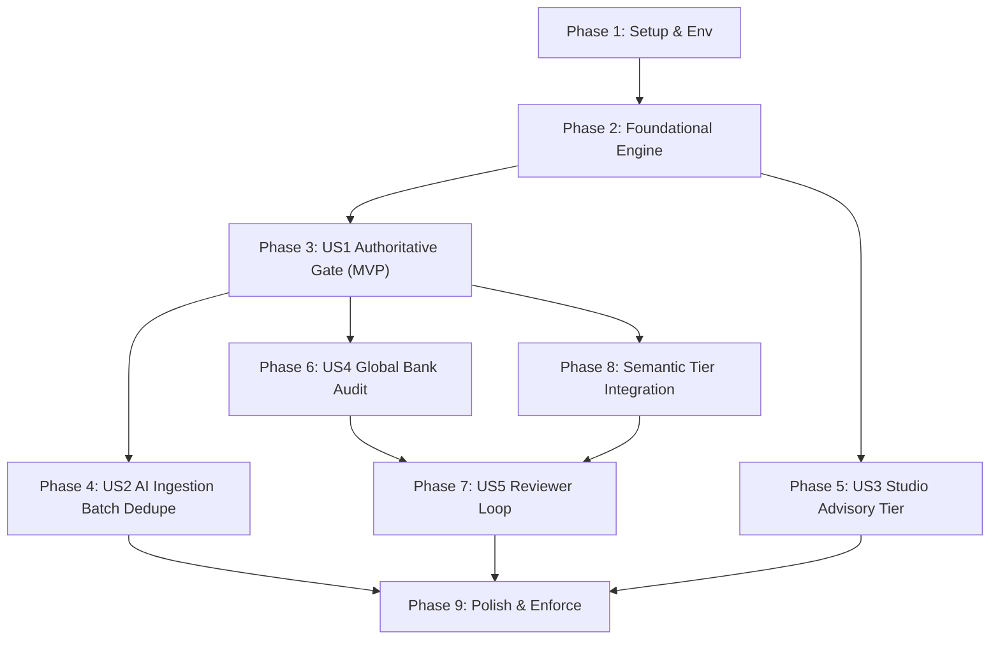

# Tasks: Question Duplication Detection Engine (QDD)

**Feature Branch**: `009-question-duplication-detection-engine`  
**Input**: Design documents from `specs/009-question-duplication-detection-engine/` (`spec.md`, `plan.md`, `contracts/duplication-detection-ports.ts`)  
**Constitution**: `.specify/memory/constitution.md` (P1, P2, P3, P4, P6, P7, P8, P9, P10)

## Format: `[ID] [P?] [Story?] Description`

- **[P]**: Can run in parallel (different files, no blocking dependencies)
- **[Story]**: Maps task to user stories (`[US1]` through `[US5]`)
- Concrete file paths, types, and invariants specified in every task.

---

## Phase 1: Setup & Environment (Bindings & Test Harness)

**Purpose**: Configure Cloudflare Worker bindings, install dev dependencies, and build the 100% automated synthetic golden benchmark.

- [x] T001 Update `wrangler.jsonc` with Cloudflare Vectorize (`QDD_VECTORS` -> `qdd-bge-small-en-v1`), Cloudflare Workers AI (`AI`), and environment configuration variables (`QDD_MODE = "shadow"`, `QDD_THRESHOLDS_VERSION = "v1"`, `QDD_DAILY_BUDGET`)
- [x] T002 [P] Install development test dependencies (`fast-check` for property tests and `@cloudflare/vitest-pool-workers` for D1 `workerd` testing) without adding any runtime dependencies in `package.json`
- [x] T003 [P] Build automated synthetic benchmark generation script in `scripts/qdd/generate-synthetic-golden.ts` that ingests `content/cvs/dist/bank.v1.json` (212 items) and deterministically outputs `test/golden/qdd-golden.v1.jsonl` (≥ 400 labeled pairs across EXACT, NEAR, SIBLING, CONFLICT, and UNIQUE with zero manual faculty labeling)
- [x] T004 [P] Implement golden evaluation runner in `scripts/qdd/eval.ts` calculating precision, recall, F1, and confusion matrix against `test/golden/qdd-golden.v1.jsonl` for CI quality gates

---

## Phase 2: Foundational (Pure Domain Mathematical Engine & In-Memory Adapters)

**Purpose**: Core mathematical normalizers, cryptographic hashers, MinHash LSH, and clinical discriminator extractors. Zero I/O, pure domain, identical in browser and Cloudflare Worker.

- [x] T005 Implement versioned AST canonicalizer `QuestionCanonicalizerV2` in `src/domain/questionBank/duplication/QuestionCanonicalizerV2.ts` normalizing whitespace, casing, smart quotes, units, LaTeX fractions, and producing order-invariant sorted choices and normalized answer key text per `NormalizerVersion = 'qdd-norm-v2'`
- [x] T006 [P] Implement WebCrypto cryptographic fingerprinting helper in `src/domain/questionBank/duplication/sha256.ts` computing branded `CanonicalStemHash`, `CanonicalItemHash`, and `AnswerKeyHash` in both browser and Worker V8 isolates
- [x] T007 [P] Implement 128-permutation MinHash signature generator and 32-band LSH band key encoder (`b00:hex` .. `b31:hex`) with 4 rows per band and word 3-shingles in `src/domain/questionBank/duplication/MinHasher.ts`, `LshBander.ts`, and `shingles.ts`
- [x] T008 [P] Implement clinical discriminator extractor with regex lexicons in `src/domain/questionBank/duplication/ClinicalDiscriminatorExtractor.ts` and `src/domain/questionBank/duplication/discriminatorLexicon.v1.ts` detecting negation, laterality, numeric units, demographics, superlatives, and temporal parameters
- [x] T009 [P] Implement calibrated logistic score fusion and symmetric `PairKey` utility in `src/domain/questionBank/duplication/LogisticScoreFusion.ts` and `src/domain/questionBank/duplication/pairKey.ts` loading weights from `src/domain/questionBank/duplication/config/fusion-weights.v1.json`
- [x] T010 [P] Implement in-memory test fakes in `src/infrastructure/questionBank/duplication/memory/` (`InMemoryFingerprintRepository.ts`, `InMemoryVectorIndex.ts`, `HashingEmbeddingFake.ts`, and `ScriptedLlmArbiterFake.ts`) passing shared contract tests for hermetic, offline testing
- [x] T011 Implement comprehensive property and invariant tests using `fast-check` in `src/domain/questionBank/duplication/__tests__/fastCheckInvariants.test.ts` mathematically proving that: (a) choice permutations yield identical `CanonicalItemHash`, (b) negators always trigger a discriminator delta, (c) `PairKey` is order-symmetric, and (d) `BLOCK` decision is impossible without exact hash collision
- [x] T012 [P] Implement cross-runtime parity tests in `src/domain/questionBank/duplication/__tests__/crossRuntimeParity.test.ts` verifying that `QuestionCanonicalizerV2` and `MinHasher` produce identical byte-for-byte fingerprints in browser JSDOM and Cloudflare `workerd` runtimes

---

## Phase 3: User Story 1 - Authoritative Gate on Submission & Canonical Publish (Priority: P1) 🎯 MVP

**Goal**: Block exact duplicates at the edge before storage, attach explainable evidence to near-duplicates, flag answer conflicts, and enforce the Zero Auto-Acceptance Invariant.

**Independent Test**: Seed D1 with the CVS bank. Submit: (a) an exact choice-shuffled copy $\rightarrow$ `BLOCK` (409), (b) a paraphrase $\rightarrow$ `REVIEW/NEAR`, (c) same stem with different answer $\rightarrow$ `REVIEW/CONFLICT`, and (d) a new item $\rightarrow$ `ALLOW`. Confirm student authors see evidence in `/api/bank/submissions/my` and zero items are auto-published.

- [x] T013 [US1] Create Cloudflare D1 relational migration `src/worker/migrations/0006_question_duplication_engine.sql` defining `question_fingerprints` (with unique partial index on `(block_id, item_hash)` for published items), `question_lsh_bands`, `qdd_pair_verdicts`, `question_duplicate_links`, `qdd_verdict_log`, `qdd_resolutions`, and `qdd_ai_budget`
- [x] T014 [US1] Implement D1 repositories `D1FingerprintRepository.ts` and `D1PairVerdictCache.ts` in `src/infrastructure/questionBank/duplication/d1/` executing batched index lookups and caching pair verdicts
- [x] T015 [US1] Implement Stage 1 `S1Exact.ts` (item/stem hash collision), Stage 2 `S2LexicalLsh.ts` (D1 band key matching), and Stage 4 `S4Discriminators.ts` (discriminator delta & answer-key conflict gate) in `src/domain/questionBank/duplication/stages/`
- [x] T016 [US1] Implement `GatePolicy.ts` enforcing: (a) `EXACT` on published item $\rightarrow$ `BLOCK`, (b) `CONFLICT` or `NEAR` $\rightarrow$ `REVIEW`, (c) `SIBLING` $\rightarrow$ `INFORM`, (d) `UNIQUE` $\rightarrow$ `ALLOW`, (e) degraded mode never blocks, and (f) Zero Auto-Acceptance (everything enters `pending_review`)
- [x] T017 [US1] Implement master `DuplicationDetectionEngine.ts` orchestrator assembling the Chain-of-Responsibility stages with early short-circuiting, timeout control, and telemetry logging
- [x] T018 [US1] Implement dedicated Worker routing and composition root in `src/worker/routes/qdd.ts` and `src/worker/qdd/compositionRoot.ts` handling `POST /api/qdd/check` with Zod validation, role authorization, and rate limiting
- [x] T019 [US1] Hook QDD validation into `POST /api/bank/submissions` in `src/worker/index.ts`: reject `EXACT` with 409 + `QDD_EXACT_DUPLICATE` envelope; attach `qddVerdict` to review queue payload for `NEAR`/`CONFLICT`
- [x] T020 [US1] Hook QDD validation into `POST /api/admin/questions/canonical` in `src/worker/index.ts`: prevent duplicate creation while allowing self-edits (excluding `questionId`)
- [x] T021 [US1] Update `GET /api/bank/submissions/my` in `src/worker/index.ts` to return the stored `qddVerdict` payload so Student-Authors have full visibility into duplicate evidence on their submissions
- [x] T022 [US1] Implement integration test suite using `@cloudflare/vitest-pool-workers` in `src/worker/__tests__/qddAuthoritativeGate.test.ts` verifying all US1 acceptance scenarios against local D1 SQLite

---

## Phase 4: User Story 2 - In-Batch & Against-Bank Deduplication for AI Ingestion (Priority: P1)

**Goal**: Detect duplicates within the parsed batch and against the canonical bank in the AI Question Parser Lab before saving, providing badges, diff inspections, and "Save all unique" filtering.

**Independent Test**: Load a 40-item batch containing 2 in-batch duplicates and 4 bank duplicates into the AI Question Parser Lab. Assert all 6 are badged correctly with 0 false positives, and "Save all unique" skips the duplicates cleanly.

- [x] T023 [US2] Implement `POST /api/qdd/check-batch` in `src/worker/routes/qdd.ts` supporting up to 50 questions: executes pairwise in-batch MinHash collision checks and parallel bank index queries, returning an ordered array of `DuplicationVerdict`
- [x] T024 [P] [US2] Create visual duplication badge component `DuplicateBadge.tsx` in `src/ui/features/qdd/DuplicateBadge.tsx` with color-coded tokens for `Already in the bank`, `Likely duplicate`, `Answer conflict`, and `Related variant`
- [x] T025 [P] [US2] Create token-level diff and discriminator inspection sheet `DuplicateCompareSheet.tsx` in `src/ui/features/qdd/DuplicateCompareSheet.tsx` displaying side-by-side stems, choices, answer keys, and discriminator chips (`NOT ↔ —`, `left ↔ right`)
- [x] T026 [US2] Integrate batch deduplication into `src/application/stores/useAdminAiQuestionParserStore.ts`, running `checkBatch` upon parsing completion and updating each `ParsedQuestionItem` with its verdict and candidate signals
- [x] T027 [US2] Update `src/ui/features/admin/aiQuestionParser/AdminAiQuestionParserLab.tsx` to render `DuplicateBadge`, attach click handler opening `DuplicateCompareSheet`, and implement "Save all unique" button skipping items flagged as `EXACT` or `NEAR`
- [x] T028 [US2] Write unit and component tests in `src/ui/features/qdd/__tests__/batchDeduplication.test.tsx` verifying batch badge rendering and "Save all unique" exclusion logic

---

## Phase 5: User Story 3 - Instant, Calm Advisory Feedback while Authoring (Priority: P2)

**Goal**: Deliver `< 16 ms` non-blocking, offline advisory duplicate hints directly inside the Question Studio as authors type, using a background Web Worker and Dexie IndexedDB.

**Independent Test**: Disconnect from the internet, type a known CVS stem in the Question Studio, pause for 250 ms, and verify the hint appears without UI freeze or layout shift.

- [x] T029 [US3] Implement browser Web Worker in `src/application/qdd/qddAdvisory.worker.ts` and type-safe message protocol in `src/application/qdd/qddWorkerProtocol.ts` executing Stages 0, 1, 2, and 4 against an in-memory index
- [x] T030 [P] [US3] Implement browser fingerprint cache in `src/infrastructure/questionBank/duplication/dexie/DexieFingerprintCache.ts` indexing synced canonical and local custom questions inside Dexie IndexedDB for instant offline lookups
- [x] T031 [US3] Implement React custom hook `useQddAdvisoryHint.ts` in `src/ui/features/qdd/useQddAdvisoryHint.ts` debouncing prompt typing at 250 ms and coordinating messages with the advisory Web Worker
- [x] T032 [P] [US3] Implement accessible inline advisory component `DuplicateHint.tsx` in `src/ui/features/qdd/DuplicateHint.tsx` with `aria-live="polite"`, keyboard accessibility (`⌘↵` to inspect, `Esc` to dismiss), calm styling, and reduced-motion support
- [x] T033 [US3] Wire `useQddAdvisoryHint` and `DuplicateHint` into `src/ui/features/studio/QuestionStudio.tsx`, offering actions: *Open existing*, *This is a different question* (dismiss), and *Make it a variant* (links SIBLING on submit)
- [x] T034 [P] [US3] Add English and Arabic localization dictionaries in `src/domain/i18n/dictionaries/en.ts` and `src/domain/i18n/dictionaries/ar.ts` for all QDD badges, hints, and explanation keys under namespace `qdd.*`
- [x] T035 [US3] Write performance benchmark and unit tests in `src/ui/features/qdd/__tests__/advisoryWorker.test.tsx` verifying `< 16 ms` execution on a 20,000-question simulated local bank and confirming 0 network calls when offline

---

## Phase 6: User Story 4 - Global Bank Health Audit & Resumable Clustering (Priority: P2)

**Goal**: Scan the canonical bank in CPU-safe chunks (`< 8 ms` per invocation on Workers Free), cluster duplicate groups via Union-Find, and present an administrative triage board with non-destructive actions.

**Independent Test**: Run audit against a synthetic bank with 120 planted clusters; verify ≥ 95% cluster recall, confirm job resumes seamlessly across Worker invocations, and verify soft-archive preserves attempt foreign keys.

- [x] T036 [US4] Implement Union-Find graph clusterer and canonical survivor selector in `src/domain/questionBank/duplication/UnionFindClusterer.ts` and `src/domain/questionBank/duplication/SurvivorSelector.ts` prioritizing published items with highest evidence citation counts
- [x] T037 [US4] Implement D1 audit repository `D1AuditJobRepository.ts` in `src/infrastructure/questionBank/duplication/d1/D1AuditJobRepository.ts` managing cursor-based job state across lexical, semantic, and clustering phases
- [x] T038 [US4] Implement chunked audit endpoints in `src/worker/routes/qdd.ts`: `POST /api/admin/qdd/audits` (start/pause/cancel), `POST /api/admin/qdd/audits/:id/advance` (executes single CPU-safe D1 `GROUP BY band_key` chunk), and `GET /api/admin/qdd/audits/:id/clusters` (cursor-paged)
- [x] T039 [P] [US4] Implement audit administrative dashboard `QddAuditBoard.tsx` and `ClusterCard.tsx` in `src/ui/features/qdd/` displaying progress bar, cluster cards, and diff comparisons
- [x] T040 [US4] Implement non-destructive cluster resolution handlers in `src/worker/routes/qdd.ts` supporting `ARCHIVE_DUPLICATE` (soft-archive `editorial_status='archived'`), `MERGE_INTO_SURVIVOR` (non-destructive evidence copy), `LINK_AS_VARIANT`, and `FIX_ANSWER_KEY` (opening canonical editor)
- [x] T041 [US4] Verify audit side effects in `src/worker/__tests__/qddAuditResilience.test.ts`: confirm monotonic `bank_revisions` increment, `question_editorial_audit_log` audit record creation, and attempt foreign-key integrity preservation

---

## Phase 7: User Story 5 - Reviewer Resolution Loop & Continuous Quality Calibration (Priority: P3)

**Goal**: Record every human triage decision, prevent re-flagging identical pairs, export reviewer overrides into golden benchmark candidates, and track live precision metrics.

**Independent Test**: Review a flagged pair as "Keep both — distinct", verify pair verdict is cached as UNIQUE, and run `pnpm qdd:golden:export` to verify the pair is appended to the golden dataset candidate file.

- [x] T042 [US5] Implement `POST /api/admin/qdd/resolutions` in `src/worker/routes/qdd.ts` recording `ReviewerResolution` in `qdd_resolutions` table and updating `qdd_pair_verdicts` cache so resolved pairs never prompt alerts again
- [x] T043 [P] [US5] Implement golden benchmark exporter script `scripts/qdd/golden-export.ts` querying human overrides from `qdd_resolutions` and formatting them into append-only evaluation candidates for `qdd-golden.vN.jsonl`
- [x] T044 [P] [US5] Implement non-blocking telemetry observer `QddTelemetrySink.ts` in `src/infrastructure/questionBank/duplication/telemetry/` forwarding `qdd_verdict` and `qdd_resolution` metrics to PostHog and live observability sinks without question text
- [x] T045 [US5] Add 30-day QDD precision proxy card (`1 - overrides/flags`) and verdict distribution widget into `src/ui/features/admin/QuestionBankGovernancePanel.tsx`
- [x] T046 [US5] Write contract tests in `src/domain/questionBank/duplication/__tests__/resolutionLoop.test.ts` verifying pair cache memoization, override export formatting, and telemetry sink non-blocking behavior

---

## Phase 8: Semantic Tier Integration (Workers AI, Vectorize & Bounded LLM Arbiter)

**Purpose**: Wire Cloudflare Workers AI embeddings, Cloudflare Vectorize HNSW search, Cross-Encoder reranking, and bounded LLM arbitration strictly for ambiguous edge cases.

- [x] T047 Implement batched embedding provider `WorkersAiEmbeddingProvider.ts` in `src/infrastructure/questionBank/duplication/cloudflare/` using `@cf/baai/bge-small-en-v1.5` (384 dimensions) with automatic retry and rate-limiting
- [x] T048 [P] Implement Vectorize adapter `VectorizeIndexAdapter.ts` in `src/infrastructure/questionBank/duplication/cloudflare/` querying HNSW index with metadata block filtering and upserting 384-dimensional vectors
- [x] T049 Implement Stage 3 `S3SemanticAnn.ts` in `src/domain/questionBank/duplication/stages/` merging lexical candidates from S2 with Vectorize cosine nearest neighbors
- [x] T050 [P] Implement resilience decorators in `src/infrastructure/questionBank/duplication/resilience/`: `withTimeout.ts`, `CircuitBreaker.ts`, and `withBudget.ts` backed by `D1AiBudgetGuard.ts` enforcing daily neuron allowances
- [x] T051 [P] Implement Stage 5 Cross-Encoder reranker `WorkersAiReranker.ts` and `S5Rerank.ts` using `@cf/baai/bge-reranker-base` with Platt score calibration (disabled via `DisabledStage` if R5 criteria unfulfilled)
- [x] T052 Implement Stage 6 bounded LLM arbiter `ProviderChainLlmArbiter.ts` and `S6LlmArbiter.ts` in `src/infrastructure/questionBank/duplication/llm/` cascading Groq `openai/gpt-oss-20b` to Gemini `gemini-2.5-flash` with strict Zod JSON schema validation and injection-resistant prompt templates
- [x] T053 Run full end-to-end golden evaluation via `pnpm qdd:eval` and commit signed-off calibration report in `specs/009-question-duplication-detection-engine/research/bakeoff-report.v1.md` confirming SC-001 (100% exact recall), SC-002 (≥ 98% near precision), and SC-003 (≥ 99% conflict recall)

---

## Phase 9: Polish, Shadow Verification & Enforce Cutover

**Purpose**: Backfill existing canonical bank questions, execute 14-day shadow observation, and transition to live enforcement.

- [x] T054 Create idempotent bank backfill script `scripts/qdd/backfill.ts` and admin endpoint `POST /api/admin/qdd/backfill` generating fingerprints, LSH bands, and Vectorize embeddings for all existing 212 questions in `global_questions`
- [x] T055 [P] Create Cloudflare Live Observability widget in `src/ui/features/admin/observability/` displaying real-time QDD latency histograms (p50/p95), daily budget burn rate, degraded verdict percentages, and stage drop-off funnels
- [x] T056 [P] Add emergency administrative bypass kill switch in `src/worker/routes/qdd.ts` allowing instant toggle of `QDD_MODE` between `'off'`, `'shadow'`, and `'enforce'` via admin header or environment variable
- [x] T057 Execute shadow mode observation for 14 days, verifying zero false `BLOCK` errors on legitimate submissions and auditing all `qdd_verdict_log` entries
- [x] T058 Flip `QDD_MODE = "enforce"` in `wrangler.jsonc`, deploy to production via `wrangler deploy`, and complete release verification checklist

---

## Dependencies & Execution Order

### Phase Dependencies

- **Phase 1 (Setup)**: Can start immediately. Unblocks Phase 2.
- **Phase 2 (Foundational)**: Depends on Phase 1. **CRITICAL PREREQUISITE** for all user stories.
- **Phase 3 (US1 Authoritative Gate - MVP)**: Depends on Phase 2. Delivers the core production gate.
- **Phase 4 (US2 AI Ingestion)**: Depends on Phase 3 server routes.
- **Phase 5 (US3 Studio Advisory)**: Depends on Phase 2 pure domain core (can proceed in parallel with Phase 3/4).
- **Phase 6 (US4 Global Audit)**: Depends on Phase 3 D1 models.
- **Phase 7 (US5 Reviewer Loop)**: Depends on Phase 6 & Phase 8.
- **Phase 8 (Semantic Tier)**: Depends on Phase 3; enhances precision with Vectorize & AI.
- **Phase 9 (Enforce)**: Final deployment phase after shadow validation.

---

## Parallel Opportunities

- **Phase 1**: T002, T003, and T004 can run completely in parallel.
- **Phase 2**: T006, T007, T008, T009, T010, and T012 can be developed concurrently in separate files.
- **Phase 3**: T013 and T014 (D1 persistence) can proceed alongside T015 and T016 (stages and policy).
- **Phase 4**: T024 (Badge component) and T025 (Diff sheet) can run in parallel.
- **Phase 5**: T030 (Dexie cache), T032 (Hint UI), and T034 (i18n dictionaries) can run in parallel.
- **Phase 6**: T039 (Audit board UI) can be created in parallel with T038 (Worker audit routes).

---

## Verification Checkpoints

1. **Checkpoint 1 (Foundational Complete)**: Run `pnpm test` $\rightarrow$ all mathematical normalizer, MinHash, discriminator, and property invariant tests pass with 100% determinism.
2. **Checkpoint 2 (Authoritative Gate MVP)**: Run `vitest-pool-workers` $\rightarrow$ exact duplicate submissions receive 409 `BLOCK`, answer conflicts receive `REVIEW/CONFLICT`, unique questions enter `pending_review` (zero auto-acceptance), and student authors can view verdict evidence.
3. **Checkpoint 3 (Advisory Tier Offline)**: Run advisory worker benchmark $\rightarrow$ `< 16 ms` compute time on 20k item bank with zero network traffic.
4. **Checkpoint 4 (Audit & Cluster Complete)**: Run synthetic audit scan $\rightarrow$ 120 planted clusters discovered with $\ge 95\%$ recall; soft-archive action updates revisions without breaking attempt foreign keys.
5. **Checkpoint 5 (Semantic Eval Gate)**: Run `pnpm qdd:eval` $\rightarrow$ SC-001 (100% exact recall), SC-002 ($\ge 98\%$ near precision), and SC-003 ($\ge 99\%$ conflict recall) confirmed.
