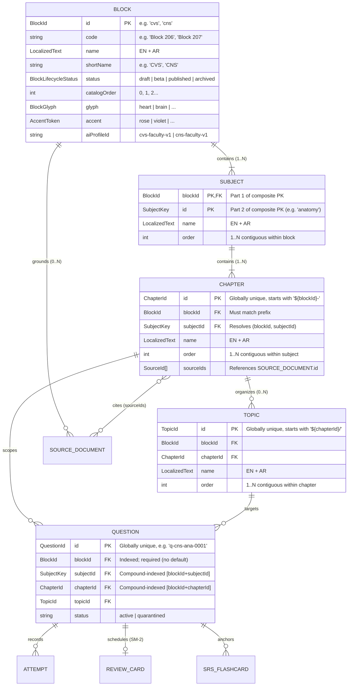

# Data Model: Multi-Block Curriculum Architecture (SPEC-010)

**Document ID**: `DATA-MODEL-010-MULTI-BLOCK-CURRICULUM`
**Spec**: [spec.md](./spec.md)
**Contracts**: [multi-block-curriculum-ports.ts](./contracts/multi-block-curriculum-ports.ts)
**Plan**: [plan.md](./plan.md)

---

## 1. Entity-Relationship Topology & Identity Rules

### 1.1 Hierarchy & Composite Identity

To preserve 100% backward compatibility with the 212 published CVS questions, existing learner attempts, and D1 rows (ADR-010-01), identity across the four-level hierarchy follows strict scoping rules:



### 1.2 Identity & Prefix Rules Summary

| Level | Type | Uniqueness Scope | Format Pattern | Example (CVS) | Example (CNS) |
|---|---|---|---|---|---|
| **Block** | `BlockId` | Global | `^[a-z][a-z0-9]{1,11}$` | `cvs` | `cns` |
| **Subject** | `SubjectKey` | **Block-local** (Composite `SubjectRef = {blockId, subjectId}`) | `^[a-z][a-z0-9-]{1,31}$` | `anatomy` (`cvs:anatomy`) | `anatomy` (`cns:anatomy`) |
| **Chapter** | `ChapterId` | Global (enforced by TI-4) | `^${blockId}-[a-z0-9-]+$` | `cvs-ana-heart-dev` | `cns-ana-brainstem` |
| **Topic** | `TopicId` | Global (enforced by TI-5) | `^${chapterId}/[a-z0-9-]+$` | `cvs-ana-heart-dev/atrial-septation` | `cns-ana-brainstem/cranial-nerve-nuclei` |
| **Source** | `SourceId` | Global | `^SRC-${BLOCK}-[A-Z0-9-]+$` | `SRC-CVS-ANA-01` | `SRC-CNS-ANA-01` |
| **Question** | `QuestionId` | Global | `^q-${blockId}-[a-z0-9-]+$` | `q-cvs-dev-0001` | `q-cns-bs-0001` |

---

## 2. Local Persistence Model: Dexie IndexedDB v8 → v9

### 2.1 Why Version 9 Is Needed

In `MedQuestsDB` v8 (`src/infrastructure/storage/db.ts`):
1. `questions`, `attempts`, and `reviewCards` only have single-column `blockId` indexes. Filtering by `(blockId, subjectId)` or ordering attempts by `[blockId+answeredAt]` forces a full-block scan in memory.
2. `srsCards` (`version(3)`) has **no `blockId` attribute or index**, making it impossible to isolate SRS flashcards per block.

### 2.2 Dexie v9 Schema Specification

```ts
// src/infrastructure/storage/db.ts (target state in Phase 2)
export interface SrsFlashcardRecord {
  id: string;
  blockId: string;           // Added in v9 (backfilled via questionId -> questions.blockId or 'cvs')
  questionId: string | null;
  highYieldTopicId: string;
  frontPrompt: string;
  backAnswer: string;
  intervalDays: number;
  nextReviewAt: string;      // ISO-8601
  createdAt: string;
}

this.version(9)
  .stores({
    questions:
      'id, blockId, [blockId+subjectId], [blockId+chapterId], [blockId+highYield], subjectId, chapterId, topicId, highYield, difficulty, provenanceScope, editorialStatus',
    attempts:
      'id, questionId, blockId, [blockId+answeredAt], [blockId+questionId], sessionId, mode, isCorrect, confidence, answeredAt',
    reviewCards:
      'questionId, blockId, [blockId+dueAt], dueAt, repetitions, lapses',
    bookmarks:
      'questionId, blockId, [blockId+bookmarkedAt], bookmarkedAt',
    notes:
      'questionId, blockId, [blockId+updatedAt], updatedAt',
    aiThreads:
      'threadId, questionId, blockId, [blockId+updatedAt], updatedAt',
    srsCards:
      'id, blockId, [blockId+nextReviewAt], questionId, highYieldTopicId, nextReviewAt, createdAt',
  })
  .upgrade(async (tx) => {
    const questionsTable = tx.table<Question, string>('questions');
    const srsTable = tx.table<SrsFlashcardRecord, string>('srsCards');

    const questionBlockMap = new Map<string, string>();
    await questionsTable.each((q) => {
      questionBlockMap.set(q.id, q.blockId || 'cvs');
    });

    await srsTable.toCollection().modify((card) => {
      if (!card.blockId) {
        const inferredFromQuestion = card.questionId ? questionBlockMap.get(card.questionId) : undefined;
        const inferredFromTopic = card.highYieldTopicId?.split('-')[0];
        card.blockId = inferredFromQuestion || (inferredFromTopic && inferredFromTopic.length >= 2 ? inferredFromTopic : 'cvs');
      }
    });
  });
```

### 2.3 Query Access Paths & Index Guarantees

| Repository Operation | Dexie Index Path | Complexity | Unscoped Scan Allowed? |
|---|---|---|---|
| Load active block questions | `db.questions.where('blockId').equals(blockId)` | $O(\log N + K_{\text{block}})$ | Never |
| Filter by subject in block | `db.questions.where('[blockId+subjectId]').equals([blockId, subjectId])` | $O(\log N + K_{\text{subj}})$ | Never |
| Filter by chapter in block | `db.questions.where('[blockId+chapterId]').equals([blockId, chapterId])` | $O(\log N + K_{\text{chap}})$ | Never |
| Block attempts (stats) | `db.attempts.where('blockId').equals(blockId)` | $O(\log N + A_{\text{block}})$ | Never |
| Global streak / today count | `db.attempts.where('answeredAt').aboveOrEqual(sinceIso)` | $O(\log N + A_{\text{recent}})$ | Only via `ILearnerGlobalActivityReader` |
| Due reviews in block | `db.reviewCards.where('[blockId+dueAt]').between([blockId, ''], [blockId, nowIso])` | $O(\log N + R_{\text{due}})$ | Never |
| Due SRS flashcards in block | `db.srsCards.where('[blockId+nextReviewAt]').between([blockId, ''], [blockId, nowIso])` | $O(\log N + S_{\text{due}})$ | Never |

---

## 3. Edge Database Model: Cloudflare D1 Migration `0007`

### 3.1 Existing D1 Tables (Already Partitioned by `block_id`)

- `bank_revisions (block_id TEXT PRIMARY KEY, revision_number INTEGER, updated_at TEXT)` — `0003`
- `global_questions (id TEXT PRIMARY KEY, block_id TEXT NOT NULL, ...)` with index `idx_global_questions_block_rev (block_id, global_revision, editorial_status)` — `0003`
- `question_review_submissions (ticket_id TEXT PRIMARY KEY, block_id TEXT NOT NULL, ...)` with index `idx_submissions_status_block` — `0003`
- `question_editorial_audit_log (id TEXT PRIMARY KEY, block_id TEXT NOT NULL, ...)` — `0003`
- `question_fingerprints` & `question_lsh_bands` — indexed on `(block_id, ...)` — `0006`

### 3.2 New Migration: `src/worker/migrations/0007_curriculum_blocks.sql`

```sql
-- Migration 0007: Authoritative Curriculum Block Registry & Per-Block Telemetry Partitioning
-- Enforces FR-050 and FR-051: unknown ?block= IDs are rejected with 404 before any D1 write.

CREATE TABLE IF NOT EXISTS curriculum_blocks (
    id              TEXT PRIMARY KEY,
    code            TEXT NOT NULL,
    short_name      TEXT NOT NULL,
    name_en         TEXT NOT NULL,
    name_ar         TEXT NOT NULL,
    status          TEXT NOT NULL DEFAULT 'draft' CHECK (status IN ('draft', 'beta', 'published', 'archived')),
    catalog_order   INTEGER NOT NULL DEFAULT 0,
    manifest_hash   TEXT NOT NULL DEFAULT 'initial',
    created_at      TEXT NOT NULL DEFAULT (strftime('%Y-%m-%dT%H:%M:%fZ', 'now')),
    updated_at      TEXT NOT NULL DEFAULT (strftime('%Y-%m-%dT%H:%M:%fZ', 'now'))
);

CREATE INDEX IF NOT EXISTS idx_curriculum_blocks_status_order
    ON curriculum_blocks (status, catalog_order ASC);

-- Seed canonical blocks: CVS (published) and CNS (beta for faculty QA until R2 GA)
INSERT OR IGNORE INTO curriculum_blocks (id, code, short_name, name_en, name_ar, status, catalog_order)
VALUES
    ('cvs', 'Block 206', 'CVS', 'Cardiovascular System', 'الجهاز القلبي الوعائي', 'published', 1),
    ('cns', 'Block 207', 'CNS', 'Central Nervous System', 'الجهاز العصبي المركزي', 'beta', 2);

-- Initialize revision cursor for CNS so delta-sync and ETag probes succeed immediately
INSERT OR IGNORE INTO bank_revisions (block_id, revision_number, updated_at)
VALUES ('cns', 1, strftime('%Y-%m-%dT%H:%M:%fZ', 'now'));
```

### 3.3 User Study Telemetry JSON Envelope (`user.study_telemetry_json`)

To prevent CNS stats from overwriting CVS stats when syncing telemetry to the edge (`edgeAuthGateway.ts`), the JSON envelope adds a `byBlock` map while preserving top-level fields for backward compatibility with existing admin dashboards:

```ts
export interface SynchronizedStudyTelemetryV2 {
  schemaVersion: 2;
  /** Learner-global habit metrics (ADR-010-05) */
  streakDays: number;
  todayAttempts: number;
  dailyAiRequestsUsed: number;
  activeBlockId: string;
  /** Per-block isolated snapshots */
  byBlock: Record<string, {
    totalAttempts: number;
    overallAccuracy: number;
    masteryPercentage: number;
    weakTopicsCount: number;
    dueReviewsCount: number;
    avgPaceSeconds: number;
    favoriteSubspecialty: string;
    updatedAtIso: string;
  }>;
  // Legacy top-level mirror of activeBlockId snapshot (kept for v1 readers)
  totalAttempts: number;
  overallAccuracy: number;
  masteryPercentage: number;
  weakTopicsCount: number;
  dueReviewsCount: number;
  avgPaceSeconds: number;
  favoriteSubspecialty: string;
}
```

---

## 4. Browser `localStorage` Namespace & Migration Matrix

| Purpose | Legacy Key (v1) | New Scoped Key (SPEC-010) | Migration Behavior on First Boot |
|---|---|---|---|
| Active block preference | *(none)* | `medquests_active_block_v1` | Initialized by `BootBlockResolver` (FR-011) |
| Dynamic taxonomy expansions | `medquests_dynamic_curriculum_taxonomy_v1` | `medquests_dynamic_curriculum_taxonomy_v2:<blockId>` | Copy v1 payload to `...:cvs`, then delete v1 key |
| Local study telemetry cache | `medquests_local_study_telemetry_v1` | `medquests_local_study_telemetry_v2:<blockId>` | Copy v1 payload to `...:cvs` |
| Global canonical bank fallback | `medquests_global_canonical_bank_v2_cvs` | `medquests_global_canonical_bank_v2:<blockId>` | Read legacy key if `:cvs` missing |
| Per-block UI memento | *(none)* | `medquests_block_memento_v1:<blockId>` | Created on filter change / block switch |
| Accuracy audit history | `medquests_accuracy_audit_history_v1` | `medquests_accuracy_audit_history_v2:<blockId>` | Copy v1 entries to `...:cvs` |

---

## 5. Canonical Block Manifests (`content/<blockId>/manifest.json`)

### 5.1 CNS Block 207 Blueprint (`content/cns/manifest.json`)

Below is the complete, faculty-structured specification for **Block 207 — Central Nervous System (CNS)** across 5 subjects, 16 chapters, 36 high-yield topics, and curriculum source placeholders:

| Subject Key (`SubjectRef`) | Order | EN Name | AR Name | Chapters (`cns-...`) |
|---|---:|---|---|---|
| `anatomy` (`cns:anatomy`) | 1 | CNS Neuroanatomy & Embryology | تشريح وأجنة الجهاز العصبي المركزي | 1. `cns-ana-embryology-meninges-csf` (Neural Tube, Meninges, Ventricles & CSF)<br/>2. `cns-ana-spinal-cord-tracts` (Spinal Cord Internal Structure, Ascending & Descending Tracts)<br/>3. `cns-ana-brainstem-cranial-nerves` (Brainstem Levels & Cranial Nerve Nuclei)<br/>4. `cns-ana-cerebellum-basal-ganglia` (Cerebellum, Basal Ganglia & Diencephalon)<br/>5. `cns-ana-cerebral-cortex-vascular` (Cerebral Hemispheres, Cortical Areas & Circle of Willis) |
| `physiology` (`cns:physiology`) | 2 | CNS Neurophysiology | فسيولوجيا الجهاز العصبي | 6. `cns-phy-excitable-synaptic` (Membrane Potentials, Synaptic Transmission & Neurotransmitters)<br/>7. `cns-phy-somatosensory-pain` (Sensory Receptors, Somatosensory Pathways & Pain Modulation)<br/>8. `cns-phy-motor-control-reflexes` (Spinal Reflexes, Corticospinal Tract, Cerebellar & Basal Ganglia Control)<br/>9. `cns-phy-special-senses` (Vision, Audition, Vestibular & Chemical Senses)<br/>10. `cns-phy-higher-functions-eeg` (Autonomic Hypothalamus, Limbic System, Sleep/EEG & Memory) |
| `histology` (`cns:histology`) | 3 | CNS Neurohistology | هستولوجيا الجهاز العصبي | 11. `cns-his-neurons-neuroglia-bbb` (Neurons, Glial Cells, Myelin & Blood-Brain Barrier)<br/>12. `cns-his-cortex-cerebellum-cord` (Microscopic Architecture of Cortex, Cerebellar Layers & Spinal Cord) |
| `pathology-micro` (`cns:pathology-micro`) | 4 | CNS Pathology & Microbiology | باثولوجيا وميكروبيولوجيا الجهاز العصبي | 13. `cns-pat-cerebrovascular-trauma` (Ischemic/Hemorrhagic Stroke, Aneurysms, Herniation & CNS Trauma)<br/>14. `cns-mic-meningitis-encephalitis` (Bacterial/Viral/Fungal Meningitis, Encephalitis, Brain Abscess & Prions)<br/>15. `cns-pat-demyelinating-degenerative-tumors` (Multiple Sclerosis, Neurodegenerative Diseases & Primary CNS Tumors) |
| `pharmacology` (`cns:pharmacology`) | 5 | CNS Neuropharmacology | فارماكولوجيا الجهاز العصبي المركزي | 16. `cns-pha-neurotherapeutics` (Antiepileptics, Sedative-Hypnotics, Anesthetics, Opioids & Antiparkinsonian Agents) |

### 5.2 AI Profile Registry Entries

| Profile ID | Block | Persona Label | Specialty Label | Allowed Toolsets |
|---|---|---|---|---|
| `cvs-faculty-v1` | `cvs` | Socratic Cardiovascular Faculty Mentor | Cardiovascular Pathophysiology & Hemodynamics | `['core', 'hemodynamics']` |
| `cns-faculty-v1` | `cns` | Socratic Neuroscience Faculty Mentor | Neuroanatomy, Neurophysiology & Clinical Neurology | `['core', 'neuro-localization']` |
| `generic-faculty-v1` | *(fallback)* | Socratic Medical Faculty Mentor | Integrated Medical Sciences | `['core']` |
