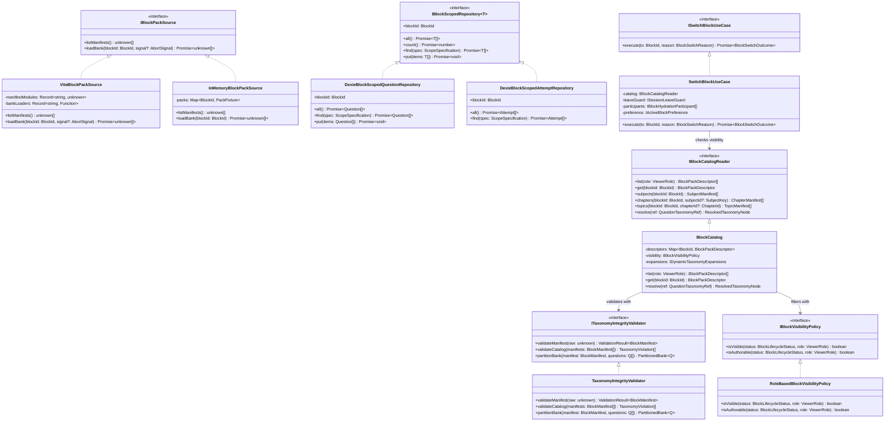
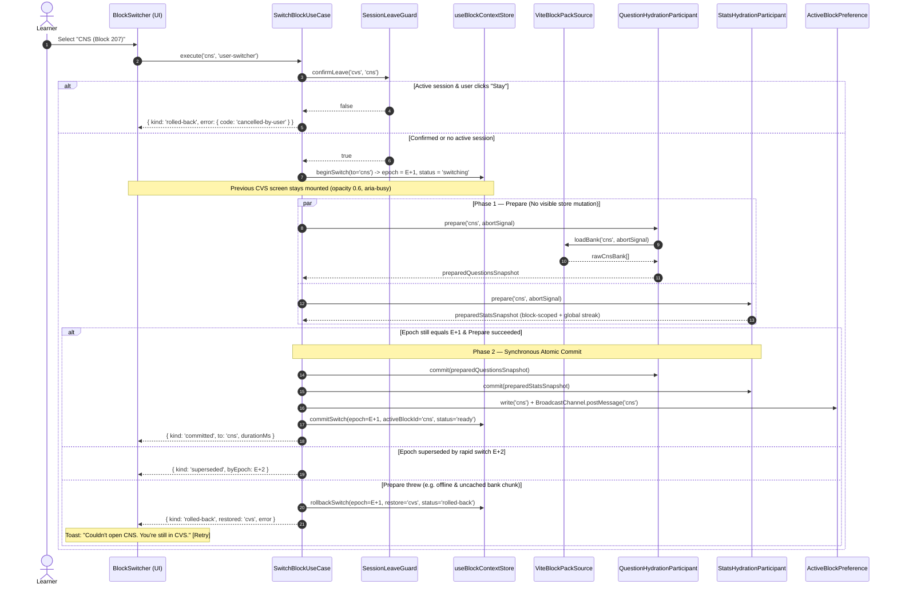

# Implementation Plan: Multi-Block Curriculum Architecture (SPEC-010)

**Branch**: `010-multi-block-curriculum-architecture` | **Date**: 2026-11-04 | **Spec**: [spec.md](./spec.md)
**Contracts**: [multi-block-curriculum-ports.ts](./contracts/multi-block-curriculum-ports.ts) | **Data Model**: [data-model.md](./data-model.md)

---

## 0. Executive Board Engineering Sign-Off Criteria

> **CEO** — "Every phase must keep the live CVS experience 100% intact. Phase 0 through Phase 3 ship dark to production with zero visual change while only CVS is `published`. When we flip CNS to `beta` for faculty in Phase 6 and `published` for students in Phase 7, the transition must feel instantaneous, calm, and unmistakable: the header heart morphs to a brain, the accent shifts from rose to violet, the streak stays alive, and every CNS subject and chapter is ready."

> **CTO** — "We execute a **Strangler Fig** migration across 7 deterministic phases. No big-bang PR. We introduce `src/domain/curriculum/` and `BlockCatalog` first, wrap `CVS_TAXONOMY` as a catalog-backed adapter so all 60+ existing test suites stay green at every commit, and then migrate stores, UI surfaces, authoring tools, and the Worker one boundary at a time. Bundle budget: initial JS delta ≤ +5 KB gzip; every block's `bank.v1.json` is code-split via `import.meta.glob`."

> **Principal SWE** — "We enforce Clean Architecture and OOP invariants mechanically:
> 1. **Compile-time brand safety**: `BlockId`, `SubjectKey`, `ChapterId`, `TopicId`, and composite `SubjectRef = { blockId, subjectId }`.
> 2. **Structural encapsulation**: Learner stores cannot touch `db.questions` or `db.attempts` directly; they receive `IBlockScopedRepository<T>` bound to a `BlockId` at construction.
> 3. **Two-phase atomic hydration**: `SwitchBlockUseCase` runs `prepare(blockId, signal)` across all participants before a synchronous, non-throwing `commit()`. Any failure aborts in-flight work and restores the prior epoch."

> **QA Engineering Manager** — "No phase advances until its gate passes in CI:
> - **Gate 1**: `pnpm blocks:validate` enforces TI-1..TI-9 on `content/*/manifest.json` and `bank.v1.json`.
> - **Gate 2**: `fast-check` property tests prove **INV-1 (Isolation)**, **INV-3 (Atomicity on fault injection)**, and **INV-4 (10-switch race convergence)**.
> - **Gate 3**: Dexie v8 → v9 upgrade test verifies **INV-2 (Zero data loss + `srsCards.blockId` backfill)** against a seeded v8 snapshot.
> - **Gate 4**: `pnpm blocks:ratchet` fails CI if the count of hardcoded `'cvs'` literals in `src/` ever increases."

---

## 1. Technical Context & Constitution Check

### 1.1 Technical Context

| Dimension | Decision |
|---|---|
| **Language & Runtime** | TypeScript 5.7 (`strict: true`, zero `any`, zero `!`), React 19, Vite 6, Cloudflare Workers (`nodejs_compat`) |
| **State & Storage** | Zustand 5 (`useBlockContextStore`, scoped `useQuestionStore`, scoped `useStatsStore`), Dexie 4 (schema v9), Cloudflare D1 (`0007_curriculum_blocks.sql`) |
| **Runtime Dependencies Added** | **0** (all patterns, validators, specifications, and state machines are pure TypeScript + Zod) |
| **Bundle Strategy** | Manifests (`content/*/manifest.json`) bundled eagerly (~3 KB gzip each); question banks (`content/*/dist/bank.v1.json`) loaded lazily via `import.meta.glob(..., { eager: false })` |
| **Testing Stack** | Vitest 3.2.7, `fast-check` 4.10.2 (property tests), `@cloudflare/vitest-pool-workers` (Worker + D1 integration), CLI validation gates |

### 1.2 Constitution Gate Check (Pre-Phase 0 & Post-Design)

| Principle | Status | Verification Evidence |
|---|---|---|
| **P1 — Testing & Review First** | PASS | `BlockSwitcher` lives in the top shell bar (desktop) and dashboard header chip (mobile); never appears inside `/session/:id` or overlays a question stem. |
| **P2 — Medical Accuracy Is Absolute** | PASS | TI-7 verifies chapter `sourceIds` against manifest `sources[]`; TI-8 quarantines any question whose `(blockId, subjectId, chapterId, topicId)` fails catalog resolution. |
| **P3 — No Runtime Question Generation** | PASS | Packs load exclusively from validated `bank.v1.json` and D1 delta-sync (`SPEC-005`). |
| **P4 — Zero-Friction Interaction** | PASS | Answering inside `SessionPlayer` remains synchronous in-memory (< 50 ms); block switching never runs during active answering without explicit confirmation (US4). |
| **P5 — Exam Integrity** | PASS | `MODE_POLICIES` in `SessionPlayer` are block-agnostic and unchanged; AI Copilot tool gating (`BlockAiProfileRegistry`) runs in the domain layer. |
| **P6 — Type Safety & Determinism** | PASS | Branded IDs + `BlockManifestSchema` Zod boundary validation + injectable clock/AbortSignal in `SwitchBlockUseCase`. |
| **P7 — Clean Architecture** | PASS | `src/domain/curriculum/` has zero imports from `react`, `dexie`, `zustand`, or `cloudflare:*` (enforced by `curriculumArchitectureBoundary.test.ts`). |
| **P8 — Local-First, Private, Free** | PASS | Lazy bank chunks cache in IndexedDB on first open; subsequent switches are 100% offline ($0, 0 ms network). |
| **P9 — Test-Backed Changes** | PASS | ≥ 95% line coverage target on `src/domain/curriculum/`; 6 invariant test suites (`INV-1`..`INV-6`). |
| **P10 — Accessible & Calm** | PASS | WAI-ARIA `listbox` pattern, 44×44 pt touch targets, `aria-live="polite"` switch announcement, instant transitions under `prefers-reduced-motion`. |

---

## 2. OOP & GoF Architectural Diagrams

### 2.1 Domain & Application Class Diagram



### 2.2 Two-Phase Atomic Block Switch Sequence (State + Command + Rollback)



---

## 3. Repository Structure & File-by-File Change Map

```text
content/
├── cvs/
│   ├── manifest.json                                  [NEW] Canonical CVS BlockManifest (EN + AR, 4 subjects, 13 chapters, 50 topics, 7 sources)
│   ├── taxonomy.json                                  [KEEP] Legacy reference (validated in sync with manifest.json)
│   └── dist/bank.v1.json                              [KEEP] Existing 212 CVS questions
└── cns/
    ├── manifest.json                                  [NEW] Canonical CNS BlockManifest (EN + AR, 5 subjects, 16 chapters, 36 topics)
    └── dist/bank.v1.json                              [NEW] Validated CNS seed bank (`[]` initially; populated via Studio/Parser Lab)

scripts/
└── blocks/
    ├── validate-blocks.ts                             [NEW] CLI gate (`pnpm blocks:validate`) enforcing TI-1..TI-9 on all packs
    └── ratchet-cvs-literals.ts                        [NEW] CI ratchet (`pnpm blocks:ratchet`) preventing new hardcoded 'cvs' strings

src/
├── domain/
│   ├── curriculum/                                    [NEW MODULE — Pure Domain, 0 framework imports]
│   │   ├── index.ts                                   [NEW] Public barrel
│   │   ├── ids.ts                                     [NEW] Branded BlockId, SubjectKey, ChapterId, TopicId, SubjectRef
│   │   ├── schemas.ts                                 [NEW] BlockManifestSchema & Zod boundary parsers
│   │   ├── TaxonomyIntegrityValidator.ts              [NEW] Enforces TI-1..TI-9 & partitionBank()
│   │   ├── BlockVisibilityPolicy.ts                   [NEW] Role-based draft/beta/published/archived visibility
│   │   ├── BlockCatalog.ts                            [NEW] Immutable catalog registry + LocalizedText resolver
│   │   ├── BootBlockResolver.ts                       [NEW] Pure FR-011 boot resolution logic
│   │   ├── MetricScopePolicy.ts                       [NEW] Block-scoped vs learner-global metric classification
│   │   ├── BlockAiProfileRegistry.ts                  [NEW] Per-block AI persona & allowed toolsets ('core', 'hemodynamics', etc.)
│   │   ├── LegacyTaxonomyAdapter.ts                   [NEW] Converts BlockManifest <-> legacy Taxonomy shape
│   │   └── __tests__/
│   │       ├── taxonomyIntegrityValidator.test.ts     [NEW] Unit + property tests for TI-1..TI-9 (INV-6)
│   │       ├── blockCatalogAndVisibility.test.ts      [NEW] Role filtering, composite SubjectRef lookup
│   │       ├── bootBlockResolver.test.ts              [NEW] Deep-link, persisted, fallback order tests
│   │       └── curriculumArchitectureBoundary.test.ts [NEW] Enforces P7 (zero React/Dexie/Worker imports)
│   ├── taxonomy/
│   │   ├── cvsTaxonomy.ts                             [MODIFY] Derived from BlockCatalog via LegacyTaxonomyAdapter (@deprecated shim)
│   │   ├── CurriculumTaxonomyRegistry.ts              [MODIFY] Block-parametric registerSubject(blockId, ...) & v2 storage key
│   │   └── CurriculumClassificationAgent.ts           [MODIFY] Parameterize block name/taxonomy instead of hardcoded CVS strings
│   ├── ai/
│   │   ├── systemPromptBuilder.ts                     [MODIFY] Resolve persona & board context via BlockAiProfileRegistry
│   │   └── languagePolicy.ts                          [MODIFY] Filter tool instructions by active BlockAiProfile
│   └── questionBank/
│       ├── questionAiPromptBuilder.ts                 [MODIFY] Resolve subject/chapter from BlockCatalog(blockId)
│       └── aiQuestionParser/QuestionParsingAgent.ts   [MODIFY] Accept target blockId + lazy seed bank via repository
│
├── infrastructure/
│   ├── curriculum/
│   │   ├── ViteBlockPackSource.ts                     [NEW] Eager manifest glob + lazy bank chunk loader with AbortSignal
│   │   ├── InMemoryBlockPackSource.ts                 [NEW] Deterministic test double for unit/property tests
│   │   ├── LocalStorageActiveBlockPreference.ts       [NEW] Persists `medquests_active_block_v1` + BroadcastChannel sync
│   │   └── LocalStorageBlockMementoStore.ts           [NEW] Persists `medquests_block_memento_v1:<blockId>`
│   ├── storage/
│   │   ├── db.ts                                      [MODIFY] Add Dexie version(9) compound indexes & srsCards.blockId backfill
│   │   ├── DexieBlockScopedRepositories.ts            [NEW] Scoped Question, Attempt, ReviewCard, SrsCard, Bookmark, Note repos
│   │   └── __tests__/
│   │       └── dexieV8ToV9Migration.test.ts           [NEW] Verifies INV-2 against seeded v8 fixture
│   ├── questionBank/
│   │   └── edgeQuestionBankGateway.ts                 [MODIFY] Remove static defaultCvsBank import; scope fallback cache by blockId
│   └── auth/
│       └── edgeAuthGateway.ts                         [MODIFY] Build SynchronizedStudyTelemetryV2 with `byBlock[activeBlockId]`
│
├── application/
│   ├── composition/
│   │   └── clientCompositionRoot.ts                   [NEW] Wires Catalog, PackSource, ScopedRepos, and SwitchBlockUseCase
│   ├── curriculum/
│   │   ├── SwitchBlockUseCase.ts                      [NEW] Two-phase prepare/commit orchestrator with epoch race guard
│   │   ├── hydrationParticipants.ts                   [NEW] Questions, Stats, Copilot, Memento, Analytics participants
│   │   └── __tests__/
│   │       └── switchBlockUseCase.property.test.ts    [NEW] fast-check tests for INV-1, INV-3 (fault rollback), INV-4 (races)
│   └── stores/
│       ├── useBlockContextStore.ts                    [NEW] ActiveBlockState store + useActiveBlock() / useActiveTaxonomy() hooks
│       ├── useQuestionStore.ts                        [MODIFY] Delegate bank loading to ViteBlockPackSource & scoped repo
│       ├── useStatsStore.ts                           [MODIFY] Scope attempts/reviews by blockId; keep streak global via MetricScopePolicy
│       ├── useBankGovernanceStore.ts                  [MODIFY] Parameterize blockId from active/selected block
│       └── useAdminAccuracyAuditStore.ts              [MODIFY] Load bank via BlockPackSource instead of static CVS import
│
├── ui/
│   ├── app/
│   │   ├── Shell.tsx                                  [MODIFY] Mount BlockSwitcher (when >=2 visible blocks), dynamic glyph & --block-accent
│   │   └── navigation/
│   │       ├── BlockSwitcher.tsx                      [NEW] Desktop WAI-ARIA listbox popover with coverage ring & accent preview
│   │       ├── BlockSwitcherSheet.tsx                 [NEW] Mobile bottom sheet switcher
│   │       └── SessionLeaveConfirmDialog.tsx          [NEW] US4 mid-session confirmation sheet
│   └── features/
│       ├── dashboard/Dashboard.tsx                    [MODIFY] Read active block title/subjects via useActiveTaxonomy()
│       ├── test/TestHub.tsx                           [MODIFY] Replace CVS_TAXONOMY with useActiveTaxonomy() + BlockSessionMemento
│       ├── test/QuickPractice.tsx                     [MODIFY] Replace CVS_TAXONOMY with useActiveTaxonomy()
│       ├── test/SessionPlayer.tsx                     [MODIFY] Register SessionLeaveGuard while session is active; remove 'cvs' fallbacks
│       ├── curriculum/CurriculumLibrary.tsx           [MODIFY] Render active block's `manifest.sources[]` grouped by subject
│       ├── studio/QuestionStudio.tsx                  [MODIFY] Add target Block selector; validate against BlockCatalog
│       ├── admin/QuestionBankGovernancePanel.tsx      [MODIFY] Add Block selector for faculty review & audit logs
│       ├── admin/AiPromptStudioModal.tsx              [MODIFY] Scope subjects/chapters to selected block
│       └── qdd/QddAuditBoard.tsx                      [MODIFY] Scope deduplication audit to selected block
│
└── worker/
    ├── migrations/
    │   └── 0007_curriculum_blocks.sql                 [NEW] Creates `curriculum_blocks` table, seeds `cvs` & `cns`
    ├── curriculum/
    │   ├── WorkerSeedBankRegistry.ts                  [NEW] Maps blockId -> bundled seed bank for D1 seeding
    │   └── EdgeBlockGuard.ts                          [NEW] Validates `?block=` against `curriculum_blocks` (404 / 409)
    └── index.ts                                       [MODIFY] Add GET /api/v1/blocks; wire EdgeBlockGuard & WorkerSeedBankRegistry
```

---

## 4. Phased Implementation Roadmap

### Phase 0: Content Packs, Contracts & CI Validation Gate (Foundation)
**Goal**: Establish `content/cvs/manifest.json`, `content/cns/manifest.json`, and the pure `src/domain/curriculum/` module without touching any existing store or UI component.

1. **Task 0.1**: Create `src/domain/curriculum/ids.ts` and `schemas.ts` implementing the Zod contracts in `contracts/multi-block-curriculum-ports.ts`.
2. **Task 0.2**: Implement `TaxonomyIntegrityValidator.ts` enforcing invariants **TI-1 through TI-9** with JSON-pointer error reporting.
3. **Task 0.3**: Author `content/cvs/manifest.json` (exact mirror of the 4 subjects, 13 chapters, 50 topics in `cvsTaxonomy.ts` + the 7 documents from `CurriculumLibrary.tsx`, enriched with Arabic translations) and `content/cns/manifest.json` (Block 207 — 5 subjects, 16 chapters, 36 topics per `data-model.md §5.1`, `status: 'beta'`) + `content/cns/dist/bank.v1.json` (`[]`).
4. **Task 0.4**: Create `scripts/blocks/validate-blocks.ts` and `scripts/blocks/ratchet-cvs-literals.ts`; wire `pnpm blocks:validate` and `pnpm blocks:ratchet` into `package.json`.
5. **Phase 0 Exit Gate**: `pnpm blocks:validate` passes on both `cvs` and `cns`; `taxonomyIntegrityValidator.test.ts` (including `fast-check` fuzzing of malformed manifests) passes at ≥ 95% coverage.

---

### Phase 1: Block Catalog, Visibility Policy & Legacy `CVS_TAXONOMY` Adapter
**Goal**: Stand up `BlockCatalog`, `ViteBlockPackSource`, and `LegacyTaxonomyAdapter` so `CVS_TAXONOMY` becomes a computed view over `content/cvs/manifest.json`.

1. **Task 1.1**: Implement `RoleBasedBlockVisibilityPolicy`, `BlockCatalog`, `BootBlockResolver`, `MetricScopePolicy`, and `BlockAiProfileRegistry` in `src/domain/curriculum/`.
2. **Task 1.2**: Implement `ViteBlockPackSource` using `import.meta.glob('/content/*/manifest.json', { eager: true })` and `import.meta.glob('/content/*/dist/bank.v1.json', { eager: false })` with `AbortSignal` support, plus `InMemoryBlockPackSource` for tests.
3. **Task 1.3**: Refactor `src/domain/taxonomy/cvsTaxonomy.ts` to derive `CVS_TAXONOMY` from `BlockCatalog.get('cvs')` via `LegacyTaxonomyAdapter`, and update `CurriculumTaxonomyRegistry.ts` to store dynamic expansions per block (`medquests_dynamic_curriculum_taxonomy_v2:<blockId>`) with automatic v1 migration.
4. **Phase 1 Exit Gate**: All existing unit and integration tests pass with zero modifications (**INV-5**); `curriculumArchitectureBoundary.test.ts` verifies zero forbidden imports in `src/domain/curriculum/`.

---

### Phase 2: Dexie v9 Upgrade & Block-Scoped Repositories
**Goal**: Eliminate unscoped IndexedDB queries by introducing `DexieBlockScopedRepositories` and upgrading `MedQuestsDB` to version 9.

1. **Task 2.1**: Upgrade `src/infrastructure/storage/db.ts` to `version(9)` per `data-model.md §2.2`, adding compound indexes (`[blockId+subjectId]`, `[blockId+chapterId]`, `[blockId+answeredAt]`, `[blockId+dueAt]`, `[blockId+nextReviewAt]`) and the non-destructive `srsCards.blockId` backfill.
2. **Task 2.2**: Implement `DexieBlockScopedQuestionRepository`, `DexieBlockScopedAttemptRepository`, `DexieBlockScopedReviewCardRepository`, `DexieBlockScopedSrsRepository`, and `DexieLearnerGlobalActivityReader`.
3. **Task 2.3**: Write `dexieV8ToV9Migration.test.ts` seeding a v8 database with CVS questions, attempts, review cards, bookmarks, notes, and un-scoped `srsCards`, running the v9 upgrade, and asserting 100% record preservation and accurate `blockId` inference (**INV-2**).
4. **Phase 2 Exit Gate**: `dexieV8ToV9Migration.test.ts` and repository contract tests (`describeRepositoryContract`) pass for both Dexie and in-memory implementations.

---

### Phase 3: Active Block Context Store, Atomic `SwitchBlockUseCase` & Store Scoping
**Goal**: Wire the application layer so `useQuestionStore` and `useStatsStore` are strictly scoped to the active block and coordinated by `SwitchBlockUseCase`.

1. **Task 3.1**: Implement `LocalStorageActiveBlockPreference` (with `BroadcastChannel('medquests_block_context')`), `LocalStorageBlockMementoStore`, and `useBlockContextStore`.
2. **Task 3.2**: Implement `SwitchBlockUseCase` and the five `IBlockHydrationParticipant` adapters (`questions`, `stats`, `copilot`, `memento`, `analytics`), enforcing two-phase `prepare` → `commit`, epoch race cancellation, and automatic rollback on failure.
3. **Task 3.3**: Refactor `useQuestionStore.ts` to load banks via `ViteBlockPackSource` and `DexieBlockScopedQuestionRepository` (removing the static `defaultCvsBank` import).
4. **Task 3.4**: Refactor `useStatsStore.ts` to compute accuracy, mastery, coverage, weak topics, due reviews, and `subjectReadiness` from `BlockCatalog.get(activeBlockId)` and block-scoped repositories, while computing `streakDays` and `todayAttempts` via `ILearnerGlobalActivityReader` per `MetricScopePolicy` (ADR-010-05).
5. **Task 3.5**: Update `App.tsx` to resolve the initial block via `BootBlockResolver` (supporting `?block=cns` deep links) and report actual hydrated question count in `app:boot_hydrated`.
6. **Phase 3 Exit Gate**: Property-based test suite `switchBlockUseCase.property.test.ts` proves **INV-1 (Isolation)**, **INV-3 (Rollback atomicity under injected failures at every participant)**, and **INV-4 (10-switch rapid race convergence)**.

---

### Phase 4: Apple HIG Block Switcher & Learner UI Decoupling
**Goal**: Deliver the Apple-grade Block Switcher UI and connect all learner-facing screens to `useActiveBlock()` and `useActiveTaxonomy()`.

1. **Task 4.1**: Define block accent CSS custom properties (`--block-accent`, `--block-accent-soft`, `--block-ring`) in `src/index.css` for `rose` (CVS), `violet` (CNS), `sky`, `amber`, and `emerald`, verified for WCAG 2.2 AA contrast in light and dark themes.
2. **Task 4.2**: Build `BlockSwitcher.tsx` (desktop popover listbox), `BlockSwitcherSheet.tsx` (mobile detented sheet), and `SessionLeaveConfirmDialog.tsx` (US4 mid-session guard). Render the switcher only when `visibleBlocks.length >= 2` (D6).
3. **Task 4.3**: Update `Shell.tsx` to cross-fade the header logo glyph (`Heart` ⟷ `Brain`), bind `--block-accent`, and announce switches via an `aria-live="polite"` region.
4. **Task 4.4**: Migrate `Dashboard.tsx`, `TestHub.tsx`, `QuickPractice.tsx`, `ReviewHub.tsx`, and `CurriculumLibrary.tsx` to read subjects, chapters, topics, and curriculum documents from `useActiveTaxonomy()` and localized templates (`t.test.hubTitle` parameterized by block name).
5. **Phase 4 Exit Gate**: Component & accessibility tests (`axe` 0 violations, keyboard navigation `Tab → Enter → ↑/↓ → Enter/Esc`, RTL layout mirroring, `prefers-reduced-motion`, and single-block visual parity snapshot **INV-5**).

---

### Phase 5: Faculty Studio, AI Copilot Profiles, Parser Lab & QDD Integration
**Goal**: Make every authoring, governance, and AI surface block-aware.

1. **Task 5.1**: Update `systemPromptBuilder.ts` and `languagePolicy.ts` to consume `BlockAiProfileRegistry.get(activeBlock.aiProfileId)`, switching persona and filtering tools (`simulate_hemodynamic_pv_loop` and `calculate_cardiovascular_equation` restricted to `hemodynamics` toolset). Namespace AI threads as `block:<blockId>:question:<id>`.
2. **Task 5.2**: Add explicit Target Block selectors to `QuestionStudio.tsx`, `AdminAiQuestionParserLab.tsx`, `QuestionBankGovernancePanel.tsx`, `AiPromptStudioModal.tsx`, and `QddAuditBoard.tsx`.
3. **Task 5.3**: Remove `.default('cvs')` from `QuestionSchema.blockId` at the ingest boundary (moving legacy CVS normalization into `ViteBlockPackSource`), and parameterize `CurriculumClassificationAgent.ts` and `questionAiPromptBuilder.ts` with the target block's catalog descriptor.
4. **Phase 5 Exit Gate**: Authoring a CNS question in Studio validates against `cns` chapters/topics; submitting a CVS chapter under `blockId: 'cns'` produces a deterministic field-level validation error; AI Copilot in CNS uses the Neuroscience mentor persona and rejects hemodynamic tool calls.

---

### Phase 6: Cloudflare Worker, D1 Migration `0007` & Telemetry Partitioning
**Goal**: Enforce authoritative block validation and per-block seeding at the edge.

1. **Task 6.1**: Add `src/worker/migrations/0007_curriculum_blocks.sql` (`curriculum_blocks` table + `cns` revision cursor).
2. **Task 6.2**: Implement `EdgeBlockGuard` and `WorkerSeedBankRegistry` in `src/worker/curriculum/`, and expose `GET /api/v1/blocks`.
3. **Task 6.3**: Wire `EdgeBlockGuard.requireKnownBlock` into all `/api/v1/bank/*` and `/api/qdd/*` routes in `src/worker/index.ts` so unknown `?block=` parameters return `404` and writes to `archived` blocks return `409`.
4. **Task 6.4**: Update `edgeAuthGateway.ts` to emit `SynchronizedStudyTelemetryV2` (preserving `byBlock[blockId]`) and attach PostHog super-property `block_id` in `medQuestsAnalyticsFacade.ts`.
5. **Phase 6 Exit Gate**: `@cloudflare/vitest-pool-workers` integration suite verifies D1 seeding for `cvs` and `cns`, isolated delta-sync cursors per block, `404` on `?block=invalid`, and role-gated visibility of `beta` blocks.

---

### Phase 7: CNS Beta Verification, Rollout & Legacy Shim Retirement
**Goal**: Promote CNS through `beta → published` and lock down the `'cvs'` literal ratchet.

1. **Task 7.1**: Run full E2E and golden verification with `cns` in `beta` (visible to faculty/admin, hidden from students) and then `published`.
2. **Task 7.2**: Remove remaining direct imports of `CVS_TAXONOMY` across `src/` and tighten `scripts/blocks/ratchet-cvs-literals.ts` threshold to `≤ 10` (content-loader allowlist only).
3. **Phase 7 Exit Gate**: All 6 release-blocking invariants (**INV-1..INV-6**) green; bundle size check confirms initial JS delta ≤ +5 KB gzip and `cns/dist/bank.v1.json` is emitted as an isolated async chunk.

---

## 5. Quality Engineering & Verification Matrix

| Suite | File / Command | Invariant / Requirement Covered | Target |
|---|---|---|---|
| **Pack & Manifest Gate** | `pnpm blocks:validate` | **INV-6**, FR-001, FR-003 (TI-1..TI-9) | 0 violations across all `content/*` packs |
| **Literal Ratchet Gate** | `pnpm blocks:ratchet` | Technical debt elimination (E1–E3) | Monotonically decreasing; ≤ 10 at Phase 7 |
| **Clean Architecture Gate** | `src/domain/curriculum/__tests__/curriculumArchitectureBoundary.test.ts` | Constitution **P7** | 0 forbidden imports in `domain/curriculum/` |
| **Isolation Property Suite** | `src/application/curriculum/__tests__/switchBlockUseCase.property.test.ts` | **INV-1** (Session & stats isolation across 200 generated catalogs) | 100% pass (200 runs) |
| **Fault-Injection Rollback** | `src/application/curriculum/__tests__/switchBlockUseCase.property.test.ts` | **INV-3**, FR-012 (Throw at each participant → full state rollback) | 100% pass |
| **Rapid-Switch Race Suite** | `src/application/curriculum/__tests__/switchBlockUseCase.property.test.ts` | **INV-4**, FR-013 (10 concurrent switches → converges on last epoch) | 100% pass |
| **Dexie v8 → v9 Migration** | `src/infrastructure/storage/__tests__/dexieV8ToV9Migration.test.ts` | **INV-2**, FR-021 (Zero data loss + `srsCards.blockId` backfill) | 100% record parity |
| **Single-Block Parity** | `src/ui/app/navigation/__tests__/blockSwitcher.test.tsx` | **INV-5**, D6, FR-030..035 (Hidden when 1 block; WAI-ARIA listbox when ≥ 2) | 0 axe violations; snapshot match |
| **Worker & D1 Edge Gate** | `src/worker/__tests__/multiBlockEdgeGovernance.test.ts` | FR-050..052 (`0007` migration, `404` unknown block, `beta` role guard) | 100% pass in `workerd` |
