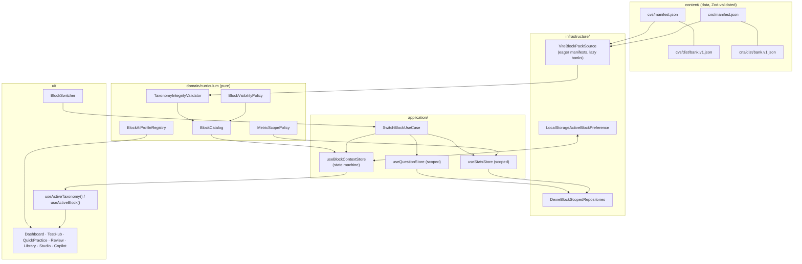

# Feature Specification: Multi-Block Curriculum Architecture (Block → Subject → Chapter → Topic)

**Document ID**: `SPEC-010-MULTI-BLOCK-CURRICULUM-ARCHITECTURE`
**Feature Branch**: `010-multi-block-curriculum-architecture`
**Created**: 2026-11-04
**Status**: Draft — Board-approved for planning (Ready for `/speckit-clarify` → `/speckit-tasks`)
**First consumer**: Block 207 — Central Nervous System (CNS)
**Depends on**: [SPEC-001 CVS Exam Prep](../001-cvs-exam-prep/spec.md), [SPEC-002 AI Copilot](../002-ai-cognitive-copilot/spec.md), [SPEC-004 Bilingual i18n](../004-bilingual-i18n-ai-localization/spec.md), [SPEC-005 Global Bank Governance](../005-global-question-bank-governance/spec.md), [SPEC-008 PostHog](../008-posthog-zero-overhead-behavioral-analytics/spec.md), [SPEC-009 QDD](../009-question-duplication-detection-engine/spec.md)
**Contracts**: [multi-block-curriculum-ports.ts](./contracts/multi-block-curriculum-ports.ts)
**Data model**: [data-model.md](./data-model.md)
**Plan**: [plan.md](./plan.md)

---

## 0. Executive Board Decision Record

Four people reviewed this spec: the **CEO**, the **CTO**, a **Principal SWE** (20+ years, platform and storage), and the **QA Engineering Manager**. This section records their positions, the points they argued about, and what they decided. Later sections follow these decisions.

### 0.1 Opening Positions

> **CEO** — "Our learner just finished CVS and opened CNS. The product should feel like it *already knew* that would happen. Switching blocks must feel like changing a tab in Safari: immediate, no surprises, and nothing lost. A student who spent three weeks building CVS mastery must never open CNS and see their CVS accuracy 'diluted', see a CVS question in a CNS exam, or lose a streak. And a student who only studies CVS today must see **zero** change until a second block is actually published."

> **CTO** — "The domain model was multi-block from day one. `BlockId` is a string, and every Dexie table and D1 table carries `block_id`. The application and UI layers are what assumed one block: **491 `'cvs'` literals**, **14 production files that statically import a 500 KB CVS bank**, and a `CVS_TAXONOMY` constant read directly by 9 UI and store modules. We are not rewriting. We are inverting a dependency: the code should depend on a `BlockCatalog` abstraction instead of a CVS constant. Same stack (React 19, Zustand, Dexie, one Worker, D1). No new runtime dependencies."

> **Principal SWE** — "Three structural defects decide whether this works. **(1) Identity collision**: `subjectId: 'anatomy'` exists in CVS and will exist in CNS. Every `filter(q => q.subjectId === x)` that runs without a block scope becomes a cross-block data leak. **(2) Unscoped reads**: `useStatsStore.refreshStats` reads `db.attempts.toArray()` across *every* block. **(3) `srsCards` has no `blockId` column at all.* We fix all three at the type level and the index level, so that leaking data across blocks becomes hard to write, not just against policy."

> **QA Engineering Manager** — "In this feature, 'reliability' means four testable things. **Isolation**: no CNS session ever contains a non-CNS question. **Integrity**: no existing CVS attempt, review card, note, bookmark, or AI thread is lost or re-keyed by the upgrade. **Atomicity**: a block switch either fully completes or fully rolls back, with no half-hydrated screen. **Race safety**: ten rapid switches end on the last block selected, with consistent state. Each of these gets an automated test, and we add a CI ratchet so the `'cvs'` literal count can only go down."

### 0.2 Contested Decisions

| # | Question | Positions | **Decision** |
|---|---|---|---|
| D1 | **How do we stop `anatomy` colliding?** | Principal proposed renaming every subject to `cvs-anatomy` (a clean namespace). QA objected: that re-keys 212 published questions, every attempt, D1 rows, and analytics history, which is a P2 integrity risk for cosmetic gain. | **Keep `subjectId` as a block-local *discipline key*.** The globally unique identity is the composite `SubjectRef = (blockId, subjectId)`. Chapter and topic IDs must be globally unique with a `${blockId}-` prefix (CVS already follows this; the registry enforces it). Zero data migration for CVS. → ADR-010-01 |
| D2 | **Where does "active block" live: URL or state?** | CEO wanted shareable links ("send my friend CNS practice"). Principal noted that a `/b/:blockId/*` route prefix touches every route, the nav partitioner, and analytics route names. | **Persisted application state is the source of truth, with a `?block=cns` deep-link adapter** that is applied at boot and then removed from the URL. `/session/:id` already carries the block through its session. The route prefix is deferred to SPEC-011 if analytics show demand. → ADR-010-02 |
| D3 | **Is the streak per-block or global?** | Principal: per-block is simpler (one more filter). CEO: "A streak measures the *student's habit*, not the block. Resetting someone's 40-day streak because they moved to CNS is a betrayal." | **Streak, daily goal, and today's count are learner-global. Accuracy, mastery, coverage, weak topics, due reviews, and pacing are block-scoped.** The rule is codified in `MetricScopePolicy`. |
| D4 | **Bundle banks statically or lazy-load them?** | Static is simplest. CTO: CVS is 507 KB today; adding CNS statically doubles first load for every learner, and at ~20k items across blocks it reaches tens of MB. | **Manifests are eager (each ≤ 8 KB). Banks are lazy chunks loaded per block** (`import.meta.glob`). The Worker keeps a bundled seed map only while each pack stays ≤ 1.5 MB. Beyond that, seeding moves to a `pnpm block:seed` D1 job (Phase 6). |
| D5 | **Global keyboard shortcut for switching?** | CEO wanted ⌘⇧B. QA: that is Chrome/Safari's bookmarks-bar shortcut, and digits `1–5` are already reserved for answers in sessions. | **No global shortcut in v1.** The switcher is fully keyboard-operable (Tab → Enter → ↑/↓ → Enter/Esc), WAI-ARIA *listbox* pattern. Revisit inside the future command palette. |
| D6 | **Show the switcher when only CVS exists?** | Principal: always show it, for discoverability. CEO: "An empty menu with one item is clutter, which is the opposite of what we promise." | **The switcher renders only when ≥ 2 blocks are *visible to this user*** (published, or beta for faculty/admin). CVS-only students see a pixel-identical UI. |
| D7 | **Switching mid-session?** | — | **An in-progress session is never silently discarded.** The switcher stays enabled, but selecting another block shows a confirmation sheet: *"Your CVS practice is saved. Resume it any time from CVS."* Sessions are already persisted per block, so leaving is lossless. |
| D8 | **How is block content authored?** | Code (TS constants) vs data (JSON). | **Data: `content/<blockId>/manifest.json`, validated by Zod at the boundary (P6)** and by a CI gate `pnpm blocks:validate`. Non-engineers and faculty can author a block without touching `src/`. `CVS_TAXONOMY` stays as a deprecated shim derived from the catalog for one release (Strangler Fig). |

### 0.3 Closing Statements

> **CEO** — "Ship it to CVS users first with zero visible change. Then turn on CNS beta for faculty. Then publish. I want the first CNS student session to feel boring, because nothing went wrong."

> **CTO** — "Approved, with these conditions: no new runtime dependencies, initial JS +≤ 5 KB gzip, and every phase independently shippable behind `multiBlock` flags."

> **Principal SWE** — "Approved. The composite-key decision (D1) and the scoped repository (`BlockScopedQuestionRepository`) carry this design. If someone can still write `db.attempts.toArray()` in a store after Phase 3, we have not finished."

> **QA Engineering Manager** — "Approved. I am holding release on the six invariants in §6, the Dexie v8→v9 upgrade test against a real v8 fixture, and the rapid-switch race test. Any one of them failing is a stop-ship."

---

## 1. Problem Statement

### 1.1 Context

Med Quests launched with a single block: **Cardiovascular System (Block 206)**. It has 4 subjects, 13 chapters, and 212 published questions. The learner has finished CVS and is now studying **CNS (Block 207)**. Future blocks (Respiratory, Renal, GIT, Endocrine, MSK, Hematology) are expected over the next 24 months.

### 1.2 Evidence (codebase audit, 2026-11-04)

| # | Finding | Location | Impact |
|---|---|---|---|
| E1 | 491 `'cvs'` literals across `src/` | e.g. `useQuestionStore.ts` (13), `edgeQuestionBankGateway.ts` (16), `worker/index.ts` (15) | Every new block would mean editing hundreds of call sites |
| E2 | 14 production modules statically `import defaultCvsBank` (507 KB) | stores, Worker, QDD, parser, gateways | Bundle growth and implicit CVS default on every path |
| E3 | `CVS_TAXONOMY` imported directly by 9 non-domain modules | `TestHub`, `QuickPractice`, `QuestionStudio`, `useStatsStore`, `QuestionBankGovernancePanel`, `AiPromptStudioModal`, `edgeAuthGateway`, `questionAiPromptBuilder` | Subject and chapter pickers are hard-wired to CVS |
| E4 | `CurriculumTaxonomyRegistry.registerSubject()` hard-codes `blockId: 'cvs'` | `CurriculumTaxonomyRegistry.ts:81` | Dynamic expansions always land in CVS |
| E5 | `refreshStats` reads `db.attempts.toArray()` and `db.reviewCards.toArray()` with no block filter | `useStatsStore.ts:253` | **Cross-block metric contamination** |
| E6 | `srsCards` Dexie table has no `blockId` | `db.ts:131` | SRS flashcards cannot be scoped |
| E7 | `subjectId` values (`anatomy`, `histology`, …) are not unique across blocks | `cvsTaxonomy.ts` | Silent leaks in any unscoped subject filter |
| E8 | i18n dictionaries hold CVS subject names and copy ("Cardiovascular Test Hub", "Block 206") | `i18n/dictionaries/en.ts`, `ar.ts` | Untranslatable for new blocks |
| E9 | Worker `ensureGlobalBankSeeded` returns early for any block ≠ `cvs`. `?block=` is accepted unvalidated | `worker/index.ts:2556`, `:1247` | New blocks cannot be seeded, and arbitrary block IDs can create rows |
| E10 | AI system prompt persona is "Cardiovascular Pathophysiologist"; CVS-only tools always exposed | `systemPromptBuilder.ts:20`, `languagePolicy.ts:76` | Wrong persona and irrelevant tools in CNS |
| E11 | `CurriculumLibrary` has a static array of 7 CVS documents | `CurriculumLibrary.tsx:10` | Library cannot show CNS sources |
| E12 | `App.tsx` boots `loadQuestions('cvs')` and reports a hard-coded `indexeddb_questions_loaded: 212` | `App.tsx:58,64` | Wrong boot block and wrong telemetry |

### 1.3 Goal

Make **Block → Subject → Chapter → Topic** a first-class, data-driven hierarchy so that:

1. A new block ships by adding **one content folder** (`content/<blockId>/`), with no `src/` edits beyond registering its AI profile (optional).
2. A block can hold **N subjects**, a subject **N chapters**, and a chapter **N topics**, with integrity checked at build time and at runtime.
3. Every learner-facing read is **block-scoped by construction**.
4. Existing CVS learners see **no regression** in data, behavior, or visuals.

### 1.4 Non-Goals (v1)

- Cross-block mixed exams (e.g., a "CVS + CNS comprehensive mock"). The design allows it (§3.6), but it is SPEC-011.
- Per-user block enrollment, paywalls, or entitlements.
- A route-prefix URL scheme (ADR-010-02).
- Authoring CNS questions themselves. That is a content workstream that uses existing Studio and Parser Lab tooling, now block-aware.
- Re-keying CVS subject IDs (ADR-010-01).

---

## 2. Users & Scenarios (User Stories)

Priorities: **P1** = MVP and release-blocking, **P2** = launch-quality, **P3** = fast follow.

### US1 — Switch to my current block (P1)
**As a** student who finished CVS, **I want to** switch the whole app to CNS in one action, **so that** every screen (Dashboard, Test Hub, Quick Practice, Review, Curriculum, Copilot) shows only CNS.

**Acceptance**
1. **Given** ≥ 2 visible blocks, **when** I open the header Block Switcher and choose *CNS*, **then** within 150 ms (warm) or 600 ms (cold first load) every block-scoped surface shows CNS data, and the header glyph and accent change from 🫀 rose to 🧠 violet.
2. **Given** I reload the browser, **then** the app reopens on CNS.
3. **Given** I open `https://…/?block=cns`, **then** CNS becomes active, the `block` param is removed via `history.replaceState`, and an unknown or unpublished block falls back to my last block with a non-blocking toast.
4. **Given** only CVS is visible to me, **then** no switcher renders and the UI is pixel-identical to today (visual-regression snapshot).

### US2 — My CVS progress is untouched (P1)
**As a** student with CVS history, **I want** CNS to start fresh, **so that** my CVS mastery is neither diluted nor lost.

**Acceptance**
1. After upgrade, CVS counts of attempts, review cards, notes, bookmarks, AI threads, and SRS cards equal their pre-upgrade values exactly.
2. CNS Dashboard shows 0 attempts and 0% coverage. My **streak and daily goal carry over** (D3).
3. Switching back to CVS shows numbers identical to before I switched.

### US3 — Study any subject or chapter inside a block (P1)
**As a** student, **I want** subject and chapter pickers to list the active block's subjects in faculty order, with each chapter's question count and my coverage, **so that** I can target a lecture.

**Acceptance**
1. Test Hub, Quick Practice, and Mock Setup derive their subject and chapter lists from `BlockCatalog.get(activeBlockId)`.
2. Choosing *CNS → Neuroanatomy → Brainstem & Cranial Nerves* produces a session in which **100%** of questions satisfy `(blockId, subjectId, chapterId)` equality.
3. Subjects or chapters with 0 published questions render disabled with "Coming soon", not hidden, so the curriculum map stays honest.

### US4 — Resume an interrupted session across switches (P1)
**Given** a CVS practice session is in progress, **when** I choose CNS, **then** a confirmation sheet explains that progress is saved. Cancel keeps me in the session. Confirm switches, and the CVS session appears under *Resume* when I return to CVS.

### US5 — Faculty author content for a specific block (P2)
**As a** faculty reviewer, **I want** Question Studio, Parser Lab, the Governance Panel, the Prompt Studio, and the QDD Audit Board to target an explicit block, **so that** content never lands in the wrong block.

**Acceptance**
1. Every authoring surface shows a block selector, defaulting to the active block.
2. Ingest rejects any item whose `(blockId, subjectId, chapterId, topicId)` does not resolve in the catalog, with a field-level error ("Chapter `cns-ana-brainstem` does not belong to subject `physiology` in block `cns`").
3. `CurriculumClassificationAgent` proposals are scoped to the target block's taxonomy.

### US6 — Beta a block before students see it (P2)
**As an** admin, **I want** a block lifecycle (`draft → beta → published → archived`), **so that** faculty can QA CNS before it is published.

**Acceptance**: `beta` blocks are visible only to `faculty-reviewer` and `admin`. `archived` blocks are hidden from switchers, but historic data stays readable in an "Archived blocks" admin view.

### US7 — The Copilot speaks the block's language (P2)
In CNS, the Copilot persona is a "Socratic Neuroscience Faculty Mentor". Hemodynamic tools (`simulate_hemodynamic_pv_loop`, `calculate_cardiovascular_equation`) are **not** offered. Block-agnostic tools stay. Threads are keyed per block.

### US8 — Curriculum Library per block (P2)
The library lists the active block's `sources[]` from its manifest, grouped by subject, with the same card design.

### US9 — Bilingual block content (P2)
Block, subject, chapter, and topic names render in EN or AR from manifest `LocalizedText`. Canonical English medical terms are preserved in parentheses (SPEC-004).

---

## 3. Domain Design

### 3.1 Ubiquitous Language

| Term | Definition | Identity |
|---|---|---|
| **Block** | A university integrated module (e.g., CNS, Block 207) | `BlockId` slug `^[a-z][a-z0-9]{1,11}$` (e.g. `cvs`, `cns`, `rrs`) |
| **Subject** | A discipline inside a block (Anatomy, Physiology…) | `SubjectRef = { blockId, subjectId }`; `subjectId` is block-local |
| **Chapter** | A lecture or handout unit inside a subject | `ChapterId`, globally unique, MUST start with `${blockId}-` |
| **Topic** | A testable concept cluster inside a chapter | `TopicId`, globally unique, MUST start with `${chapterId}/` |
| **Block Pack** | The deployable unit: manifest + bank + sources | Folder `content/<blockId>/` |
| **Block Catalog** | Read model of all packs visible to the current user | Singleton per composition root |
| **Active Block** | The block that scopes learner surfaces | Persisted `ActiveBlockState` |
| **Metric Scope** | Whether a metric is `block` or `learner-global` | `MetricScopePolicy` |

### 3.2 Hierarchy Invariants (enforced by `TaxonomyIntegrityValidator`)

| ID | Invariant |
|---|---|
| **TI-1** | `block.subjectIds` equals exactly the set of `subjects[].id`, with no duplicates |
| **TI-2** | Every `subject.blockId === block.id` |
| **TI-3** | Every `chapter.blockId === block.id` and `chapter.subjectId ∈ block.subjectIds` |
| **TI-4** | Every `chapter.id` starts with `${block.id}-` and is unique across **all** packs |
| **TI-5** | Every `topic.chapterId` resolves within the same block, and `topic.id` starts with `${topic.chapterId}/` |
| **TI-6** | `order` values are unique and contiguous (1..n) within their parent |
| **TI-7** | Every chapter `sourceIds[]` resolves to a manifest `sources[]` entry |
| **TI-8** | Every bank question's `(blockId, subjectId, chapterId, topicId)` resolves. Otherwise it is loaded as `status: 'quarantined'` with `quarantineReason: 'orphan-taxonomy'` and **never** served (P2) |
| **TI-9** | ≥ 1 subject and ≥ 1 chapter per subject (empty chapters allowed, flagged "Coming soon") |

Violations of TI-1..7 and TI-9 **fail the build** (`pnpm blocks:validate`) and, at runtime, cause the block to be excluded from the catalog with a logged `block:pack_rejected` event. Other blocks keep working. TI-8 is a per-item quarantine.

### 3.3 Architecture Overview

Dependency direction follows P7: `ui → application → domain ← infrastructure`. `domain/curriculum` imports nothing from React, Dexie, Vite, or `cloudflare:*`. An import-boundary test enforces this.

### 3.4 SOLID Realization

| Principle | Realization |
|---|---|
| **S**ingle Responsibility | `BlockPackSource` loads. `TaxonomyIntegrityValidator` validates. `BlockCatalog` queries. `BlockVisibilityPolicy` authorizes. `SwitchBlockUseCase` orchestrates. `MetricScopePolicy` classifies metrics. No class does two of these. |
| **O**pen/Closed | Adding `rrs` means adding a folder. No `switch (blockId)` anywhere. Per-block behavior (AI persona, toolsets, accent) is data or a registered strategy. |
| **L**iskov | Every `IBlockScopedRepository<T>` (Dexie, in-memory test fake, future D1) honors the same contract suite (`describeRepositoryContract`). |
| **I**nterface Segregation | Read ports (`IBlockCatalogReader`) are separate from admin ports (`IBlockLifecycleAdmin`). Learner UI never sees mutation methods. |
| **D**ependency Inversion | Stores depend on `IBlockCatalogReader`, `IActiveBlockPreference`, and `IBlockScopedQuestionRepository`, injected by `createClientCompositionRoot()`. There are no static JSON imports in stores. |

### 3.5 Design Patterns

| Pattern (GoF / PoEAA) | Where | Why |
|---|---|---|
| **Registry / Catalog** | `BlockCatalog` | One queryable source of truth for all packs |
| **Abstract Factory** | `BlockPackSource` → `ViteBlockPackSource`, `InMemoryBlockPackSource`, `WorkerBlockPackSource` | The same domain runs in the browser, in tests, and in the Worker |
| **Builder** (validated) | `BlockPackBuilder` | Tests and fixtures build packs fluently, and `build()` runs the validator |
| **State** | `BlockContextMachine`: `idle → switching → hydrating → ready \| rolled-back` | Makes atomic switch and rollback explicit and testable |
| **Command** | `SwitchBlockCommand { from, to, epoch, reason }` | Undoable (rollback), loggable, and analytics-friendly |
| **Strategy** | `BlockAiProfile`, `MetricScopePolicy`, `BlockVisibilityPolicy` | Swappable per-block behavior without conditionals |
| **Repository + Specification** | `BlockScopedQuestionRepository.find(spec)` with `InBlock & InSubject & InChapter & HighYield` | Block scope is mandatory in the constructor, so an unscoped query cannot be expressed |
| **Observer** | Catalog and context subscriptions (Zustand) and `BroadcastChannel('medquests_block_context')` | Multi-tab consistency: switching in tab A updates tab B |
| **Adapter** | `LegacyCvsTaxonomyAdapter` (`CVS_TAXONOMY` shim) | Strangler Fig migration with no big-bang edit |
| **Null Object** | `EMPTY_BLOCK_SNAPSHOT` | Screens render calm skeletons, never `undefined` crashes, mid-hydration |
| **Memento** | `BlockSessionMemento` (per-block last route, filters, scroll) | Returning to CVS restores the exact Test Hub filters you left |

### 3.6 Forward Compatibility

`ScopeSpecification` already composes (`InBlocks(['cvs','cns'])`), so SPEC-011 cross-block mocks need no repository change. Only the session-builder UI is new.

---

## 4. Functional Requirements

### 4.1 Catalog & Content
- **FR-001** Each block MUST be defined by `content/<blockId>/manifest.json` that conforms to `BlockManifestSchema` (contracts §2): block metadata, `LocalizedText` names, presentation (`icon`, `accentToken`), lifecycle `status`, `subjects[]`, `chapters[]`, `topics[]`, `sources[]`, `aiProfileId`, `schemaVersion`.
- **FR-002** The client MUST load all manifests eagerly (total ≤ 8 KB gzip per block) and bank JSON **lazily per block** as separate chunks.
- **FR-003** `TaxonomyIntegrityValidator` MUST enforce TI-1..TI-9. Build-time failure blocks CI. A runtime failure excludes only the offending pack.
- **FR-004** `BlockCatalog` MUST expose `list()`, `get(id)`, `subjects(id)`, `chapters(id, subjectId?)`, `topics(id, chapterId?)`, `resolve(ref)`, and `visibleTo(role)`, each returning **readonly, frozen** data.
- **FR-005** `CurriculumTaxonomyRegistry` MUST become block-parametric: `registerSubject(blockId, …)` and `registerChapter(blockId, …)`. Dynamic expansions are persisted under `medquests_dynamic_curriculum_taxonomy_v2:<blockId>`, and the v1 key is migrated into `cvs`.
- **FR-006** `CVS_TAXONOMY` MUST remain exported as a deprecated, catalog-derived shim (`@deprecated SPEC-010`) until Phase 7 removes it.

### 4.2 Active Block Context
- **FR-010** `useBlockContextStore` MUST hold `{ activeBlockId, status, epoch, lastError }`, persisted at `medquests_active_block_v1`.
- **FR-011** Boot resolution order: (1) valid `?block=` deep link, (2) persisted preference if still visible, (3) the first published block by `catalogOrder`, (4) `LEGACY_DEFAULT_BLOCK_ID = 'cvs'`. This is the **only** place in `src/` allowed to name `'cvs'` outside content and tests.
- **FR-012** Switching MUST run `SwitchBlockUseCase` as an atomic transaction: guard (US4), abort in-flight sync for the old block (`AbortController`), increment `epoch`, lazily load and seed the target bank, hydrate the question and stats stores, commit. On any failure, **roll back** to the previous block and show a toast. The UI never displays a mix of two blocks.
- **FR-013** Results that arrive for an `epoch` other than the current one MUST be discarded (last-write-wins race guard).
- **FR-014** Switching MUST broadcast to other tabs. A tab with an in-progress session prompts instead of switching automatically.
- **FR-015** Per-block UI memento (Test Hub filters, last subject and chapter, Review tab) MUST be restored on return.

### 4.3 Scoped Data Access
- **FR-020** All learner reads of questions, attempts, reviewCards, srsCards, bookmarks, notes, and aiThreads MUST go through `IBlockScoped*Repository` instances constructed with a `BlockId`. Direct `db.<table>.toArray()` in `application/` or `ui/` MUST fail an architecture test.
- **FR-021** Dexie schema **v9** MUST add compound indexes `[blockId+subjectId]` and `[blockId+chapterId]` (questions), `[blockId+answeredAt]` (attempts), `[blockId+dueAt]` (reviewCards), and add `blockId` to `srsCards` with an `upgrade()` backfill (via `questionId → questions.blockId`, otherwise `LEGACY_DEFAULT_BLOCK_ID`).
- **FR-022** `useStatsStore` MUST compute block-scoped metrics only from the active block's records, and learner-global metrics (streak, daily goal, today's attempts) from all records, per `MetricScopePolicy`.
- **FR-023** Seeding MUST be generalized: `loadQuestions(blockId)` seeds from that block's pack on first use, and the non-destructive bankVersion upgrade applies per block.

### 4.4 UI/UX
- **FR-030** `BlockSwitcher` (header capsule, desktop ≥ `md`) and `BlockSwitcherSheet` (mobile, opened from a Dashboard title chip) MUST list visible blocks with glyph, localized name, code ("Block 207"), published question count, and a personal coverage ring.
- **FR-031** The active block's `accentToken` MUST drive the CSS custom properties `--block-accent` / `--block-accent-soft`, and the header logo glyph MUST cross-fade (Heart → Brain) in 200 ms, or instantly under `prefers-reduced-motion`.
- **FR-032** All block-specific copy MUST be templated (`t.test.hubTitle` → "`{blockName}` Test Hub"). Subject and chapter names come from the manifest `LocalizedText`, not from the i18n dictionaries.
- **FR-033** During switching, screens MUST keep the previous content dimmed (opacity 0.6, `aria-busy="true"`) until commit. They never go blank. A switch longer than 400 ms shows an inline progress hairline under the header.
- **FR-034** Empty block (0 published questions) shows a designed empty state: "CNS is being prepared by faculty. N chapters mapped." The curriculum map is still navigable.
- **FR-035** The switcher MUST follow the WAI-ARIA listbox pattern, keep 44×44 pt targets, and announce "Switched to Central Nervous System, Block 207" via a polite live region.

### 4.5 Authoring & Governance
- **FR-040** Studio, Parser Lab, Governance Panel, Prompt Studio, Export, and QDD Audit Board MUST take an explicit `targetBlockId` (default: active) and validate taxonomy refs against it.
- **FR-041** `QuestionSchema.blockId` MUST no longer default to `'cvs'`. Ingest without a resolvable `blockId` is a validation error. (Bundled legacy CVS JSON is normalized by the pack loader, not by schema defaults.)
- **FR-042** `CurriculumClassificationAgent` and `questionAiPromptBuilder` MUST receive the target block's taxonomy and name.

### 4.6 Edge (Worker + D1)
- **FR-050** Migration `0007_curriculum_blocks.sql` MUST create `curriculum_blocks(id PK, status, catalog_order, manifest_hash, updated_at)` and seed `cvs` (published) and `cns` (beta). It MUST insert a `bank_revisions` row for `cns`.
- **FR-051** Every `?block=` parameter MUST be validated against `curriculum_blocks`. Unknown IDs return `404 {error:"unknown-block"}`. Writes to non-`published`/`beta` blocks return `409`.
- **FR-052** `ensureGlobalBankSeeded(blockId)` MUST use a `WorkerSeedBankRegistry` keyed by block and stay idempotent per block.
- **FR-053** PostHog super-property `block_id` MUST be attached to every learner event. A `block:switched {from,to,duration_ms,cold,outcome}` event is added (SPEC-008 budget preserved).

### 4.7 AI Copilot
- **FR-060** `BlockAiProfile { personaKey, specialtyLabel, boardContext, toolsetIds[] }` MUST be resolved from the active block's `aiProfileId`. `systemPromptBuilder` and `languagePolicy` take the profile instead of CVS literals.
- **FR-061** Tool exposure MUST be filtered by `toolsetIds` (`core`, `hemodynamics`, `neuro-localization` in the future). A filtered-out tool call is rejected in the domain layer.
- **FR-062** AI thread IDs MUST be namespaced `block:<id>:question:<qid>` / `block:<id>:session:<mode>`. Legacy thread IDs are read as `cvs`.

---

## 5. UX Specification (Apple HIG)

| Moment | Behavior | Rationale |
|---|---|---|
| **Discover** | The capsule appears left of the Copilot button only when ≥ 2 blocks are visible: `🧠 CNS ▾` | Progressive disclosure (D6) |
| **Open** | Popover, 320 pt wide, glass material, spring-in 180 ms; current block has a checkmark; rows show glyph, name, "Block 207 · 0/0 questions", and a 20 pt coverage ring | Recognition over recall |
| **Preview** | Hover or focus on a row tints the popover edge with that block's accent | Shows what the change will look like before committing |
| **Commit** | Click or Enter closes the popover. Header glyph cross-fades and accent animates over 200 ms. Content dims and then swaps in place. VoiceOver announces the switch | Continuity with no blank frames |
| **Mid-session** | Bottom sheet: "Leave CVS practice? Your 7 answers are saved." [Stay] [Switch to CNS] — default focus on **Stay** | Prevent loss; the safe action is the default |
| **Failure** | Accent snaps back, toast: "Couldn't open CNS. You're still in CVS." [Retry] | Honest, recoverable, no dead ends |
| **Empty block** | Illustration in the block accent, chapter map, "Notify faculty I'm ready" (analytics only) | Calm, with no fake content |
| **Mobile** | Tapping the Dashboard title chip "Cardiovascular ▾" opens a detented sheet (medium). Swipe down to dismiss | Thumb reach, iOS idiom |
| **RTL** | Capsule mirrors, chevron flips, glyph stays upright; Arabic names come from the manifest | SPEC-004 |
| **Reduced motion** | All transitions become instant opacity swaps | P10 |

Accent tokens (manifest-referenced, defined once in `index.css`): `rose` (CVS), `violet` (CNS), `sky` (RRS), `amber` (Renal), `emerald` (GIT). All tokens meet a 4.5:1 text contrast ratio in light and dark.

---

## 6. Reliability, Quality Gates & Invariants

### 6.1 Release-Blocking Invariants (QA-owned)

| ID | Invariant | Test type |
|---|---|---|
| **INV-1 Isolation** | ∀ sessions S built in block B: ∀ q ∈ S, `q.blockId = B` | fast-check property over random catalogs and banks |
| **INV-2 Integrity** | v8→v9 upgrade preserves record counts and primary keys of every table, and `srsCards.blockId` is non-null afterwards | Dexie upgrade test from a real v8 fixture |
| **INV-3 Atomicity** | A failure injected at any step of `SwitchBlockUseCase` leaves `activeBlockId`, questions, and stats equal to their pre-switch values | Fault-injection unit tests (one per step) |
| **INV-4 Race safety** | 10 switches fired within 50 ms end in `activeBlockId = last`, with question and stats stores consistent with it | Deterministic scheduler test |
| **INV-5 No-regression** | With only CVS visible: DOM snapshot of Dashboard, TestHub, and Shell header equals baseline; stats equal baseline | Snapshot + golden metrics |
| **INV-6 Taxonomy** | All shipped packs pass TI-1..TI-9 | `pnpm blocks:validate` in CI |

### 6.2 Non-Functional Requirements

| NFR | Target |
|---|---|
| Switch latency (warm, pack cached, ≤ 5k items) | p95 ≤ 150 ms |
| Switch latency (cold, first bank fetch + seed) | p95 ≤ 600 ms on mid-tier mobile |
| Initial JS impact | ≤ +5 KB gzip. CNS bank is never in the entry chunk |
| Dexie v9 upgrade on 50k attempts | ≤ 1.5 s, non-blocking with a splash progress |
| Answer feedback latency | Unchanged (< 50 ms, P4) |
| `'cvs'` literal ratchet | Monotonically non-increasing; ≤ 10 (content-adjacent allowlist) by Phase 7 |
| Domain coverage (`domain/curriculum`) | ≥ 95% lines, 100% of invariants |
| Accessibility | WCAG 2.2 AA; axe 0 violations on switcher and sheet |

### 6.3 Failure Modes

| Failure | Detection | Behavior |
|---|---|---|
| Corrupt or invalid manifest | Zod / validator | Pack excluded; other blocks fine; `block:pack_rejected` logged |
| Bank chunk fetch fails (offline, first visit) | Dynamic import rejection | Rollback to previous block; toast with Retry; offline-cached packs still work |
| Persisted block no longer visible (archived / beta revoked) | Boot resolver | Fallback chain FR-011; non-blocking toast |
| Dexie upgrade throws | `db.open()` catch | Upgrade transaction aborts (Dexie atomic); app loads read-only v8 path with "Update needed" banner; telemetry |
| Worker receives unknown block | Allowlist | 404, no row creation |

---

## 7. Security & Privacy

- Block IDs from URL, storage, and HTTP are untrusted. They are validated against `BlockIdSchema` and the catalog before use, which prevents storage-key or D1 injection.
- `beta` visibility is enforced in `BlockVisibilityPolicy` (client) **and** the Worker (`curriculum_blocks.status` + role guard). The client check is UX; the Worker check is authority.
- No new PII. `block_id` is a curriculum identifier.

---

## 8. Success Metrics

| Metric | Target (30 days post-CNS publish) |
|---|---|
| Crash-free sessions | ≥ 99.9% (unchanged baseline) |
| `block:switched` outcome = `rolled-back` | < 0.1% |
| Support reports of "lost CVS progress" | 0 |
| CNS weekly active learners / CVS WAL | ≥ 60% within 2 weeks |
| Median time from first visit to first CNS answer | < 20 s |

---

## 9. Rollout

| Stage | Flag | Audience | Exit criterion |
|---|---|---|---|
| R0 Refactor (dark) | `multiBlock.core=on`, 1 visible block | Everyone | INV-5 green in prod for 72 h, 0 data-integrity alerts |
| R1 CNS Beta | `cns.status=beta` | Faculty + admin | Faculty QA sign-off, ≥ 50 CNS questions published |
| R2 CNS GA | `cns.status=published` | All students | INV-1..6 green, rollback rehearsal done |
| R3 Cleanup | — | — | `CVS_TAXONOMY` shim removed, ratchet ≤ 10 |

**Rollback**: setting `cns.status=beta` in D1 hides CNS within 5 minutes (stale-cache window, SPEC-005). The client falls back per FR-011. No data is deleted.

---

## 10. Open Questions (for `/speckit-clarify`)

1. Confirm the official CNS subject list and faculty order for Block 207 (the proposed list is in `data-model.md §4`).
2. Should "Coming soon" chapters be visible to students during beta→GA, or only to faculty?
3. Does the university number blocks (`code`) per academic year? If so, `code` becomes `LocalizedText` plus a `cohortYear`.

---

## 11. Glossary of ADRs

| ADR | Title |
|---|---|
| ADR-010-01 | Composite subject identity; no CVS re-keying |
| ADR-010-02 | State-held active block with deep-link adapter; route prefix deferred |
| ADR-010-03 | Data-defined Block Packs (JSON + Zod) over TS constants |
| ADR-010-04 | Lazy bank chunks; Worker seed size budget |
| ADR-010-05 | Learner-global vs block-scoped metric policy |
