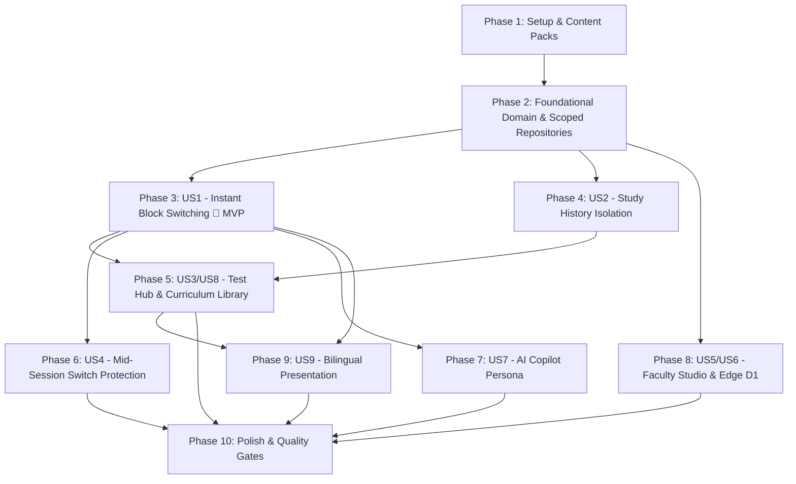

# Tasks: Multi-Block Curriculum Architecture (SPEC-010)

**Feature Branch**: `010-multi-block-curriculum-architecture`  
**Input**: Design documents from `specs/010-multi-block-curriculum-architecture/` (`spec.md`, `plan.md`, `data-model.md`, `contracts/multi-block-curriculum-ports.ts`)  
**Constitution**: `.specify/memory/constitution.md` (P1, P2, P3, P4, P5, P6, P7, P8, P9, P10)

## Format: `[ID] [P?] [Story?] Description`

- **[P]**: Can run in parallel (different files, no blocking dependencies)
- **[Story]**: Maps task to user stories (`[US1]` through `[US9]`)
- Concrete file paths, types, interfaces, and invariants specified in every task.

---

## Phase 1: Setup & Content Packs (Foundational Assets & CI Gates)

**Purpose**: Author canonical block manifests, establish the lazy content loading boundary, and configure CI validation scripts so malformed blocks or hardcoded `'cvs'` regressions are caught mechanically.

- [x] T001 Author canonical CVS manifest in `content/cvs/manifest.json` conforming to `BlockManifestSchema` (mirroring 4 subjects, 13 chapters, 50 topics from `src/domain/taxonomy/cvsTaxonomy.ts` and 7 documents from `src/ui/features/curriculum/CurriculumLibrary.tsx`, enriched with verified Arabic translations)
- [x] T002 [P] Author canonical CNS Block 207 blueprint manifest in `content/cns/manifest.json` with `status: 'beta'`, `code: 'Block 207'`, 5 subjects (`anatomy`, `physiology`, `histology`, `pathology-micro`, `pharmacology`), 16 chapters (`cns-ana-...` through `cns-pha-...`), 36 topics, and initial source document citations per `data-model.md §5.1`
- [x] T003 [P] Initialize empty validated CNS seed question bank in `content/cns/dist/bank.v1.json` (`[]`)
- [x] T004 [P] Implement build-time taxonomy integrity CLI runner in `scripts/blocks/validate-blocks.ts` validating all `content/*/manifest.json` and `dist/bank.v1.json` packs against invariants `TI-1` through `TI-9`
- [x] T005 [P] Implement technical debt ratchet script in `scripts/blocks/ratchet-cvs-literals.ts` scanning `src/` for hardcoded `'cvs'` literals, enforcing a non-increasing threshold against baseline (491)
- [x] T006 Wire `pnpm blocks:validate` and `pnpm blocks:ratchet` into `package.json` scripts and git pre-push hooks

---

## Phase 2: Foundational (Pure Domain Mathematical Core, Catalog & Scoped Repositories)

**Purpose**: Build the framework-free domain layer (`src/domain/curriculum/`), Dexie IndexedDB v9 compound indexes, and compile-time block-scoped repositories. Blocks cannot be leaked across queries by construction.

- [x] T007 Implement branded identity types (`BlockId`, `SubjectKey`, `ChapterId`, `TopicId`), composite `SubjectRef = { blockId, subjectId }`, and `LEGACY_DEFAULT_BLOCK_ID` in `src/domain/curriculum/ids.ts`
- [x] T008 [P] Implement Zod boundary parsers (`BlockManifestSchema`, `SubjectManifestSchema`, `ChapterManifestSchema`, `TopicManifestSchema`, `SourceDocumentSchema`) in `src/domain/curriculum/schemas.ts`
- [x] T009 [P] Implement pure domain `TaxonomyIntegrityValidator` in `src/domain/curriculum/TaxonomyIntegrityValidator.ts` enforcing invariants `TI-1..TI-9` with JSON-pointer violation paths and `partitionBank()` for orphan quarantine (TI-8)
- [x] T010 [P] Implement role-based visibility policy in `src/domain/curriculum/BlockVisibilityPolicy.ts` mapping `(draft, beta, published, archived)` to viewer roles (`student-free`, `student-pro`, `faculty-reviewer`, `admin`)
- [x] T011 [P] Implement metric scope classification policy `MetricScopePolicy` in `src/domain/curriculum/MetricScopePolicy.ts` enforcing ADR-010-05 (learner-global streak/daily goal vs block-scoped mastery/accuracy)
- [x] T012 [P] Implement pure boot block resolver `BootBlockResolver` in `src/domain/curriculum/BootBlockResolver.ts` evaluating FR-011 precedence: (1) `?block=` deep link, (2) persisted preference, (3) first published block, (4) `cvs`
- [x] T013 Implement immutable registry `BlockCatalog` in `src/domain/curriculum/BlockCatalog.ts` providing frozen reads (`list`, `get`, `subjects`, `chapters`, `topics`, `resolve`) and subscriber notifications
- [x] T014 [P] Implement Vite pack source `ViteBlockPackSource` in `src/infrastructure/curriculum/ViteBlockPackSource.ts` using `import.meta.glob` for eager manifests and lazy, abortable `bank.v1.json` chunks
- [x] T015 [P] Implement in-memory test double `InMemoryBlockPackSource` in `src/infrastructure/curriculum/InMemoryBlockPackSource.ts` for fast, offline unit and property testing
- [x] T016 [P] Implement `LegacyTaxonomyAdapter` in `src/domain/curriculum/LegacyTaxonomyAdapter.ts` converting `BlockManifest` to legacy `Taxonomy` and refactor `src/domain/taxonomy/cvsTaxonomy.ts` to export catalog-derived `CVS_TAXONOMY` (@deprecated shim)
- [x] T017 Upgrade `MedQuestsDB` to `version(9)` in `src/infrastructure/storage/db.ts` adding compound indexes (`[blockId+subjectId]`, `[blockId+chapterId]`, `[blockId+answeredAt]`, `[blockId+dueAt]`, `[blockId+nextReviewAt]`) and non-destructive `srsCards.blockId` upgrade backfill per `data-model.md §2.2`
- [x] T018 Implement block-scoped IndexedDB repositories in `src/infrastructure/storage/DexieBlockScopedRepositories.ts` (`DexieBlockScopedQuestionRepository`, `DexieBlockScopedAttemptRepository`, `DexieBlockScopedReviewCardRepository`, `DexieBlockScopedSrsRepository`, and `DexieLearnerGlobalActivityReader`)
- [x] T019 Implement unit tests and fast-check property tests in `src/domain/curriculum/__tests__/taxonomyIntegrityValidator.test.ts` verifying all invariants `TI-1` through `TI-9`
- [x] T020 [P] Implement architecture boundary test in `src/domain/curriculum/__tests__/curriculumArchitectureBoundary.test.ts` proving zero imports from React, Dexie, Zustand, or Cloudflare Workers in `src/domain/curriculum/` (Constitution P7)
- [x] T021 [P] Implement Dexie migration integration test in `src/infrastructure/storage/__tests__/dexieV8ToV9Migration.test.ts` validating zero record loss and accurate `srsCards.blockId` backfill against a seeded v8 database fixture (INV-2)

---

## Phase 3: User Story 1 - Instant & Calm Block Switching (Priority: P1) 🎯 MVP

**Goal**: Students can switch the entire application to CNS via the header switcher or deep link in < 150 ms (warm) / < 600 ms (cold), with atomic rollback on error, cross-tab synchronization, and zero screen blanking.

**Independent Test**: Load the app with CVS active. Select CNS from the header switcher. Verify header glyph cross-fades from Heart to Brain, `--block-accent` transitions to `violet`, questions and stats hydrate to CNS within 150 ms, reloading keeps CNS active, and `https://.../?block=cns` deep-links cleanly with URL query cleanup.

- [x] T022 [US1] Implement browser storage preference `LocalStorageActiveBlockPreference` in `src/infrastructure/curriculum/LocalStorageActiveBlockPreference.ts` managing `medquests_active_block_v1` and multi-tab synchronization via `BroadcastChannel('medquests_block_context')`
- [x] T023 [US1] Implement per-block UI filter memento store `LocalStorageBlockMementoStore` in `src/infrastructure/curriculum/LocalStorageBlockMementoStore.ts` persisting `medquests_block_memento_v1:<blockId>`
- [x] T024 [US1] Implement client composition root in `src/application/composition/clientCompositionRoot.ts` wiring `BlockCatalog`, `ViteBlockPackSource`, `DexieBlockScopedRepositories`, and `SwitchBlockUseCase`
- [x] T025 [US1] Implement two-phase atomic command orchestrator `SwitchBlockUseCase` in `src/application/curriculum/SwitchBlockUseCase.ts` executing `prepare(blockId, signal)` across participants, monotonic epoch race checking, non-throwing synchronous `commit()`, and automatic rollback on failure
- [x] T026 [P] [US1] Implement hydration participants in `src/application/curriculum/hydrationParticipants.ts` for questions, stats, copilot, memento, and analytics
- [x] T027 [US1] Implement reactive active block state store `useBlockContextStore` in `src/application/stores/useBlockContextStore.ts` exposing `useActiveBlock()` and `useActiveTaxonomy()` hooks
- [x] T028 [US1] Refactor `useQuestionStore.ts` to load and seed banks via `ViteBlockPackSource` and `DexieBlockScopedQuestionRepository`, removing the static `defaultCvsBank` import
- [x] T029 [P] [US1] Define CSS color tokens (`--block-accent`, `--block-accent-soft`, `--block-ring`) for `rose` (CVS), `violet` (CNS), `sky`, `amber`, and `emerald` in `src/index.css` with 4.5:1 WCAG contrast
- [x] T030 [US1] Build desktop glassmorphic popover component `BlockSwitcher.tsx` in `src/ui/app/navigation/BlockSwitcher.tsx` implementing WAI-ARIA `listbox` pattern, 44×44 pt touch targets, block glyph, code, question count, and personal coverage ring (rendered only when visible blocks ≥ 2)
- [x] T031 [P] [US1] Build mobile bottom sheet switcher `BlockSwitcherSheet.tsx` in `src/ui/app/navigation/BlockSwitcherSheet.tsx` with medium detent and swipe-to-dismiss gesture
- [x] T032 [US1] Update `src/ui/app/Shell.tsx` to mount `BlockSwitcher`, cross-fade header glyph (`Heart` ⟷ `Brain`) over 200 ms, dynamically bind `--block-accent`, and announce switches via `aria-live="polite"`
- [x] T033 [US1] Update `src/App.tsx` to resolve initial block via `BootBlockResolver`, handle `?block=` deep links with `history.replaceState`, and emit dynamic question count in `app:boot_hydrated`
- [x] T034 [US1] Write property-based test suite in `src/application/curriculum/__tests__/switchBlockUseCase.property.test.ts` using `fast-check` to prove INV-1 (Isolation), INV-3 (Rollback atomicity under injected participant failures), and INV-4 (10-switch race convergence)
- [x] T035 [P] [US1] Write component and accessibility test suite in `src/ui/app/navigation/__tests__/blockSwitcher.test.tsx` verifying zero axe violations, keyboard navigation (`Tab → Enter → ↑/↓ → Enter/Esc`), and visual parity when single block is visible (INV-5)

---

## Phase 4: User Story 2 - Study History Isolation & Global Streak Continuity (Priority: P1)

**Goal**: Switching to CNS gives a fresh 0% mastery and 0-attempt slate while preserving CVS history 100% and maintaining the learner's continuous study streak and daily goal across blocks.

**Independent Test**: Record 5 attempts and a 10-day streak in CVS. Switch to CNS. Assert CNS total attempts is 0, mastery is 0%, weak topics count is 0, but streak remains 10 days and today's attempts count is preserved. Switch back to CVS; assert all 5 CVS attempts and stats reappear exactly.

- [x] T036 [US2] Refactor `useStatsStore.ts` to compute block-scoped metrics (`overallAccuracy`, `masteryPercentage`, `weakTopicsCount`, `dueReviewsCount`, `pacingQuadrants`, `subjectReadiness`) strictly from `DexieBlockScopedAttemptRepository` and `DexieBlockScopedReviewCardRepository`
- [x] T037 [US2] Update `useStatsStore.ts` to compute learner-global metrics (`streakDays`, `todayAttempts`, `dailyGoalTarget`) via `DexieLearnerGlobalActivityReader` querying all attempts across blocks per `MetricScopePolicy`
- [x] T038 [US2] Update `Dashboard.tsx` in `src/ui/features/dashboard/Dashboard.tsx` to read block name, subjects, and readiness cards via `useActiveTaxonomy()` instead of static CVS structures
- [x] T039 [US2] Write unit and integration tests in `src/application/stores/__tests__/multiBlockStatsIsolation.test.ts` verifying that recording attempts in CNS never shifts CVS accuracy, and streak counts persist across block transitions

---

## Phase 5: User Story 3 & User Story 8 - Multi-Subject Test Hub, Practice Modes & Curriculum Library (Priority: P1)

**Goal**: Test Hub, Quick Practice, Mock Exam Setup, and Curriculum Library dynamically adapt to the active block's subjects, chapters, topics, and source documents with zero hardcoded CVS dependencies.

**Independent Test**: Switch to CNS. Open Test Hub: verify subject tabs list the 5 CNS subjects. Select *Neuroanatomy → Brainstem & Cranial Nerves*: verify generated practice session contains 100% CNS questions. Open Curriculum Library: verify listed lecture handouts match CNS sources from manifest.

- [x] T040 [US3] Refactor `src/ui/features/test/TestHub.tsx` to consume `useActiveTaxonomy()`, restoring last-used filters from `BlockSessionMemento` and dynamically populating subject and chapter dropdowns
- [x] T041 [P] [US3] Refactor `src/ui/features/test/QuickPractice.tsx` to read subjects and chapters from `useActiveTaxonomy()`
- [x] T042 [P] [US3] Refactor `src/ui/features/test/MockExamSetup.tsx` to construct mock exam blueprinted pools using active block subjects and target question distributions
- [x] T043 [P] [US3] Refactor `src/ui/features/review/ReviewHub.tsx` to scope SM-2 due review cards and mistake drill queues strictly to `activeBlockId`
- [x] T044 [US8] Refactor `src/ui/features/curriculum/CurriculumLibrary.tsx` to dynamically render `manifest.sources[]` grouped by subject from `useActiveTaxonomy()`, displaying localized document titles, page counts, and formats
- [x] T045 [US3] Write component integration tests in `src/ui/features/test/__tests__/multiBlockTestHub.test.tsx` verifying that practice sessions generated in CNS contain strictly `q.blockId === 'cns'` questions

---

## Phase 6: User Story 4 - Mid-Session Switch Protection & Resume Flow (Priority: P1)

**Goal**: Prevent accidental abandonment of active exams or practice drills when switching blocks, allowing students to safely confirm, cancel, or resume saved sessions.

**Independent Test**: Start a practice session in CVS and answer 3 questions. Trigger CNS switch: assert `SessionLeaveConfirmDialog` appears. Click "Stay": assert user remains on question 4. Click "Switch to CNS": assert session state is saved, app navigates to CNS dashboard, and returning to CVS displays a "Resume in-progress practice" banner.

- [x] T046 [US4] Implement `SessionLeaveGuard` in `src/application/curriculum/SessionLeaveGuard.ts` and UI dialog `SessionLeaveConfirmDialog.tsx` in `src/ui/app/navigation/SessionLeaveConfirmDialog.tsx`
- [x] T047 [US4] Register `SessionLeaveGuard` inside `src/ui/features/test/SessionPlayer.tsx` while a session is active, persisting session memento on exit
- [x] T048 [US4] Add "Resume in-progress session" card to `src/ui/features/dashboard/Dashboard.tsx` when a saved session exists for the active block
- [x] T049 [US4] Write end-to-end component test in `src/ui/features/test/__tests__/sessionLeaveGuard.test.tsx` verifying both confirm and cancel user flows

---

## Phase 7: User Story 7 - AI Copilot Persona & Clinical Tool Specialization (Priority: P2)

**Goal**: AI Copilot seamlessly transitions clinical persona (e.g. Socratic Neuroscience Mentor) and filters autonomous tools based on the active block, while isolating chat history per block.

**Independent Test**: In CVS, verify `simulate_hemodynamic_pv_loop` is available. Switch to CNS: open Copilot and ask a neuro question. Verify system prompt introduces the Neuroscience Faculty mentor, hemodynamic calculation tools are excluded, and chat history is blank/isolated.

- [x] T050 [US7] Implement `BlockAiProfileRegistry` in `src/domain/curriculum/BlockAiProfileRegistry.ts` defining `cvs-faculty-v1`, `cns-faculty-v1`, and neutral fallback `generic-faculty-v1`
- [x] T051 [US7] Refactor `src/domain/ai/systemPromptBuilder.ts` to inject persona label, specialty label, and board examination context from the active block's `BlockAiProfile`
- [x] T052 [US7] Refactor `src/domain/ai/languagePolicy.ts` and autonomous tool execution dispatchers to filter allowed tools by `profile.toolsetIds` (restricting `hemodynamics` tools to CVS)
- [x] T053 [US7] Update AI chat thread storage in `src/infrastructure/storage/db.ts` to namespace thread keys as `block:<blockId>:question:<id>` and `block:<blockId>:session:<mode>`
- [x] T054 [US7] Write prompt and tool policy unit tests in `src/domain/ai/__tests__/multiBlockAiCopilotPolicy.test.ts` verifying persona switching and tool exclusion

---

## Phase 8: User Story 5 & User Story 6 - Faculty Studio, Ingestion Lab & Edge Block Registry (Priority: P2)

**Goal**: Authoring tools (Studio, Parser Lab, Governance) explicitly target a selected block, and Cloudflare Worker validates block existence against D1 `curriculum_blocks` table with role-gated beta access.

**Independent Test**: Log in as admin: open Question Studio and select CNS. Author question: assert chapters dropdown displays CNS chapters. Attempt submission with mismatched chapter: assert field-level error. Issue `POST /api/bank/submissions?block=unknown`: assert Worker returns 404. Log in as student: assert CNS (in `beta`) is hidden from switcher.

- [x] T055 [US6] Create Cloudflare D1 migration `src/worker/migrations/0007_curriculum_blocks.sql` creating `curriculum_blocks` table, seeding `cvs` (published) and `cns` (beta), and creating `cns` revision cursor in `bank_revisions`
- [x] T056 [US6] Implement `EdgeBlockGuard` and `WorkerSeedBankRegistry` in `src/worker/curriculum/` enforcing 404 on unknown blocks and 409 on writes to non-authorable blocks
- [x] T057 [US6] Wire `EdgeBlockGuard` into all `/api/v1/bank/*` and `/api/qdd/*` routes in `src/worker/index.ts` and implement endpoint `GET /api/v1/blocks`
- [x] T058 [US5] Add Target Block selector dropdown to `src/ui/features/studio/QuestionStudio.tsx` and validate chapter/topic selections against `BlockCatalog.get(targetBlockId)`
- [x] T059 [P] [US5] Add Target Block selector to `src/ui/features/admin/aiQuestionParser/AdminAiQuestionParserLab.tsx` and parameterize batch deduplication checks with target block
- [x] T060 [P] [US5] Update `src/ui/features/admin/QuestionBankGovernancePanel.tsx` and `src/ui/features/admin/AiPromptStudioModal.tsx` to scope faculty review queues and prompt generators by selected block
- [x] T061 [P] [US5] Update `src/ui/features/qdd/QddAuditBoard.tsx` to filter duplicate audit jobs and cluster cards by selected block
- [x] T062 [US5] Remove `.default('cvs')` from `QuestionSchema.blockId` in `src/domain/model/types.ts` and parameterize `CurriculumClassificationAgent.ts` with target catalog descriptor
- [x] T063 [US6] Write Worker edge tests using `@cloudflare/vitest-pool-workers` in `src/worker/__tests__/multiBlockEdgeGovernance.test.ts` verifying D1 seeding, 404 unknown block guard, and beta visibility filtering

---

## Phase 9: User Story 9 - Bilingual Curriculum Presentation & Arabic Typography (Priority: P2)

**Goal**: Block titles, descriptions, subjects, chapters, and topics render flawlessly in Arabic and English, preserving canonical English USMLE terms and applying Apple HIG BiDi typography rules.

**Independent Test**: Switch language to Arabic (`ar`). Verify Block Switcher displays "الجهاز العصبي المركزي (Block 207)", subjects render Arabic titles, direction is RTL, and canonical English entity names remain in parentheses.

- [x] T064 [US9] Parameterize curriculum and test hub localization strings in `src/domain/i18n/dictionaries/en.ts` and `src/domain/i18n/dictionaries/ar.ts` (`t.test.hubTitle` -> `"{blockName} Test Hub"` / `"مركز اختبارات {blockName}"`)
- [x] T065 [US9] Update navigation breadcrumbs, topic selector tags, and score cards to resolve `LocalizedText` using active locale (`ar` | `en`)
- [x] T066 [US9] Write localization tests in `src/domain/i18n/__tests__/multiBlockLocalization.test.ts` verifying RTL layout flipping and correct bilingual fallback behavior

---

## Phase 10: Polish, Quality Gates & Legacy Shim Retirement

**Purpose**: Execute end-to-end quality validation, verify bundle budget constraints, tighten the technical debt ratchet, and remove deprecated shims.

- [x] T067 [P] Execute full golden quality verification running `pnpm test` across all 60+ test suites
- [x] T068 [P] Run `pnpm blocks:validate` verifying zero violations of invariants `TI-1` through `TI-9` across all manifest and bank files
- [x] T069 [P] Execute production build via `pnpm build` and verify initial JavaScript bundle delta is ≤ +5 KB gzip, with `content/cns/dist/bank.v1.json` emitted as an asynchronous code-split chunk
- [x] T070 Retire direct `CVS_TAXONOMY` imports in non-test files and run `pnpm blocks:ratchet` ensuring hardcoded `'cvs'` string literals are reduced to ≤ 10
- [x] T071 Document the step-by-step block authoring guide for medical faculty in `docs/authoring-new-curriculum-blocks.md`

---

## Dependencies & Execution Order

### Phase Dependencies



### Critical Path

1. **Phase 1 (Setup)**: `T001..T006` unlocks pure domain modeling.
2. **Phase 2 (Foundational)**: `T007..T021` unlocks all application and store refactoring (**BLOCKS all user stories**).
3. **Phase 3 (US1 - MVP)**: `T022..T035` delivers the core Block Switcher and two-phase atomic hydration.
4. **Phase 4 (US2)**: `T036..T039` isolates learner attempts while preserving the global streak.
5. **Phase 5 (US3 & US8)**: `T040..T045` connects testing and lecture documents to the active block.
6. **Phase 6 through Phase 9**: Deliver session safety, AI persona, faculty authoring, and bilingual support.
7. **Phase 10**: CI gate verification and release cutover.

---

## Parallel Opportunities per Phase

```bash
# Phase 1 Parallel Run:
Task T002: "Author canonical CNS manifest in content/cns/manifest.json"
Task T003: "Initialize empty CNS seed bank in content/cns/dist/bank.v1.json"
Task T004: "Implement build-time taxonomy CLI in scripts/blocks/validate-blocks.ts"
Task T005: "Implement technical debt ratchet in scripts/blocks/ratchet-cvs-literals.ts"

# Phase 2 Parallel Run (Domain Types & Scoped Repositories):
Task T008: "Implement Zod boundary parsers in src/domain/curriculum/schemas.ts"
Task T009: "Implement TaxonomyIntegrityValidator in src/domain/curriculum/TaxonomyIntegrityValidator.ts"
Task T010: "Implement BlockVisibilityPolicy in src/domain/curriculum/BlockVisibilityPolicy.ts"
Task T011: "Implement MetricScopePolicy in src/domain/curriculum/MetricScopePolicy.ts"
Task T014: "Implement ViteBlockPackSource in src/infrastructure/curriculum/ViteBlockPackSource.ts"
Task T015: "Implement InMemoryBlockPackSource in src/infrastructure/curriculum/InMemoryBlockPackSource.ts"

# Phase 3 Parallel Run (UI Switcher & CSS Tokens):
Task T029: "Define CSS color tokens for block accents in src/index.css"
Task T031: "Build mobile bottom sheet switcher in src/ui/app/navigation/BlockSwitcherSheet.tsx"
Task T035: "Write accessibility & component tests in src/ui/app/navigation/__tests__/blockSwitcher.test.tsx"

# Phase 8 Parallel Run (Faculty Tooling):
Task T059: "Add Target Block selector to AdminAiQuestionParserLab.tsx"
Task T060: "Update QuestionBankGovernancePanel.tsx and AiPromptStudioModal.tsx"
Task T061: "Update QddAuditBoard.tsx"
```

---

## Implementation & Rollout Strategy

### 1. MVP First (Phase 1 → Phase 3)
Complete Setup, Foundational Domain, and User Story 1. At this milestone, the application can switch between CVS and CNS, stores hydrate reactively, and fast-check property tests prove isolation and rollback atomicity.

### 2. Dark Launch Refactor (Phase 4 → Phase 5)
Deploy Phase 4 and Phase 5 to production while `cns.status = 'beta'`. Students with the `student-free` or `student-pro` role only see CVS; the UI and behavior are pixel-identical to baseline (INV-5), but the underlying stores are completely multi-block ready.

### 3. Faculty QA Gate (Phase 6 → Phase 8)
Faculty reviewers access CNS via role gating. They author and validate CNS questions using Question Studio and the AI Question Parser Lab, testing real questions against the D1 edge revision system.

### 4. General Availability (Phase 9 → Phase 10)
Set `cns.status = 'published'` in D1. The Block Switcher automatically reveals CNS to all medical students within the 5-minute cache resolution window.
